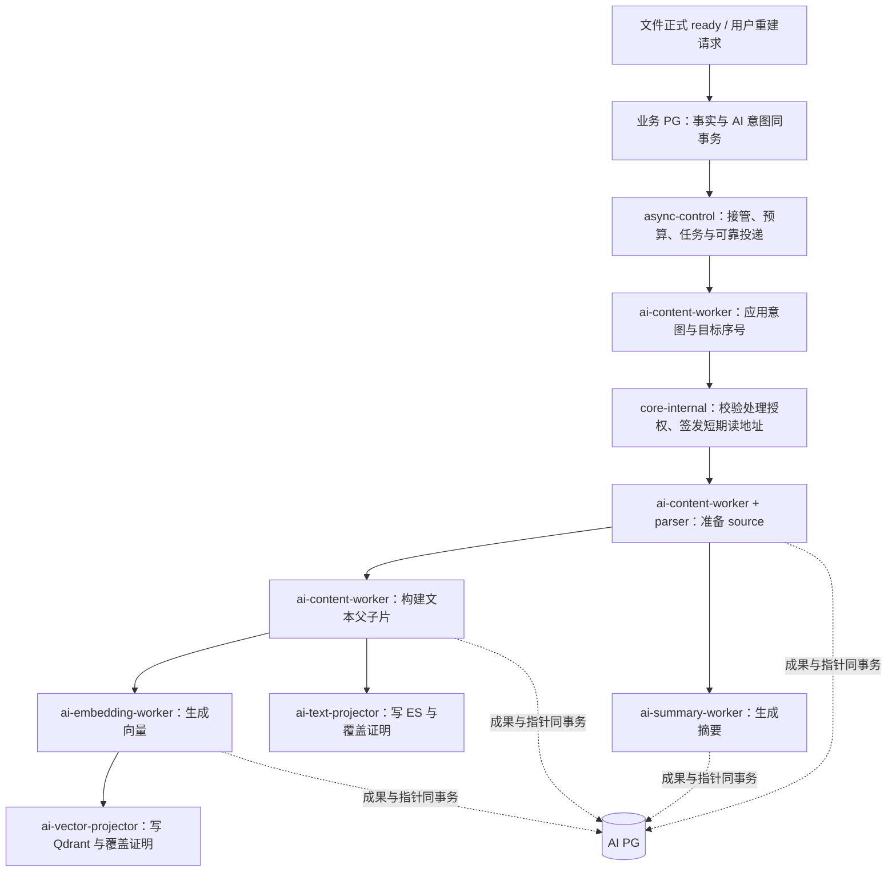

# AI PG 简化实施计划

日期：2026-11-19。本文保留为原计划和验收基线；当前代码、迁移工具、专用环境验证及未完成的运行验收见 [PG 简化实施记录](PG_SIMPLIFICATION_EXECUTION_2026-11-19.md)。文中“尚未实施”“未来”等措辞描述计划编写时的状态。

目标：取消 AI 通用的 staging → 控制接纳 → release 提交流程。AI worker 完成一个阶段后，直接在 AI PG 中写入完整成果、切换对应 active 指针并保存幂等回执，再回报控制 PG。控制 PG 继续负责任务、有限重试、租约、期限、后继协调和用户作业汇总。

本文是 [控制 PG 简化计划](CONTROL_PG_SIMPLIFICATION_PLAN_2026-11-19.md) 的 AI 专项补充，取代该计划最初“继续保留 AI 通用 staging”的范围约定；其他控制协议约束继续适用。[异步协调裁剪计划](ASYNC_COORDINATION_SIMPLIFICATION_PLAN_2026-11-19.md)和 [AI 拆分施工书](AI_SYSTEM_SPLIT_CONSTRUCTION_2026-11-16.md)作为现有实现及历史基线，不将其中已完成工作计作本轮成果。

## 1. 当前实现与简化位置

以下依据工作区源码与迁移文件，未查询运行库，未确认部署版本。

| 当前实现 | 源码依据 | 本轮处理 |
|---|---|---|
| AI worker 已经自己计算、自己提交；独立 committer 入口拒绝启动 | `backend/internal/bootstrap/ai_split.go` | 保留进程职责，简化 worker 内部协议 |
| 计算结束将完整 JSON 写入 `ai_artifact_manifests`，通用正文上限为 128 MiB | `backend/internal/aisystem/compute.go` | 新协议不再写通用暂存 |
| worker 保存控制 `results`，进入提交阶段，再检查 `AcceptedResult` | `backend/internal/asynccontrol/runtime.go`、`execution.go`、`aisystem/publish.go` | 接入控制简化后的直接执行与完成接口 |
| 发布事务读取 artifact，写规范化成果、active 指针、能力状态和 receipt | `backend/internal/aisystem/publish.go` | 复用领域校验和原子事务，改为接收当前进程的类型化计算值 |
| AI receipt 当前以 `result_id` 定位，含计算代次与 artifact 摘要 | `backend/internal/aisystem/model.go` | 改为逻辑任务稳定幂等，历史语义另行兼容 |
| 摘要 map/reduce 节点也存在 artifact 表中，`ai_summary_checkpoints` 是其视图 | `backend/internal/aisystem/summary_checkpoint.go`、AI 迁移 000010 | 抽成领域专用 checkpoint，保留模型调用复用能力 |
| artifact GC 查询控制 `results`，并通过 artifact 关联 GC 回执、发现孤儿投影 | `backend/internal/aisystem/cleanup.go` | 先接住这些职责，再退役 artifact 表 |
| AI 作业汇总 JOIN `results.body`，后继依据结果冻结到控制库 | `backend/internal/aisystem/jobs.go`、`planner.go` | 改为回执提供必要版本引用，控制完成事务登记后继并汇总 |
| AI 迁移到 000011，共定义 18 张业务表 | `backend/ai-migrations/` | 以实际迁移为准；AGENTS.md 中 000007 的描述已落后 |

当前没有两套完整的规范化 staging/release 内容表。主要重复是：完整计算结果先作为 artifact JSON 保存，控制接纳后，再转换成规范化成果。已有 active 指针也不是本轮新发明；本轮去掉的是它前面的通用交接协议。

## 2. 本轮范围

### 2.1 要移除

- 新任务对 `ai_artifact_manifests` 的通用读写，包括 intent、解析、文本、向量、最终摘要、投影和维护命令的暂存。
- 新任务对控制 `SaveResult / BeginCommit / AcceptedResult` 的调用，以及通用 compute/commit 阶段交接。
- 依赖结果正文的冻结后继和 AI 作业汇总查询；与控制 PG 简化计划一起替换。
- “所有任务必须先保存完整计算结果，崩溃后只恢复提交”的新协议保证。领域提交之前丢失的计算允许在剩余预算内重做。
- 历史依赖处理完后，退役 artifact 表；迁移台账满足归档条件后退出在线 schema。

### 2.2 要保留

- source、text、vectors、summary 各自的目标序号、不可变成果版本和 active 指针。
- 对象世代、生命周期版本、墓碑、依赖版本、模型和解析配置身份。
- AI PG 内成果、指针、能力状态、领域回执的原子提交。
- 控制 PG 对重试、退避、租约、期限和停止预算的唯一管理权。
- 摘要分段专用 checkpoint、外部索引覆盖证明及孤儿清理能力。
- `core-internal` 的处理授权和检索权限校验；AI worker 仍无业务 SQL 连接。
- 现有 worker、parser、projector、query 的进程划分；用户 AI 作业仍由控制库两张作业表协调。
- 查询视图和查询账号隔离。`publication_state`、`published_at` 等兼容字段先保留，不为去掉 release 编排而同时重命名整套查询模型。

不合并解析块、父片、子片和向量表，不把全部成果塞入一张 JSON 表，不增加 AI 自有任务调度器或 AI outbox 来替代控制 PG。

## 3. 目标流程与进程职责



1. 上传正式完成后，在文件事实事务内追加首次 AI 意图；相同物理内容可复用成果。手动重建由 API 校验归属、文件状态、请求幂等键，在业务事务内写用户作业与 AI 意图，返回 202。
2. Relay 继续按安全位点接管意图；控制事务内登记任务、来源和投递意图，RabbitMQ 负责通知。
3. `ai.intent.apply` 是 content worker 执行的轻量领域任务。它更新 desired seq，并为定向重建选择兼容的已有 source/content/set 引用；选择结果与回执同事务保存。
4. source worker 携带处理授权调用 `core-internal`。后者检查对象世代、哈希、ready 状态及引用，签发短期 URL。worker 下载、校验并调用 parser，完成后直接提交 source。
5. source 成功后，文本构建和摘要按启用能力分别运行；文本成功后再启动向量。定向重建可以复用已冻结的兼容前置版本，跳过不需要的阶段。
6. 各阶段单独提交、单独生效，不等待所有能力一起完成。文本更新时，旧文本的向量不能被当作新文本的向量继续使用。
7. 启用 ES/Qdrant 时，projector 独立追平。外部索引暂未覆盖当前版本时，查询按已有规则回退 AI PG，或返回能力未就绪。
8. worker 回报后，控制 PG 在同一事务内确认父任务、登记真实后继及作业关联，再判断请求终局；手动作业通过 `ai.job.finish` 由 gc-worker 的 `core-command` 消费者更新业务库。

`core-internal` 和 `ai-query` 是在线 RPC 服务；parser 是计算依赖；维护由 content worker 的维护队列消费。去掉 release 不增加或恢复独立 committer，也不增加 release 任务。

## 4. AI PG 最终表结构

当前 18 张业务表中，保留 14 张，退役通用 artifact 表，3 张历史迁移表满足条件后归档；新增 1 张摘要专用表。**最终在线目标为 15 张业务表**，迁移工具的 `schema_migrations` 另计。兼容阶段允许超过此数，不能为达到表数提前删证据。

| 目标在线表 | 用途 | 本轮变化 |
|---|---|---|
| `ai_objects` | 对象世代、desired seq、4 个 active 指针及墓碑 | 继续作为对象级串行与切换锚点 |
| `ai_sources` | 不可变解析版本及质量、覆盖信息 | 直接由 source 提交事务创建 |
| `ai_source_blocks` | 解析块与原文位置 | 与 source 同事务写全 |
| `ai_content_versions` | 文本切片版本及 source 依赖 | 直接由文本事务创建 |
| `ai_parent_chunks` | 父片和引用上下文 | 与文本版本同事务写全 |
| `ai_child_chunks` | 检索子片、位置、词法索引 | 保持独立于向量 |
| `ai_embedding_sets` | 向量集合、模型配置及文本依赖 | 完整集合提交后才切指针 |
| `ai_chunk_vectors` | 子片向量 | 与集合事务一致 |
| `ai_summaries` | 最终摘要、标签、覆盖信息 | 与摘要指针同事务提交 |
| `ai_commit_receipts` | 稳定逻辑任务结论和必要引用 | 改造身份、唯一约束及恢复内容 |
| `ai_capability_status` | 各能力最新构建状态、错误和新鲜度依据 | 失败观察不能覆盖新成功 |
| `ai_projection_targets` | ES/Qdrant 物理目标、配置、索引 epoch | 保留目标启用与配置兼容边界 |
| `ai_projection_states` | 指定成果在目标中的完整覆盖证明 | 直接提交证明，不经 artifact |
| `ai_orphan_projections` | 外部输出清理线索 | 扩展为外部写入前可登记的清理事实 |
| `ai_summary_nodes`（新增） | 摘要 map/reduce 已完成节点 | 仅摘要复用，不能承载通用结果和任务状态 |

| 当前退出表 | 退出条件 |
|---|---|
| `ai_artifact_manifests` | 新写入为零；旧接纳结果处理完；摘要节点迁移并校验；GC/投影/工具不再依赖；历史数据可核查地归档 |
| `ai_migration_runs` | 旧 AI 升级批次结束，交接/核验工具可查询归档证据 |
| `ai_migration_items` | 每项迁移结论和未决项已核清，无运行中批次引用 |
| `ai_migration_legacy_tasks` | 旧任务、结果、预算及作业观察者已交接，保留历史映射和核验证据 |

`ai_published_*`、`ai_projection_catalog`、`ai_summary_checkpoints` 当前都是视图，不额外算业务表。前两类继续承担查询隔离和兼容；后者改为仅访问 `ai_summary_nodes` 的私有视图。视图并非全部只含 active 数据，查询仍须按对象 active 或任务冻结引用选择具体版本。

3 张迁移表的归档是收缩阶段工作，不是启用直接提交的前置条件。

## 5. 新 worker 接口和本地提交协议

目标调用链：

```text
控制 PG 条件领取任务
→ AI PG 查询稳定领域回执
→ 无回执：在事务外解析 / 切片 / 调模型 / 执行外部 I/O
→ AI PG 本地事务校验并提交
→ 从已提交回执取得最小完成描述
→ 控制 PG 完成与后继登记同事务
→ ACK
```

### 5.1 类型化计算值

- 解析、文本、向量、摘要分别使用已有领域结构，计算值只在当前进程传给提交函数；不序列化为通用大 JSON 再持久化、读出和解码。
- 增加新提交入口，例如 `ApplyDirect`；具体名称在编码时确定。旧 `Publish(Task, Result)` 仅为存量兼容保留，不能伪造 `Result` 继续驱动新链路。
- 新完成契约不强制 `ArtifactID / ArtifactHash / Generation`。保留任务身份、输入摘要、outcome、成果版本引用、契约版本及少量必要的计数、覆盖信息。
- intent、墓碑、能力终结和 GC 命令直接执行领域事务，不生成假的 source 或计算产物。
- 保留实际解析字节、分片数、向量数、模型调用、事务超时和内存限制；退出 128 MiB 通用 JSON 上限不意味着取消资源限制。

### 5.2 成果提交事务

1. 锁定对象世代行；创建对象的 intent/墓碑遵守固定的创建与加锁顺序。
2. 再查稳定回执。若已有匹配结论，返回已提交赢家，丢弃当前进程尚未采用的计算值。
3. 校验输入身份、对象世代、目标序号、冻结依赖、墓碑、期限及领域终局。
4. 校验领域内容完整性：块/父子片关联、向量维度与覆盖数、摘要覆盖及配置身份。
5. 写完整规范化成果。使用有界批量 INSERT/COPY 改善逐行开销，但所有批次仍在同一事务内。
6. 切换对应 active 指针，处理不兼容依赖的失效、旧版本退休及能力状态。
7. 写入包含最终 outcome 和引用的领域回执，提交事务。

事务中不下载对象、不调用 parser、模型、ES 或 Qdrant，也不读取控制 PG。任一规范化写入失败，整个事务回滚，查询不能看见半套成果。禁止先提交部分行、再另开事务切指针来变相恢复 staging。

## 6. 稳定回执与并发提交

### 6.1 身份与字段

- 同一逻辑任务的回执身份在重试、失租、重启时保持不变；输入摘要必须完全匹配。
- 可复用 `task_id` 并增加 receipt 协议版本；新协议对逻辑 `task_id` 设置部分唯一约束，读取时再核对 `input_digest` 和 effect kind。不能只用 `(task_id, input_digest)` 唯一约束放过“同任务不同输入”的冲突。
- 新 `result_id` 若为兼容暂留，可存由任务与输入确定的稳定 ID；不能继续由计算代次生成。旧回执保留原值和旧语义，不批量覆盖。
- 在现有回执扩展对象 ID、内容世代及契约身份，消除 GC 经 artifact 反查对象的依赖。
- `published_refs` 只保留成果 ID、已选定的前置引用、必要摘要/计数及维护游标等小型恢复信息，不保存原文、全量向量或完整模型响应。
- 同一逻辑任务若存在多个无法证明等价的历史结论，先隔离核验，不能任意选择一个改造成新赢家。

### 6.2 赢家与后继依据

同一任务的两次模型调用可能生成不同摘要。对象锁与唯一约束共同保证：第一个满足领域前提并成功提交的结果获胜；其他执行者返回赢家回执，不用自己的输出覆盖它。

`ai.intent.apply` 选出的 source/content/set 引用必须在该事务回执中固定。后继恢复使用原回执与冻结契约，不重新读取可能已经变化的 active 指针。任务原有确定性 output ID 可继续复用，不把重试代次加入成果身份。

## 7. 指针切换和能力一致性

| 阶段 | 切换指针 | 提交前必须证明 |
|---|---|---|
| source | `active_source_id` | 对象世代/哈希匹配，source seq 仍是当前 desired，解析结果完整 |
| text | `active_content_version_id` | source 仍是冻结的兼容 source，text seq 匹配，父子片完整 |
| vectors | `active_embedding_set_id` | text 仍是冻结文本版本，vector seq 与模型配置匹配，全部子片向量完整 |
| summary | `active_summary_id` | source 依赖和 summary seq 匹配，覆盖信息准确 |

1. desired seq 更新只表示新请求到达，不提前清空可用成果；重建失败保留已有可用版本，并准确显示新构建失败及旧成果新鲜度。
2. source 切换后，旧 text/summary 可以作为有来源标识的上一版成果保留；不得把它们标成基于新 source 的当前成功。查询和引用继续携带真实版本链。
3. text 切换时原子清空不兼容的旧 vector 指针；新向量成功前，全文仍可用，semantic 按能力规则等待，hybrid 可文本降级。
4. 新旧请求交错时，旧 seq 或不兼容依赖的结果记为 superseded，不切指针、不生成正常成功后继。
5. 删除/墓碑和成功提交在同一对象级锁下串行；旧 worker 不能复活墓碑对象。晚到的失败观察也不能覆盖新成功。
6. 只要前提不成立，就不能靠“结果已经算出来”强行提交；未采用的内存结果可丢弃。

## 8. 重试、停止与崩溃恢复

控制 PG 继续管理尝试次数、退避、发布预算、租约和总期限；AI PG 不添加另一套重试状态机。

| 故障窗口 | 恢复规则 |
|---|---|
| 领取后、计算前崩溃 | 原预算内再次领取，先查回执 |
| 计算完成、AI 事务前崩溃 | 没有持久成果时允许重算；摘要可复用专用节点 |
| AI 事务中崩溃 | 回滚全部成果和指针；提交响应不明时先查回执，不能直接重算 |
| AI 已提交、控制回报前崩溃 | 按稳定回执补回报和同一后继，不再次计算 |
| 控制已完成、ACK 前崩溃 | 重投消息查终态后 ACK，不重复产生领域效果 |
| 失租后旧 worker 返回 | 尽力取消计算；领域提交仍按稳定身份、seq、依赖和墓碑竞争，控制回报需匹配当前执行凭据 |
| 预算或期限耗尽 | 采用控制计划的有限只读回执核对；不能因缺少暂存而额外补发计算机会 |
| 回执查询持续不可用 | 停止自动执行并保留 needs_attention，不把未知提交状态推断成确定失败 |

控制租约不是 AI PG 的跨库锁，提交前查询一次控制租约也不构成原子 fence。需要明确两类竞争：

- 已经开始的旧执行者只能在原任务领域前提和期限仍允许、且没有终局回执时参与同一赢家竞争，不能覆盖新请求或已确定的领域终局。
- 确定失败/取消的领域收尾与成功必须围绕原任务身份，在对象锁下写唯一终局。能力终结命令先检查原任务回执；成功已发生就恢复成功，失败终局已落地就拒绝晚到成功。

用户作业依据可证明的领域结论收口。仅停止控制调度、尚不能证明领域失败时，不提前宣称失败或清除已有能力；后续核验不重开原任务、刷新预算或期限。该竞争契约必须与控制完成/终结接口一起验证后才能启用。

## 9. 后继协调和用户作业

1. 保留真实依赖：intent → source；source → text/summary；text → vectors/text projection；vectors → vector projection。不存在“计算完成后再创建一个 release 任务”的通用中间阶段。
2. 后继按冻结的任务契约版本和父回执生成，具有稳定身份；回报重试不重复创建、不刷新预算。不能把接收到的任意 JSON 解释为新任务或 SQL。
3. 控制完成事务先登记父结论、子任务、子投递和作业关联，再判断作业终局，防止子任务尚未出现就结束作业。
4. `ai_job_task_links` 存必要的小型成果引用，`ai_job_aggregates` 汇总请求能力；不再 JOIN 控制 `results.body`。
5. superseded、拒绝和确定失败按固定规则抑制正常后继，并为不再运行的能力提供终局，不能让作业永久等待。
6. 用户请求哪些能力，就按这些能力汇总；不把可选摘要或外部投影强行变成所有请求的完成前提。显式请求投影时，覆盖证明也属于完成条件。
7. `ai.job.finish` 仍经核心命令消费者写业务作业；AI worker 不增加业务写连接。历史 observers 的覆盖与退出按控制计划处理。

## 10. ES/Qdrant 直接提交和孤儿清理

投影任务不持久化完整内容 manifest；保留小型的目标身份、版本、配置摘要、预期数量及校验摘要，因为这些是查询覆盖证明。

```text
查询本任务回执和固定输入
→ AI PG 登记外部写入清理线索
→ 事务外幂等写 ES / Qdrant
→ 校验完成响应
→ AI PG 事务：校验前提、写完整覆盖证明、写回执、处理清理线索
→ 回报控制 PG
```

- 清理线索在第一次外部写入之前持久化，优先扩展 `ai_orphan_projections`；记录确定的 backend、target、成果版本、对象世代以及必要的任务/宽限依据。不能只在异常捕获中登记，否则进程崩溃会丢失线索。
- 该记录仅服务外部副作用回收，不存完整文本/向量，不带任务调度状态，不成为所有 AI 类型的通用前置步骤。
- 外部文档/point ID 继续由目标和不可变成果确定；同输入重试写相同内容。ES 部分失败、Qdrant 未完成不能登记 complete。
- 成功事务同时记录覆盖证明与回执，已有证明接管后才条件移除临时清理线索。陈旧结果可以登记为不可见的清理事实，不能被提升为当前覆盖。
- 查询同时检查 active 成果、目标配置/epoch、模型兼容性、完整覆盖；外部部分输出始终不能作为有效检索依据。
- 物理目标的 building/active/retired 生命周期保留，这是索引配置切换，不等于恢复 AI 通用 staging/release。
- 回收继续按固定目标、固定成果版本定向删除，验证 ES 的响应正文和 Qdrant 的完成状态；不扫描全索引猜测归属。
- 宽限期不能单独证明远端不再有晚到写入。必须结合任务/授权期限、在途 I/O 边界和不可变目标规则；不能证明写者退出时保留清理事实并可重复清理，避免第一次删除后忘掉迟到的物理输出。

## 11. 摘要专用 checkpoint

本轮保留现有摘要 map/reduce 节点复用能力，推荐迁往新表 `ai_summary_nodes`，避免同名视图与物理表冲突。

- 字段包括节点 ID、逻辑任务 ID、输入摘要、对象世代、source ID、算法/模型/prompt 身份、层级与位置、节点输入 hash、输出摘要/标签及 hash、创建时间。
- 节点身份沿用任务输入、算法、层级、位置和精确文本身份；不包含尝试代次。不同 source、模型、prompt 或显式新任务不能误复用。
- 只保存已经完成并校验的节点；保留现有单节点 1 MiB 边界及总调用限制。并发插入采用先提交赢家，下一层读取已保存赢家。
- `ai_summary_checkpoints` 私有视图改为读取新表；query 账号不得读取中间摘要节点。
- 最终摘要仍在一次成果事务内写 `ai_summaries`、切指针、写回执。节点不是用户可见的半成品，也不需要 release。
- 节点允许在任务重试中复用，不保证模型恰好调用一次；调用成功但节点落库前崩溃仍可能重调。
- 旧节点按原 ID、输入摘要、数据 hash 和节点语义核验后迁移，不能把迁移当成重新调用模型的理由。

## 12. 成果退休和维护改造

1. 将 `ai.artifact.gc` 的领域职责改为 AI 成果/节点/投影维护；新类型名称可调整，但历史类型保留兼容处理。维护仍由控制 PG 调度，不添加 worker 自有定时权威。
2. 新路径不逐 artifact 查询控制 `results`，也不再通过 artifact JOIN 读取 GC 游标；游标保存在现有维护回执的小型字段中。
3. 维护先批量取得必要的控制任务/冻结输入/终局证据，再在 AI 本地事务内重验 active、retired、墓碑与依赖；事务内不跨库查询。
4. 安全证明必须覆盖“领域已提交、父尚未回报、子尚未登记”的窗口。利用控制完成与后继原子登记的闭包关系保护待用输入和回执引用；无法证明时保留，不能以一次过期时间判断代替。
5. active 成果、仍被活动任务固定的前置版本、尚需重放后继的版本、有效投影引用及查询宽限内的版本不删除。长期回执只保留紧凑结论，不要求所有历史正文永久驻留。
6. 按 FK 依赖顺序、有界批次删除退休成果。墓碑和幂等语义屏障继续保留；旧回执所指正文退休后，也不能令同一任务重新产生效果。
7. 摘要节点在终局和宽限条件成立后有界回收；历史已接纳但未提交的产物继续按旧协议证据保护。
8. 保留当前安全宽限作为起点，实施时依据任务最大期限、处理授权、外部调用和最长查询重新核算；不顺手缩短时间参数。

## 13. 代码、权限和工具修改入口

| 位置 | 预期修改 |
|---|---|
| `backend/internal/aisystem/compute.go` | 按领域返回类型化计算值，退出通用 artifact 写入 |
| `backend/internal/aisystem/publish.go`、`model.go` | 新直接提交入口、稳定回执、对象锁、完整性校验和指针切换 |
| `backend/internal/aisystem/planner.go` | 从稳定回执生成真实后继，保留定向重建和失败终局规则 |
| `backend/internal/aisystem/jobs.go` | 读取控制作业关联中的小型引用，退出 results JOIN |
| `backend/internal/aisystem/summary_checkpoint.go` | 新摘要节点模型、兼容迁移与复用 |
| `backend/internal/aisystem/projection.go`、`cleanup.go` | 外部写前清理线索、直接覆盖证明、无 artifact/results 的安全维护 |
| `backend/internal/aiprotocol/model.go` | 新领域完成契约；旧 Output 仅供历史兼容，保留内容身份与处理授权边界 |
| `backend/internal/asynccontrol/` | 接入控制计划的直接执行、稳定完成、有限核对与原子后继接口 |
| `backend/internal/bootstrap/ai_split.go` | worker 新接口装配，维持现有角色和连接池边界 |
| `backend/internal/aisystem/migration.go`、`deploy/ai-upgrade.sh`、交接工具 | 旧结果核验、节点搬迁、回执兼容及归档入口 |
| `backend/ai-migrations/` | 扩展回执、摘要节点、投影线索及索引；最后另行收缩旧表 |
| `deploy/ai-role-init.sql` | query 保持只读视图，worker 获新表权限，退出旧 artifact/compute 授权依赖 |
| 配置校验、Compose、本地启动、env 模板 | 对齐新协议开关及兼容账号；新增变量同步四处，保留实际 `.env` 现值 |
| `AGENTS.md`、当前实现文档、指标与测试夹具 | 按实施阶段更新事实，清除已退役协议引用 |

`AI_COMMIT_DSN` 继续服务 worker 的 AI PG 事务，`AI_QUERY_DSN` 继续只读。`AI_COMPUTE_DSN` 当前是历史兼容，不因取消 staging 恢复独立计算写者；账号/变量仅在历史工具依赖清零后退役，不借本轮重命名全部连接配置。

## 14. 实施阶段与依赖

| 阶段 | 工作 | 完成条件 |
|---|---|---|
| P0：固定契约 | 与控制计划对齐直接执行、稳定回执、完成/终结接口、后继和预算语义；列出旧数据分类 | 协议、故障矩阵、切换与兼容规则可审查，无歧义的领域终局竞争契约 |
| P1：扩展迁移 | 新摘要节点表、回执字段/部分唯一索引、投影清理字段、权限及兼容读取 | 专用库迁移与旧版本兼容检查通过，新表不对 query 放权 |
| P2：基础命令与节点 | intent、墓碑、能力终结、维护命令的直接事务；摘要节点迁移和复用 | 轻量任务不造 artifact；旧节点复用可验证，原终局不丢 |
| P3：source/text | 类型化计算值、完整规范化写入、指针切换、回执恢复与后继 | 解析/切片结果和引用一致，崩溃与交错请求通过 |
| P4：vectors/summary | 向量集合直接提交、最终摘要直接提交、资源边界 | 不完整向量不生效，摘要并发赢家唯一，模型调用复用符合约定 |
| P5：projection/GC/job | 写前清理线索、覆盖证明、维护闭包、无 results 作业汇总 | 外部部分失败可恢复/清理，父子窗口不误删，作业不会提前或永久等待 |
| P6：存量交接与激活 | 停旧写者、处理旧接纳结果、保留预算与后继；有界对象世代分组启用新链路 | 所有 AI 类型具备新能力后才激活该分组，全链路单一写协议 |
| P7：收缩与对照 | 归档 artifact 和历史迁移台账、退出旧授权/配置/SQL；测量读写变化 | 无在线旧依赖，归档可核查，目标表数与实测收益报告一致 |

P2–P5 是开发和专用环境验证顺序，不代表可以让同一对象世代的新旧协议混跑。运行切换按对象世代分组或一次性受控切换，必须有协议标记和拒绝旧写者的机制。仅有 MQ 前缀隔离不足以阻止旧进程写 AI PG。

优先使用控制计划的新协调协议（计划 v3）完成一次协调切换；AI 意图事件的既有 v2 内容身份可继续兼容，不因内部提交流程变化无差别改写所有业务事件。协议名称和迁移编号在实施前重新核对，AI 下一编号候选为 000012。

## 15. 存量数据、切换与回退

新增迁移采用 expand → 交接 → activate → contract，不修改已经执行过的历史 SQL。

| 存量状态 | 交接要求 |
|---|---|
| 已发布成果和 active 指针 | 原样保留，不因协议变化重建；校验规范化数据、引用和覆盖证明 |
| 已存在领域回执、控制未确认 | 使用原结论补确认并恢复同一后继，保留旧身份对应证据 |
| 已被控制接纳、尚未发布的 artifact/result | 在受控旧协议窗口内完成原提交，或显式保留/隔离；不能删除后套用新重算规则 |
| 未接纳的旧 artifact | 核清任务、输入、预算及外部输出后再决定处置；不得直接批量删除 |
| 旧摘要节点 | 保留确定性节点身份，校验 hash 后搬迁；迁移失败保留原数据 |
| 外部已写、尚无覆盖证明 | 从旧 artifact、输入和目标信息交接可核查清理线索，或补证明；不能遗失部分输出 |
| 已冻结后继与历史作业观察者 | 按原契约释放/抑制并补齐作业关联，不改变已停止结论 |
| running、pending、stopped 任务 | 停旧进程并等待租约边界，保留任务身份、已耗预算、期限和终态；不按新默认值续命 |

- 新旧回执共存须有显式协议识别；不能让新 worker 把旧“尚未提交”误认为无结果，从而重算已接纳结果。
- 不重跑核心 `async-import`，不重复执行原 AI 拆库归档，不 purge 队列；旧消息逐条持久分类、交接后 ACK。
- 历史迁移台账仍有未决项时，继续在线兼容或保留独立核验入口，不能提前宣称最终 15 表已达成。
- 激活前可回退到兼容旧代码；激活后只能使用理解新标记和新回执的兼容构建。直接运行旧镜像或 down migration 不是回退方案。
- 归档前形成对象/任务/成果数量、身份摘要、未决项和归档位置清单；物理删除独立于计划编写与功能激活，不在本任务中执行。

## 16. 验证与验收

本节是实施阶段的待执行清单，不表示测试已经运行。数据库、MQ、MinIO、parser、ES/Qdrant 使用专用环境；缺少变量而 skip 必须单列。

| 验证面 | 必须覆盖的证据 |
|---|---|
| 正常链路 | 上传自动意图、手动全量/定向重建、仅全文、关闭向量/摘要、同内容复用 |
| 本地原子性 | 每种规范化写入中途失败均回滚；只有完整版本能切 active；查询读取不到半套数据 |
| 回执恢复 | AI commit 成功但响应丢失、控制回报丢失、ACK 丢失；恢复原版本和原后继，provider 不重调 |
| 并发与版本 | 双执行者不同模型输出、旧 seq 晚完成、source/text 被替换、文本切换和向量提交竞争 |
| 终局竞争 | 失租、最后一次崩溃、失败终结/取消/墓碑与成功竞争；不复活对象，不重置预算，不把未知当失败 |
| 摘要节点 | map/reduce 局部失败、节点迁移、并发赢家、跨 source/model/prompt 禁止误复用 |
| 外部投影 | ES 部分成功、Qdrant 未完成、外部写后崩溃、配置/epoch 切换、晚到写与清理、覆盖不足回退 |
| 维护 | 父已提交未回报/子待登记窗口、冻结前置输入、active/退休引用、查询宽限、checkpoint 清理和 GC 游标恢复 |
| 用户作业 | 并行阶段回报、部分成功、superseded、请求仅部分能力、投影显式请求、唯一 finish 命令 |
| 权限 | query 不能写成果/读私有节点；worker 无业务 SQL；core 处理授权和检索 scope 回验仍生效 |
| 存量切换 | 旧接纳未发布结果、旧 receipt、节点、孤儿投影、停止任务和 observers 全部分类型交接 |

实施时按变更范围运行 focused tests、专用三库集成和真实链路故障注入，再运行仓库要求的 build/vet/回归；protobuf 或 OpenAPI 有变更时同步生成与检查。

读写收益需按同一输入集、相同能力开关和并发，记录改造前后：

- 每阶段 AI PG/控制 PG 的 SQL 次数、事务数、读写字节、WAL、锁等待及耗时分布；长任务续租和失败恢复单列。
- 新协议任务的通用 artifact INSERT/SELECT 为零，控制 SaveResult/BeginCommit/AcceptedResult 调用为零；兼容任务的旧访问单独归因。
- 正文/向量不再先完整序列化写 artifact、再读出转规范化；内存峰值和规范化大事务不能因此失控。
- 外部投影仍有必要的写前清理记录和完成证明；摘要仍有专用节点读写，不将它们包装成“每任务只有一次数据库访问”。
- 模型调用次数、回执命中、重复计算次数、作业收敛时间、孤儿清理积压和旧协议剩余项。

验收以领域结果一致、故障可恢复、预算不增加、权限边界不退化及实测读写减少为准。单机 smoke、fake provider、静态检查不作为容量或高可用结论。

## 17. 本次计划交付状态

- 已完成：核对当前源码、表结构和关键依赖，明确目标流程、15 表目标、回执/指针规则、投影清理、摘要节点、实施顺序与验收要求。
- 未实施：P0–P7 的代码、迁移、运行切换、历史数据归档及收益测试。
- 本次只编写计划并同步控制计划的 AI 范围说明；未变更源码、配置、数据库、运行服务或历史数据。
