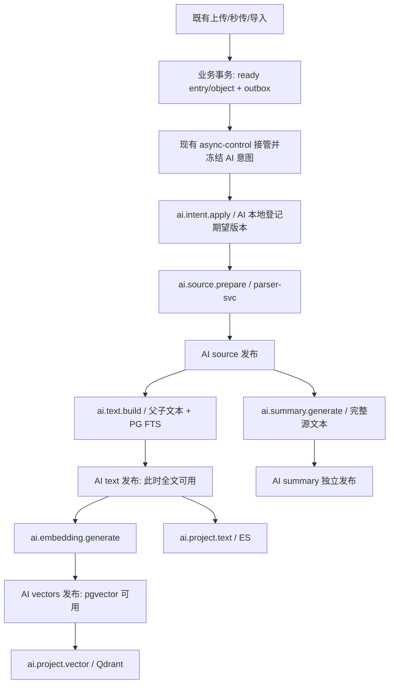

# BX YunPan AI 独立服务、数据拆分与检索问答施工书

日期：2026-11-16。状态：**方案已确定，供新对话直接实现；本文不是已实施或已部署报告。**

本文整合本轮讨论的最终决定，覆盖 AI 独立库、服务与进程边界、异步一致性、PG/ES/Qdrant、独立全文/概览/向量流水线、父子切片、普通及指定文件问答、接口、前端接入、迁移和核心验收。新对话不需要原聊天记录。

优先级：用户后续明确指令 > 当前仓库 AGENTS.md > 本施工书 > 历史方案。`ARCHITECTURE_UPGRADE_PLAN_2026-11-10.md` 的 AI 部分是历史背景；`ASYNC_SYSTEM_CONSTRUCTION_2026-11-16.md` 和 `docs/ASYNC_SYSTEM_IMPLEMENTATION_2026-11-16.md` 是已完成异步基础的入口。旧施工书“不实施 AI 数据独立”的限制仅属于上一轮，本轮按本文实施 AI 拆分，不重新改造已可用的异步底座。

## 0. 给新对话的执行要求

用户要求的是：**直接动代码，完整做出本文目标，不再交另一份规划，不先做铺垫测试或性能基线，也不在每个工作包后等待确认。**

1. 快速看工作区差异和相关入口后开始实现。保留用户改动、配置、密钥、数据和已有异步语义。
2. 按依赖顺序完成数据库、任务协议、发布、服务、检索问答、接口、前端及部署接线。可以边改边验证，不能只做新表或后端骨架便宣布整项完成。
3. 本轮先落实后端与接口契约，再接前端。前端复用现有 React/Ant Design/ProductUI 风格，做功能适配，不另开视觉设计项目。先前“前端以后单独弄”的讨论体现施工顺序；本次完整计划已包含前端实现。
4. 验收必须有核心测试、相关回归和真实依赖链路冒烟。不要将性能基线、完整故障矩阵、长时间压测、随机性质测试、跨主机 HA 或深度安全审计设为开工条件。更深入测试由用户另行安排。
5. 不重复审核整个异步系统，不引入 Saga/TCC/通用 Workflow 引擎，不换 MQ，不引入第二个任务权威。
6. 修改代码时同步迁移、protobuf/生成物、OpenAPI/生成物、启动命令、配置模板、运行说明和实际执行报告。
7. 合理实现细节自行决定；迁移号冲突顺延，不为常规实现再问权限。遇到真正阻塞，说明具体缺失及已完成部分，不用另一份计划代替施工。
8. 本文授权的迁移是保留数据的 expand/copy/cutover/archive。不得清空库、purge 队列、删卷、覆盖 `.env`，或默认删除旧 AI 数据。

可直接交给新对话：

> 按根目录 `AI_SYSTEM_SPLIT_CONSTRUCTION_2026-11-16.md` 直接改代码，完成整套 AI 服务与数据拆分、独立全文/向量/概览、父子切片、普通/指定文件问答、接口与前端适配、迁移和部署接线。异步系统已可用，按其现有协议扩展，不重新做基础审计，不先跑性能基线。完成核心测试、回归和真实依赖链路冒烟，报告实际运行状态与未验证边界，合理实现选择自行处理。

## 1. 最终效果与本轮边界

### 1.1 必须得到的效果

- 上传仍走现有云盘上传链路。文件成为可读的业务事实后，异步准备文本；**全文准备成功即可全文检索和基于文本的问答，不等待向量或概览**。
- 解析、文本索引、向量生成、概览生成、ES 投影、Qdrant 投影有独立任务、预算和结果。概览失败不阻止全文或向量；向量失败不阻止全文或概览；ES/Qdrant 任意一个失败不阻止另一个。
- AI 进程脱离业务库：使用独立 AI PG、独立迁移和账号；不跨库 JOIN，不持有业务 PG 写连接，也不保留常驻业务只读 SQL 作为最终架构。
- 业务库保存业务事实，控制库保存任务执行权威，AI PG 保存派生内容的发布版本。ES/Qdrant 是可重建投影。业务上传、列表、分享、配额不依赖 AI 可用。
- AI 查询通过 etcd 发现和 gRPC 调用；API 对外保持 HTTP。文件名搜索回到 core，AI 停用或故障时仍可用。
- 一套父子索引同时支持普通问答、指定单文件和多文件问答。指定文件扩大该范围的召回与上下文预算，不能再固定每文件最多两片，也不能越出所选范围。
- 文件选择接口只返回用户有权使用且文本已可问答的文件，支持服务端搜索、目录/类型过滤及游标分页。向量和概览不是入选前提。
- 旧数据可迁移或明确重建；旧执行预算和停止结论不因切换清零；旧表退出业务在线路径；可回滚边界写清。

### 1.2 明确不扩张的内容

本轮不做业务服务全面微服务化，不拆用户/上传/配额/分享事务，不做 PG/MQ/etcd 集群建设，不实现跨库原子提交，不承诺外部模型调用恰好一次，不做新文件格式与 OCR 专项，不更换前端框架。

当前文本型 PDF、DOCX、代码/文本/配置、CSV、已有 XLSX 解析能力需要保留。PPTX 目前只检测、没有完整解析；旧 `.doc/.ppt`、扫描 PDF OCR 也不能因“文档”二字自动宣称支持。图片已有视觉解析分支可保留，但文本 FTS、视觉概览、缩略图要分别声明能力。新增格式另列扩展项，不阻塞本文核心交付。

普通 RAG 不承诺逐段读完超长文件。全文级概览使用完整源文本分段汇总；“列出全文所有风险/比较全部差异”等穷尽任务不能用提高 top-K 冒充完成，见第 9 节。

## 2. 当前源码基线及必须拆掉的耦合

以下为写本文时读源码得到的基线，不是对线上部署的认证：

| 当前入口/行为 | 本轮改造 |
|---|---|
| `internal/ai/service.go` 的 `runIndex` 串行解析、切片、embedding、enrich 后一起发布 | 拆成源文本、文本切片、向量、概览的独立任务及发布 |
| `ai_chunks.embedding vector(1024) NOT NULL` | 子文本和向量分表；文本发布无需向量 |
| 全文查询依赖旧版本 `status=indexed` | 改为独立 active text version 与文本可用性 |
| `provider.ModelVersion()` 把 chat 和 embedding 拼在一起 | 解析、切片、embedding、概览模型/prompt 各自版本化 |
| 概览对重叠子片拼接，只取前 12000 rune | 使用规范化源块、不重复覆盖全文，长文本分段归并 |
| Ask 默认融合候选 30、rerank 输出 8，另有每文件最多 2 片硬限制 | 按 scope 分配召回和 token 预算，父片去重组装 |
| 当前切片有标题/页码等元数据，没有真实父片关系 | 新建父片表和显式 child→parent 关系，不伪造旧父片 |
| `ai.Reader` 和 search projector 直接 JOIN 业务/AI 表 | 摘要走 AI RPC；权限/对象走 core 内部 RPC；投影只读 AI PG |
| search projector 在一个处理器里写 ES 与 Qdrant | 分成独立消费者、任务、队列与投影完成状态 |
| `aisvc combined` 可同时承载查询和索引 | 独立角色为默认；旧参数只保留清楚的兼容入口 |
| HTTP/gRPC Ask 已可携带最多 50 个 file IDs，前端没有传 | 统一 scope 契约、服务端二次校验、实现选择与提交 |
| `SaveResult` 对 `BusinessEffect=false` 立即成功 | 新增 AI effect target；需要发布的结果不能直接成功 |
| 当前控制库没有通用的原子后继任务释放机制 | 在现有控制状态机内补充冻结后继与提交后释放 |

当前业务迁移到 `000034`，控制迁移到 `000002`，尚无独立 AI 迁移目录。实际施工前只核实编号冲突并顺延，不重跑基线工程。

## 3. 数据与微服务边界

### 3.1 三个 PG 的不同权威

| 存储 | 保存什么 | 不保存/不负责什么 |
|---|---|---|
| 业务 PG | 用户、目录、entry、ACL、分享、配额、对象/世代/引用、上传事实、用户作业与 AI 请求意图、outbox | 不存文本、embedding、概览正文，不调度 AI 执行 |
| 控制 PG | 接管事件、冻结计划、任务、预算、租约、durable result、结果路由、后继关系、用户作业任务关联 | 不作为权限源，不保存整份文档/向量，不成为第二份文件事实 |
| AI PG | 规范源块、父子文本、向量、概览、独立版本/pointer、发布凭据、墓碑、投影版本与完成证明 | 不判断最终权限，不更新业务配额，不自建任务重试调度器 |
| ES | 子文本全文索引、必要定位/版本标识 | 不作权限源、版本源或唯一正文存储 |
| Qdrant | 子片向量、必要定位/版本标识 | 不保存父片权威，不独立决定候选能否给用户/模型 |
| MinIO | 文件字节、现有缩略图/必要的大型不可变工件 | 不管理任务状态 |
| Redis | 缓存、限流 | 不做任务权威或分布式一致性锁 |

“PG 是事实、ES/QD 是投影”在拆分后仍成立，但需要分清：**业务 PG 是业务事实源；AI PG 是可重建派生内容的发布权威及查询回退源；二者不是同一套事实。** AI PG 也可从业务事实与字节重建，只是在线查询必须以其 active 版本证明为准。

AI 和业务库之间不建外键，不用 FDW/dblink/跨库 JOIN。AI PG 内部可以建外键和唯一约束。共享物理 object 的解析内容按 `(object_id, content_generation)` 去重；entry/owner/文件名和 ACL 不复制进 embedding，不因重命名或移动重新调用模型。

### 3.2 逻辑服务和实际进程

逻辑上保留 core、AI、parser 三个边界。AI 内按负载拆进程，不要求多个 Go module、仓库或每进程一库。各 AI 角色共用 AI PG，但账号和装配按职责最小化。

| 角色 | 职责 | 主要依赖/权限 |
|---|---|---|
| `api` | 公共 HTTP、认证、业务命令/outbox、文件名搜索、AI 网关 | 业务 PG；AI gRPC client；不连 AI PG、控制 PG/MQ |
| `core-internal` | 内部文件/对象/权限/scope 读取、有限存储读取授权 | 业务 PG 只读、签名能力；独立内部 gRPC listener；不调用 AI |
| `async-control` | 现有接管/调度/恢复，扩展 AI 订阅、结果路由、后继释放 | 现有业务只读、控制 PG、MQ；不连 AI PG |
| `committer` | 核心业务提交；新增用户 AI 作业结论提交 | 业务写 PG、控制 PG、MQ；不写 AI PG |
| `ai-query` | 全文/语义/混合检索、Ask、概览/能力读取 | AI PG 只读、core RPC、模型查询、可选 ES/QD；不需要控制 PG/MQ |
| `ai-content-worker` | 调 parser 准备规范源块；独立文本父子切片任务 | 控制 PG/MQ、core RPC、受限对象读取、AI staging 写；无 AI 发布权限 |
| `ai-embedding-worker` | 仅对已发布子文本计算 embedding | 控制 PG/MQ、AI published 读+staging 写、embedding provider |
| `ai-summary-worker` | 对规范源块生成概览、标签等 | 控制 PG/MQ、AI published 读+staging 写、chat provider |
| `ai-committer` | 接受控制库已接纳结果，AI 本地幂等发布、墓碑、投影状态 | AI 发布写账号、控制 PG/MQ、必要 core RPC；无业务写权限 |
| `ai-text-projector` | 只向 ES 投影已发布子文本/删除 | 控制 PG/MQ、AI 读+staging 状态写、ES；不连 QD |
| `ai-vector-projector` | 只向 QD 投影已发布 child vectors/删除 | 控制 PG/MQ、AI 读+staging 状态写、QD；不连 ES |
| `parser-svc` | 现有 Go gRPC + Python 文档解析，返回规范源块 | 不连接业务/控制/AI PG，不消费 MQ；独立资源限制 |

`ai-content-worker` 的“源提取”和“父子切片”是不同任务，第一版可在该角色的独立处理器和有界池运行。全文查询是同步短请求；全文准备/投影是异步任务，不能把用户 Search/Ask 都改成后台作业。

保留原上传/object/media/gc 角色和状态机。`ai-indexer` 旧名字若保留，明确映射 embedding 角色；不能同时启动旧 `runIndex`。`search-indexer` 兼容命令必须显式选择 text/vector 角色，不能继续一条任务捆绑两种外部效果。

### 3.3 对外暴露与内部保护

- 浏览器仅使用既有 HTTP API 与同源 `/storage` 上传；不直连 AI gRPC、模型、ES/QD 或任一 PG。
- 对外只暴露文件与引用定位、能力/状态、答案、概览、作业与可解释的降级信息；不返回内部 DSN、对象存储永久 key、embedding 数组、内部堆栈、原始 provider 错误或凭据。
- core 内部 RPC 与 AI/parser gRPC 使用专用服务身份认证 interceptor；部署支持 TLS/mTLS，至少要有来源约束、受众明确的服务凭证和授权。etcd 注册本身不等于认证。
- 用户 principal 只能来自 API 认证上下文；不能信任浏览器传来的 owner_id。内部 scope grant 绑定 principal、action、范围、内容/ACL epoch、到期时间与请求标识，不能拿服务凭证任意伪装用户。
- core-internal 的管理读取与用户范围读取分开授权。工作任务只允许读取任务绑定的 object/世代；查询只能读取 grant 授权的范围。
- 服务端对不属于用户的 ID 返回统一不可访问语义，避免泄露文件是否存在、名称和内部失败详情。

## 4. 异步任务图与独立发布



图中各发布均通过 `ai-committer`，并在提交回报之后由控制库原子释放后继。图中没有 summary→text 或 embedding→text 的依赖。

### 4.1 新任务契约

| kind | 工作队列 | 发布 target | 成功后的后继 |
|---|---|---|---|
| `ai.intent.apply` | `ai-content` | `ai` | 根据冻结意图，创建/复用需要的 source/text/vector/summary 任务 |
| `ai.source.prepare` | `ai-content` | `ai` | 独立 text build 与 summary generate |
| `ai.text.build` | `ai-content` | `ai` | embedding generate 与 ES project，互不等待 |
| `ai.embedding.generate` | `ai-embedding` | `ai` | QD project |
| `ai.summary.generate` | `ai-summary` | `ai` | 无强制检索后继 |
| `ai.project.text` | `ai-project-text` | `ai` | 仅发布 ES 对应完成证明 |
| `ai.project.vector` | `ai-project-vector` | `ai` | 仅发布 QD 对应完成证明 |
| `ai.object.tombstone` | `ai-content` | `ai` | 分别派生 ES/QD 清理及 AI 内容清理 |
| `ai.artifact.gc` | `ai-maintenance` | `ai` | 有界清理已证明无引用的工件/旧版本 |
| `ai.job.finish` | 现有 `commit` | `core` | committer 写用户作业结论 |

清理消费者可由 `ai-content-worker` 的独立低优先级池承接，不引入无界历史扫描。任务 registry 的 timeout/lifetime/预算/优先级来自可信代码；不能信任 MQ 任意输入。模型并发、parser 并发和两种投影各有独立限流与背压。

### 4.2 重建粒度

- `text`：复用兼容 source 重切父子文本；不强制调用 chat；新 child 发布后自动生成对应向量和 ES 投影。
- `vectors`：复用当前 child；只换 embedding set 和 QD 投影。
- `summary`：复用 source；只换 summary，不重新 embedding。
- `source`：重新解析；以新 source 生成 text 和 summary，再派生 vector/投影。
- `all`：明确要求 source、text、vectors、summary 均得到目标版本；自动复用输入完全兼容的已完成工件，不用刷新预算绕开失败。
- `projection_text` / `projection_vector`：只从 AI PG 重建相应投影，不重新解析/调用模型；作为内部管理或明确授权命令提供。

配置升级必须显式创建版本化 rollout/重建意图，不能在每次读取时偷偷重建。chat 模型升级不废弃 child/vectors；embedding 模型升级不废弃 text/summary；chunker 升级需要新 text 与 vectors，不必重新解析。

profile 使用版本化 catalog：core 只需知道公开的 profile ID/revision 和支持能力，不持有模型密钥；可信 planner 将该 revision 展开成精确 parser/chunker/model/prompt 配置并冻结 digest。worker 不能把历史输入静默替换成自己启动时的最新配置；旧 revision 已不再可执行时明确失败/隔离，由显式升级意图替换。

## 5. 一致性协议：复用控制库，分库本地事务

### 5.1 能保证的语义

使用 **事实事务 + outbox + 控制库唯一执行状态机 + 至少一次通知 + 不可变工件 + 接纳后发布 + 本地幂等凭据 + 版本/墓碑条件 + 可恢复提交**。

不承诺跨三个库的瞬间原子可见。业务文件成功后 AI 允许稍后可用；AI 命令受理成功不等于索引已完成。可以保证不漏已提交意图、重复消息不重复发布、旧结果不覆盖已知新意图、权限不由旧投影决定、计算成功后提交失败能够恢复。

Saga/TCC 的预留/补偿在此没有必要：生成概览/向量是可重建派生效果，业务文件/配额不因派生失败而回滚。失败需要保留状态、有限重试和按新意图重建，而不是撤销上传。

### 5.2 必须扩展现有控制状态机的地方

1. 给任务定义增加 `effect_target=none|core|ai`，默认映射现有语义：旧核心 BusinessEffect→core，真正无效果任务→none。迁移兼容旧字段，最终仅保留一处决定提交目标的逻辑，不能 bool 和 target 各管一套。
2. AI 任务保存结果后进入现有 `computed`/待提交语义，不能因旧 `BusinessEffect=false` 直接成功。`ai-query` 不参与该状态机。
3. 扩展结果路由与分片：现有 `bx.async.v1.result.NN` 保留 core；新增 `bx.async.v1.result.ai.NN`，第一版同为 32 分片、SAC，模块/成员租约按 target 命名空间隔离。只向匹配 target 的写进程投递，避免两类 committer 竞争同一结果消息。
4. 冻结可信后继：结果接纳时把后继 specs/digest 与结果同事务保存为 blocked；效果发布的 `MarkCommitted` 同事务标成功并通过现有 `ensure(tx,...)` 创建/复用后继、记录来源、释放后继。无效果任务可在 SaveResult 同事务释放。
5. **不能先把父任务记成功再在另一个事务创建子任务。** 也不能在 AI PG 写完后临时发一条普通 MQ 消息当作唯一后继来源。
6. 子任务的版本、输入 digest、模型/prompt 配置在可信 planner 中冻结；不接收 worker 任意指定任务 kind、重试预算或下一条 SQL。父任务重放只命中同一语义子任务。
7. 更新 `asyncprotocol`、admin inspect/redo、retention、统计和结果验证。已 computed 的结果只补发/提交，不重新调用模型。

### 5.3 计算、结果接纳与 AI 发布的三个提交点

**A. 计算准备（AI PG 本地事务/有界批次）**

- worker 领取控制租约，读取冻结输入，验证 core 返回的 object generation/状态，调用 parser/provider。
- 写不可变 staging 工件。身份包含 task ID、generation、input digest；工件 manifest 包含类型、行数/字节数、内容 hash、输出版本 ID，最后原子设置 complete。
- 中间批次不对查询开放；一个完整父子版本或 embedding set 必须全部校验后才允许发布。不在数据库事务内调用 parser、模型、MinIO、ES 或 QD。
- worker 只能 INSERT 自己的工件，不能更新 active pointer、发布 receipt 或墓碑。失租立即停止新工作；已落库的私有工件由有界 GC 后续清理。

**B. 控制库接纳（控制 PG 本地事务）**

- SaveResult 严格验证 task/generation/token/input digest 和类型化工件声明（complete、hash、引用字段的结构/长度）；控制角色不连 AI PG，不在该事务跨库验证正文。工件的实际存在、完整性与 hash 由 C 中的 AI 提交者核实。只保存小型引用，不把全文/向量塞入控制结果或 MQ。
- 控制库持久化 accepted result 和 blocked continuations，进入 computed，发/补发 target=ai 的结果通知。旧 generation 的结果被拒绝，旧工件保持不可见。
- B 之前进程死亡可按原预算重试，外部模型调用可能重复；不把这说成模型调用 exactly once。

**C. AI 发布（AI PG 本地事务）**

- ai-committer 从控制库确认该结果已被接纳，核对工件和输入、源版本/父片完整性、期望 capability seq、对象世代、生命周期 revision 和墓碑。
- 在 AI PG 同事务内条件切换 active pointer/登记能力结果，并写 `ai_commit_receipts`。相同 result 重复提交返回相同结论；同 ID 不同 digest 隔离。
- 发布不兼容/已过期时写 `superseded/rejected` receipt，不把它当作新版本发布；向控制库回报终结及是否释放后继。
- 事务提交后回报控制库；控制库同事务确认效果并释放后继，最后 ACK 结果消息。AI 提交后回报前崩溃，重放先读 receipt，不能再调用模型或重复切版本。
- 一旦 B 接纳且处于待发布，结果不可被普通预算耗尽删除。发布故障按现有有限补发/提交预算进入保留结果的 attention/待处理结论；修复后恢复提交，不创建新语义计算刷新预算。

该协议不需要“每次跨库先检查租约就等于全局 fencing”的错误假设。**控制 token 只约束控制库接纳；AI 本地 CAS、accepted-result 引用、不可变工件和墓碑才约束 AI 可见效果。**

### 5.4 对象世代、期望序号和能力指针

- 内容身份使用 core 已有 `file_objects.content_generation`、SHA-256 和 size。`file_entry.version`、`object.version`、控制 task generation、AI content version 不得混为一个数字。
- 新增业务 `ai_resource_intents`，对 `(object_id,content_generation)` 保存单调的 source/text/vector/summary 请求序号与明确 profile revision。自动 ready 与用户重建均在业务事务中登记意图和 outbox。用户命令只递增涉及的能力序号。
- AI 接收意图时按每能力序号取新值，旧意图不能回退 desired seq；输出绑定完整输入版本及对应 capability seq，发布时 CAS 匹配当前 desired 值。
- 更新 source/text 的意图要冻结其后继输入关系。新 child 的 vectors 必须绑定新 content version；不能把旧向量接到新子片上。发布新文本时可立即全文可用，旧 vector pointer 不可冒充与新 child 兼容。
- source/text/summary 各自保留已发布版本与最新构建状态。刷新失败允许旧的同 object generation 的兼容版本继续可用，返回 `available=true, freshness=previous, latest_build=failed`。可用性与最近一次任务结果分开。
- 请求 seq 是意图的排序，不强制等于工件创建 seq。命中完全兼容的已发布工件时，结果/receipt 仍携带本次 requested seq，提交者按当前 desired seq 校验后复用该 immutable version；不能修改旧工件的创建 seq 或伪造一轮模型调用。若命令明确 force，则不复用其要求重算的能力。
- 尚未被 AI 接收到的新意图与旧结果之间存在正常异步延迟；不能承诺从业务命令提交的纳秒起旧结果绝不短暂发布。收到新意图后不得回退；响应携带已采用版本/刷新状态，业务权限和世代始终回验。
- 取消尚未接纳的计算可以阻止其发布；已经接纳/发布的派生效果不靠删除控制任务撤销。撤销/替换使用更高序号意图或墓碑，停止与撤销语义必须写清。

### 5.5 删除、恢复、共享和 GC

- 删除一个 entry 只影响其授权/可见性，不能删除其他 entry/owner 仍引用的 object 索引。查询由 core 最新合法 scope 排除该 entry。
- object 进入不可再读取的 deleting/deleted 世代时，core 同事务发带 object ID、content generation、lifecycle revision 的版本化事件。不要只靠旧 GC 处理器直接 DELETE ai_documents。
- AI 墓碑先于内容/外部索引清理生效；同世代旧发布、旧 intent 和迟到投影不能清除墓碑。若业务重新生成字节，必须使用 core 新 content generation。
- 墓碑与终结凭据是防复活屏障，不按一般短 TTL 删除。保留至所有旧任务/结果/消息与回滚窗口都已越过并有可证明边界；第一版宁可保留紧凑墓碑。
- ES/QD 清理可以稍后，查询拿不到 core 授权或 AI active 版本证明就不能把残留交给用户/模型。物理清理失败单独可见、独立重试。
- AI 工件 GC 只删无 active 引用、无 accepted 未提交结果引用且超出保留窗口的工件。控制结果/receipt 的清理先后必须与其协调；不能按工件创建时间直接扫掉待发布结果。

### 5.6 外部投影的特殊处理

投影 worker 可以在结果接纳前把数据写入 ES/QD，但只写带不可变 content/vector version 的键；查询仍须 AI active 版本与 scope 证明。只有结果被控制库接纳并经 ai-committer 提交后，才登记“该版本投影完整”。因此迟到 worker 的外部写不能独立成为可见事实。

- ES 文档 ID 绑定 target epoch + content version + child ID；需要更新的状态使用单调 external version，删除也保留对应版本屏障。
- QD point ID 绑定 target epoch + embedding set + child ID（确定性 UUID），不对同 point 原地混写新模型。QD 不假定具备 PG 一样的 CAS；不可变版本 ID、AI active 过滤和墓碑承担可见性防线。
- 先写外部数据、后登记投影完成证明。部分成功/进程中断只会得到不完整投影，不能把 watermark 提前推进。重复写按同 ID/同 digest 幂等。
- 某次外部写已成功但控制结果未接纳，可以重试相同版本，或最终报该投影失败；AI PG 回退仍正确。不用另一套外部重试账本重开控制任务。
- 查询过滤版本后丢失候选要有有界补召回或 PG 回退；不能把无效候选占满 top-K 后的空集当成可靠零命中。

### 5.7 用户作业与失败收敛

`async_tasks` 继续属于业务 PG。新增用户请求附表保存 requested targets、profile、请求世代/序号和 capability outcomes。控制库保存 job↔task 的执行关联，不允许 ai-worker 直接写业务作业状态。

控制库在可信代码内聚合 requested targets 的终结状态：全部成功、部分成功、全部失败、被替换、取消、等待处理。聚合结论与 `ai.job.finish` 的 ensure 同控制事务提交；core committer 幂等写业务作业及结论事件。可选 ES/QD 加速失败不应把“文本/向量/概览核心构建成功”改成失败，除非用户明确请求的是投影重建。

同一个已存在的语义任务可被多个作业引用；加入新的观察者不刷新它的重试预算。已停止任务需要 admin redo 留痕子任务或新的明确用户意图，不能重投一条旧消息复活。

### 5.8 核心故障窗口的预期

| 故障点 | 应有结果 |
|---|---|
| 业务提交后控制/MQ 暂不可用 | 文件和命令事实仍提交；outbox 后续接管 |
| source 成功、summary 挂掉 | text/FTS 与后续 vectors 独立推进 |
| embedding 超时/额度不足 | text/FTS/文本问答可用；明确 vector 不可用 |
| staging 完成但 SaveResult 未成功 | staging 不可见；按原预算恢复/重试，不发布孤儿 |
| 失租旧 worker 回报 | 控制库拒绝旧结果，不切 active |
| AI 发布完成后控制回报丢失 | 重放命中 AI receipt，恢复后继，不重算 |
| 控制成功提交与后继创建间崩溃 | 二者同事务，不出现缺后继 |
| 旧重建结果晚于新 intent | AI CAS 判 superseded，不覆盖新期望 |
| 删除先于旧向量/概览结果 | 墓碑拒绝发布；外部残留无授权可见性 |
| ES down | PG FTS 回退；QD/pgvector 不受牵连 |
| QD down | pgvector 回退；全文与概览不受牵连 |
| AI PG down | AI 查询明确不可用，核心云盘与文件名搜索可用 |

### 5.9 稳定身份与小型结果样式

新任务使用独立 contract namespace，避免与旧 `ai.index` 碰撞。推荐 semantic key（各 digest 是规范序列化 hash，不是随进程启动变化的随机数）：

| 工作 | semantic key 构成 |
|---|---|
| apply intent | `ai.v2.intent:<object>:<generation>:<intent_id>` |
| source | `ai.v2.source:<object>:<generation>:<source_seq>:<parser_input_digest>` |
| text | `ai.v2.text:<source_id>:<text_seq>:<chunk_config_digest>` |
| vectors | `ai.v2.vector:<content_version>:<vector_seq>:<embedding_config_digest>` |
| summary | `ai.v2.summary:<source_id>:<summary_seq>:<model_prompt_strategy_digest>` |
| projection | `ai.v2.project:<es或qd>:<target_epoch>:<artifact_version>:<operation>` |
| capability failure | `ai.v2.capability.finish:<terminal_task_id>:<terminal_revision>` |
| job finish | `ai.v2.job.finish:<job_id>:<aggregate_revision>` |

模型 alias 之外还要冻结 provider/revision、维度/归一化或 prompt 版本；provider 不提供真实 revision 时标明配置版本与可验证范围，不能声称能识别供应商后台的静默模型升级。

结果最少包含 contract version、task/input identity、artifact ID/hash、typed output IDs、object/generation、requested capability seq、output counts/coverage 和 outcome。控制 generation 是一次执行代次，不能进 semantic key 导致每次失租变成新任务。

资源串行/CAS 的 shard key 优先绑定 object/generation；owner 公平使用冻结的触发 owner 或明确的系统对象预算，不能因同 object 被多人引用就复制整套计算。用户作业链接独立保存，不把 owner_id 拼进共享 content 的身份。

## 6. 数据结构、字段和迁移归属

以下是目标逻辑结构，实施者需落实完整 up/down SQL、索引与模型。允许合并无必要的物理附表，但不得省略列出的不变量。所有时间用 timestamptz；版本/seq 使用 bigint；ID 使用 UUID；错误详情脱敏并限长。新表只在其所属库迁移，不用 GORM AutoMigrate 代替。

### 6.1 业务库：仅新增意图和用户作业契约

建议 `000035_ai_split_intents.up/down.sql`：

| 表/变更 | 必要字段与约束 |
|---|---|
| 新 `ai_resource_intents` | PK `(object_id,content_generation)`；source_seq、text_seq、vector_seq、summary_seq；各目标 profile/revision；最后请求 ID、created_at/updated_at；seq 非负；对象 ready 初始化与 outbox 同事务；不存派生结果 |
| 新 `ai_job_requests` | `job_id` PK/FK→async_tasks；owner_id、file_id、object_id、content_generation、requested_targets、profile_revisions、requested_seqs、capability_outcomes JSONB、result_version_refs JSONB、created_at/finished_at；只存小型引用/结论，不存正文或执行租约 |
| 调整 `async_tasks` | 保留现有字段/语义，补充 `partial_success` 等确实缺少的用户结论枚举及匹配约束；progress 仅显示，不成为执行推进依据；执行预算仍只在控制库 |
| 新/扩展事件契约 | AI intent requested、对象世代失效/墓碑、作业完成；payload 带 aggregate revision、object generation、能力 seq、冻结 profile 和请求标识；注册/订阅/校验一起改 |

`ai_resource_intents` 可有业务 object 外键，历史意图随对象保留策略处理；AI 输出 ID 不做跨库 FK。`file_entries` 不新增 `summary/embedding/ai_status` 这类统一状态字段。保留 `async_tasks`、`event_consumptions`、outbox、对象/配额/上传表，不能因为 AI 拆走把共享表整体删除。

### 6.2 AI 库：源文本、父子片、向量与概览分表

创建 `backend/ai-migrations/`，独立 migration history。建议 `000001_ai_content_schema` 建表/约束，`000002_ai_search_indexes` 建 pgvector/FTS/中文辅助函数/索引，必要后续顺延。

| 表 | 字段、归属及索引要求 |
|---|---|
| `ai_objects` | PK `(object_id,content_generation)`；content_hash、size、media_type；lifecycle_revision、tombstoned_at；desired_source/text/vector/summary_seq 与 profile revisions；active_source_id、active_content_version_id、active_embedding_set_id、active_summary_id；timestamps。发布按 object/世代行加锁/CAS；同世代墓碑不可回退 |
| `ai_sources` | id；object_id/generation、source_seq、input_digest；parser_id/version、parser_profile_version、vision_model_version、language、quality JSONB、warnings、block_count、source_hash、publication_state、prepared/published/retired_at。唯一 `(object,generation,source_seq,profile_revision)`；source 不含 embedding/chat 模型版本 |
| `ai_source_blocks` | PK `(source_id,ordinal)`；规范 text、kind、heading_path、稳定 block_key、页/slide/sheet/行列位置、source_start/end、offset_unit、location_precision、source_kind、encoding、merged_ranges。文本仅此规范来源，摘要不再拼重叠 children |
| `ai_content_versions` | id；source_id、object/generation、text_seq；chunker_version、tokenizer_id/version、配置 digest；parent_count/child_count、text_hash、coverage/truncated/warnings、publication_state/timestamps。唯一输入版本+text_seq；与 source 同库 FK |
| `ai_parent_chunks` | id；content_version_id、ordinal、parent_key、content、heading_path、kind、源 block 范围、页/表位置、token_count/estimated 标记。唯一 `(content_version_id,ordinal)`；父片上界受配置限制；不存 embedding |
| `ai_child_chunks` | id；content_version_id、parent_id、ordinal、child_key、content、规范范围/精确度、引用位置、token_count/estimated、content_tsv/中文检索字段。唯一版本+ordinal；复合 FK 保证 parent 同版本；GIN FTS，object/version/parent 查询索引；**无 embedding NOT NULL 列** |
| `ai_embedding_sets` | id；content_version_id、object/generation、vector_seq、provider/model/revision、dimension、distance_metric、normalization、input_digest、vector_count、publication_state/timestamps。唯一完整向量输入身份；数量和子片集合完整校验后才发布 |
| `ai_chunk_vectors` | PK `(embedding_set_id,child_id)`；content_version_id、embedding vector(1024)、input_text_hash；复合 FK 保证 child/set 属于同 content version；HNSW cosine 及 set/version 索引。仅 children 有向量 |
| `ai_summaries` | id；source_id、object/generation、summary_seq；provider/chat_model/revision、prompt_version、strategy_version、input_digest；summary、tags、language、coverage、source_block_count、processed_block_count、truncated/warnings、publication_state/timestamps。与 vector/text 版本独立 |
| `ai_artifact_manifests` | artifact_id；task_id/generation、kind、input_digest、artifact_hash、typed_output_ref、row_count/byte_count、complete、created_at。不可变、同身份 digest 校验；查询无权通过此表获得 staging 正文 |
| `ai_commit_receipts` | result_id PK；task_id/generation、input_digest、result_digest、artifact_hash、effect_kind、outcome、published_refs、revision、committed_at。重复提交同凭据同结论；保留至控制结果/旧消息边界可证明安全 |
| `ai_projection_targets` | id；backend=es/qd、projection_kind=text/vector、target_version、index_epoch、mapping/model/config digest、state=building/active/retired/failed、activated_at。每 backend/kind 至多一个 active，二者独立切换 |
| `ai_projection_states` | backend、target_id、object/generation、content_version_id、nullable embedding_set_id、**artifact_version_id NOT NULL**（text 为 content ID、vector 为 set ID）、operation、source_revision、artifact_hash、expected/applied_count、state、last_error、published_at。唯一 `(target_id,artifact_version_id,operation)`，CHECK 约束 kind 与引用一致，避免 NULL 唯一漏洞；不存自驱动重试计数/租约 |
| `ai_migration_runs/items` | 一次性迁移 manifest、源范围/快照、item identity、源 hash、目标 ID/hash、游标、兼容性结论、错误和阶段。仅迁移工具使用，可断点续传，不成为在线执行权威 |

所有 published 查询通过安全 view/repository 只读 active/published 数据；staging 必须物理权限隔离或使用经过验证的 SECURITY DEFINER 只写函数/只读 view，不能“代码约定不查询”就声称账号隔离。query 账号不能写任何表；compute 账号不能更新 ai_objects、receipt、墓碑或已发布行；AI committer 独占发布写权限。

active 指针与 source/child/set 的内部外键还必须校验同 object/generation/content version，不能仅依赖 UUID 存在。使用复合唯一键/复合外键和发布锁落实；保证不存在“对象 A 的 pointer 指向对象 B 的正文”或“新 child 接上旧 vector”的合法数据库状态。

embedding 初版保持现有 **1024 维**，配置启动校验一致。换维度需要新表/列或独立 collection/index schema 迁移，不能在旧 `vector(1024)` 中硬塞其它维度。同维度不同模型也必须独立 set/target，禁止混算相似度。

文本/向量/概览没有业务表 FK；不在 AI 表保存用于调度的 `lease_token/lease_until/attempt/next_retry_at`。发布状态是内容可见性，不是另一个 running/retry 状态机。最新构建状态通过受控控制读接口或业务作业结论映射，不能让 AI query 直接依赖控制库健康（见接口状态说明）。

### 6.3 控制库：最小扩展

建议 `000003_ai_effects_continuations.up/down.sql`：

- 给 tasks/results 及必要结果派发记录增加/冻结 `effect_target`；现存行按旧 registry 确定性回填，core 路由不变。
- 新 `task_continuations`：parent_task_id、accepted_result_id、ordinal、spec JSONB、spec_digest、state=blocked/released/suppressed、child_task_id、时间；唯一 `(accepted_result_id,ordinal)`，与 accepted result/子任务同库 FK。
- 新 `ai_job_task_links` 或通用等价表：job_id、task_id、target、required、requested input identity；job ID 仅跨库逻辑引用。对复用任务支持多作业观察。
- 必要的 job aggregate frozen outcome/finish-task 唯一关系；聚合与 finish-task ensure 同事务，避免“计算完成但用户作业永远 processing”。
- 结果 target 分片索引/租约 namespace、retention 引用约束同步更新。不能复制一套 tasks_ai/retries_ai 再实现相同状态机。

### 6.4 旧表、旧字段的明确处理

切换后业务库 **public 在线模型** 不再含以下 AI/search 存储职责：

| 旧表/字段 | 最终处置 |
|---|---|
| `ai_documents` 全表 | 迁移/重建后归档退出 public；summary/tags/language 移至 ai_summaries，active 指针改为 AI 多能力指针 |
| `ai_document_versions` 全表 | 归档；拆成 sources/content_versions/embedding_sets/summaries；删除在线旧 lease_token/lease_until、组合 pipeline/model 状态语义 |
| `ai_chunks` 全表 | 归档；正文迁到/重建为父子结构，embedding 进入独立 vector 表；旧 ordinal/页码不能自动当成真实 parent/source offsets |
| `search_index_versions` | 归档；由 AI projection targets 替代 |
| `search_content_projections` | 归档；文本源/向量源由 AI 内容表负责，投影进度由 projection states 负责，不保留重复权威 |
| `search_file_projections` | 归档；本方案不建立权限副本作 authority，scope 由 core 提供。文件名搜索走 core，重命名/移动不要求重建 AI 内容 |
| `search_projection_checkpoints` | 归档；控制执行预算 + AI 投影完成证明替代其混合重试职责 |
| 公用 `event_consumptions` | 不整体迁走/删除；仅停止旧 AI/search consumer 写入，审计其他消费者后保留必要行/约束 |
| 旧中文 FTS 函数/index | AI 库建立自有版本；业务归档数据仍依赖的函数保留，确认无依赖才在显式迁移删除 |

建议业务 `000036_archive_legacy_ai_search` 在完成切换检查后，把上述 **7 张表**迁到 `ai_legacy_20261116` schema（ai 3 张 + search 4 张）。去掉指向业务 file_objects 的旧外键，保留归档内部必要关系，撤销在线账号访问；不 `DROP CASCADE`，不默认物理删除数据。这样业务 public 不再承载 AI，回滚材料仍在。后续物理 DROP 归档不属于默认施工动作。

历史迁移 000006/000015/000017 等保留原样，不能改旧迁移假装新建实例从未有过旧结构；新建实例顺序执行到归档迁移后达到同样目标。新增迁移的 down 必须说明仅回退结构能做什么，不能声称自动把新 AI 输出同步回旧表。

### 6.5 独立能力状态，不保留一个万能 ai_status

另建 `ai_capability_status`：PK `(object_id,content_generation,capability)`，capability 为 source/text/vector/summary；保存 desired_seq、latest_observed_seq、latest_build_state、error_code、safe_error_message、source_task_id、observed_at。它是面向查询的**派生状态快照**，没有租约、尝试预算或自主重试逻辑。

意图登记写 pending；发布成功更新对应 snapshot；控制库任务终结失败时，可信 failure planner 同控制事务创建稳定身份的 `ai.capability.finish` 后继，由 AI 提交路径写失败快照。该后继不能启动重算，旧 seq 的失败不能把新 seq 覆盖成失败。其派发/提交也使用已有有限预算及保留结果机制。

这样 ai-query 只读 AI PG 就能返回能力状态，不为了显示状态强依赖控制库。`running` 若没有可靠事件桥就返回 `pending/unknown` 与 observed_at，不能伪造实时进度。用户作业结论另由业务 jobs API 返回；两者允许有可解释的短暂投影延迟。

每能力至少区分：

- `supported`：当前对象类型/策略支持，不能从队列失败推导为不支持。
- `available`：已有可用且世代兼容的 active 结果。
- `latest_build.state`：最近目标的 pending/succeeded/failed/superseded/unknown 等观察值。
- `freshness`：current/previous；旧版本继续可用但刷新失败要明确表达。
- `coverage`：complete/partial/none，及 truncated/warnings；不能因有一片就表示全文件已覆盖。

## 7. PG + ES + Qdrant 的确定读写策略

### 7.1 派生写入与发布

1. parent/child 文本完整发布到 AI PG 后，PG FTS 立即可用，同时创建 ES 投影任务和 embedding 任务。
2. embedding set 完整发布后，pgvector 立即可用，再独立创建 QD 投影任务。
3. 概览直接由 source 发布，既不等 text index，也不等任何外部投影。
4. ES 与 QD 使用各自 target epoch、索引/collection、完成证明、重建/切换和清理，不能共享一个 all-or-nothing 的 indexed 状态。
5. 投影只读 AI PG 的已发布数据和任务冻结输入，不 JOIN 业务库；rename/move/ACL 由 core scope 实时处理，不触发 embedding。

### 7.2 查询路由

| 模式 | 正常路径 | 降级与限制 |
|---|---|---|
| `name` | core 业务 PG 文件名查询 | 与 AI_ENABLED、AI PG、模型、ES/QD 健康无关 |
| `fulltext` | 配置且版本覆盖完整时优先 ES | ES 错误/超时/版本不完整→AI PG FTS；不请求 embedding/chat |
| `semantic` | 生成 query embedding，优先完整 QD 投影 | QD 错误/未覆盖→同模型 AI PG pgvector；没有兼容 vectors 或 query embedding 失败，明确 semantic unavailable |
| `hybrid` | 两分支独立召回、融合、重排 | 向量分支失败仍运行文本并返回 degraded；全文分支失败而向量成功可按语义返回；两者都失败才整体失败 |
| `Ask` | scope 内 hybrid/可用分支召回→重排→父片上下文→LLM | 无向量可文本问答；无 chat provider 不能生成答案，返回 answer unavailable；不能把全文可用伪装成 chat 可用 |

外部投影默认 `auto`：未配置即 PG；配置且具备匹配覆盖则优先外部，否则 PG。可保留 postgres/外部优先/shadow 调试配置，但 `shadow` 不得偷偷多调用付费模型、影响主请求或成为验收前置。

pgvector 回退只能解决 QD 故障，**不能解决 embedding 模型故障、无向量、维度/模型不兼容**。AI PG 不可用时，ES/QD 无法独立证明 active 版本并装载 parent，因此 AI 内容查询应明确失败，不绕开发布/权限规则硬返回。

### 7.3 覆盖、空结果与融合

- 查询先由 AI PG 解析 scope 对应的 active content/embedding IDs，再在 ES/QD 的过滤条件中限制这些 ID；不要全库 top-K 后再过滤所选文件。
- 投影完成证明必须与 scope 里的 active 版本相符。完整性证明缺失时：第一版按该分支整体回退 PG，避免复杂的部分双读漏排；后续可优化按缺失对象补查，但不是本轮必要条件。
- 外部后端健康、覆盖匹配且返回 0，属于真实零命中，不把它无条件当故障。确有陈旧/不完整证明才回退。删除/世代变化造成无效候选时有界 refill，仍不足则回退 PG。
- 每分支先按原始可比 score/distance 得到**全 scope 的候选排名**，再做 RRF；不能在文件分批内先 RRF 再把局部名次拼成全局。
- 预过滤要落实到实际查询算子：ES 使用 kNN/query 的 filter 而非仅 response post_filter，QD 使用 vector query 的 payload filter。PG 对小范围 selected 可先物化合法 child 集合做精确距离排序；大范围 ANN 使用受支持的 filtered/iterative scan，候选不足时有界精确补查或明确超时，不把 HNSW 先全局取少量点再过滤产生的空集当作无相关内容。
- 同一个 child 的多路命中合并；同 object 被多个合法 entry 引用时内容去重，引用映射遵循选中文件，不将别人的文件名带出来。
- 返回实际 backend、fallback reason、分支是否可用、投影版本和 coverage；不把 provider 失败映射为“没有找到相关文件”。

### 7.4 重建外部索引

新 target 在 building 独立回灌，校验 chunk/vector 数量、hash、模型/维度和版本覆盖后，AI PG 事务切 active target。每种 backend 独立切换，不要求 ES/QD 同时成功。

旧 target 保留回滚窗口，查询携带的 target/版本必须一致；切换期间不能把旧模型 query vector 发往新维度 collection。回灌、增量和切换采用稳定版本身份及显式完成边界，不能用“最大收到 event seq”假定所有先前事件都完成。

## 8. 父子切片的具体实现

### 8.1 一份规范源内容，两个尺度

parser-svc 返回规范 source blocks；父子关系由 Go 中确定性 chunker 构造。逐步把现有 parser 返回 child chunks 的职责移出 parser，保留兼容字段到调用方全部迁走；parser 不负责 embedding、摘要或 AI 发布。

- **parent**：一个语义连续的章节/有界段落组，作为给 LLM 的上下文单元。
- **child**：parent 内较小片段，用于 FTS/BM25/vector 召回、重排和精确引用；每个 child 属于一个 parent。
- parent 内容从 canonical blocks 构建，不从有重叠 children 反拼。child 重叠只能在同 parent 的有限范围内；不跨 parent 制造无法解释的归属。
- parent_key 基于 source ID、真实 block 区间、层级位置及配置，不用 heading 文本直接当唯一键。重复标题、重复页眉、同名 sheet 必须仍有不同定位。
- 新 child 要能定位到 parent 的实际范围。现有 section-wide offsets 不能照抄后声称精确到子片；没有可靠位置时使用 nullable 范围和 `location_precision=block/page`，保留 block ordinal/片内范围。

建议起始配置（是可调工程默认，非压测/效果评测结果）：

| 参数 | 默认值/原则 |
|---|---|
| child target | 约 400 tokens，允许按句/代码块边界浮动，上限 600 |
| child overlap | 约 50 tokens，且不跨 parent |
| parent target | 约 1600 tokens，硬上限 2400；过长章节进一步切 parent |
| 普通入库 | 复用既有文件大小/页数安全限制；替换旧默认 256 children 截断，支持有界批量覆盖完整允许源内容 |
| 超限 | 解析前限制与实际覆盖都入 metadata；不静默丢尾，必要时标 partial/not exhaustive |
| ID | source/content version 内确定性 parent/child ID，输入变化生成新版本 |

如果 provider 有可靠 tokenizer，优先使用该模型兼容 tokenizer；否则对中文/代码使用保守估算并预留余量。必须标注 estimate 与 estimator_version，不能把 rune/4 当成准确 token 数。上下文最后还有 provider 请求上限校验。

### 8.2 按格式保留结构

| 格式 | parent/child 边界 |
|---|---|
| DOCX/Markdown/普通文本 | 标题层级优先，段落/句子分割兜底；长节有界拆分 |
| PDF | 现有页文本/段落边界，保留页范围；没有真实跨页章节识别时不伪造复杂版面结构 |
| 代码/配置 | 文件/声明或连续代码块优先，现有 parser 不具备 AST 时用确定性块规则；保留行号，不宣称完整语法分析 |
| CSV/XLSX | sheet+有界行组，保留表头/行列定位；父片带必要表头，避免把每行都塞成不可检索的碎片 |
| 图片视觉文本 | 保留 source_kind/vision model 与页面/图像定位，能否问答取决于实际非空文本和策略 |

重叠去重以 source/block 范围和版本为准，不能只靠完全相同字符串删除（文档可能确有重复条款）。引用保留 child 精确摘录，同时返回其 parent/章节/页位置。

## 9. 普通、单文件和多文件问答

### 9.1 共同链路

`认证 principal → core scope grant → 范围内 active children 多路召回 → 候选权限/世代回验 → 全局融合/重排 → parent 去重与扩展 → token 预算组装 → core 最终权限/世代回验 → LLM → 返回答案与版本引用`。

如果 reranker 是外部模型，第一次回验必须先于发送 child 正文给 reranker；最终回验先于发送 parent 给回答模型。按去重 file/object 批量验证，不对每片串行发 RPC。Search 返回正文 excerpt 之前同样回验。不能只保护最终答案，却提前把失效范围的候选发给第三方模型。

召回与上下文是两个预算：多召回用于找到好片段，不代表把全部候选塞给模型。保留 system/question/history/output token 空间，再分配 evidence budget；总量取配置与实际模型上下文的较小值。

不选择文件：在所有**当前有权且文本可用**的文件中普通检索。选一个或多个文件：先 core 检查所选范围，再对该范围内的 children 检索，绝不能失败后扩大到全盘。HTTP 兼容层可把“未传/空 file_ids”规范化为 all；新前端使用明确 scope，`mode=selected` 配空数组必须 400。

### 9.2 分 scope 的默认预算

下表仅为可配置初值，实施时不得宣称经过容量或准确率认证：

| scope | 召回起点 | 上下文起点 | 分配策略 |
|---|---|---|---|
| 普通 all/folder | 每分支全局 top 40，合并重排约 60 | evidence 最多约 8000 tokens，parent 硬上限 12 | 文件多样性是软偏好，先覆盖相关文件，再把剩余预算给最相关文件 |
| 指定单文件 | 每分支 top 80，合并重排约 100 | evidence 最多约 12000 tokens，parent 硬上限 24 | 去掉每文件 2 片硬上限；短文件全文能放下时可直接使用完整规范文本 |
| 指定多文件 | 每文件每分支至少请求 top 8，再全局合并；最终候选总上限 240 | 共用约 12000 tokens，parent 硬上限 24 | 对有相关证据的文件保留份额，再按相关性分配；不因选了 N 个文件就把上下文变成 N 倍 |

文件最多 50 个，重复 ID 去重。多文件候选调度有全局并发/总量上限，不能一次触发 50×多路×多副本无界请求。候选配额是召回机会，不是强行加入不相关文本的最低义务。

相关 parent 超预算时优先使用命中区间及邻近段落，可拆入更小连续证据单元，并保留覆盖说明；不能机械地截断一大 parent 导致关键结论/代码块被砍掉。相邻且同源连续的父片可合并，但不重复计入 overlap。

### 9.3 选择失效与引用

- 提交时重新确认每个选中文件：权限、未删除、object ready/世代、非空兼容 text。任何无效项返回结构化 scope_invalid，列出安全可展示的原因；不静默丢掉它继续回答，也不退成 all。
- 检索期间发生移动/权限/删除/世代变更，最终回验可以剔除并有界重检索；selected 语义变化时返回 scope_changed 要求更新范围，不用旧名称掩盖变化。
- 多文件没有某文件的相关证据时，返回 coverage/missing_evidence，不编造“已逐份比较”。答案不得引用没有真正进入 evidence 的片段。
- 引用绑定 file_id、object generation、source/content version、child/parent ID 与位置；外部公开仅暴露必要标识和定位，不能泄露其他 owner 的 entry。
- 响应保存/返回使用的 scope snapshot/fingerprint 与文件名快照；前端在一次问题进行中更改选择，只影响下一次提问。

### 9.4 概览与穷尽任务

概览 pipeline 必须遍历完整 canonical source blocks：短文直接 summarization，长文分段 map + reduce/refine，处理中间摘要也需要稳定输入身份、有限模型调用预算及可恢复工件。若源解析本身 partial，最终 summary 的 coverage 不能标 complete。

不要把分段中间节点另建任务调度器：需要细分时仍由现有控制任务/后继机制管理。summary 的输入/输出 token 和每文件总调用数有明确上限；达到上限返回 partial/failed 与原因，不能偷偷只看开头后声称全文概览。

本轮同步 Ask 仅实现 bounded RAG；“全面逐段审阅/所有差异”暂不增加新的公共产品入口。需要支持时走明确的异步 exhaustive-analysis 命令、分段遍历和覆盖报告，不能让普通 Ask 自动宣称穷尽覆盖。独立概览生成的完整覆盖属于本轮要求。

## 10. core 内部 gRPC、scope 与权限协议

### 10.1 新的只读业务接口

在 `api/proto/core/v1/core.proto` 定义 `CoreReadService`，生成到 `internal/core/pb` 或等价独立包；接口不得 import AI 的数据库模型。

| RPC | 契约 |
|---|---|
| `OpenRetrievalScope` | 验证用户 grant、all/folder/selected 范围，返回 scope ID、epoch、选中文件 refs/摘要、有效期与分页约束；无权限 ID 不返回私密信息 |
| `StreamScopeMembers` | 从业务事实流式分页返回合法 file_id→object_id/generation、entry version、名称/路径/MIME；游标绑定 scope/epoch/filter，不持有跨服务写事务 |
| `ValidateEvidence` | 对有限 file/object/version/citation refs 批量权限与世代回验，返回当前合法 refs 或 scope_changed；LLM 前执行 |
| `GetObjectForProcessing` | 验证服务身份与任务绑定资源，返回 ready object 的 generation/hash/size/MIME 和短期只读定位/URL；不允许任意路径/任意 bucket 读取 |
| `BatchGetFileRefs` | 文件能力/详情接口必要的业务元数据；有界批量、用户权限校验，不能暴露原始 SQL 查询能力 |

Query 只得到授权对象，不读取业务 SQL；worker 不得用“服务账号”绕过任务资源限制。MinIO 读取优先使用 core 签发的短期 exact-object GET URL；如保留只读 MinIO 账号，也只能读专用前缀，仍必须核验 task object/generation。请求和日志不得打印签名 URL。

处理读取使用独立 `ProcessingGrant`：可信 control planner 在接管业务意图时签发，绑定 root intent、冻结输入 identity、object/generation/hash、action、audience 与 lineage deadline，作为冻结输入传给需读原对象的后继；后继 deadline 不得越过该授权边界。core-internal 只持验证公钥并回查当前业务世代，不需要连接控制库。普通计算角色不持签名私钥，不能任意签发对象授权；redo/迁移通过可信 planner 重新核验后产生新 grant。它与用户查询 scope grant 使用不同受众/权限，签名有效不能代替 core 当前对象状态验证。

### 10.2 大范围的检索过滤

不能把所有文件一次塞进浏览器、JWT、一个超大 SQL IN 或单次 gRPC 响应。确定采用以下正确性基线：

1. selected 最多 50 个文件，由 core 一次校验、映射并去重 object；每个 entry 的合法引用关系仍保留。
2. all/folder 由 core 以 keyset/cursor 分页流式返回授权成员，每批例如 500 个、上限 1000；绑定内容/ACL epoch。epoch 在遍历中变化时返回 scope_changed，最多在模型调用前自动重试一次。
3. PG 路径使用只读 SQL，将每批有限 object/generation IDs 通过参数化 VALUES/unnest 与 AI active 版本 JOIN，先限制合法 child 集合再排名；分支全局合并遵循下一项规则。第一版不依靠 query 账号 CREATE 临时表，保持真实只读权限，不在池化连接留下 scope 数据。
4. ES/QD 对每批 active content/set IDs 在检索前过滤，各批取本分支至少所需 top-K，合并为全 scope 分支 top-K 后再融合。相同 score 的 tie-break 确定性排序，query embedding 只计算一次。
5. 分批并发、总时间、内存与 provider 请求都有界。大 scope 超出同步预算时明确返回 scope_too_large/query_timeout，建议缩小目录；不能只查前几批却声称搜索了全盘。
6. 后续可做 owner/file membership 加速读模型，但本轮不把它作为权限 authority，也不引入不必要的权限副本迁移。最终 ValidateEvidence 永远保留。

这是 API→AI→core 的内部只读回调，必须避免资源互锁：core-internal 独立 listener/连接预算，不回调 AI；API 不持有业务事务等待 AI；不在 core 持有写锁时调用 parser/provider。scope stream 有独立超时，取消及时传播。

权限保证以最终业务回验的已提交快照为准。其后的瞬时撤权无法撤回已经发送给模型的文本；不承诺跨系统线性化的“撤权瞬间撤回在途请求”，但下一请求必须使用新的授权。

## 11. 公共 HTTP 与 AI gRPC 契约

### 11.1 内部 AI 查询服务

新增 `api/proto/ai/v2/query.proto`，服务 `AIQueryService`，生成到 `internal/ai/pbv2`。保留 parser 的现有 v1 proto，不为查询改版顺便重写 Python 协议。新查询 RPC：

- `Search(SearchRequest) returns (SearchResponse)`：有界 unary 响应，hits + retrieval metadata，零命中也能携带降级信息。
- `Ask(AskRequest) returns (AskResponse)`：principal scope grant、问题、request ID；答案、引用、scope snapshot、coverage 与 retrieval metadata。
- `BatchCapabilities(BatchCapabilitiesRequest)`：有界 object/generation 列表；只返回状态/支持能力，不含正文；供 API 组合文件选择列表。
- `GetOverview(GetOverviewRequest)`：带 file授权 scope/object proof；返回 summary/tag/language/version/coverage/状态；不能直接拿 object ID 无授权读正文。

旧 AIService v1 Search/Ask 可在迁移窗口提供只读兼容 shim，但新 API 只使用 v2；旧 Reprocess RPC 不再持有业务写能力，所有命令都落 core HTTP/本地业务事务。旧调用方切完后删除 AIService 查询/命令兼容实现，保留 parser v1 和必要协议保留标号；不得重新使用旧 protobuf tag。

`make proto` 与 `make proto-check` 必须覆盖 `internal/ai/pb`、`internal/ai/pbv2`、`internal/core/pb` 的实际生成路径，不能只检查旧一个目录。

### 11.2 HTTP 接口清单

| HTTP | 行为 |
|---|---|
| `POST /api/v1/search` | 保留 URL；name 由 core 处理，fulltext/semantic/hybrid 代理 AI v2；兼容现有 hits，并新增 retrieval/coverage |
| `POST /api/v1/ai/ask` | 接受明确 scope，兼容旧 file_ids/folder_id；返回答案、版本引用、范围和降级信息 |
| `GET /api/v1/ai/files` | 新的可问答文件列表；默认 eligibility=askable；服务端搜索/目录/MIME/排序/游标；只出当前用户有权条目 |
| `GET /api/v1/files/:id/ai` | 保留 URL；core 校验文件，RPC 获取 AI 能力/概览；兼容 summary/tags/language 字段，新增分能力状态 |
| `POST /api/v1/files/:id/ai/reprocess` | 保留 URL；body 指定 targets/profile；默认 all；必须 Idempotency-Key；业务本地事务创建作业/意图/outbox，202 |
| `GET /api/v1/ai/jobs/:id` | 只读业务作业及分能力结论；不向客户端暴露控制库；保留 owner 授权 |

旧接口字段通过兼容 adapter 过渡，不能让前端升级前 summary 一律消失。旧 `status` 如必须保留，只作为 deprecated 展示映射，不能继续作为 Ask eligibility 的唯一依据。

### 11.3 Ask 请求与响应

新请求示例：

```json
{
  "question": "比较这两份文档中的回滚策略",
  "scope": {"mode": "selected", "file_ids": ["uuid-a", "uuid-b"]}
}
```

普通问答使用 `{"scope":{"mode":"all"}}`，目录范围使用 mode=folder 加 folder_id/include_subfolders。不得同时传互相矛盾的新旧 scope；重复 ID 去重、最多 50、问题/body 长度限额；客户端不得直接指定内部 top-K、模型、token 上限或任意 owner。

响应需要以下字段（保留旧 answer/citations）：

```json
{
  "answer": "……",
  "citations": [{
    "id": "c1", "file_id": "uuid-a", "file_name": "方案A.docx",
    "content_version_id": "uuid-v", "parent_id": "uuid-p", "child_id": "uuid-c",
    "page_number": 3, "section": "回滚", "excerpt": "……"
  }],
  "scope": {"mode": "selected", "file_ids": ["uuid-a", "uuid-b"], "snapshot_id": "opaque"},
  "retrieval": {"text_backend": "postgres", "vector_backend": "unavailable", "degraded": true,
    "reasons": ["vector.not_ready"], "evidence_tokens": 7200, "token_count_is_estimate": true},
  "coverage": {"mode": "retrieved", "exhaustive": false, "missing_evidence_file_ids": []}
}
```

不暴露完整 prompt/系统指令/内部 provider URL。excerpt 长度有限，答案中引用 ID 必须来自最终 evidence。语义匹配分数不应包装为准确率。

### 11.4 能力与概览响应

`GET files/:id/ai` 和列表 item 的 capability 采用统一结构，例如：

```json
{
  "file_id": "uuid-a",
  "capabilities": {
    "askable": true,
    "text": {"supported": true, "available": true, "freshness": "current", "coverage": "complete",
      "latest_build": {"state": "succeeded"}},
    "vector": {"supported": true, "available": false, "latest_build": {"state": "failed", "error_code": "embedding.unavailable"}},
    "summary": {"supported": true, "available": false, "latest_build": {"state": "pending"}}
  },
  "preview": {"kind": "document_summary", "state": "pending"},
  "summary": null, "tags": [], "language": "zh"
}
```

`askable` 最小条件为当前授权/live entry + ready generation + 非空兼容 text；不要求 summary/vector 成功。chat 服务整体暂不可用由全局 availability 提示/Ask 错误表达，不把所有文件永久改成不合格。

preview 单独表达 `image_thumbnail|document_summary|none` 和 available/pending/failed/unsupported；缩略图能力仍由 core/media 提供。类型有文本并不等于已有概览，概览失败不等于下载/文件预览不可用。

### 11.5 可问答文件列表与分页

查询参数：q、folder_id、include_subfolders、mime_types、sort（name_asc/updated_desc）、cursor、limit（默认 30，上限 100）、eligibility=askable。返回 `items`、`page.next_cursor`、`page.has_more`、`scan_incomplete`，每项有 id/name/path/MIME/size/updated_at、capabilities；不要求不真实的精确 total。

跨库无 JOIN 的初版算法：API 从业务有序 keyset 拉候选页，批量 RPC 查 object/generation 能力，保留 askable，继续扫描直至填满、到末尾或本请求扫描/时间预算用尽。游标指向**最后扫描的业务候选**，绑定查询、排序与业务 epoch；不是最后返回的合格文件。

预算用尽但后面还有候选时必须 `has_more=true, scan_incomplete=true`，允许空 items 且 next_cursor 前进；前端可受控继续取页，不能显示“没有可问答文件”并丢失后续项。AI RPC 故障返回明确不可用，不能当作所有文件都未建立索引。更高效资格读模型可后续优化，但本轮必须正确支持多页稀疏合格项。

### 11.6 错误及命令受理语义

| 情况 | HTTP/业务码建议 |
|---|---|
| 结构/重复范围参数错误、selected 空列表、超过 50 | 400 `ai.invalid_scope` |
| 指定项无权限/已删除/文本不可用 | 409 `ai.scope_invalid`，返回仅可安全展示的 invalid_file_ids/reasons |
| 查询期间范围 epoch/世代发生变化 | 409 `ai.scope_changed` |
| 文本已覆盖但没有相关证据 | 200，有界说明和空引用；不伪装成系统故障 |
| 指定 pure semantic 但无兼容向量/模型不可用 | 503 `ai.semantic_unavailable` |
| chat 不可用 | 503 `ai.answer_unavailable` |
| AI/query/core 内部依赖无法完成必需回验 | 503 `ai.unavailable` / 504 `ai.query_timeout`，不放宽权限 |
| 请求超过资源/速率预算 | 429 或明确 422 `ai.scope_too_large`，不得悄悄截半范围 |
| 重建接受 | 202 + job_id + requested_targets，不等控制/MQ/AI 可用 |

码名实现时与现有 errmap 一致，语义不能丢失。internal gRPC 错误携带有界结构详情，HTTP 映射不能变成全部 500/全部无结果。

重建命令同一个 Idempotency-Key + 同一规范请求必须返回同 job，不重复递增 seq；同 key 不同 targets/profile 返回冲突。`all` 展开为当前支持且启用的能力，响应明确 effective targets 和 skipped reasons；明确请求被禁用/不支持的能力返回 422 `ai.capability_disabled/unsupported`，临时 provider 故障则可以正常受理、按任务预算失败收敛。无可执行 target 不创建永远 pending 的空作业。

## 12. 前端适配与上传后指定文件流程

### 12.1 文件范围选择

复用现有 `web/src/pages/AIAsk.js`、Ant Design 5、ProductUI、tokens/Emotion。默认展示“全部可问答文件”和“选择文件”入口；选中后展示前 2–3 个文件 chip、其余数量、编辑与明确清空操作。

弹窗/抽屉实现：文件名服务端搜索、目录/类型筛选、文件名+路径行、复选框、选中集合、加载/空态/错误与游标加载更多。选择草稿与实际 scope 分离，应用后生效，取消不修改。跨搜索/分页保留已选集合，按 file ID 去重，最多 50；不要把已选项只保存在当前页 rowSelection 中。

不用普通文件第一页再前端过滤 ai_status；使用专用资格接口。空结果分清：真正无合格文件、搜索无匹配、扫描尚未完成、AI 服务不可用。大量文件不一次性下载全部列表。

### 12.2 提问与失效选择

- `web/src/services/ai.js` 扩展 listAskableFiles、scope Ask、分目标 reprocess 与结构化错误；保留现有调用兼容。
- 点击发送时复制一份 scope snapshot，展示本次问题对应范围；请求期间 UI 修改选择不改变在途请求。
- scope_invalid 展示具体可安全显示的失效项，保留问题文本和草稿；用户移除/重新选择后再发。不得自动清空 file_ids 后全盘重试。
- 向量 unavailable/summary pending 的文件，只要 text 可用仍可选；响应降级提示用用户能理解的“本次使用文本检索”等表述，不向产品 UI 散布 DSN、控制库 task generation 等实现细节。
- 引用显示文件名、页/章节，遵循既有打开文件能力；后端返回的版本定位在组件数据中保留。

### 12.3 上传指定文件的确切含义

保持现有浏览器→MinIO 分片上传、异步校验和 entry 创建。**不新增把文件 bytes 上传到 ai-query/Ask 的旁路。**

上传完成但 text 尚未发布时显示“正在准备问答”；支持从上传完成项/文件菜单进入“加入问答”，待资格可用后加入 scope。等待使用现有文件详情/作业的有界轮询，离开页面取消；不能高频轮询所有文件。刚上传的文件在资格列表 ready 后能搜索到，失败时提供对应重建操作/原因。

从文件菜单发起“问此文件”同样先校验资格并带 file_id 进入 AIAsk，不自动换成全盘。秒传或导入复用同 object 已有兼容文本时可以立即可问答，不重复模型调用。

### 12.4 文件点击与概览

保留图片缩略图与文档概览的既有习惯，使用后端 preview/capability 契约决定：

- 图片：现有缩略图路径，缩略图失败按现有回退；不因 summary 没有就显示文档错误。
- 支持概览的文档：独立展示 available/pending/failed/unsupported，summary 失败仍允许全文检索/问答/下载。
- 无预览支持的文件：维持可理解的通用文件信息/下载入口；不要点击无反馈，也不显示“索引失败”冒充不支持。
- `FileSummaryModal.js` 不再以单个 indexed 状态决定所有功能。兼容旧 summary 字段，逐步使用分能力状态。

这属于功能与状态适配，不要求重做全站文件网格/导航/视觉系统。

## 13. etcd、gRPC、超时和健康检查

### 13.1 复用当前发现链路

复用 `internal/platform/registry` 的 etcd 注册、lease、watch、自定义 `yunpan-etcd` resolver 和 `round_robin`，不另做 Redis 发现或固定地址轮询。

- 新服务发现名固定为 `ai-query-v2`、`core-internal-v1`；parser 保持现有已配置的发现名，避免无关兼容破坏。统一通过 registry helper 拼出 `/services/<name>/...` 和 resolver target，不在各处手拼路径。
- 一个实例注册自己可达的 advertise address，不能把容器的 127.0.0.1 注册给别的容器。listener/advertise/health 地址分开配置，宿主机模式由 local-run 派生。
- 注册带协议版本、role、instance ID；退出撤销；watch 从一致快照 revision+1 接续，临时 etcd 故障保留最后已知可用地址。不要把 etcd key 数量等同服务健康。
- AI worker 通过控制队列获取任务，无需注册成 query 服务。parser 只接受解析 RPC。core-internal 和 ai-query 各有独立 health service 与方法白名单。

### 13.2 请求治理

起始配置建议：普通内部读 3–5s，Search 10s，Ask 总预算 60s（provider 子预算必须更短），parser 取任务级预算且支持取消；这些均为配置，不是已验证延迟承诺。

只读 RPC 可以在总 deadline 内做一次受限重试；已开始返回结果的流不能整流重试导致重复。Ask 不自动重试付费模型调用；命令幂等由 core Idempotency-Key 和业务事务保证，不能靠 gRPC retry 重新受理。

所有调用传播 context、request/trace ID、scope 身份与 deadline。为 query、core scope、parser、embedding、summary、两种投影分别设连接池/并发/超时/熔断边界，避免 summary 模型限流耗尽全文查询连接。

### 13.3 readiness 不重新绑死

- API readiness 仍不要求控制库/MQ/AI PG/AI query 健康；AI 故障只影响对应路由。
- core-internal readiness 取决于业务只读连接和内部鉴权配置，不取决于 AI 或模型。
- ai-query 的基础 readiness 要求 AI PG/必要服务身份可用；ES/QD/summary/chat 暂不可用表现为分能力 availability。完整权限回验失败时请求必须失败，但不能用“chat 未配”让 fulltext listener 永远不 ready。
- parser readiness 要真实验证 Python 子进程可服务；不能仅因 Go 端口已开就报解析就绪。
- ai-committer 不执行模型/解析；ES/QD 投影网络 I/O 在 projector 事务外，不得塞进持 AI 发布锁的事务。
- worker/committer 的控制 PG 续租/提交回报保留现有 critical pool，与大批 AI 写入隔离。

## 14. 迁移、旧任务交接与回滚

### 14.1 原则与工具

新增 `cmd/ai-migrate` 和 `local-run.sh ai-migrate ...`，子命令至少有 inspect、copy/rebuild-plan、enqueue-intents、resume、verify、cutover-check。检查/复制默认使用显式业务只读、AI 导入写、控制迁移账号；`enqueue-intents` 使用仅工具持有的窄权限业务迁移账号，按 manifest 有界本地事务登记历史对象意图与 outbox，不直接修改文件/配额或调用模型。正常 ai-worker 不能因此获得业务 SQL 权限。

迁移记录 manifest：run ID、源码/迁移版本、源数据库标识（不记密码）、安全读取边界、源对象集合/hash、目标 identity、每项 copy/rebuild/skip/quarantine 结论、游标、开始/完成时间及校验摘要。可中断续跑，重复执行不重复生成任务/输出；不能依靠运维记住“上一批跑到哪”。

不要求先额外做性能基线或完整备份工程。迁移必须保留旧数据并输出影响范围；使用已有备份措施，遇到真实数据损坏/权限不足再具体报告。

### 14.2 确定的迁移顺序

1. **Expand**：应用业务 035、控制 003、新 AI migrations；配置 AI PG、账号、服务和 v2 协议。旧查询可继续读取旧表，尚不归档。
2. **停止旧 AI/search 写者**：停止 combined/indexer/search 旧逻辑，等任务交接或 lease 明确到期；通过进程/consumer/control task 状态验证。只停相关角色，核心上传/committer/async-control 不整套停机。工具要求 `AI_LEGACY_WRITERS_STOPPED=true` 并核实，不凭 flag 盲信。
3. **接管未完成 AI 工作**：冻结旧任务交接映射，保留 budgets/终结结论；把后续 AI 业务事件路由到新 intent/task 契约。旧 query 可在短期只读窗口工作，新增文件 AI 稍后可用，不影响 core 文件上传。
4. **建立快照/manifest 与兼容性分类**：按对象/世代记录旧文档、chunks、summary、向量来源和业务当前状态；使用已有安全 relay 接管边界及迁移游标，不用裸 `MAX(outbox.seq)` 证明没有未提交/乱序事件。
5. **导入/重建**：可证明同输入的派生数据才复用；否则走新任务重解析/重建。数据量大时有界批量，不在迁移 SQL 里调用 provider。成本/调用量估计作为执行报告，不为此再开性能专项。
6. **追增量**：业务 outbox 持续保留并被新 planner 接管；manifest 覆盖的历史对象和实时任务以稳定 source/input identity 去重。重复事件和先后倒置遵循 seq/世代 CAS。
7. **核心校验与 v2 切换**：完成约定 fixtures 的全文/向量/概览/指定范围/回退链路；切 API 查询到 v2，前端接新接口；验证不再执行业务 ai_* SQL。不要只因对象总数相同就切换。
8. **归档**：cutover-check 确认旧写者和调用方已退出、无需要读取旧表的未提交控制结果后，执行业务 036，将旧 7 表移出 public。撤销在线业务账号对归档 schema 的权限，停止兼容服务。
9. **交付**：新安装与从旧库升级两条路径都能启动；报告迁移完成/重建中/明确不可兼容的项，不把“已经建了 AI 空库”写成迁移完成。

以上是同一轮施工中的依赖顺序，不是每一步等用户再次批准。

### 14.3 旧内容能否直接复用

- 旧 chunks 没有可信父子边界；默认重新解析原对象，生成 canonical blocks 和父子索引。禁止按“每三片包一父片”把旧重叠文本拼成真实 source。
- 对可确证完全相同 child 文本 hash、同 embedding 模型/revision/维度/归一化的向量，可按兼容缓存复用，不承诺旧 vectors 普遍可迁。
- 旧组合 model version 不能随意拆字符串猜出两个真实模型来源；无证明则重建。
- 旧 summary 可能只覆盖前 12000 rune，不能标 complete。可作为 legacy preview 带 coverage=unknown 导入，但默认不作为新完整概览的完成证明；由新 summary pipeline 替换。
- 旧不支持或失败文件保留状态/原因；新解析策略确有能力变化时，用新的明确意图重试，不无条件刷新已停止预算。
- 业务已删除/世代失效对象先建 AI 墓碑或跳过并记录，不导入 active 内容后等待未来扫描碰巧删除。

### 14.4 旧控制任务和消息

旧 `ai.index/ai.reprocess/search.project` 有冻结计划、semantic identity 和预算，不能只改 registry 把它们当新输入执行。

- 完成/停止任务保留，不重开；原状态和历史可 inspect。
- pending/retry/running 任务停止旧消费者后，用显式迁移映射转成兼容桥接或留痕子任务，继承已消耗 attempts/dispatches/recoveries、原 deadline/停止结论，不能获得一套全新默认预算。
- computed 任务先核实其旧效果/receipt/版本，能证明已生效则补交接；不能证明的隔离并生成可审阅结论。不能丢掉结果后重新全量调用模型。
- 用户 job 与新目标任务关联必须保留；终结后由 core committer 正确收尾，避免历史作业永久 processing。
- 旧 MQ 通知逐条确认转移/隔离持久化后 ACK，不 purge；旧队列退出后保持可诊断，无双消费旧/新效果。
- **不重跑整套核心 `async-import`**：该迁移已属于异步上一轮；本轮工具只处理 AI/search 兼容边界。

### 14.5 回滚边界

归档前可切回旧 query 读取旧索引，但迁移期间新文件/新 AI 结果未必在旧表里，因此是有限降级，不能保证新输出无损回退。需要回到旧写者时必须停止新发布并按 manifest/意图重放，不能简单同时重启两个 indexer。

业务 036 的 down 可恢复 schema/table 位置，不会自动反向生成旧 embeddings/summary。归档和新 AI 数据都保留；数据库结构 rollback、服务 rollback、派生重建 rollback 分别说明。不得为“回滚成功”删除业务事实或重置 outbox/control。

## 15. 配置、权限、部署与运维接线

### 15.1 角色配置

`deploy/.env` 仍是唯一配置来源。新增变量在 config/compose 环境锚点/两个 env 模板同步，两个模板键集合一致。配置读取和校验按 role 进行，迁移/admin 密码不能传给所有容器。

| 配置组 | 要落实的内容 |
|---|---|
| AI PG | `AI_POSTGRES_DSN` 仅迁移/管理；`AI_POSTGRES_QUERY_DSN`、`AI_POSTGRES_STAGING_DSN`、`AI_POSTGRES_COMMIT_DSN` 分角色；各自 pool/timeout；不得缺失时回退业务 DSN |
| 内部 core RPC | listen、advertise、service name、身份认证/TLS、scope TTL/page/scan limits、RPC 超时与保留连接预算 |
| AI query v2 | listen/advertise、etcd 服务名、RPC deadline、查询池、scope 限额、retrieval budget |
| 能力开关 | 保留 `AI_ENABLED` 总开关；新增/明确 embedding、summary、Ask 各自 enable；文本准备不要求 chat/embedding key；name 搜索不受总 AI 开关影响 |
| 模型版本 | embedding provider/model/revision/dimension；summary chat model/revision/prompt version；query rerank 与 Ask 单独配置；凭据仅传需要的角色 |
| parser/chunker | profile、source limits、child/parent token/overlap、tokenizer/estimator version、完整覆盖限制与警告 |
| 两种投影 | ES/QD endpoint、独立 target/epoch/mapping/collection、timeout、batch rows/bytes、并发；分别 enable，不能一方缺失阻止另一方启动 |
| 异步 AI | 各队列、并发、owner 公平、provider 全局预算、result target、GC 保留窗口，复用现有控制参数体系 |

环境变量实际命名可与已有统一风格对齐，但文档、模板、LoadForRole、compose 和脚本必须一致。现有密钥原值保留；日志/测试报告不打印完整 DSN、provider key 或 signed URL。

`AI_ENABLED=false` 时，AI 内容查询/问答/重建明确不可用，业务 jobs 历史查询可继续；core 文件名搜索及其他云盘接口可用。`AI_ENABLED=true` 但 embedding/summary/Ask 单项关闭时，允许全文链路单独启动并验收。历史可用概览/向量是否可读由兼容 profile 与读取配置决定，不把“禁止新生成”误当“删除旧输出”。

### 15.2 启动与镜像

- 增加 `ai-postgres` 服务/volume/健康检查和独立 migration 命令，支持外部独立 PG DSN。同一 PG 实例多数据库仅用于开发/验收，不写成 CPU/IO 资源隔离。
- 新 AI 默认拓扑运行 core-internal、ai-query、ai-content-worker、ai-embedding-worker、ai-summary-worker、ai-committer、parser-svc；ES/QD projector 按各 backend enable 启动。
- `--ai-split` 保留为新默认拓扑的兼容开关，不再默认回到 combined；`--search-indexer/--search-backends` 与独立投影的组合要明确且兼容。
- 在 cmd/bootstrap、compose、up/down/build/status/config-check/logs、local-run、init-env、env examples 一并接入。新 local 命令至少含 `migrate ai up/version/down-one`、`ai-reader-init`/账号初始化、`ai-migrate` 及各角色。
- migration 只由显式一次性工具执行，不让每个副本启动时抢着改表；新安装和已有库升级都要可操作。
- 宿主机地址从 deploy/.env 派生，内部/宿主机端口明确区分；新角色 metrics 端口延续现有分配、避免冲突。
- 新进程支持 SIGTERM/drain/取消/租约释放；不在退出时删除已接纳结果。
- 遵循受限机器串行构建方式，后端 `GOMAXPROCS=2`、`go build -p=1` 可用；不并行冷构建一整套 Docker 镜像。

### 15.3 最小观测和管理

必须能按 request/job/task/object generation/content version 关联：解析耗时/结果、每能力 pending/available/failed、模型调用/失败、待发布结果与 receipt 命中、ES/QD 投影 lag/coverage、回退原因、scope 校验失败、evidence token 与是否 partial。

沿用现有 metrics/logging/admin；新增必要指标和 inspect 字段即可，不把大盘/监控专项设为主线。admin 支持按能力重建、指定投影重建、任务 inspect/redo 和迁移 manifest 查询；不能提供默认“清空全部索引/重置所有任务”按钮。

## 16. 代码修改地图与删除入口

下表是实现落点，不要求机械按包名复制所有旧代码；保持 core 不依赖 AI 数据实现、query 不依赖业务 GORM 的方向。

| 位置 | 必须完成的修改 |
|---|---|
| `backend/internal/asynccontrol/{model,store,runtime,...}.go` | effect target、分片路由、接纳结果与冻结后继、提交确认原子释放、失败后继、预算/retention/admin 兼容 |
| `backend/internal/asyncjobs/{planner,compute,committer,batch,admin,...}.go` | 新 AI 契约/订阅、job 聚合与业务结论、旧 AI 任务迁移桥；核心 storage/upload 不变量保持 |
| `backend/internal/asyncprotocol` / `eventcontract` / `outbox` | 小型版本化输入输出、意图/墓碑/作业事件、可信路由与 schema 验证 |
| `backend/internal/ai/service.go` | 拆掉 runIndex 巨链；按 source/text/vector/summary/query/publish 组织；删除旧本地执行租约与 combined writer |
| `backend/internal/ai/{model,tasks,async,backend,http,...}.go` | 独立 AI 模型、core command 适配、详情 RPC 化、分能力状态、兼容 HTTP adapter |
| `backend/internal/ai/{search,tracing,provider,reranker,...}.go` | 双分支独立降级、scope 预过滤、父片组装、预算、真实版本引用；拆组合 ModelVersion/enrich 截头逻辑 |
| `backend/internal/rag` | 确定性 parent/child chunker、source 范围/token metadata、长 source 概览策略与覆盖校验 |
| `backend/internal/search/{projector,index,...}.go` | AI PG 数据源；ES/QD 分开角色/状态；不可变版本键、完成证明、各自重建/删除；移除业务/AI JOIN |
| `backend/internal/core/...`（新） | CoreReadService、scope/grant/分页、任务 object 授权、证据回验；基于已有 drive/identity 读取逻辑复用权限 |
| `backend/internal/platform/{dependencies,config,registry,...}` | AI 三种账号装配、core RPC 客户端、按角色验证/健康；resolver 复用 |
| `backend/internal/bootstrap` / `backend/cmd` | 新角色、AI commit target、core-internal、ai-migrate、显式 migrate ai；旧命令兼容/退场 |
| `backend/internal/objectstore` / `upload` / `drive` / `sharing` | ready/失效意图与 outbox；移除 core GC 删除 ai_documents；文件名 search 回到业务；不使 rename/move 触发模型 |
| `backend/api/proto`、生成 pb 目录 | 新 core/v1 与 ai/v2、parser 兼容、删除已退出 v1 Reprocess 路径、make proto-check 覆盖全部生成物 |
| `backend/api/openapi.yaml`、`internal/contract` | HTTP scope/分页/能力/job/error 契约与生成物；API `/docs` 同步 |
| `backend/migrations`、`control-migrations`、新 `ai-migrations` | 三套迁移、权限/角色初始化、archive 和真实回滚说明 |
| `web/src/services/ai.js` / `pages/AIAsk.js` | 资格列表、游标/草稿选择、scope 提交、错误/降级/引用适配 |
| `web/src/components/FileSummaryModal.js` 及文件菜单/上传完成入口 | 分能力状态、preview 行为、问此文件/加入问答、ready 后选择 |
| `deploy/*`、README/AGENTS/当前实现说明 | 新默认拓扑、账号/配置/迁移/启动/状态/运维、旧 combined/Asynq 过时说明不再作为当前入口 |

必须删除或退出在线路径的代码：业务库 ai.Reader 直读；旧 runIndex 统一发布；AI 内部创建/更新业务作业；AI/search 业务可写依赖装配；旧 AI 自有执行租约/重试；ES+QD 绑定处理器；全文等待 indexed+embedding；组合模型版本；每文件两片硬限制；概览只截前 12000 rune；GC 跨边界删 AI 表；依赖单个 ai_status 的资格判断。

不要以“保留兼容”为由让旧路径继续默认可启动、或在新 DSN 缺失时静默回落原业务数据库。兼容入口都要有调用方、期限和明确退场条件；切换完成即停止默认注册。

## 17. 实施顺序与完成清单

各工作包属于一次完整实现，不在包之间等用户确认。需要改动现有语义时，优先写出失败窗口与约束，再随代码补核心测试，不先搭一套铺垫验证工程。

- [ ] **A：契约与存储**。三套 schema/账号、意图/事件、AI v2/core v1、scope/capability/error 契约、按角色 config/dependencies。
- [ ] **B：控制与 AI 发布**。effect target、AI 结果分片、staging→accepted→publish→receipt→后继原子释放、失败快照与 job finish。
- [ ] **C：独立流水线**。source、parent/child text、embedding、全文概览；单项重建；AI tombstone 与清理。
- [ ] **D：投影与查询**。ES/QD 分进程、不可变目标版本、完成证明、PG 回退、fulltext 无模型依赖、hybrid 独立降级。
- [ ] **E：RAG 与范围**。core scope、预过滤、分批全局 top-K、父片预算、单/多文件策略、引用回验/版本/覆盖。
- [ ] **F：API 与前端**。资格分页、概览能力、命令/job、文件选择和上传/文件菜单接入；保持全站现有风格。
- [ ] **G：迁移与部署**。旧任务交接/manifest/新旧库升级、默认拓扑、env/脚本/健康/metrics、归档退场。
- [ ] **H：验收与交付**。下节核心检查、专用环境真实链路冒烟、相关回归、当前实现与运行报告、剩余深入验证边界。

如果上下文压缩或新对话接续，写清已改文件、迁移/进程状态、已通过及未跑项和下一条具体工作；继续同一目标，不重新从“是否采用父子切片”开始讨论。

## 18. 验收：核心测试、回归和链路冒烟

### 18.1 验证范围

本轮验收要证明核心路径可用及关键一致性窗口，不要求容量/高可用认证。使用专用业务/控制/AI 测试库、隔离 RabbitMQ vhost、MinIO bucket/prefix、ES index/QD collection；不能把整个套件指向开发 public schema 或现有正式数据。

允许用确定性 fake embedding/chat/失败 provider 控制成本和故障，但数据库/MQ/MinIO 以及**声称已验证的 ES/QD 投影/回退链路必须真实运行**。fake provider 只能证明调用协议和流程，不能证明模型效果。可选一次真实 provider smoke，不是阻止核心交付的前置要求，实际费用/授权沿用用户现有配置边界。

### 18.2 必须覆盖的核心用例

| 类别 | 要证明的行为 |
|---|---|
| 正常主链 | 现有上传→entry ready→source→text→vector/summary→ES/QD→Search/Ask；引用可映射到上传文件 |
| 独立性 1 | embedding provider 持续失败、summary provider 也失败，text 发布、PG FTS、ES 全文和文本 Ask 仍可用（Ask chat 使用独立可用 provider） |
| 独立性 2 | summary 失败，vectors/QD 与 semantic 可用；vectors 失败，summary 可显示；只重建 summary 不新增 embedding 调用 |
| 模型隔离 | embedding 模型升级不删除 text/summary；summary/prompt 升级不删除 vectors；无兼容 query embedding 时 semantic 明确失败、hybrid 文本降级 |
| 控制接纳 | staging 完成但旧 lease 的结果被拒绝，不可见；computed 结果重启只补交，不重算 |
| 跨库间隙 | AI receipt 提交后模拟控制回报丢失，重试命中 receipt，active 不二次切换、后继最终齐全 |
| 后继事务 | 在父效果确认/后继 ensure 的事务点中断，恢复后无丢子任务；重复通知不增预算/重复建语义任务 |
| 版本竞态 | 重建 A 慢于 B、旧失败快照晚于新成功、旧 source/vector 迟到，都不能覆盖新 desired seq/active 兼容关系 |
| 删除与共享 | 两 entry/owner 引用同 object，删一个不删另一个内容；object 墓碑后旧发布/迟到 QD 写不能复活可见性 |
| ES 单独故障 | ES 关闭/超时/版本不完整→PG FTS，QD 仍可用；完整 ES 真零命中不误报故障 |
| QD 单独故障 | QD 关闭/超时/投影不完整→pgvector，ES 不受影响；AI PG 故障不能跳过版本证明硬返回外部候选 |
| 父子片 | 重复标题、跨段/跨页长节、代码/表格位置、overlap 去重、child→parent 同版本、token 上限，不生成虚假精确偏移 |
| 普通/单/多范围 | all 软多样性；单文件不受两片硬限；多文件有相关证据份额与公共 token 上限；selected 不越界 |
| 权限 | 错 owner/伪造 grant/过期 grant/删除/ACL 变化，用户和模型均拿不到不合法证据；final evidence 回验失败不能全盘重试 |
| 大 scope | 核心分页与外部 scope 过滤先于 top-K；分批分支合并排名正确；预算超限有明确错误、不静默只查首批 |
| 资格列表 | 合格项在业务多页之后仍能找到；空页有前进 cursor/has_more；search/filter 下跨页选择保持；vector/summary 失败不挡 text-ready 入选 |
| 前端 | 默认全盘、单/多选、应用/取消、清空、50 上限、scope_invalid 保留问题、不自动变全盘、上传 text-ready 后可加入 |
| 预览 | 文档 summary pending/failed 与 text 可用分开；图片缩略图和不支持类型不受误判 |
| 迁移 | 小型真实旧 schema 夹具→可重入迁移→旧预算/停止结论保留→新父子版本→切换→归档；迁移中断/续跑不丢项 |
| 核心回归 | AI 全停时登录、列表、上传完成、下载/分享、配额/对象流程与 name 搜索正常；现有 async 核心测试仍通过 |

故障窗口采用少量有意义的注入点/集成用例，不要求建设全量 chaos 平台。不要写大量只验证 struct 字段赋值的测试替代真实发布与权限路径。

### 18.3 命令与检查

后端按 Go 1.25.13+；对改动文件格式化，受限环境使用串行 package 测试：

```bash
cd backend
go build ./cmd/...
go vet ./...
go test -p=1 ./...
make proto
go generate ./api
python3 -m unittest parser_worker.test_parsers -v
```

更新 `proto-check` 后验证生成可重复：工作区有未提交生成物时，旧的 `git diff --exit-code` 可能把应提交变更误判为生成漂移；用临时目录/前后 hash 对比验证重生成不再变化，提交后再正常 `make proto-check`。不能为了通过 check 丢弃新生成物。

新增 `TEST_AI_POSTGRES_DSN` 及必要 query/staging/commit 账号测试 DSN，复用已有业务/控制/MQ/MinIO/ES/QD 测试环境变量；fixture/schema/collection 隔离并只清理自己创建的资源。报告准确区分 PASS、FAIL、SKIP 和依赖缺失；核心链路不能因环境变量漏设而全部 skip 后声称通过。

前端：

```bash
cd web
npm run lint
CI=true npm test -- --runInBand
npm run build
```

对前端新选择/失效处理编写必要行为测试；用 Playwright 或同等真实浏览器完成登录、上传/等待 text、选择单/多文件、提问、引用、失效提示的关键交互冒烟。图片/不支持文件至少各一例。不要只靠 React 单测宣布跨服务链路可用。

整栈使用专用 compose project/env，实际跑三 PG 连接、etcd 发现、gRPC、MQ、parser、ES/QD；只启动与验证有关角色。检查 status/config-check/readiness 与独立停止能力。构建不要并行冷启动；仅清理测试专用资源，不碰现有数据卷。

### 18.4 交付必须分清

提交当前实现说明（建议 `docs/AI_SYSTEM_IMPLEMENTATION_2026-11-16.md`，加入 `.gitignore` 精确白名单）和必要运行命令，报告：

1. 实际代码/配置/表变化与最终角色，已退出的旧路径。
2. 执行了哪些迁移、针对哪个专用环境，旧库搬迁/重建/归档的实际数量与未完成项。
3. 核心测试、回归和真实链路结果；fake provider、真实依赖、skip/未跑分别写清。
4. 当前运行/已部署/仅构建/未部署的边界；测试栈验证不等于现有业务栈已升级。
5. 剩余深入验证：容量、长期稳定性、复杂文档效果、跨主机 HA/容灾等；它们不是本轮缺失核心实现的借口。

## 19. 完成定义与后续对话的禁止误解

满足以下条件才能把这轮任务标为完成：

- [ ] 三库物理连接/迁移/权限独立，AI 无业务 SQL/写池，核心 API 不因 AI/MQ 停机失败。
- [ ] AI 计算接纳后发布、receipt 恢复、版本/墓碑 CAS 和后继原子释放实际实现并有核心证据。
- [ ] 全文、向量、概览独立；两个生成分支同时失败时全文仍可用；概览不是只看开头。
- [ ] PG FTS/pgvector 是正确回退，ES/QD 独立重建/切换/失败，不是仅建了两个空服务。
- [ ] 父子片真实入库，单/多文件范围、token 预算、权限回验和版本引用贯通。
- [ ] 资格分页与所有公共契约完整，前端实际选择/提交/失效/上传后加入可用，保持现有风格。
- [ ] 旧任务/数据有可执行迁移，旧表退出业务在线 schema，兼容入口不会默认恢复旧耦合。
- [ ] compose/local/env/生成物/文档完整，真实依赖核心链路、相关回归与浏览器冒烟通过或具体报告阻塞。

“异步已做好”不表示已支持 AI 多库发布 target/原子后继；这些是本轮对底座的有限扩展。“拆成多个进程”不表示数据已独立。“vector/summary 失败后返回空数组”不等于全文可用。“选文件”不等于 top-K 后过滤。“更多切片”不等于全文穷尽理解。“可回退 PG”不等于可跳过 query embedding 或权限。“生成了迁移文件”不等于真实环境迁移已完成。

本文之外出现的新业务选择可按用户意图处理；本文已经确定的库、边界、独立性、父子切片、scope 与一致性路径无需再次讨论后才能开工。
