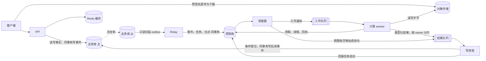
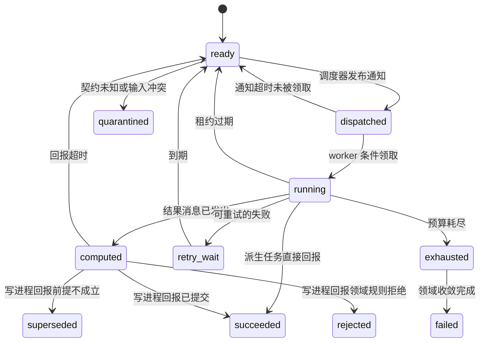
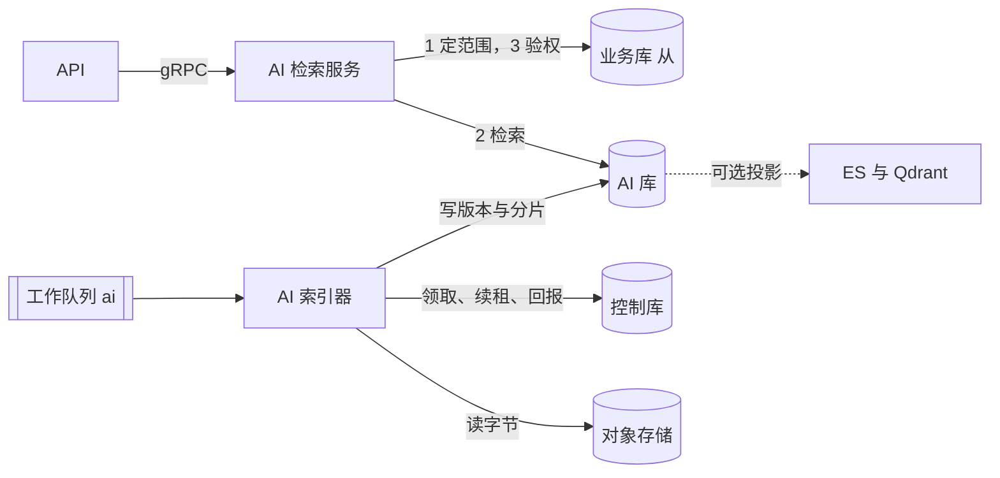
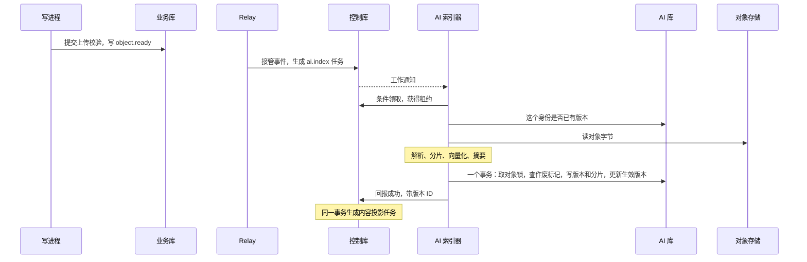

# BX YunPan 架构升级报告与计划书

日期：2026-11-10。状态：**方案，待评审，未实现**。本文没有改动任何代码、表结构或部署。

全文分三部分：第一部分是异步系统拆分，第二部分是 AI 数据独立，第三部分是部署优化。第三部分之后有一个补充部分，讲分片上传链路的优化，它独立于前三部分。前面的第 0 节给出结论、术语和总图，后面的第 4–6 节是分阶段计划、未决事项和参考资料。

## 0. 总览

### 0.1 结论

1. **业务库只存事实和事件。** 任务、租约、重试、投递状态这些执行过程数据，迁到独立的控制库。
2. **Relay 是异步系统的唯一输入。** 它只读业务库的 `outbox_events`，把事件和自己的读取位点在同一个事务里写进控制库。业务库不再保存投递状态，也不再被回写。
3. **Worker 只做计算，不写业务库。** 它们无状态、可水平扩容，输出是一条类型化的结果消息。
4. **写进程是异步系统写业务库的唯一入口。** 结果消息按 owner 分片，每个分片串行消费、批量提交，限流和背压集中在这里做。
5. **API 的简单写保持同步直写。** 两类写入的规则是：API 的写无条件生效，异步的写在提交时核对前提。
6. **AI 数据独立成库。** 索引器直接写 AI 库，检索拆成“业务库定范围、AI 库检索、业务库验权”三步。
7. **部署上做显式的读写分离和对象存储冷热分层。** 冷热分层第一版用 MinIO 内置能力。
8. **顺序是先测量和同库减写，再做逻辑拆分，最后做物理拆分。** 逻辑拆分做完后，物理拆分主要是换连接串和迁数据。

### 0.2 证据范围

- 带路径和行号的陈述是本次读码核实的。基线是提交 `74cff07`。
- **没有任何运行态数据。** 没有采集过 `pg_stat_*`、WAL、锁等待或队列指标。文中关于压力和收益的判断都是读码推断，第 4 节的 P0 阶段负责补上测量。
- 外部资料凭记忆引用。本次会话里联网搜索和网页抓取都失败了，第 6 节列出的资料没有重新核对，其中涉及具体版本行为的地方在正文里单独标了“需验证”。
- 标有【补充】的条目是讨论中没有提到、由我补充的内容。

### 0.3 与已有设计文档的关系

仓库里有一份 `docs/ASYNC_CONTROL_PLANE_DESIGN_2026-11-12.md`（已随提交 `74cff07` 入库，文档自述状态是待评审、未实现）。它是不是你的基线，我问过两次，还没有得到确认。本方案和它的主干一致：业务事实留业务库、执行控制迁控制库、控制库持有租约和重试的权威。下表列出不同之处。

| 议题 | 设计文档 | 本方案 |
|---|---|---|
| 谁写业务库 | worker 的业务 handler 直接写（§4） | 只有写进程写，worker 不持有业务库写凭据 |
| 事件交接 | 业务库 handoff 表、MQ 入口、控制库回接受回执（§8） | relay 直接读 outbox，位点存控制库，没有回执 |
| 存储操作租约 | 放到 P5 再迁（§10.4） | 和写进程同时迁 |
| 业务协调命令 | 独立的业务命令应用器（§9.3） | 并入写进程 |
| AI 数据 | 明确不迁（§1） | 独立成库 |
| 读写分离、冷热分层 | 未涉及 | 第三部分 |
| Redis 进度与准入 | §12 | 不在第一版范围内 |

设计文档里关于身份、摘要、灾备对账的细节（§6、§16）本方案没有重写，实施时可以直接沿用。

### 0.4 术语

| 术语 | 含义 |
|---|---|
| 事实 | 丢了就无法重算的数据，或者有其他不变量依赖它的数据。例：目录、文件条目、配额、引用计数 |
| 晚到的事实 | 由异步流程写入的事实。例：上传校验通过后创建的文件条目。它和 API 写的事实共用同一批不变量 |
| 派生数据 | 可以由事实加对象字节重新算出、且没有其他不变量依赖它的数据。例：缩略图、AI 分片和向量、搜索投影 |
| 业务库 | 存放事实和事件的 PostgreSQL，下文图中记作 BIZ-PG |
| 控制库 | 存放异步执行状态的独立 PostgreSQL，记作 CTRL-PG |
| AI 库 | 存放 AI 派生数据的独立 PostgreSQL（带 pgvector），记作 AI-PG |
| Relay | 把业务库的事件交给控制库的进程 |
| 计算 worker | 执行任务的无状态进程，只读输入、调用外部服务、读写对象字节，不写业务库 |
| 写进程 | 消费结果消息、在业务库里执行条件提交的进程。建议角色名 `committer` |
| 操作身份 | 一个业务效果的稳定标识，重试和重投时不变，用来去重。例：上传会话 ID |
| 前提 | worker 计算时依据的事实。写进程提交前要核对它是否仍然成立。例：会话仍处于校验中 |
| owner | 资源所属的用户 ID，是结果消息的分片键 |

### 0.5 目标拓扑



AI 支路单独画在第二部分。各存储的职责如下。

| 存储 | 存什么 | 谁写 |
|---|---|---|
| 业务库 | 事实、事件、量小的派生记录（缩略图记录） | API、写进程 |
| 控制库 | 接管的事件、任务、租约、重试、调度、relay 位点 | Relay、调度器、worker（只写执行状态）、写进程（回报任务结论） |
| AI 库 | AI 文档版本、分片、向量、作废标记、搜索投影 | AI 索引器、搜索投影器 |
| 对象存储 | 对象字节、缩略图、大结果的暂存 | 浏览器直传、worker |
| Redis | 读缓存、限流 | API |

---

## 第一部分 异步系统拆分

### 1.1 现状与问题

| 事实 | 位置 |
|---|---|
| 所有进程共用一套连接池，只有一个主库地址 | `backend/internal/platform/dependencies/dependencies.go:80-83` |
| 业务事务里除了写事件，还按路由表给每个目的地写一行投递记录；每个目的地先查一次再插入 | `backend/internal/outbox/outbox.go:332-363` |
| Dispatcher 单 leader，每批默认 20 条 | `backend/internal/platform/config/config.go:354-358` |
| 领取时逐行更新投递状态 | `backend/internal/outbox/dispatcher.go:498-499` |
| 逐条发布并等待确认，发布器用一个闸门串行化 | `backend/internal/taskqueue/taskqueue.go:73`、`:245-255` |
| 每条发布成功后单独开事务回写：更新投递行、统计未完成数、必要时更新事件行 | `backend/internal/outbox/dispatcher.go:555-563`、`:666-707` |
| 每次插入投递记录都触发语句级 NOTIFY | `backend/migrations/000025_outbox_notifications.up.sql` |
| 每个任务执行时在业务库领取、续租、写终态；默认每 15 秒续租一次 | `Store.claim`、`Store.renew`、`Store.finish`，`backend/internal/taskqueue/execution.go` |
| 存储操作自带一套租约和 12 次尝试上限 | `backend/internal/storageops/operations.go:34` |
| `file.created`、`share.imported` 各生成一个 maintenance 任务，handler 只打一行日志 | `backend/internal/bootstrap/roles.go:196-204`、`worker.go:207-208` |
| 事件、投递、执行、结果、失败、恢复、消费这几类账本表，Go 代码里没有任何删除语句 | 在 `internal` 和 `cmd` 下搜索删除语句，无结果 |
| `outbox_events.aggregate_id` 没有索引，但恢复和对账都按它查 | 索引清单见 `backend/migrations/`；查询见 `outbox.go:171-172`、`execution_recovery.go:50`、`upload/retry_cleanup.go:108-110` |
| “已发布但无回执”的部分索引覆盖全部已发布行，而已发布是终态 | `backend/migrations/000024_task_execution_leases.up.sql:17` |
| 业务状态判断直接关联任务账本表 | `upload/retry_cleanup.go:107-112`、`outbox/execution_recovery.go:88-136`、`recovery/reconciler.go` |

按读码估算，一个事件的一个目的地，从写入到执行完成，在业务库里大约产生 7 次行写入和 4 次以上的提交，另加执行期间每 15 秒一次的续租。这些写入都和业务事务抢同一个主库。**这个数字是读码推断，没有实测。**

由此带来四个问题：

- **写放大**：一次业务动作的异步控制写入多于业务写入本身。
- **耦合**：业务代码通过 JOIN 读任务账本来决定是否释放配额，异步系统无法单独演进。
- **竞争**：多个 worker 并发提交时，在同一个用户的配额行和版本号行上排队，还会挡住这个用户的 API 操作（见 1.5）。
- **只增不减**：账本表没有清理路径，扫描成本随历史增长。

### 1.2 目标与边界

目标：

- 业务库的写入只剩业务动作本身，加每个事件一行。
- 异步系统可以独立部署、独立扩容、独立故障。控制库或消息队列不可用时，API 仍能提交业务事务。
- 同一个用户的异步提交不互相等锁，也尽量不和这个用户的 API 操作等同一行。
- 任何一步重复、乱序、崩溃，最终状态都收敛到同一个结果。

不做的事：

- 不做跨库分布式事务，不宣称跨 PG、MQ、对象存储的全局恰好一次。
- 不引入通用 Saga 框架。上传链路本身已经是一个带补偿的编排（预留配额、建分片、校验、提交；补偿是释放配额、中止分片、删暂存），再套一层框架会让“这次上传走到哪了”有两个事实源。
- 不把重命名、移动、删除这类简单写改成异步。
- 不更换 RabbitMQ。

### 1.3 业务库的定义与数据归属

业务库是系统里唯一的事实源，只放三样东西：

1. 事实，包括晚到的事实。
2. 事件，即 `outbox_events`。
3. 量小、和事实强绑定的派生记录。目前只有缩略图记录一种。

不放：执行过程状态（租约、心跳、重试次数、投递状态），以及可重建的大体量派生数据（分片、向量、搜索投影）。

判断一份数据是不是派生数据，要同时满足两条：丢了能由事实加对象字节重算；没有别的不变量依赖它。上传校验后创建的文件条目不满足这两条：它重算不出来，而且和 API 抢同一把文件名锁（`backend/internal/upload/service.go:172-173` 与 `:547-548`）。所以它是晚到的事实，必须留在业务库。

表级归属如下。

| 表 | 类别 | 去向 | 写入方 |
|---|---|---|---|
| `users`、`refresh_sessions` | 事实 | 业务库 | API |
| 配额计数（从 `users` 拆出，见 1.5） | 事实 | 业务库 | API；写进程只在失败释放时写 |
| `folders`、`shares`、`share_imports` | 事实 | 业务库 | API |
| `file_entries` | 事实 | 业务库 | API（改名、移动、删除、秒传）；写进程（校验后创建） |
| `file_objects` | 事实 | 业务库 | API（引用增减）；写进程（创建、状态迁移） |
| `upload_sessions`、`upload_parts` | 事实 | 业务库 | API（创建、确认分片、完成、中止）；写进程（状态推进） |
| `owner_content_epochs` | 加速用的版本号 | 业务库，拆成两行（见 1.5） | API 一行，写进程一行 |
| `storage_operations` | 事实（意图与结果） | 业务库保留意图和结果；租约列迁到控制库 | API 和写进程登记意图，写进程写结果 |
| `async_tasks` | 事实（用户可见的作业） | 业务库 | API 创建，写进程更新终态 |
| `object_variants` | 派生（量小） | 业务库 | 写进程，只插入 |
| `outbox_events` | 事件 | 业务库 | API、写进程，都在业务事务内 |
| `outbox_deliveries`、`task_executions`、`task_results`、`task_failures`、`outbox_recoveries` | 执行状态 | 控制库，合并进任务模型 | Relay、调度器、worker |
| `ai_documents`、`ai_document_versions`、`ai_chunks` | 派生 | AI 库 | AI 索引器 |
| `search_*` 四张表、`event_consumptions` | 派生及其消费屏障 | AI 库 | 搜索投影器 |
| `workflow_*`、`command_deduplications` | 未接入任何进程 | 需要决定去留，建议删除 | — |
| `legacy_task_imports` | 迁移遗留 | 归档后删除 | — |

`event_consumptions` 要跟着搜索投影走。它的作用是在同一个事务里既写投影又记“这个事件我处理过了”（`backend/internal/search/projector.go:160`），屏障和效果必须在同一个库。

### 1.4 写入语义：API 写与写进程写

业务库有两类写入者，各自的语义如下。

**API 写**

- 在请求内同步完成，一个事务，只碰常数行，当场把成功或冲突返回给用户。
- 无条件生效：不等待、也不检查后台正在跑什么任务。
- 并发控制用两套现成的机制：
  - 改已有的东西靠行版本号。客户端把看到的版本放在 `If-Match` 头里（`backend/internal/drive/file_http.go:141`），事务里先锁行再比对，对不上返回冲突（`backend/internal/drive/service.go:718-727`）。
  - 新建东西靠幂等键。按“用户加幂等键”加事务级锁，再查这个键是否用过（`backend/internal/upload/service.go:147-166`）。
- 只要有派生数据或后续步骤依赖这次修改，就在同一个事务里写事件。

**写进程写**

- 输入是结果消息，来自计算 worker，或者来自控制库的协调命令。
- 每个提交函数的步骤固定为四步：
  1. 锁住要修改的聚合行。
  2. 去重：这个操作身份是否已经提交过。提交过就直接返回，不重复生效。
  3. 核对前提：worker 计算时依据的事实现在是否仍然成立。
  4. 写入，并在同一个事务里写后续事件。
- 事务提交后，把任务结论回报给控制库（见 1.9）。
- 结论只有四种：已提交、早已提交过、前提不成立（作废）、领域规则拒绝（例如重名，转入失败分支）。

**规则：API 的写无条件，异步的写有条件。** API 的写代表用户最新的意图。异步的结果是基于过去某个时刻的事实算出来的，所以由它负责在提交时确认那个事实还在。

两类写入相遇只有三种情况：

| 情况 | 例子 | 处理 |
|---|---|---|
| API 改的东西，派生数据不依赖 | 建索引期间重命名、移动、删除文件条目 | 不处理。索引挂在对象上，能不能搜到由检索时现查文件条目决定 |
| API 的写抽掉了异步工作的前提 | 对象已被回收；上传期间目标目录被删；同名文件先出现 | 写进程核对前提失败，结果作废，并登记清理 |
| 派生数据复制了 API 会改的内容 | 文件名搜索投影里存了名字和目录 | API 每次写都发带版本号的事件，投影只接受更新的版本，删除发墓碑 |

**前提不能用整行版本号。** 一行的版本号会因为和这次异步工作无关的事情变化。例如缩略图 worker 读到对象版本 5，生成期间另一个用户秒传了同一份内容，引用计数加一，版本变成 6（`backend/internal/objectstore/service.go:366-368`）。如果核对“版本还是 5”，这个结果会被拒绝，但文件内容没变，缩略图完全有效；热门内容上这个任务可能永远提交不了。所以每类任务要声明自己真正依赖的最小前提。

| 任务 | 操作身份 | 前提 | 前提不成立时 |
|---|---|---|---|
| 建分片上传 | 存储操作 ID | 会话处于 `initializing` | 作废，登记中止分片 |
| 完成分片上传 | 存储操作 ID | 会话处于 `completing` | 作废 |
| 上传校验提交 | 上传会话 ID | 会话处于 `verifying`；目标目录存在；没有同名文件 | 会话已完成则按已提交处理；重名或目录不存在则走失败分支，释放配额并清理 |
| 缩略图 | 对象 ID、变体类型、流水线版本 | 对象为 `ready` 且对象 key 未变 | 作废，删除已写入的缩略图字节 |
| 对象回收 | 存储操作 ID | 对象为 `deleting`，引用为零，没有活跃条目 | 取消回收 |
| AI 索引回报 | 对象 ID、索引版本 ID | 无 | — |
| 冷热迁移（第三部分） | 对象 ID、目标层 | 对象为 `ready`，key 未变，仍在源层 | 作废，删除目标层副本 |

这些前提和现有代码一致：缩略图核对对象状态和 key（`backend/internal/media/variant_write.go:63-64`），校验提交核对会话状态（`backend/internal/upload/service.go:541`），已完成的会话直接返回（`:538-540`）。本方案是把它们从分散在各 handler 里的写法，统一成提交函数的固定结构。

提交函数和计算函数的接口示意：

```go
// 计算步：在 worker 里执行，不持有业务库写连接
type Compute[I, R any] func(ctx context.Context, in I) (R, error)

// 提交步：在写进程里执行，tx 是业务库事务
type Commit[R any] func(ctx context.Context, tx *gorm.DB, r R) (Outcome, error)

type Outcome int // Committed、AlreadyDone、Superseded、Rejected
```

提交函数放在各自的领域包里（`upload`、`media`、`objectstore`），写进程只负责调度它们。写进程不是一个通用的行写入器。

### 1.5 降低竞争的表结构调整

**竞争在哪。** 一次上传校验提交要独占锁住三行：用户的配额行（`backend/internal/identity/service.go:230-235`）、用户的版本号行（`backend/internal/drive/service.go:656`）、对象行（`backend/internal/objectstore/service.go:366-368`）。前两行每个用户只有一行，而且 API 也在写：发起上传改配额行，重命名、移动、删除都推进版本号行。一个用户拖一个文件夹上传 300 个文件时，300 个校验提交在这两行上排成一队，这个用户自己点的重命名也排在队里。

分三层处理。第一层靠写进程（见 1.9），第二、三层是表结构调整，不依赖写进程，可以先做。

**第一层：同一个用户的异步提交交给同一个写进程。** 结果消息按 owner 分片，一个分片只有一个消费者。同一批里同一个用户的 N 条提交合并成一个事务：版本号只推进一次，配额只更新一次。

**第二层：一行只让一方写。**

- **版本号拆成两行。** 行锁的粒度是行，同一行里分两列没有用，所以要拆行。一行只由 API 推进（重命名、移动、删除、秒传），另一行只由写进程推进（异步入库）。缓存 key 从“内容版本加权限版本”（`backend/internal/drive/service.go:227`、`:376`）变成再加一个入库版本。任何一边变化 key 都会变，缓存照样失效。代价是每次读缓存前多查一行。
- **配额计数从 `users` 行拆出。** 新建一张窄表，只放额度和计数，不再和账号资料的更新互相等锁。
- **配额只维护“已占用”一个数。** 已占用等于已用加预留。发起上传时预留量等于文件大小（`backend/internal/upload/service.go:241`），校验提交时把这部分从预留转到已用（`:585`），两者之和不变。判断能不能再传只看这个和（`backend/internal/identity/service.go:214`）。所以如果只存已占用，正常的校验提交就完全不用碰配额行，只有上传失败、过期、删除文件时才改。界面要分开显示“已用”和“上传中”时，上传中的量从活跃会话求和，已有索引 `idx_upload_sessions_active` 支持这个查询。

**第三层：派生表只插入，有就是做完了。**

- 行存在就代表做完，表里没有状态列、进行中的行或租约列。过程状态都在控制库。
- 写进程只做 `INSERT ... ON CONFLICT DO NOTHING`，不更新已有的行，因此不抢行锁，也不产生死元组。
- 读的时候按“来源 ID、类型、流水线版本”走索引点查，没有就跳过。

缩略图记录已经是这个形状（`backend/internal/media/variant_write.go:70`）。AI 的版本表还不是，见第二部分。

“没有”有三种含义：还没做、永久做不了、不需要做。读的一方都当作没有，没问题。但对账扫描看到“没有”会补发任务（`backend/internal/recovery/reconciler.go:192-200`），所以“试过了，做不了”必须有地方记着。本方案里它是控制库中按任务语义键保存的终态任务（见 1.7）。

【补充】**固定加锁顺序。** 写进程一个事务里会锁多行，API 事务也会锁其中一部分，顺序不一致会死锁。约定全局顺序：上传会话、对象内容锁、文件名锁、目录、文件条目、对象行、版本号行、配额行。批内同类行按 ID 排序后加锁。遇到死锁错误，整批重试。

### 1.6 事件投递：outbox 与 relay

**业务侧只写事件。** 业务事务里调 `outbox.AddTyped`，只插入一行 `outbox_events`，不再写逐目的地的投递记录。事件发给谁，由控制库在接管时决定。

这同时去掉了现在的一个隐患：事件是否写入取决于放在 `context` 里的开关，新入口忘了设就等于静默丢弃（`OUTBOX_V2_EVENTS_ENABLED`，默认关闭）。改成事件一律写入，订阅关系放在控制库，“这个事件没有订阅者”成为控制库里一个可见的合法状态。【补充】

**Relay 怎么知道哪些事件还没交接。** 有三种做法：

| 做法 | 读 | 对业务库的写 | 主要代价 |
|---|---|---|---|
| A 状态列加部分索引 | 在主库按“待交接”的部分索引批量领取 | 每个事件交接后更新一次 | 每个事件一次更新和一个死元组；relay 必须连主库 |
| B 只追加，按事务号水位读取 | 可以在从库读 | 没有 | 长时间不结束的写事务会拖住水位，交接延迟 |
| C 逻辑复制（CDC） | 不轮询，读 WAL | 没有 | 复制槽要运维，槽停滞会撑满磁盘，主从切换要专门处理 |

**推荐以 B 为终态，上线时可以先用 A 过渡。** B 的做法：

- `outbox_events` 只插入、不更新。每行多带两个值：一个自增序号，一个写入它的事务号。
- Relay 记住上次读到的位置（事务号加序号），每次读“事务号小于当前最老的在途事务号、且位置在上次之后”的行，按位置排序取一批。
- Relay 在控制库的**一个事务**里做三件事：把这批事件插入接管表（按事件 ID 去重），按订阅关系生成任务，推进自己的位点。

为什么不能简单地“读序号大于上次的行”：提交顺序不等于序号顺序。事务甲先拿到序号 10 但晚提交，事务乙拿到序号 11 先提交。Relay 读到 11 后把位点推到 11，甲提交的 10 就永远读不到了。加上“小于最老在途事务号”这个条件后，relay 只读那些不可能再有更早事务插队的行，位点之前不会再出现新行。

B 的收益：

- 业务库不再有任何由投递产生的更新，业务主库对投递的负担只剩每个事件一次插入。
- Relay 可以读从库，对主库的读压力为零。
- 不需要“控制库已接管”的回执链路，因为位点和接管记录在同一个事务里，要么都成功要么都没发生。
- 清理靠按天分区后直接删分区，不产生死元组。

B 的条件和风险：

- 任何长时间不结束的写事务（例如一次长迁移）都会拖住水位。要监控交接延迟，并设置空闲事务超时。
- 需验证：我记得 PostgreSQL 的 `pg_current_snapshot()`、`pg_snapshot_xmin()` 和 `xid8` 类型能满足这个用法，并且前两个函数能在从库上执行。实现前要在项目用的 PG 17 上，对主库和从库各验证一次。
- 从库上不能 `LISTEN`。Relay 改成短间隔自适应轮询从库（轮询从库不消耗主库资源），或者只留一个主库连接专门收通知。

示意 SQL，未执行过：

```sql
-- 业务库：事件表增加位置信息
ALTER TABLE outbox_events
  ADD COLUMN seq bigint GENERATED ALWAYS AS IDENTITY,
  ADD COLUMN xid xid8 NOT NULL DEFAULT pg_current_xact_id();

-- relay 读取一批
SELECT seq, xid, id, event_type, aggregate_id, payload
FROM outbox_events
WHERE xid < pg_snapshot_xmin(pg_current_snapshot())
  AND (xid, seq) > ($1, $2)
ORDER BY xid, seq
LIMIT $3;
```

**批处理策略。**

- 每批同时受三个上限约束：行数、总字节数、最长等待时间。起步值建议 200 行、1 MiB、20 ms，按测量调整。
- 控制库一侧整批用多行插入，一批一个事务、一次提交。
- 控制库慢时，relay 减小批量并退避，不在内存里堆积。

**Relay 的多副本。** 只需要一个在工作，其余待命。用控制库里的一行租约选主，位点的推进带上租约令牌做条件更新。即使短暂出现两个 relay，接管表的事件 ID 主键和位点的条件更新也能保证不重不漏。这样 relay 不再依赖 Redis 选主。【补充】

【补充】**去掉 NOTIFY 触发器。** 现在每个写投递记录的业务事务都带一次 NOTIFY。我记得有公开文章报告过，带通知的事务在提交时要取一把全局锁，高并发下会让提交串行化。本项目没有压测过这一点。改用 B 之后轮询从库即可，这个触发器可以删除。

### 1.7 控制库：任务模型与状态机

**表。** 下面是逻辑模型，不是可直接执行的迁移。

| 表 | 关键字段 | 说明 |
|---|---|---|
| `relay_positions` | 来源、事务号、序号、租约令牌 | Relay 的位点和选主 |
| `event_inbox` | 事件 ID（主键）、类型、聚合 ID、载荷、订阅计划版本、接管时间 | 按事件 ID 去重，按时间分区 |
| `tasks` | 任务 ID（主键）、语义键（唯一）、类型、队列、分片键、输入摘要、载荷或载荷指针、状态、执行序号、租约令牌和到期时间、失败次数和上限、下次运行时间、截止时间、结果引用、状态版本 | 一行同时是任务状态和待派发记录 |
| `task_attempts` | 任务 ID、执行序号、起止时间、结论、错误分类 | 只追加，按时间分区。心跳不写这张表 |
| `task_sources` | 事件 ID、任务 ID | 记录哪些事件触发了这个任务 |

**语义键。** 由任务类型和操作身份拼成，例如 `thumbnail:{对象ID}:{对象key的哈希}:thumbnail-v1`。相同语义键只对应一个任务。

现在的任务 ID 是“事件 ID 加目的地”（`backend/internal/outbox/dispatcher.go:540`），换一个恢复事件就是一个新任务、一份新的重试预算。为了限制这一点，现有代码用恢复族和上限 `MaxRecoveryEvents` 来兜（`backend/internal/recovery/reconciler.go:424-470`）。改用语义键后，恢复事件直接复用原任务，预算天然不重置，终态失败的任务就是“试过了，做不了”的记录。

**状态机。**



- **任务完成有两条路径，由任务类型声明。**
  - 要改业务库的任务：worker 发出结果后进入 `computed`，写进程提交后回报，任务进入终态。
  - 只写派生库的任务（AI 索引、搜索投影）：worker 在派生库提交后，直接向控制库回报成功。
- **写进程的回报无条件接受。** 业务库已经提交是事实，不管此刻租约在谁手里，任务都进入终态。另一个执行者晚到的结果会被写进程去重。
- **`superseded` 和 `rejected` 都是终态，但不算失败**，不消耗重试预算，也不触发告警。
- **`exhausted` 之后要做领域收敛。** 例如校验任务耗尽预算，上传会话还卡在校验中、占着预留配额。调度器向结果队列发一条协调命令，写进程执行该任务类型的耗尽处理（把会话置为失败、释放配额、登记清理），再回报，任务进入 `failed`。没有业务状态的任务直接进入 `failed`。
- 每次状态转换都带期望状态和状态版本做条件更新。

**去重分四层，各管一段。**

| 层 | 防什么 | 机制 |
|---|---|---|
| 接管 | 同一事件被重复交接 | `event_inbox` 的事件 ID 主键 |
| 任务 | 不同事件请求同一项工作 | `tasks` 的语义键唯一约束 |
| 提交 | 同一结果被重复送达 | 写进程在业务库里按操作身份去重 |
| 外部资源 | 旧执行者覆盖新结果 | 确定性 key、世代、条件写 |

**重试。**

- 重试由控制库调度：失败后写 `retry_wait` 和下次运行时间，到期回到 `ready`。它取代 RabbitMQ 的 TTL 重试队列（`backend/internal/taskqueue/taskqueue.go:82`）。切换时逐个队列排空旧的重试队列，两套机制不能同时给同一个任务计数。
- 预算分开记：发布失败不计入；已知的执行失败计入失败次数；进程崩溃和依赖不可用计入基础设施重试，受总截止时间约束；前提不成立不算失败。
- 退避用指数加抖动。
- 契约未知、相同身份但输入不同、反复使 worker 崩溃的任务进入 `quarantined`，等人工处理。隔离不自动改动配额或删除文件。

**租约。**

- 控制库是任务租约的唯一权威。
- 续租按批执行。没有被返回的任务视为失租，worker 立即取消它的执行。

```sql
UPDATE tasks t
SET lease_until = clock_timestamp() + $1::interval
FROM (VALUES ($2::text, $3::int, $4::uuid) /* , ... */) AS v(task_id, run_seq, lease_token)
WHERE t.task_id = v.task_id AND t.run_seq = v.run_seq
  AND t.lease_token = v.lease_token
  AND t.state = 'running' AND t.lease_until > clock_timestamp()
RETURNING t.task_id;
```

- 租约时长至少是三倍心跳间隔，加上允许的数据库延迟和停止宽限。
- **存储操作的租约并入任务租约。** `storage_operations` 只保留意图、目标、结果和尝试预算。这件事必须和写进程一起做：worker 不再能写业务库，也就无法续租业务库里的那份租约。

**调度。**

- 调度器批量选出到期的 `ready` 任务（`FOR UPDATE SKIP LOCKED` 加部分索引），发布到工作队列，批量标记为 `dispatched`。发布使用有界的未确认窗口，不再逐条等确认。
- 工作队列里的消息只是通知。worker 收到后必须到控制库条件领取，领取不到（已被别人领走、已是终态）就直接确认消息。
- 派生任务成功时，控制库在同一个事务里按订阅关系生成后续任务。例如 AI 索引成功后生成内容投影任务。
- 【补充】**公平性。** 每个 owner 在每个队列里的在途任务数设上限，超出的留在 `ready`。一个用户上传一万个文件，不会占满所有 worker。

### 1.8 计算 worker

**定义。** 输入是任务载荷，必要时用只读凭据从业务从库补充。过程是读写对象字节、调用解析服务或模型。输出是一条结果消息。它没有业务库的写凭据。

这带来一个安全上的好处：缩略图解码和文档解析处理的是用户上传的不可信内容，这些进程被攻破也写不了业务库。

**读从库的规则。**【补充】worker 读的从库可能比事件落后。读不到某一行时要按“可重试”处理，不能当成“已删除”。更稳妥的做法是让事件载荷带够输入（对象位置、大小、类型、期望的 key），worker 不必再查库。读到旧数据没有关系，因为写进程提交时会在主库核对前提。

**结果消息的字段。**

| 字段 | 用途 |
|---|---|
| 任务 ID、执行序号 | 回报控制库；派生外部资源的确定性 key |
| 结果类型和版本 | 写进程据此选择提交函数 |
| 分片键 | 路由到结果队列的分片 |
| 操作身份 | 写进程去重 |
| 前提 | worker 计算时依据的事实 |
| 载荷或载荷指针 | 结果本身 |
| trace 上下文 | 沿用现有的 `_trace` 字段续接链路 |

**大结果不进消息队列。** 超过阈值的结果先写到对象存储的暂存前缀，消息里只带指针。暂存前缀配置过期规则作为兜底。

**现有 handler 的拆分。**

| 现在的 handler | 计算步（worker） | 提交步（写进程） |
|---|---|---|
| 建、完成、中止分片上传 | 调用对象存储 | 记录上传 ID，推进会话状态 |
| 上传校验 | ① 读对象算哈希；② 需要时把对象复制到正式位置 | ① 核对哈希，决定正式位置；② 最终提交：建对象和条目、加引用、完成会话、写事件 |
| 缩略图 | 解码、缩放、写到确定性 key | 核对对象仍有效，插入记录 |
| 对象回收 | 删除对象和缩略图的字节 | 复核引用为零，标记已删除，写事件 |
| 删除暂存对象 | 删除字节 | 标记操作成功（同质，可集合化） |
| AI 索引 | 解析、分片、向量化、写 AI 库 | 不经过写进程；用户发起的“重新处理”才需要写进程更新作业状态 |
| 搜索投影 | 写投影和外部后端 | 不经过写进程 |

上传校验现在是一个 handler 里数据库和 IO 交错（`backend/internal/upload/service.go:503-607`）：读会话、算哈希、事务里决定正式位置、复制、最终事务。拆开后是两个计算步和两个提交步。对象已经存在（内容重复）时，第一个提交步直接进入最终提交，省掉复制。

**外部副作用的幂等。** 缩略图现在的做法是先在业务库登记一个补偿操作，再上传（`backend/internal/media/variant_write.go:20-45`）。worker 不能写业务库之后改成：对象 key 由任务 ID 和执行序号确定性派生；某次执行失租或结果作废时，控制库知道这次执行的序号，由清理任务按 key 删除。

**分类和扩容。** 沿用现有按资源类型分队列的做法，各自设并发（`backend/internal/platform/config/config.go:326-333`）：`object` 是 IO 密集（要读完整个对象），`media` 是 CPU 密集，`upload` 是对象存储 API 调用，`ai` 受外部模型限速。扩容看“就绪任务里最老的那个等了多久”，不看队列长度。某一类 worker 全部宕机只影响那一类任务，任务留在控制库里等恢复。

### 1.9 写进程

**分片路由。**

- 结果队列分成 N 个分片队列。发布方计算分片键的哈希对 N 取模，直接路由到对应队列。
- 分片键由任务类型声明，取“竞争最激烈的那一行归谁”：上传链路的结果用 owner；缩略图和对象回收只碰对象行，用对象 ID。
- 每个分片队列是 quorum 队列，并设置为单一活跃消费者：多个写进程实例都可以订阅，但同一时刻只有一个在消费，它断开后自动切换到下一个。
- 另一种路由方式是 RabbitMQ 的一致性哈希交换机插件。项目目前只启用了管理和监控两个插件（`deploy/rabbitmq/enabled_plugins`），而发布方本来就是我们自己的代码，在发布方算哈希更简单，不多一个插件依赖。
- N 的起步值建议 32。这是起步值，没有测量依据。

为什么要按 owner 固定分片：如果同一个用户的三条结果被随机分给三个写进程，就是三个事务抢这个用户的那几行，和现在一样。固定分片保证一个用户的结果只有一个进程在处理，自己不会和自己抢；不同用户在不同分片，改的是不同的行，并行互不影响。

**正确性不依赖独占。** 单一活跃消费者只是为了减少锁竞争。一个失去连接的旧写进程可能还在提交事务，此时新的写进程已经开始处理同一条消息。这是安全的：提交函数按操作身份去重，并核对前提，重复执行不会重复生效。所以调整分片数时也不需要停机：先往新布局发布，写进程同时消费新旧两套队列，旧队列排空后下线，过渡期间最多是多一点锁等待。

**串行和批量。** 每个分片的处理循环：

```text
循环：
  从分片队列取消息，取满 64 条或等满 10 ms 为止
  按分片键分组
  对每个 owner 分组，开一个业务库事务：
      按固定顺序加锁
      对每条结果：建保存点 → 去重 → 核对前提 → 写入
          单条被领域规则拒绝：回滚到保存点，改走该类型的失败分支
      合并：入库版本号只推进一次；配额的增减合成一次更新
      写后续事件
      提交
  批量向控制库回报这批任务的结论
  逐条确认消息
```

批处理分两种：

- **按 owner 合并**：用于晚到的事实。同一用户的多条提交合成一个事务。不同用户不合进同一个事务，否则一个用户的冲突会回滚别人，锁也会持有更久。
- **按类型集合化**：用于同质的结果，例如标记暂存删除成功、插入缩略图记录。这类结果没有领域分支，可以跨用户用一条多行语句写入。

单条消息反复失败时，靠队列的投递次数上限转入隔离队列，同时把任务标记为 `quarantined`。失败的批次退回逐条处理来定位问题消息，不做无限的对半拆分重试。

**完成回报。** 写进程提交业务事务后，直接向控制库回报结论，再确认消息。三步之间任何一处崩溃，消息都会重投，写进程去重后补上后面的步骤。

另一种做法是把结论作为一个事件写进业务库的 outbox，由 relay 带回控制库。它和业务提交是原子的，写进程也不需要控制库的凭据，但每个结果要在业务库多写一行，完成状态还要等 relay 的延迟。本方案的目标是减少业务库的写入，所以选直接回报。

**独立扩容。** 写进程的实例数不超过分片数，加实例后各实例自动分摊分片。扩容依据是结果队列里最老消息的年龄和业务库的余量，和 worker 的扩容互不相干。

**故障隔离。**

| 故障 | 影响 | 恢复 |
|---|---|---|
| 某个写进程实例宕机 | 它持有的分片短暂停顿 | 其他实例接管分片，未确认的消息重投 |
| 写进程全部宕机 | 异步结果不落库；API 读写不受影响 | 结果留在队列里，任务停在 `computed`，恢复后继续 |
| 某类 worker 宕机 | 该类任务停止 | 任务留在控制库 |
| 控制库不可用 | 停止派发新任务；写进程能提交但不能回报，因此不确认消息 | 恢复后消息重投，去重后补回报 |
| 消息队列不可用 | 派发和结果传递停止 | 任务和事件分别留在控制库和业务库 |
| Relay 宕机 | 新事件不被接管 | 事件留在业务库，待命实例接管后从位点继续 |

上面所有情况下，API 的业务事务都能照常提交。

### 1.10 限流与背压

统一写入口带来一个硬上限：异步系统对业务主库的最大并发写入，等于写进程实例数乘以每实例的连接数。这个数由部署配置决定，不随 worker 数量变化。

积压放在控制库（`ready` 状态的任务），不放在消息队列里。队列里只有即将执行的通知和等待提交的结果，并设置长度上限，满了拒绝发布而不是丢弃旧消息。

| 位置 | 观测什么 | 超限时怎么办 |
|---|---|---|
| 写进程到业务库 | 连接池等待、提交延迟、主从复制延迟 | 减小批量和并发，结果留在队列里 |
| 结果队列 | 每个分片的深度和最老消息年龄 | 调度器减少派发会产生结果的任务 |
| 调度器到工作队列 | 各队列和各 owner 的在途任务数 | 任务留在控制库，保持 `ready` |
| Relay 到控制库 | 控制库事务延迟 | 减小批量，事件留在业务库 |
| API | 未被接管的事件数量和最老年龄 | 拒绝新发起的上传，已受理的继续完成 |

调节规则用高低水位加迟滞：连续几个采样窗口超过高水位就把速率减半，持续低于低水位才逐步恢复。压力信号缺失时按高压处理，不能在看不见指标时提速。

**优先级。** 结果队列分两级：事实类（校验提交、失败后释放配额）和后台类（缩略图、冷热迁移）。写进程按权重消费，业务库吃紧时先压后台类。续租和结论回报使用保留的连接，不和普通流量共用一个会被耗尽的池子。否则暂停调度会引发大面积失租和重复执行。

### 1.11 一致性保证与故障窗口

**不变量。**

| 编号 | 不变量 | 靠什么保证 |
|---|---|---|
| I1 | 业务修改和它产生的事件一起成功或一起失败 | 业务库本地事务 |
| I2 | 已提交的事件不会丢 | 事件行保留到 relay 位点越过它、且过了保留期 |
| I3 | 任务标记成功，当且仅当它的效果已经提交 | 写进程提交后才回报；派生任务在派生库提交后才回报 |
| I4 | 同一个效果不会生效两次 | 四层去重 |
| I5 | 基于过期认识的结果不会生效 | 提交时核对前提 |
| I6 | API 提交业务事务不依赖控制库和消息队列 | 依赖按角色装配，API 只连业务库和缓存 |
| I7 | 重投、恢复不会重置重试预算 | 语义键 |
| I8 | 队列、批次、未确认窗口都有上限 | 各级背压 |

系统提供的是至少一次投递，加上提交处的去重。不宣称恰好一次。

**故障窗口。**

| 崩溃点 | 结果 |
|---|---|
| API 事务提交后，relay 还没读到 | 事件在业务库，relay 从位点继续读 |
| Relay 读到了，控制库事务失败 | 位点没有推进，下次重读 |
| 调度器发布成功，标记 `dispatched` 失败 | 重新发布，worker 条件领取时只有一个成功 |
| Worker 算完，结果还没发出 | 租约过期，任务重派 |
| Worker 发出结果，还没标记 `computed` | 租约过期后重派，产生第二个结果，写进程按操作身份去重 |
| 写进程提交了业务事务，还没回报 | 消息重投，写进程发现已提交，补回报 |
| 写进程回报了，还没确认消息 | 消息重投，去重，重复回报被控制库忽略 |
| 派生任务在派生库提交了，还没回报 | 任务重派，worker 发现版本已存在，直接回报 |
| 控制库恢复到较早的时间点 | 从业务库 outbox 的保留窗口重新接管；重建出来的任务即使重跑，也被写进程去重 |
| 业务库主从切换丢了最近的提交 | 控制库里可能有业务库已不存在的事件，对应任务在提交时前提不成立，作废 |

【补充】最后一行说明了 relay 读**同步从库**的额外好处：relay 只能看到已经复制到从库的事件，被接管的事件至少在两个节点上，切换后不会出现“控制库有、业务库没有”的事件。

### 1.12 对账与恢复

分成两套，各扫各的库，不跨库关联。

**控制恢复**，只读写控制库：

- `dispatched` 超时没人领取：回到 `ready`。
- `running` 租约过期：回到 `ready`，或在预算耗尽时进入 `exhausted`。
- `retry_wait` 到期：回到 `ready`。
- `computed` 长时间没有回报：先告警；超过更长的阈值才重派，因为结果消息本身是持久的。

**业务对账**，读业务从库：

- 找出卡在中间态的业务行，例如长期停在校验中的会话、没有缩略图的图片对象。
- 通过 outbox 发“确保存在这项工作”的事件，沿用 `outbox.EnsureRecovery` 的确定性事件 ID 做法。
- 控制库按语义键处理：任务还在跑就忽略；已是终态失败就不重建；不存在才新建。

现有三处跨域关联的替换方式：

| 现在 | 之后 |
|---|---|
| 业务代码关联 `task_results` 判断校验任务是否已死，再释放配额（`upload/retry_cleanup.go:107-112`） | 控制库把任务置为 `exhausted`，发协调命令，由写进程执行失败分支 |
| 在同一把锁下查回执并重置投递（`outbox/execution_recovery.go:88-136`） | 控制库内部的恢复扫描 |
| 对账时在业务事务里检查任务是否活跃（`recovery/reconciler.go`） | 对账只发事件，是否新建由控制库的语义键决定 |

【补充】扫描器做成独立角色并选主。现在每个 maintenance 副本各跑一整套扫描（`backend/internal/bootstrap/roles.go:191-194`），副本越多重复扫描越多。

### 1.13 留存、清理与可观测性

【补充】这一节的内容讨论中没有涉及，但不做的话，新系统会重复现在“账本只增不减”的问题。

**留存。**

| 数据 | 清理方式 | 保留期的下限 |
|---|---|---|
| 业务库 `outbox_events` | 按天分区，整分区删除 | 长于控制库的备份恢复窗口，保证控制库丢数据后能重新接管 |
| 控制库 `event_inbox` | 按天分区 | 不短于业务库事件的保留期，否则重放会重复建任务 |
| 控制库终态任务 | 归档后删除 | 长于最长重试周期加人工重放窗口 |
| 控制库 `task_attempts` | 按天分区 | 按排障需要，例如 30 天 |
| 业务库里的操作身份 | 不删除 | 它们就是业务行本身（会话、条目、缩略图记录） |

删除详细日志和删除去重身份是两件事。可以先删掉大的载荷，保留紧凑的身份和结果引用。

**可观测性。**

| 指标 | 说明什么 |
|---|---|
| Relay 交接延迟（最新事件与位点之差） | 事件多久被异步系统看到 |
| 各队列各状态的任务数和最老年龄 | 积压在哪一步 |
| 结果队列每分片的深度和最老年龄 | 写进程是否跟得上，有没有热点分片 |
| 写进程的批大小、提交延迟、每批合并掉的更新数 | 批处理是否生效 |
| 各类型的作废率 | 作废率高说明在白算，要么派发太早，要么前提定得太粗 |
| 去重命中率 | 重复投递的规模 |
| 失租次数 | 租约参数是否合适 |

另外保留一条按上传会话 ID 查全链路的途径：任务表带上关联 ID，配合已有的 trace 续接，能回答“这次上传走到哪了”。

### 1.14 测试策略

【补充】

- **提交函数的性质测试。** 提交函数是纯数据库函数，可以脱离消息队列单测。对每个提交函数，随机生成“API 写、结果提交、重复结果、乱序结果”的交错序列，断言最终状态和不变量（配额不为负、引用计数等于活跃条目数、同名唯一）。这是这套设计最重要的一组测试。
- **故障注入。** 对 1.11 的故障窗口表逐行注入，断言最终收敛。
- **回归基础。** 现有的 `taskqueue/hardening_test.go`、`outbox/execution_recovery_test.go`、`upload/retry_cleanup_test.go` 和并发测试作为起点。双库和写进程的测试是新增的，不能用同库测试通过来代替。
- **容量测试。** 相同输入速率下对比新旧路径的业务库写入量、锁等待和端到端延迟。先验证正确性，再测稳定区间。

### 1.15 端到端示例：一次分片上传

1. **API** 发起上传：一个事务里预留配额、建会话（`initializing`）、登记“建分片上传”的意图、写事件。返回。
2. **Relay** 接管事件，控制库生成任务，语义键是存储操作 ID。
3. **Worker** 调对象存储建分片上传，发结果（含上传 ID）。**写进程**核对会话仍是 `initializing`，记录上传 ID。
4. 客户端直传分片，**API** 确认分片。
5. **API** 完成上传：会话置为 `completing`，登记“完成分片上传”的意图，写事件。
6. **Worker** 调对象存储完成合并，发结果。**写进程**把会话置为 `verifying`，写“请求校验”事件。
7. **Worker** 读对象算哈希，发结果。**写进程**核对：不匹配走失败分支；匹配且对象已存在，直接到第 9 步；否则登记“复制到正式位置”的意图并写事件。
8. **Worker** 复制对象，发结果。
9. **写进程**最终提交：建对象、建文件条目、加引用、会话置为完成、推进入库版本号、写 `file.created` 和 `object.ready`、登记删除暂存。配额行不用动。
10. **控制库**按订阅扇出：缩略图、AI 索引、删除暂存。

和现在相比，每一步多一次“结果消息加写进程事务”的跳转，延迟是毫秒级，换来 worker 不写业务库和同一用户的提交可合并。

**API 需要等结果时。** 等待不改变提交路径：API 写完事件后，在限定时间内观察业务状态的变化（轮询该行，或订阅通知），超时就返回“处理中”，由客户端继续轮询。前端现在就是这样做的：发起上传和发起合并之后都轮询会话状态（`web/src/services/drive.js:82-90`、`:38-59`）。仓库里有 `backend/internal/eventstream` 包，但启动装配（`bootstrap`、`cmd`）里没有引用它，前端也没有使用服务端推送；这个包的内容本次没有读。

---

## 第二部分 AI 数据独立

### 2.1 现状

| 事实 | 位置 |
|---|---|
| `ai_documents`、`ai_document_versions` 对 `file_objects` 有级联外键，`ai_chunks` 对文档有级联外键 | `backend/migrations/000006_ai_search.up.sql:5`、`:19`；`000015_ai_document_versions.up.sql:6` |
| 向量列是 `vector(1024)`，带 HNSW 余弦索引 | `backend/migrations/000006_ai_search.up.sql:25`、`:33` |
| 建索引全程写业务库：开始时插入带租约的“构建中”版本，中途续租，结束时一个事务写分片、切换生效版本、写事件 | `backend/internal/ai/service.go:503-559`、`:231-295` |
| 用户发起的“重新处理”由 AI worker 直接改业务库里的作业状态 | `backend/internal/ai/service.go:425-446` |
| 对象回收的事务里直接删除 `ai_documents` | `backend/internal/objectstore/service.go:226` |
| 语义检索是一条 SQL，同时关联文件条目、对象和 AI 表，owner 和目录范围是预过滤 | `backend/internal/ai/search.go:343-353` |
| 外部后端路径：Qdrant 只按墓碑和索引代次过滤，全局取候选，再回 PG 验权 | `backend/internal/search/external.go:389-422`、`backend/internal/ai/search.go:381-487` |
| 对账用一条跨表 SQL 找“就绪但没有索引”的对象 | `backend/internal/recovery/reconciler.go:228-235` |
| 文件名搜索只查业务表 | `backend/internal/ai/search.go:317-328` |
| 部署镜像是 PG 17 加 pgvector 0.8.6 | `deploy/compose.yaml:217` |

AI 数据是派生数据，却和事实放在同一个库里、用外键绑在一起。搜索投影在这一点上已经做对了：迁移里明确写着它是可重建的投影，故意不建指向业务表的外键（`backend/migrations/000017_search_projections.up.sql:3-5`）。本部分把 AI 数据改成同样的待遇。

### 2.2 目标与数据模型

要分开看三样东西：**数据**搬到独立的 AI 库；**建索引**进入异步体系，由控制库调度；**检索**是同步的读，不进异步体系。



AI 库的表：

| 表 | 关键字段 | 写入方式 |
|---|---|---|
| `ai_index_versions` | 版本 ID、对象 ID、对象世代、流水线版本、模型版本、结论（已索引、不支持、内容为空）、摘要、标签、语言、解析器信息 | 只插入 |
| `ai_active_versions` | 对象 ID、流水线版本、模型版本（三者为主键）、版本 ID | 发布时写入或更新，是 AI 库里唯一会被更新的行 |
| `ai_chunks` | 版本 ID、序号、内容、位置信息、向量 | 只插入，随版本删除 |
| `ai_object_tombstones` | 对象 ID、对象世代、时间 | 对象回收后写入 |
| `search_*` 四张表、`event_consumptions` | 原样迁入 | 搜索投影器 |

设计要点：

- **有版本行就是处理过了。** 表里没有“构建中”，也没有租约列。过程状态在控制库。
- **永久做不了也写一行。** 不支持的类型、内容为空，写一行结论为“不支持”或“内容为空”的版本，不带分片。这样对账时“有没有版本行”就能回答“要不要再试”，不会反复给同一个对象补发任务。临时失败不写任何东西，由控制库重试。
- **对象世代。** 对象被回收后复活会换新的 key（`objectstore.RevivalKey`）。缩略图已经用对象 key 的哈希区分世代（`backend/internal/media/service.go:130`），AI 用同样的做法。作废标记按“对象 ID 加世代”记录，复活后的新世代不会被旧标记挡住。
- **生效版本按“对象、流水线版本、模型版本”记录**，为模型升级时新旧并存留出位置（见 2.6）。

### 2.3 建索引流程

任务的语义键是 `ai.index:{对象ID}:{世代}:{流水线版本}:{模型版本}`。用户发起的重新处理再加上作业 ID。



1. 写进程提交上传校验，同一事务写出 `object.ready`。事件载荷带上对象位置、类型、大小和世代。
2. Relay 接管，控制库生成缩略图和 AI 索引两个任务。
3. 索引器领取任务，租约记在控制库。
4. 先查 AI 库：这个身份是否已有版本。有就跳到第 7 步。
5. 读字节、解析、分片、向量化、生成摘要。期间的心跳只写控制库。
6. 在 AI 库的一个事务里：取这个对象的事务级锁，检查作废标记，插入版本和全部分片，更新生效版本。
7. 向控制库回报成功。控制库在同一事务里按订阅生成后续任务。
8. 如果是用户发起的重新处理，另发一条结果消息，由写进程更新业务库里的作业状态。

**和讨论时的一处不同。** 讨论时我说索引完成后经写进程在业务库写一个 `ai.indexed` 事件。写这份报告时我改成了直接回报控制库：普通索引不改业务库的任何一行，绕一圈只会给业务库多一次写入。

**索引器为什么直接写 AI 库，不经过写进程。**

- 写进程的价值是协调 API 和异步对同一批业务行的写入。AI 库没有 API 写入，也没有和配额、引用计数共享的不变量。
- 一篇文档几百个分片、每个带 1024 维向量（每个向量原始大小约 4 KB），结果是 MB 级，不适合走消息队列。
- 它是派生数据，按任务身份幂等写入就够了，控制库保证同一身份同时只有一个索引器在处理。

**崩溃时的收敛。**

- AI 库提交了、回报没发出：任务重派，索引器在第 4 步发现已做过，直接回报。
- 算到一半崩溃：租约在控制库过期，任务重派。AI 库里没有任何半成品，因为只在最后一步才写。

第二点是相对现在的改进。现在崩溃会在业务库留下一行“构建中”，要等租约过期后被下一个 worker 改成失败（`backend/internal/ai/service.go:524-533`）。

### 2.4 检索流程与范围过滤

用户在“财务”目录下搜“季度预算”：

1. **业务库**：查出这个用户在目录范围内能看到的对象 ID 集合。
2. **AI 库**：只在这些对象的分片里做向量检索和全文检索，融合后取候选。
3. **业务库**：把候选对象映射回用户的文件条目，取名字和目录；中途被删掉的丢弃。

第 1、3 步读业务从库。第 3 步可能把刚删除的文件多显示几百毫秒，打开时会得到 404。检索只在本人的文件范围内，不涉及别人撤销权限，这个窗口可以接受。

现在这三步是一条 SQL。拆开后多两次往返，换来 AI 库和业务库互不拖累。

**范围怎么传给 AI 库。**

| 做法 | 怎么做 | 适用 | 代价 |
|---|---|---|---|
| A 传对象集合 | 第 1 步的对象 ID 作为数组参数传给 AI 库 | 范围内对象数在几千以内 | 集合很大时参数大、执行计划差 |
| B AI 库维护成员关系 | AI 库多一张“用户、对象”的表，由文件事件投影维护 | 单个用户有几万以上对象 | 多一份要保持同步的投影 |
| C 把 owner 写进分片 | 不采用 | — | 对象是多人共享的，引用变化要改写全部分片 |

推荐先做 A，设一个阈值（例如 5000 个对象），超过时走 B。B 只用来提高召回，权限仍然以第 3 步为准。按目录搜索时范围通常很小，A 足够；全盘搜索且用户文件很多时才需要 B。

【补充】**带过滤的向量检索要分两种情况。**

- 范围内分片少（几千到几万）：按对象 ID 的普通索引取出分片，直接算距离排序。结果是精确的，不需要近似索引。
- 范围很大：用 HNSW 加过滤。近似索引是先找近邻再过滤，过滤掉太多时返回的结果会不足。我记得 pgvector 从 0.8.0 起提供迭代扫描，可以继续往后找直到凑够，项目镜像是 0.8.6，应该可用。**需验证。**

现在的 SQL 把这个选择交给了优化器（`backend/internal/ai/search.go:343-353`），同样有这个问题，只是数据量小时不显现。拆库时应该把两种路径写成显式的分支。

**降级。** AI 库不可用时，全文和语义检索返回不可用；文件名搜索只查业务表，不受影响；上传、下载、目录操作都不受影响。这是拆库带来的故障隔离。

### 2.5 删除、回收与对账

- **删除文件条目**：不动索引。索引挂在对象上，这个用户下次检索时在第 1 步就查不到这个对象了，立即生效；其他引用者照常能搜到。
- **对象回收**：回收事务提交后会发事件（现在已经在发，`backend/internal/objectstore/service.go:235-238`）。控制库据此生成清除任务，在 AI 库的一个事务里写作废标记，并删除这个对象的版本、分片和生效版本。原来的外键级联由这个任务代替。
- **发布和清除必须取同一把锁。**【补充】如果不加锁，会出现这样的并发：发布事务检查时还没有作废标记，于是插入版本；清除事务只删掉了它能看到的旧行；两边都提交后留下一个孤儿版本。所以两者都先取按对象 ID 的事务级锁。加锁之后，回收和发布谁先谁后，最终结果都一样：对象没了，索引也没了。

**对账。** 两个方向都用批量 ID 比对，不做跨库关联，低频运行：

| 方向 | 做法 | 修复 |
|---|---|---|
| 业务库有就绪对象，AI 库没有版本行 | 从业务从库分页取对象 ID，批量问 AI 库哪些没有 | 通过 outbox 发“确保索引”事件，控制库按语义键去重 |
| AI 库有版本，业务库对象已删除 | 从 AI 库分页取对象 ID，批量问业务从库哪些已删除 | 生成清除任务 |

它们代替现在的跨表扫描（`backend/internal/recovery/reconciler.go:228-235`）。

### 2.6 模型升级与重建

【补充】

- **新旧版本并存。** 换向量模型或升级流水线时，新组合下的版本在后台逐个建立，旧版本继续服务。检索只读当前配置的那个组合，现有 SQL 已经按模型版本和流水线版本过滤（`backend/internal/ai/search.go:352`）。等新组合的覆盖率达到要求，再切换配置，然后清理旧版本。不能逐个对象切换：查询向量和文档向量必须来自同一个模型。
- **维度变化。** 向量维度写死在迁移里。换成不同维度的模型需要新的分片表。AI 库独立后，这只是 AI 库自己的迁移，不影响业务库。
- **重建是全量读对象。** 每个对象都要读完整字节并调用模型。重建走低优先级队列并限速，受模型配额和对象存储读流量两方面约束。冷层的对象会被读回来，见 3.3。
- **向量缓存（可选）。** 按“分片文本的哈希加模型版本”缓存向量。流水线只做小改动时，大部分分片文本不变，可以不重复付费。
- **备份。** AI 库可以重建，但重建要花模型调用费，所以值得备份。恢复点目标可以比业务库宽松。

### 2.7 搜索投影与外部后端

- `search_*` 四张表、检查点和 `event_consumptions` 迁到 AI 库。投影器读事件、写 AI 库和外部后端，不经过写进程。
- 投影现在在同一个事务里读业务表、写投影行。拆库后读业务从库、写 AI 库。读到旧数据是安全的：投影行带文件版本和索引代次，只接受更新的版本（`ErrStaleProjection`，`backend/internal/search/index.go:25`）。
- 文件名投影依赖 API 每次修改都发事件。这些事件现在受 `OUTBOX_V2_EVENTS_ENABLED` 控制，默认关闭。新架构下事件一律写入（见 1.6）。
- ES 和 Qdrant 保持为可选投影。Qdrant 路径现在是全局取候选再验权，用户多了以后，一个用户的分片要和所有人竞争有限的候选名额。检索请求应带上 2.4 的对象范围做过滤。

### 2.8 取舍

| 得到 | 付出 |
|---|---|
| 业务库去掉体量最大的表和最重的读 | 失去外键级联，改用作废标记加对账 |
| AI 库可以单独调参、扩容、备份 | 检索多两次往返 |
| 索引器不写业务库，崩溃不留半成品 | 范围过滤要选策略，取决于租户规模 |
| AI 库故障不影响上传、下载和文件名搜索 | 两库之间是最终一致：对象回收后，AI 库里的数据会短暂残留，靠第 3 步验权保证搜不到 |

---

## 第三部分 部署优化

本部分按上云后的多机部署来写。

### 3.1 进程角色与权限

| 角色 | 实例数 | 业务库 | 控制库 | AI 库 | 消息队列 | 对象存储 |
|---|---|---|---|---|---|---|
| api | 多个 | 主库读写，从库只读 | 不连 | 不连 | 不连 | 只签发链接 |
| relay | 一主一备 | 从库只读 | 读写 | 不连 | 不连 | 不连 |
| 调度器（含控制恢复） | 一主一备 | 不连 | 读写 | 不连 | 发布 | 不连 |
| 计算 worker（按队列分组） | 多个 | 从库只读，可选 | 只写执行状态 | 不连 | 消费工作，发布结果 | 读写 |
| 写进程 | 不超过分片数 | 主库读写 | 回报结论 | 不连 | 消费结果 | 不连 |
| AI 索引器 | 多个 | 从库只读，可选 | 只写执行状态 | 读写 | 消费工作 | 只读 |
| 搜索投影器 | 多个 | 从库只读 | 只写执行状态 | 读写 | 消费工作 | 不连 |
| AI 检索服务 | 多个 | 从库只读 | 不连 | 只读 | 不连 | 不连 |
| 对账扫描器 | 一主一备 | 从库只读，主库只写事件 | 不连 | 只读 | 不连 | 不连 |
| parser-svc | 多个 | 不连 | 不连 | 不连 | 不连 | 不连 |

【补充】这张表同时是数据库账号的权限矩阵。每个角色用单独的账号，权限按表里的最小集合授予。能写业务主库的只有 api、写进程和对账扫描器（只写事件表）。

仍然是同一个 Go module、同一份代码，按角色启动不同的入口，和现在 `cmd/*` 加 `internal/bootstrap` 的做法一致。

### 3.2 读写分离

**拓扑。** 业务库一个主库，至少一个同步从库（用于高可用，relay 也读它），按需加异步只读从库。控制库写多读少，不做读写分离。AI 库读多，可以给检索服务加只读副本。

**代码。** 现在只有一个主库句柄（`backend/internal/platform/dependencies/dependencies.go:80-83`）。改成在依赖集合里提供显式的句柄：业务读写、业务只读、控制库、AI 库，由调用点自己选。不用自动路由：GORM 有按语句类型自动分流的插件，但这个项目里“哪些读必须读主库”是业务规则，交给自动分流会出错。新增的环境变量按项目约定改四处：`config.go`、`compose.yaml` 的锚点和两个 `.env` 模板。

**哪些读走哪里。**

| 读 | 走哪里 | 原因 |
|---|---|---|
| 写事务内的读 | 主库 | 同一事务 |
| 配额、权限、幂等键、状态机判断 | 主库 | 读到旧值会做出错误决定 |
| 写完立即返回给用户的读 | 主库 | 用户要看到自己刚做的修改 |
| 缓存校验用的版本号 | 主库 | 从库的旧版本号会让旧缓存被当成新的 |
| 目录列表的回源查询 | 从库，带条件（见下） | 最热的读 |
| Relay 扫描 outbox | 同步从库 | 见 1.6 |
| 对账扫描的候选查询 | 从库 | 修复决定会回主库加锁复核 |
| Worker 取输入 | 从库 | 提交时核对前提 |
| AI 检索的定范围和验权 | 从库 | 见 2.4 |
| 积压等指标采集 | 从库 | 不要求实时 |

【补充】**目录列表怎么安全地走从库。** 缓存 key 里带着版本号，版本号在主库读。缓存未命中时去从库查列表，但从库可能落后，查到的是旧列表，却被存到新版本号的 key 下。解决办法是在从库的同一个快照里，把版本号和列表一起读出来：从库上的版本号等于主库的，说明从库已经重放到了这个版本，列表可以用、可以缓存；不相等就回主库查。版本号在这里兼作新鲜度凭证，代价是从库上多读一行。这依赖一个前提：所有影响列表的修改都推进版本号。现有代码满足这一点，版本号拆成两行后两行都要比对。

**复制延迟。** 持续监控从库延迟。超过阈值的从库从只读池里摘除，读请求回到主库，所以主库要留出承接的余量。

**连接池。** 如果上云后使用事务级连接池：

- 项目里的 advisory lock 全部是事务级的（`backend/internal/platform/dblock/lock.go:6`、`backend/internal/taskqueue/execution.go:86`），和事务级连接池兼容。
- `LISTEN` 需要专用的直连（`backend/internal/outbox/notify.go:27`）。Relay 采用 1.6 的 B 做法后，这个监听可以去掉。
- 预处理语句在事务级连接池下的行为和连接池版本有关，需验证。

### 3.3 对象存储冷热分层

**现状。** MinIO 单节点、单卷、单桶，没有生命周期或分层配置（`deploy/compose.yaml:327-360`）。代码里没有记录对象的访问时间或次数。对象的位置是数据：`file_objects` 每行带 `bucket` 和 `object_key`，下载时现读这两个字段签发链接（`backend/internal/drive/files.go:125-131`）。

**第一版：MinIO 内置分层。** 热集群保留所有对象的元数据，把老对象的字节搬到一个远端存储，客户端仍然只和热集群打交道。

1. 管理员登记一个远端层。远端可以是另一套 MinIO 或云上的对象存储。
2. 在桶上加一条生命周期规则，例如“`objects/` 前缀下、大于 64 MB、创建满 90 天的对象，转到远端层”。
3. 后台扫描器把符合规则的对象的字节搬到远端，本地只留元数据。
4. 读取时 key 不变，热集群从远端取回再转发，只是更慢。
5. 在热集群删除对象，远端那份跟着被清掉。

项目的 key 布局正好能用前缀区分：正式对象在 `objects/sha256/…`（`backend/internal/upload/service.go:656`），缩略图在 `variants/…`（`backend/internal/media/service.go:130`），上传暂存在 `staging/…`。规则只套 `objects/` 前缀，缩略图留在热层，列表页不会碰冷层。应用代码零改动。

规则能按什么筛选：

| 能 | 不能 |
|---|---|
| 创建后的天数，或固定日期 | 最后访问时间 |
| key 前缀 | 访问次数 |
| 对象标签 | |
| 对象大小的上下限 | |

左列在项目依赖的客户端库里核对过（minio-go v7.2.1 的 `pkg/lifecycle/lifecycle.go`），规则结构里没有访问时间字段。

限制（凭记忆，需验证）：

- 远端的数据离开热集群就没法用。对应关系只存在热集群的元数据里，热集群的备份和高可用不能因为“数据都在冷层”而放松。
- 远端的桶和前缀必须由 MinIO 独占，不能手工改，也不能在远端另配过期规则。
- 远端必须能立即读，需要先解冻的归档类存储不支持。
- 没有自动回热。
- 冷读的流量经过热集群，远端在云上时有流出费用。

和这个项目的设计有两处不合：

- **秒传让“老”不等于“冷”。** 对象按内容去重。一年前有人传过的内容，今天另一个用户秒传了同一份并马上打开，这个对象按创建时间早已在冷层。按年龄的规则看不到这次新的引用。
- **重建索引会把冷层整个读一遍。** 见 2.6。

【补充】**顺手可以配的兜底规则。** 生命周期规则除了分层，还能做过期清理：

- 未完成的分片上传超过若干天自动中止（规则类型在客户端库里存在，`lifecycle.go:31-33`）。
- `staging/` 前缀和大结果暂存前缀下的对象超过若干天自动过期。

天数要远大于上传会话的有效期。正常清理仍由应用完成，这些规则只在应用侧漏掉时兜底。

**第二版（按需）：应用级分层。** 上面两处不合成为实际问题时再做。冷热迁移就是异步体系里的一种任务：

1. API 签发下载或预览链接时记一次访问，按天去重后合并到对象的最后访问日期，不在请求里更新对象行。
2. 对账扫描挑出“长期未访问、大于下限、状态就绪、在热层”的对象，发迁移事件。
3. Worker 把字节复制到冷层的确定性 key，校验大小和哈希，发结果。
4. 写进程核对前提后把位置指针改到冷层，登记延迟删除热层副本。

要守住四点：删除热副本的延迟长于下载链接的有效期；迁移和回收相遇时按前提核对作废；缩略图永远留在热层；层级跟着对象走，任何一个引用者访问都算热。

**一个要先定的部署选择。** 如果上云后直接用云厂商的对象存储、不再自建 MinIO，冷热分层就是厂商自己的生命周期功能，有的还提供按访问自动分层，MinIO 的内置分层用不上。项目用的是标准 S3 接口，两条路都走得通。

需验证：内置分层在目标 MinIO 版本上的实际行为；compose 用的是第三方构建的镜像（`coollabsio/minio`），社区版的维护状态我没能联网核实，它关系到要不要加深对 MinIO 专有功能的依赖。

### 3.4 高可用与容量

【补充】

**三个 PG 的要求不同。**

| 库 | 不可用时的影响 | 数据丢失时 | 建议 |
|---|---|---|---|
| 业务库 | API 不可用 | 事实丢失，无法重建 | 同步复制，自动切换，时间点恢复 |
| 控制库 | 异步停止推进，API 正常 | 从业务库 outbox 的保留窗口重新接管，代价是部分任务重跑 | 至少一个从库；备份窗口短于业务库事件保留期 |
| AI 库 | 全文和语义检索不可用，其余正常 | 可以重建，代价是模型调用费和时间 | 定期备份，恢复点目标可放宽 |

**消息队列。** 代码声明的是 quorum 队列（`backend/internal/taskqueue/taskqueue.go:194`），但 quorum 队列要至少三个节点才有容错。单节点上它只是一个持久队列。

**Redis。** Relay 选主迁到控制库之后，Redis 只剩缓存和限流。它不可用会影响读性能，不影响异步系统的正确性。

**连接预算。** 对每个 PG 实例分别校验：各角色的实例数乘以该角色的连接池上限，加上监控、迁移和故障处理的预留，不超过实例的连接上限。部署脚本在启动前检查，超预算就拒绝启动。写进程的连接数单独受 1.10 的硬上限约束。

**迁移。** 三个库各有自己的迁移目录和版本表。进程启动时不自动执行迁移。大表加索引用在线方式单独执行，不和事务性迁移混在一个脚本里。

---

## 补充部分 分片上传链路优化

这一部分独立于前三部分，改动集中在前端，后端只有两处小改。它不依赖控制库、写进程或 AI 库的任何工作，可以随时做。

### S.1 现状

| 事实 | 位置 |
|---|---|
| 前端对每个分片依次做三件事：请求一片的预签名、PUT 到对象存储、确认这一片；做完再处理下一片 | `web/src/services/drive.js:102-124` |
| 文件级并发是 4 个文件，每个文件内部串行；单次最多选 10 个文件 | `web/src/contexts/TransferContext.js:7-8` |
| 分片大小 10 MiB，超过 10000 片时翻倍 | `backend/internal/upload/service.go:1183-1187` |
| 分片链接有效期默认 15 分钟，上传会话 24 小时 | `backend/internal/platform/config/config.go:348-349` |
| 预签名接口一次最多 20 片，确认接口一次最多 100 片 | `backend/internal/upload/http.go:102`、`:132` |
| 预签名在 API 进程里本地计算，不访问对象存储 | `backend/internal/platform/storageurl/presigner.go:29-32`；区域有默认值，`config.go:320` |
| 预签名和确认的入口都会读会话并带出全部已确认分片；确认还要开一个事务更新会话行，结束后再读一次 | `backend/internal/upload/service.go:307`、`:326`、`:347-368` |
| 确认接口的响应是完整会话，含全部已确认分片 | `backend/internal/upload/http.go:208-226` |
| 合并用的 ETag 来自数据库里确认过的记录，合并前检查片数是否齐全 | `backend/internal/upload/service.go:1131-1135`、`:386` |
| 任何一片 PUT 失败，整个上传抛错 | `web/src/services/drive.js:117` |
| 响应里读不到 ETag 时，前端编造一个 `part-N` | `web/src/services/drive.js:118` |
| 发起上传后和发起合并后各轮询一次会话状态；后端建议间隔 1 秒和 2 秒，前端在状态不变时翻倍到最多 5 秒 | `web/src/services/drive.js:82-90`、`:38-59`；`backend/internal/upload/http.go:233-238`；`web/src/services/polling.js:19-28` |
| 选完文件立刻跳到传输页；目录页不订阅上传完成；回到文件页时重新挂载并加载根目录 | `web/src/pages/Drive.js:183-186`、`:80`、`:151-161` |
| `/api/` 和 `/storage/` 同源，Nginx 监听 80 端口，上传请求不缓冲 | `web/nginx-app.conf:21`、`:68-86` |

### S.2 问题

- **往返是串行的。** 每片两次 API 请求加一次 PUT，三者排队。1 GB 的文件是 103 片、206 次 API 请求。
- **每片的数据库开销随片数增长。** 预签名和确认都会带出全部已确认分片，分片越多，单次越重。
- **单片失败等于整个文件失败。** 没有分片级的重试。
- **编造的 ETag 会把错误推迟到合并。** 合并时提交给对象存储的是数据库里的 ETag。按 S3 的语义，ETag 不匹配会让合并失败。这一点需验证，但无论如何不应该编造。
- **完成后目录不更新。** 用户回到文件页时停在根目录，要自己点回上传的目录。

### S.3 方案

**1. 按窗口取链接。** 一次取接下来的一小批（起步 8 片，上限是接口的 20 片），剩余不足一半时取下一批。

不一次取全部，是因为链接会过期：10 GB 的文件有 1024 片，按 20 Mbps 的上行要传一个多小时，而链接只有 15 分钟。

**2. 用一个全局的并发预算。** 现在的限制是“同时 4 个文件”。改成“同时 N 个分片请求”，所有文件共用：

- 只有一个大文件时，它可以同时传多片。
- 文件很多时，每个文件占一个名额，和现在一样。
- 每个文件能占的名额设上限（起步 3），避免一个大文件占满全部名额。
- N 起步取 4。浏览器对同一个源的 HTTP/1.1 连接上限通常是 6 条，而上传和 API 同源，要给预签名、确认、轮询和目录列表留出连接。前面有 HTTP/2 的负载均衡时可以调大。

文件级并发和分片级并发不能相乘。4 个文件各开 4 片就是 16 个并发请求。

**3. 批量确认。** 每完成一批（起步 8 片）或每隔几秒，用一个请求确认。暂停、取消和出错退出之前，先把已完成但没确认的分片确认掉。

不用并发确认，是因为每次确认都要更新同一行会话（`backend/internal/upload/service.go:362`），并发的确认请求只会在这一行上排队。一个请求确认多片，就是一个事务、一次行更新。

代价是断点续传的粒度变粗：异常中断时，最多有一批分片要重传。

**4. 分片级的重试和错误分类。**

| 现象 | 处理 |
|---|---|
| 网络错误、超时、5xx | 退避后重试同一片，最多 3 次 |
| 403（链接过期或签名不符） | 重新取这一片的链接，再重试 |
| 其他 4xx | 这个文件失败 |
| 响应里读不到 ETag | 按失败处理并重试，不编造 |
| 用户取消 | 中止所有在途请求。现有的取消信号只传给了 PUT 和轮询请求（`web/src/services/drive.js:112`、`:57`），预签名和确认请求没有带，改造时一并带上 |

**5. 后端的两处小改。**

- 预签名和确认的入口改成只读会话行，不带分片列表。
- 确认接口增加精简响应，只返回状态和已确认片数。完整的已确认列表只在续传时需要，由查询会话的接口提供。

改完之后，每次预签名和确认的开销不再随片数增长。接口变化要同步修改 `backend/api/openapi.yaml`。

**6. 完成后刷新目录。**

- 上传完成时，如果目录页显示的正是目标目录，就重新加载。
- 从传输页回到文件页时，回到上传的目标目录，不回根目录。

多设备之间的同步不在这次范围内。以后要做的话，轻量的做法是页面可见时低频查询 1.5 节的版本号（主键点查），变了才重新拉列表；重一点的做法是接入服务端推送。

### S.4 效果估算

以 1 GB 的文件（103 片）为例，窗口和批量都取 8。下表是算术结果，不是实测。

| | 现在 | 之后 |
|---|---|---|
| 预签名请求 | 103 | 13 |
| 确认请求 | 103 | 13 |
| 确认事务（更新会话行的次数） | 103 | 13 |
| 分片 PUT | 103，串行 | 103，最多 4 个并发 |

并发 PUT 能提速多少取决于上行带宽。带宽已经跑满时，收益主要来自省掉串行的 API 往返。

### S.5 和其他部分的关系

- 确认是 API 的简单写，按 1.4 的划分留在 API。批量确认直接减少业务主库的写事务，性质上属于 P1 的同库减写。
- 合并之后的轮询读的是业务库里的会话状态。新架构下这个状态改由写进程更新，前端不需要变。
- 发起上传后等待会话变成 `created` 的那一段，新架构下多一次“结果消息加写进程提交”的跳转。这是毫秒级的延迟，而轮询间隔从 1 秒起，体验上没有差别。

### S.6 验证

- 前端已有 `web/src/services/drive.test.js` 和 `web/src/contexts/TransferContext.test.js`。新增用例：续传时跳过已确认分片；链接过期后重取；单片失败重试后成功；重试耗尽；读不到 ETag；取消时中止全部在途请求；暂停前先确认已完成的分片；并发数不超过全局预算。
- 运行方式：`CI=true npm test -- --runInBand src/services/drive.test.js`。
- 手工验证：限速网络下上传 1 GB 的文件，中途断网、刷新页面、暂停再继续，各做一遍。

---

## 4. 分阶段计划

| 阶段 | 内容 | 完成门槛 |
|---|---|---|
| P0 测量 | 在隔离环境里按表、按语句采集写入量、WAL、锁等待；跑一组固定负载（批量上传、目录混合读写、AI 索引）作为基线 | 有可重放的基线数据，能说出控制写入占业务库写入的比例 |
| P1 同库减写 | 见下 | 语义不变，现有测试通过，基线指标显示调用数下降 |
| P2 逻辑拆分 | 见下 | 行为不变；提交函数的性质测试通过；代码里不再有业务表和任务表的关联查询 |
| P3 控制库独立 | 控制库实例和迁移；接管表、任务表、relay（先 A 后 B）；调度器接管重试；存储操作租约迁移；逐队列切换 | 双库各自故障的注入测试通过；业务库里的任务账本表停止写入 |
| P4 写进程独立 | 结果队列分片；写进程角色；worker 去掉业务库写凭据；背压；协调命令 | worker 的数据库账号只有只读权限时全链路通过；同一用户批量上传的锁等待对比基线下降 |
| P5 AI 库独立 | AI 库实例和迁移；只插入的版本模型；索引器改写；检索拆三步；清除任务和对账 | 业务库里没有 `ai_*` 表；AI 库宕机时上传和文件名搜索正常 |
| P6 部署优化 | 读写分离；冷热分层；主从切换和不同时间点恢复的演练；容量测试 | 给出实测的吞吐、延迟、恢复时间和成本 |
| PU 上传链路优化 | 补充部分的内容：按窗口取链接、全局并发预算、批量确认、分片级重试、不编造 ETag、完成后刷新目录；后端精简确认响应、入口不加载分片列表 | S.6 的前端用例通过；1 GB 文件的预签名和确认请求数降到估算值附近 |

**P1 的内容。** 都是同库内的改动，不改变语义：

- 去掉 `file.created`、`share.imported` 发往 maintenance 队列的空转任务（`backend/internal/outbox/routes.go:57-60`）。路由、恢复和监控要一起改，队列里的旧消息靠兼容 handler 排空。
- 给账本表加清理任务。
- 给 `outbox_events(aggregate_id)` 加索引；缩小“已发布但无回执”那个部分索引的范围；把恢复族的前缀查询（`backend/internal/recovery/reconciler.go:424-427`）改成能用主键的范围条件。
- Dispatcher 改成批量：一条集合更新完成领取，发布使用有界的未确认窗口，批量回写。
- 兼容窗口结束后，停止同时维护事件行上的旧状态（`refreshLegacyEventStatus`）。

**P2 的内容。**

- 每个 handler 拆成计算函数和提交函数，先在进程内用函数调用连接。
- 提交函数补齐去重和前提核对，写性质测试。
- 定义类型化的结果契约，放在 `eventcontract` 旁边。
- 1.12 的三处跨域关联改成接口。
- 表结构调整：版本号拆行，配额拆表并改为已占用。
- 异步相关的表移到独立的 schema，用测试禁止跨 schema 关联。

**依赖关系。** P5 只依赖 P2，可以和 P3、P4 并行。P6 里的读写分离可以在任何时候做；relay 读从库依赖 P3。PU 不依赖其他任何阶段，可以最先做。P1 和 P2 做完后即使不再往下走，也已经拿到减写和解耦的大部分好处。

**切换和回滚。**

- 逐个队列切换。同一个队列在任一时刻只有一套机制拥有执行权和重试计数。
- 旧表先只读保留，观察期结束再删除。切换过程不删数据卷、不清空队列。
- P1、P2 可以按代码回滚。P3 之后回滚要把控制状态导回旧表，只把连接串切回去会丢失控制事实；出现旧模型无法表达的状态时只能向前修复。细节可沿用设计文档 §19。

## 5. 风险与未决事项

**风险。**

| 风险 | 应对 |
|---|---|
| 没有测量，各部分的收益都是推断 | P0 先行；每个阶段的门槛都包含对比基线 |
| Handler 拆步改动面大，容易引入回归 | 先在进程内拆分并保持行为不变，用性质测试覆盖交错和重复 |
| Relay 的 B 做法依赖几个 PG 行为，长事务会拖住水位 | 先用 A 上线；B 启用前在 PG 17 主从上验证，并监控交接延迟 |
| 热点分片：某个用户的结果量远大于其他人 | 监控每分片的最老消息年龄；分片布局可以在线切换；每 owner 的在途任务数有上限 |
| 提交函数集中了所有领域写入逻辑 | 放在各自的领域包里，写进程只做调度 |
| 任务状态和业务状态之间有短暂的不一致窗口 | 用户可见的状态只读业务库，不读控制库 |
| 运维面变大：三个 PG、更多进程角色 | 同一份代码按角色启动；阶段之间可以停留 |

**需要你决定的事。**

1. **设计文档的地位。** `docs/ASYNC_CONTROL_PLANE_DESIGN_2026-11-12.md` 是不是基线。是的话，0.3 的差异表就是对它的修订意见；不是的话，本文单独成立。
2. **租户规模。** 自己用、几个人用，还是按多租户设计。它决定 2.4 的范围过滤用哪种做法，也影响分片数。
3. **对象存储的部署形态。** 上云后继续自建 MinIO，还是直接用云厂商的对象存储。它决定 3.3 走哪条路。
4. **Relay 是否接受先 A 后 B。** 如果希望一步到位用 B，P3 之前要先做完 1.6 列出的验证。
5. **`internal/workflow` 的去留。** 它有状态机和表，但没有接进任何进程。本方案不用它，建议删除。

**不需要现在决定、由测量确定的参数。** 分片数、批大小和等待时间、租约时长、各级水位。文中给出的都是起步值。

## 6. 参考

### 6.1 项目内的关键位置

| 主题 | 位置 |
|---|---|
| 事件写入和逐目的地投递 | `backend/internal/outbox/outbox.go`、`routes.go` |
| Dispatcher | `backend/internal/outbox/dispatcher.go` |
| 任务执行账本 | `backend/internal/taskqueue/store.go`、`execution.go` |
| 队列拓扑和发布 | `backend/internal/taskqueue/taskqueue.go` |
| 对账 | `backend/internal/recovery/reconciler.go`、`backend/internal/outbox/execution_recovery.go` |
| 存储操作 | `backend/internal/storageops/operations.go` |
| 上传链路 | `backend/internal/upload/service.go`、`retry_cleanup.go`、`http.go` |
| 前端上传 | `web/src/services/drive.js`、`polling.js`、`web/src/contexts/TransferContext.js`、`web/src/pages/Drive.js`、`web/nginx-app.conf` |
| 目录和文件的 API 写 | `backend/internal/drive/service.go`、`files.go`、`file_http.go` |
| 配额 | `backend/internal/identity/service.go:212-246` |
| 版本号 | `backend/internal/ownerepoch/epoch.go` |
| 对象和回收 | `backend/internal/objectstore/service.go` |
| 缩略图 | `backend/internal/media/service.go`、`variant_write.go` |
| AI 索引和检索 | `backend/internal/ai/service.go`、`search.go` |
| 搜索投影和外部后端 | `backend/internal/search/projector.go`、`external.go` |
| 进程装配 | `backend/internal/bootstrap/roles.go`、`worker.go`、`aisvc.go` |
| 依赖和配置 | `backend/internal/platform/dependencies/dependencies.go`、`backend/internal/platform/config/config.go` |
| 表结构 | `backend/migrations/` |
| 已有的设计提案 | `docs/ASYNC_CONTROL_PLANE_DESIGN_2026-11-12.md` |

### 6.2 外部的成熟设计

以下凭记忆列出，本次会话无法联网，没有逐条核对出处和版本细节。

| 资料 | 本方案里用在哪 |
|---|---|
| Transactional Outbox、Polling Publisher、Transaction Log Tailing（Chris Richardson，microservices.io） | 1.6 事件投递的三种做法 |
| Debezium 的 Outbox Event Router | 1.6 的做法 C |
| Oskar Dudycz（event-driven.io）关于 Postgres outbox 顺序与事务号水位的文章 | 1.6 的做法 B |
| PostgreSQL 文档：`FOR UPDATE SKIP LOCKED`、快照函数、表分区、流复制与同步提交级别 | 1.6、1.7、3.2 |
| 基于 PG 的任务队列：River（Go）、Oban、Graphile Worker、pg-boss | 1.7 的任务表和领取方式 |
| Temporal 和 Cadence：独立的状态存储、无状态 worker、按分片单写 | 整体形态的类比：状态库、计算 worker、分片归属 |
| Single Writer Principle（Martin Thompson，LMAX） | 1.9 按 owner 串行 |
| Kafka：按 key 分区、消费组、位点与结果一起提交 | 1.9 的分片路由；1.6 的位点与接管同事务 |
| RabbitMQ 文档：Quorum Queues、Single Active Consumer、Consistent Hash Exchange、Publisher Confirms | 1.7、1.9 |
| Stripe 关于幂等键的工程文章；Brandur Leach 在 Postgres 里实现幂等键的文章 | 1.4 的幂等键和操作身份 |
| AWS Builders’ Library：幂等 API、避免队列积压、超时重试与抖动、过载保护 | 1.7 的重试、1.10 的背压 |
| Martin Kleppmann：《How to do distributed locking》（fencing token）；《Designing Data-Intensive Applications》关于派生数据的章节 | 1.4 的前提核对；1.3 的事实与派生划分 |
| Enterprise Integration Patterns：Claim Check、Idempotent Receiver、Competing Consumers | 1.8 的大结果指针；1.9 |
| Pat Helland：《Life Beyond Distributed Transactions》 | 1.2 不做跨库事务的依据 |
| Garcia-Molina 与 Salem：《Sagas》（1987） | 1.2 关于 Saga 的判断 |
| Google SRE Book：Handling Overload、Addressing Cascading Failures | 1.10 |
| Netflix concurrency-limits（自适应并发限制） | 1.10 的调节规则 |
| pgvector 文档：HNSW、过滤、迭代扫描 | 2.4 |
| Qdrant 文档：过滤与多租户 | 2.7 |
| MinIO 文档：Object Lifecycle Management、Tiering | 3.3 |
| AWS S3：存储类别、生命周期、Intelligent-Tiering | 3.3 的云对象存储选项 |
| Patroni；PgBouncer 文档的连接池模式说明 | 3.2、3.4 |
| 一篇关于 Postgres LISTEN/NOTIFY 在高并发下提交串行化的公开文章（我记得出自 Recall.ai） | 1.6 去掉 NOTIFY 触发器 |

