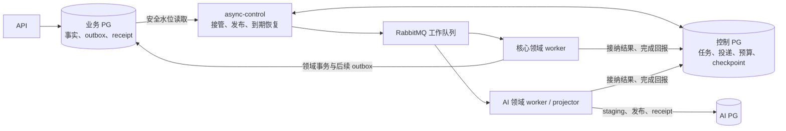

# 异步协调模块裁剪与适配计划

日期：2026-11-19。状态：**代码、控制迁移、配置、交接工具及专用环境验证已完成；生产环境尚未切换。** 实施和验证记录见 [实现报告](docs/ASYNC_COORDINATION_IMPLEMENTATION_2026-11-19.md)。下文保留制定计划时的现状描述与目标，执行结果以报告为准。

本计划依据当前工作区源码和本轮讨论制定。重点是现有模块的删除、复用、适配和切换，不重新建设一个工作流引擎。

`ASYNC_SYSTEM_CONSTRUCTION_2026-11-16.md`、`AI_SYSTEM_SPLIT_CONSTRUCTION_2026-11-16.md` 是保留的历史实现基线。本次裁剪以本文描述的目标变更为准；未涉及的领域规则继续保留。AGENTS.md 和两个当前实现说明已同步协议 v2，历史部署与验证记录保留原范围。

## 1. 本轮确定的定位

把原本围绕业务 outbox 的异步交付、执行记录和故障恢复抽到独立控制 PG。保留 RabbitMQ，领域 worker 自己完成计算和领域提交。

- 业务库：业务事实、操作意图、本地 outbox、业务效果幂等凭据。
- 控制库：可靠接管记录、稳定任务身份、投递记录、有限尝试预算、执行租约、必要 checkpoint 和处理结论。
- MQ：工作积压、消费者分发、未 ACK 消息重投。
- 协调进程：接管、可靠发布、到期投递、失租与耗尽处理、有界维护。
- worker：执行外部 I/O 或计算，提交对应数据库的领域效果，回报完成，再 ACK。

跨库使用各库本地事务、至少一次交付和幂等重放。当前实现本来就没有跨库分布式事务；本次裁剪的是执行协调与结果交接设施。

## 2. 当前实现与裁剪目标

当前链路是：业务 outbox → 控制接管 → 调度 → 工作 MQ → 计算 → 控制库结果 → 结果 MQ → committer → 领域事务 → 控制确认。

本次目标是：业务 outbox → 控制接管与发布 → 工作 MQ → worker 内计算与领域提交 → 控制确认。

当前 `asynccontrol` 声明 12 个工作队列，core / AI 各 32 个结果队列，以及 dead 队列；这些是声明拓扑，不代表每个队列都在处理工作。控制迁移当前到 000004、业务到 000036、AI 到 000007，实施时重新核对编号。

| 当前模块 / 入口 | 裁剪与适配动作 | 必须接住的职责 |
|---|---|---|
| `cmd/committer`、`cmd/ai-committer` | 退出默认构建、启动和在线角色；删除对应入口或保留明确拒绝启动的退役提示 | 核心 worker 直接提交业务；AI worker / projector 直接发布 AI 结果 |
| `asynccontrol/runtime.go: RunResults`、`scheduler.go: NextResult` | 删除独立结果发布、补发循环及其预算 | checkpoint 保留；普通工作通知恢复时继续提交同一结果 |
| `asynccontrol/shards.go` | 删除结果分片成员分配、分片租约、写许可和动态写速率机制 | 业务事务锁、receipt 和版本条件继续保证效果正确 |
| `asyncjobs/batch.go`、`Broker.ConsumeBatchesOnce` | 删除结果聚批、跨任务合并及批失败逐条回退 | 每个任务独立短事务；保留单任务领域内必要的合并更新 |
| `asyncjobs/committer.go` | 提取单任务领域提交能力，去掉结果通知入口、分片依赖、批处理和控制回报耦合 | receipt、前提复核、业务冲突收尾、事务超时及提交后故障窗口 |
| `aisystem/publish.go` | 复用 `Publish`；撤掉面向结果队列的 `Commit` 包装 | manifest 校验、active / desired 条件、墓碑、发布 receipt |
| `scheduler.go: Reserve` | 删除 owner / 优先级轮转、派发前全局名额预留、结果高水位背压 | 发布器只处理到期且需要交付的记录，不执行公平调度 |
| `RunScheduler`、`Recover`、`PrepareCommands` | 拆出小型到期发布与故障回收；取消纯提交命令的特殊结果生成通道 | 延迟 GC、会话过期、有限重试、最后一次执行崩溃和失败收尾 |
| `model.go`、`store.go` | 简化任务状态和预算，适配 worker 内执行 / 提交；保留身份与条件更新 | 旧消息、旧执行者、重复发布和并发结果不能越过屏障 |
| `relay.go` | 复用安全水位和原子接管，接管时同时建立可靠投递意图 | 接管后进程崩溃仍能继续发布；未知契约持久隔离 |
| `outputs.go`、`scan.go`、`maintenance.go` | 保留必要清理与有限扫描；迁走原 committer 独占的维护工作 | 废弃输出、业务 outbox 留存、上传过期兜底仍有执行者 |
| 旧 outbox dispatcher / taskqueue / recovery | 保持退出在线链路，保留必要历史导入与兼容读取 | 不恢复历史巡检和另一套在线重试权威 |

删除对应机制的实现和接线，不能只换函数名后继续保留结果调度、分片租约及全局写许可。

## 3. 控制协议的具体适配

### 3.1 接管与投递

1. 业务事务继续只追加 outbox，不写控制库、不同步请求 MQ。
2. Relay 沿用同一 SQL 快照的 `xmin` 和 `(event_xid, seq)` 安全水位，不改成只按自增号推进。
3. 事件接纳、冻结的类型与输入、任务 / 来源、投递意图和位点在控制库同事务落地。
4. 发布器用短事务小批领取到期投递记录，在事务外发布，完成路由检查及 publisher confirm 后条件登记发布成功。
5. 发布确认丢失允许重发；复用原任务身份、输入摘要和投递代次，不创建新语义操作或刷新预算。
6. 消费者可能在发布确认登记前就开始执行。发布回写只能更新对应投递记录，不能把已运行或已完成任务改回待执行。

任务与投递分开记录：复用 `tasks`，增加必要的轻量投递记录，或以等价字段实现。投递记录只管理发布 claim、到期时间、有限发送预算和确认，不承担执行调度。队列已确认接收后，不因排队较久就定时重发；排队超时达到明确截止时间时按过期处理。

### 3.2 worker 从“只计算”适配为“执行并提交”

有计算结果的任务按以下顺序处理：读取消息 → 条件领取 → 恢复 / 生成结果 → 领域提交 → 控制确认 → ACK。无计算步骤的类型化命令在条件领取后直接执行幂等领域事务；不为它们伪造计算结果，恢复时使用稳定命令身份与 receipt。

- 领取时检查任务身份、消息代次、期限、预算和当前执行租约；数据库时间为准。
- 无已接纳结果时执行计算；外部 I/O 不放在业务事务中。保存结果必须校验当前计算代次、token 和租约。
- 接纳结果时固定 result ID / digest，并原子冻结必要的 AI 后继。计算任务只有已接纳的结果才能进入领域提交。
- 有结果时跳过计算，直接恢复提交。提交重试不能改变原结果的计算代次、身份或内容。
- 同一 worker 可以在保存结果后立即提交；保存结果后继续使用或转换领取凭据的规则必须明确，不能沿用当前“清 token、等另一个消费者”的行为。
- 提交事务沿用领域锁、receipt、对象 / 会话版本、配额与引用检查。AI 在 AI 库本地事务发布；核心在业务库本地事务提交。
- 控制确认、AI 后继释放和作业汇总继续在控制库同事务完成。只有领域结论已经持久化，才确认任务效果完成。
- 回报丢失后复用 receipt 补确认；ACK 失败后的重复消息不再次生效。

业务库 receipt 和 AI 库 receipt 保持原位置，与各自效果同事务。控制库执行记录不替代它们。计算租约不能充当跨库事务锁；旧执行者先被控制结果接纳条件挡住，领域内还要靠 receipt 和版本条件保护晚到提交。

### 3.3 ACK、重投与失租

| 情况 | 处理规则 |
|---|---|
| 任务已完成 / 已停止 | 校验身份后 ACK，保留原结论；停止任务的未提交结果和人工处理线索继续保留 |
| 另一执行者仍持有效租约 | 作为重复通知处理；只有控制库已持久保留当前执行与失租恢复依据时才可 ACK |
| 原通知已过时或重试尚未到期 | 核实下一次投递 / 停止结论已持久化，再 ACK |
| 瞬态错误 | 在控制库同事务记录错误、剩余预算、下次时间与新投递意图；成功后 ACK 原消息 |
| 记录结果或恢复意图失败 | 不 ACK；使用有界连接恢复，避免热 nack / requeue 循环 |
| 执行租约到期 | 回收器条件使旧 token 失效；按当前 checkpoint 决定重新计算还是恢复提交 |
| 最后一次执行崩溃 / 永久失败 | 登记有限失败收尾或明确停止；不能等待一个永远不会发生的正常重试 |
| MQ dead 消息 | 持久核实消息与任务关系，登记恢复或隔离结论；不能把进 dead 等同于业务已收尾 |

MQ 的连接断开重投与控制库恢复可能同时发生，二者最终都经过同一个条件领取与预算检查。控制库是唯一的业务重试记录；不再同时建设 TTL 重试链或另一套消息 header 重试预算。

## 4. 状态、预算与数据结构变动

### 4.1 目标状态

任务生命周期收成 `pending / running / done / stopped`，具体业务结论使用 `outcome` 保留成功、过时、拒绝、失败、隔离及需要人工处理等差异。

“计算已完成但提交尚未完成”通过已接纳 `result_id` / checkpoint 和当前处理阶段表达。必要的执行 / 提交阶段仍须保存，不能用减少状态名掩盖恢复信息丢失。失败收尾使用类型化结果或确定性子任务，不建设任意 Saga。

| 现有状态 | 目标映射 |
|---|---|
| `ready / retry_wait` | `pending`，保留原到期时间、已耗预算和截止时间 |
| `dispatched` | 保留发布事实，停旧消费者后转为新投递协议；不直接当作未执行新任务 |
| `running` | 保留代次和输出线索，等待旧执行者退出 / 失租后条件恢复 |
| `computed` | 保留原 result ID / digest，进入只提交恢复，禁止重算 |
| `convergence_pending / exhausted` | 按收尾是否已持久化映射为待收尾或停止；不能直接标成业务失败已处理 |
| 已确认的成功 / 过时 / 拒绝 / 失败 | `done` 加原结论，receipt 与预算屏障保留 |
| 隔离 / 需要人工处理 | `stopped` 加原原因，未提交结果和操作线索保留 |

### 4.2 预算收敛

- 保留有限发布、计算、提交预算及总期限；提交窗口按持久结果单独有界管理。
- 删除独立 `max_recoveries` 在线策略，失租计入已领取的计算 / 提交尝试。
- 删除结果发送预算；结果恢复复用普通工作投递和提交预算。
- 所有重投、重启、扫描和重复来源沿用预算；人工 redo 新建留痕子操作，不重开原停止任务。
- 业务效果可能已成功时，优先查 receipt 补确认；不能因为预算到顶而把已成功效果改成失败。无法证明时保留结果并标记需要人工处理。
- 历史任务先保留旧预算作为更严格上界；只有证明映射不增加剩余尝试后才能折叠字段，不能按新默认值重建预算。

### 4.3 表与字段

| 数据 | 变动 |
|---|---|
| `relay_positions / event_inbox / tasks / task_sources` | 保留身份和安全接管；去掉在线分片、复杂优先级和公平游标依赖 |
| 轻量投递记录 | 承接可靠发布、延迟重试、发布租约和确认；与任务变更原子登记 |
| `results / executions` | 保留 checkpoint、计算代次和外部输出线索；停止承接结果队列补发；终态详情有界归档 |
| `committer_members / write_permits / write_budget / queue_budgets` | 新在线链路停止读写；实际物理删除另行核对历史与回滚依赖 |
| `module_leases` | 只保留确有共享位点 / 扫描职责的互斥；移除 scheduler、results、每结果分片租约 |
| `control_settings` | 保留导入、协议切换标记；退役固定分片布局和结果轮转配置 |
| `task_continuations / ai_job_*` | 复用 AI 固定领域依赖与作业汇总，适配新状态 / outcome；不扩展为通用工作流 |
| 业务 / AI receipt、对象世代、配额、epoch | 保留原业务作用，只调整调用者 |

迁移采用新增文件，不改写已执行的历史迁移。业务、控制、AI 三条迁移独立管理；具体新编号在施工时核对。旧表 / 旧字段先退役保留，不能在本轮切换中顺手清理数据。

## 5. 核心领域需要做的适配

| 类型 | 复用部分 | 必须修改的接线与恢复 |
|---|---|---|
| multipart create / complete / abort | `asyncjobs/compute.go`、`upload/async_commit.go` | upload worker 直接提交；保留操作专属 key、未知成功找回、NoSuchUpload 恢复和晚到结果收尾 |
| 哈希 / 大小验证、正式世代复制 | 同上 | object / upload worker 提交验证与建文件结论；result 接纳后才生效；配额、引用、命名与目录前提继续复核 |
| thumbnail | `media/async.go` | media worker 计算后直接发布变体记录；旧世代结果不发布；废弃输出继续可清理 |
| GC 授权与删除 | `objectstore/async_commit.go` | 删除授权仍先在业务库持久进入 deleting；字节删除在事务外；完成后条件提交 deleted |
| 过期 / 失败 / 清理 | `upload/async_commit.go`、`outputs.go`、`scan.go` | 预算耗尽后仍释放预留、登记定向清理；保留延期、取消与晚到结果竞争规则 |
| outbox 留存 | `asyncjobs/maintenance.go` | 从 committer 方法解耦，移交已有业务写 worker 的有界维护循环；删除仍受安全接管位点约束 |

当前 `queue='commit'` 中的 `upload.expire / object.authorize_delete / failure.converge / ai.job.finish` 必须逐项接住：改成普通输入命令，建议统一进入 `core-command` 工作队列，由现有 gc-worker 的独立小并发池消费。它不消费其他 worker 的计算结果，也不恢复独立提交服务。命令没有外部计算时直接进入幂等领域事务，取消 `PrepareCommands` 伪造结果的特殊路径。

任务契约继续在 `asyncprotocol/contract.go` 和注册表中闭合定义。新增 / 改路由同步 `asynccontrol/model.go`、`asyncjobs/planner.go`、领域处理函数及测试，禁止 MQ 消息指定任意 SQL、处理器或写入字段。

## 6. AI、投影与用户作业需要做的适配

1. AI worker 调用现有 `Computer.Compute` 后接纳结果，直接调用 `Publisher.Publish`，成功后控制确认。projector 同样负责发布自己的完成证明。
2. 保留不可变 staging manifest、hash / 行数 / 字节校验。接纳失败的 staging 不可见，也不能由 worker 绕过接纳直接切 active。
3. source / text / vectors / summary 的 desired seq、active pointer、依赖版本及墓碑规则不变。版本规则不能被 MQ 顺序替代。
4. 保留 `freezeContinuations / releaseContinuations` 的原子边界：结果接纳时冻结，领域发布成功后的控制确认才释放；过时结果抑制后继。
5. `aisystem/jobs.go` 适配新任务状态与 outcome；原子登记 `ai.job.finish` 普通核心命令，AI 仍不写业务用户作业表。
6. 失败能力结论和不会再运行的后继仍需终局记录；失败收尾独立有界，不刷新原计算预算。
7. ES / Qdrant 的不可变目标、active / coverage 证明、失败回退及未接纳输出清理保留。去掉结果 MQ 不等于投影写入成功就可被查询使用。
8. 真实模型调用与控制 checkpoint 保存之间仍有未知成功窗口。保留 summary checkpoint、embedding cache 和可用的 provider 幂等 / 查询能力，不宣称消息去重保证模型只调用一次。

本次复用既有 AI 后继与发布代码，不新增一套 AI outbox / 通用 DAG 平台。AI 在线检索、parser 能力和前端交互不随本次裁剪重写。

## 7. 角色、连接与权限变动

| 角色 | 当前 | 目标适配 |
|---|---|---|
| API | 业务事实与 outbox | 保留；启动和 readiness 不引入 MQ / 控制库硬依赖 |
| async-control | Relay、复杂调度、结果发布、维护 | 保留命令名；缩成接管 / 发布、到期投递 / 回收、控制侧维护；业务访问继续只读 |
| 核心四类 worker | 控制池、保留池、业务只读池 | 增加原 committer 对应的业务写能力；计算与短事务调用在代码中明确分开 |
| AI worker / projector | AI staging 写、控制池 | 获得 AI 本地发布能力；优先复用既有 `AI_COMMIT_DSN`，不增加业务 SQL 连接 |
| ai-query / core-internal / parser | 查询、权限 RPC、解析 | 保留既有权限边界；query 不读 staging，core-internal 保持业务只读 |
| committer / ai-committer | 独立结果提交 | 从在线部署退出，所承担领域提交、作业终结和维护必须先迁完 |

具体修改：

- `dependencies/async.go`：将 `write bool` 的 committer 特例改成明确角色能力；worker 打开必要业务写池，协调 / 管理角色仍按需求只读。
- `dependencies/ai.go`、`config/ai_split.go`、`deploy/ai-role-init.sql`：调整后台 AI 账号选择和权限检查。旧的“compute 一律不能发布”断言要重写；query 限权断言保留。原 `AI_COMPUTE_DSN` 可作为退役配置保留，不再作为默认在线后台账号。
- `bootstrap/async.go`、`bootstrap/ai_split.go`：装配计算与领域提交；取消 shard layout 检查、结果消费者和写预算初始化；挂接纯命令、业务 outbox 留存及失败收尾。
- 核心 worker 复用原 committer 的业务写连接约定，SQL 角色权限按所需表核对；不把迁移专用 DSN 发给在线 worker。
- 保留续租 / checkpoint 保存的连接可用性，连接池总量按角色重新核算。不能为了少一个池而让正常 SQL 占满续租通道。

这是明确的权限变化：计算进程开始具备所属领域的写 / 发布能力。验收应验证这一目标，而不是继续要求核心计算账号绝对只读。AI 与业务库隔离仍然保留。

第一轮沿用现有 upload / object / media / gc 及 AI 计算进程，先裁剪交接机制，不把角色合并、命令重命名和代码包大搬迁作为前置工作。后续同权限角色合并部署可以单独处理。

## 8. MQ、配置、脚本与观测变动

### 8.1 MQ

- 新协议建议使用独立 `bx.async.v2` 前缀和版本标记；旧消息由切换工具处理，新 worker 不兼容猜测旧身份。
- 保留持久工作队列、publisher confirm、路由检查、有界 prefetch 与 dead 出口；删除新拓扑中的结果队列、SAC 结果设置和分片参数。
- 消息保留任务身份、契约版本、输入摘要、投递代次及 trace；result shard / layout 字段退出新工作协议。checkpoint 从控制库加载。
- 删除旧 `ai / search` 兼容工作队列的默认在线声明前，核对迁移和历史消息处理；新命令队列有明确消费者。
- worker 并发与 prefetch 都是每消费者限制。扩副本会增加总并发；不再承诺旧的跨副本全局执行上限、owner 公平和动态写速率限制。
- 队列长度与发布错误通过原有容量上限反馈；发布失败持久退避，不无限缓冲在进程内。

### 8.2 配置与脚本

| 配置 / 文件 | 变动 |
|---|---|
| `ASYNC_RESULT_SHARDS`、`ASYNC_MAX_RESULT_SENDS` | 退出新在线配置和校验 |
| `ASYNC_QUEUE_INFLIGHT / OWNER_INFLIGHT / RESULT_HIGH` | 随集中调度策略退出；不悄悄解释成进程内等价保证 |
| `ASYNC_WRITE_CONCURRENCY / WRITE_RATE / COMMIT_BATCH_*` | 随写许可与批提交退出 |
| `ASYNC_MAX_RECOVERIES` | 对新任务退役；历史上界保留到对应任务结束 |
| 执行 / 发布 / 提交预算、期限、worker 并发、prefetch、poll 和维护参数 | 保留或补齐；移除无实际用途的配置 |
| `config.go / async.go / ai_split.go` | 同步角色、DSN、协议版本、预算和退役参数校验 |
| `compose.yaml`、两个 env 模板 | 同步服务、权限注入和配置键；核心 worker 当前清空业务写 DSN、AI worker 清空发布 DSN 的覆盖必须调整 |
| `up.sh / build.sh / local-run.sh / status.sh / config-check.sh / logs.sh` 及相关部署测试 | 移除 committer 默认目标、依赖和端口要求；补新启动协议检查及命令消费者 |

新增参数同步 Go 配置、Compose 锚点和两个 env 模板；两个模板键保持一致。实际 `deploy/.env` 只补缺项并保留现值 / 密钥；退役键可保留并提示，不覆盖用户配置。构建继续采用受控串行方式。

### 8.3 观测与管理

- 控制库全局任务统计由 async-control 集中采集 / 缓存；worker 只暴露本地执行、耗时、错误与连接池指标，取消每次 scrape 重复聚合全部历史任务。
- 保留接管滞后、待发布最老时间、运行 / 失租、重试 / 停止、未提交 checkpoint、失败收尾和队列积压指标；移除结果分片 / 写许可专用指标与告警。
- 同步 `deploy/prometheus/prometheus.yaml`、规则和相关 Grafana 展示；保留本地事实与 MQ 指标，清理失效的 committer 抓取目标。
- `cmd/async-admin` 的 inspect / redo 改查新状态、投递、checkpoint 和收尾；去掉 shard / result_sends 依赖，保留原停止预算、人工原因与新操作身份。
- readiness 按真实角色依赖检查；删除 committer 健康要求，不给 API 增加异步硬依赖。

## 9. 数据与旧消息切换

本次是“当前控制系统 → 精简协调系统”的交接，不是再次运行最早的 `async-import`，也不重复进行 AI 历史归档迁移。

1. 只读盘点当前控制任务、未提交结果、receipt、活跃执行者、旧工作 / 结果 / dead 队列；建立可核对的交接清单和恢复点。
2. 完成扩展迁移、角色初始化及新协议工具。控制 / 业务 / AI 迁移分别记录版本；旧服务运行时不能提前破坏其约束。
3. 在明确维护窗口停止旧协调器、所有旧 worker 与两个 committer，并确认旧执行者已退出或租约失效；新旧消费者不得同时处理同一任务。API 是否短暂停止按迁移锁和切换窗口安排，至少保证旧异步写者已停。
4. 按第 4 节映射存量任务。保留身份、已耗预算、期限、计算代次、输出、result ID、receipt、后继和人工停止结论；未知旧结果隔离，不重新计算代替证明。
5. 逐条处理旧 MQ：先核实 / 持久转移或隔离，再 ACK。旧结果通知转换成原 checkpoint 的恢复投递，旧已完成通知不重开任务；不 purge、不清空 bucket、不删卷。
6. 切换标记同时约束旧 / 新启动链；交接未完成时拒绝新 worker 提前消费。工具可中断重入，重复交接不增加尝试和预算。
7. 启动新协调与 worker，验证真实上传、取消 / 过期、结果回放、AI 发布 / 检索和失败收尾；确认各旧职责都有接收者。
8. 旧队列、表和字段保留为退役数据，给出清理清单后另行处理。代码与启动目标退出不等于自动删除对应持久数据。

回滚先停止新写者。必须核对新状态、新消息和 worker 已产生的业务 / AI 效果能否映射回旧协议；不能仅启动旧镜像或执行 down migration。保留交接清单与原 receipt，不能为回滚重置配额、引用或成功结论。若反向映射尚未实现，明确采用停止新执行、保留事实和向前修复的恢复方式。

## 10. 施工顺序与交付检查

以下是同一次裁剪的依赖顺序，不是要求逐段等待确认。

1. **固定协议与扩展迁移**：任务 / 投递 / checkpoint、预算与旧状态映射；先证明发布确认竞态和恢复边界。
2. **迁移领域提交调用者**：拆出核心单任务 applier，AI 复用 Publish；接入 worker，调整账号与事务装配。
3. **接住原特殊职责**：纯提交命令、失败收尾、AI 后继 / 作业、业务 outbox 留存和输出清理。
4. **替换集中调度**：小批到期发布与失租回收接管，删除 Reserve 策略、结果发布、分片和写许可在线调用。
5. **裁剪入口与接线**：删除两个 committer 服务和结果消费实现，同步配置、部署、指标、管理命令及测试夹具。
6. **完成交接工具与验证**：在专用资源上验证存量迁移、中断续跑、真实核心和 AI 链路，再形成部署与恢复说明。

| 检查项 | 必须证明的行为 |
|---|---|
| 接管 / 发布 | 晚提交事件不漏；接管事务中断可重入；confirm 丢失可重复发布；消费者先执行不会被发布回写倒退 |
| 并发 / 去重 | 重复来源、重复消息、并发 worker 和旧代次不会重复生效；消息 ID 不能替代语义身份 |
| checkpoint | 保存成功后崩溃只恢复提交；提交重试不改变结果身份；旧计算者不能接纳或发布新代次输出 |
| 双库窗口 | 领域提交成功、控制回报失败；控制确认成功、ACK 失败，均靠 receipt 与持久任务结论恢复 |
| 有限重试 | 普通失败、发布失败、失租、最后一次崩溃均有界；重启 / 交接 / 扫描不刷新预算 |
| 失败收尾 | 耗尽、取消、延期和过期竞争下配额只释放一次；必要清理不丢；无法收尾明确需要人工处理 |
| 核心领域 | multipart 未知成功、哈希拒绝、安全复制、同内容竞争、缩略图、分享引用和对象世代 GC 保持正确 |
| AI | staging 不可见、receipt 回放、旧 seq / 墓碑拒绝、后继仅成功后释放、失败能力与作业终局、ES / QD 证明及降级 |
| 权限与角色 | 核心 worker 可执行授权的业务提交；AI 后台可发布但无业务 SQL；query / core-internal 仍受限；无 committer 也无职责悬空 |
| 交接 | 存量 computed 不重算；停止 / 预算 / receipt 保留；旧消息先持久交接再 ACK；中断重跑无新增效果 |
| 部署 / 观测 | 两模板键一致、Compose 可解析、默认不启动 committer、不声明新结果队列；指标不由各 worker 重复全表统计 |

调整现有测试而非整体删除：`asynccontrol/runtime_integration_test.go` 的双 committer 分片用例退役，替换为多 worker、重复投递和恢复竞争；`asyncjobs/committer_integration_test.go` 保留 receipt / 回滚 / 配额语义，移除必须跨任务批合并的断言；`bootstrap` 核心 / AI 真实链路及角色权限断言按新目标适配。测试 MQ 清理夹具同步新拓扑，仅处理该用例专属资源。

后端 build / vet / 相关真实依赖集成与全量回归按实际改动执行。没有改前端 / parser 时不重写其用例；接口、proto、OpenAPI 若确实改动，再执行对应生成与检查。所有集成资源使用迁移过的专用测试库、独立 schema / vhost / bucket，不把测试套件指向开发业务库。

最终交付应包括：裁剪后的代码与迁移、配置和启动接线、可重入交接工具、真实执行结果、实际部署范围、恢复边界及剩余风险。跨主机 HA、容量和付费模型质量不由本轮单机 smoke 推导。

## 11. 完成标准与范围约束

- [x] 正常任务不再经过独立结果队列和独立提交进程。
- [x] 在线链路无结果分片成员、写许可、复杂公平 / 优先级调度及动态提交降速。
- [x] 核心与 AI 领域提交、纯命令、失败收尾、维护和作业终结都有明确 worker。
- [x] 业务 outbox 与事实同事务，控制接管与投递意图同事务，领域 receipt 与效果同事务。
- [x] 已接纳结果可恢复且不重算；重复交付、失租、晚到结果和预算耗尽有确定结论。
- [x] 现有版本、墓碑、配额、引用和对象世代屏障得到保留。
- [x] 旧任务 / 结果 / 消息可保留数据交接，旧预算和停止结论不被新默认值覆盖。
- [x] 配置、角色权限、部署脚本、管理命令、观测和测试同步退出旧机制。
- [x] 报告明确分开已改代码、已执行验证、已部署状态及未验证范围。

以上完成项依据专用资源上的回归和交接验证；实际生产停旧写者、迁移、交接和启动尚未执行。新容器镜像构建与整套 Compose rollout 也未执行，详见实现报告第 5 节。

本轮不引入 Temporal / 通用 Workflow / Saga / CDC / 跨库分布式事务，不迁回旧业务执行账本，不恢复周期全库 / 全 bucket 巡检，不以扩大角色合并或基础设施改造替代上述裁剪。
