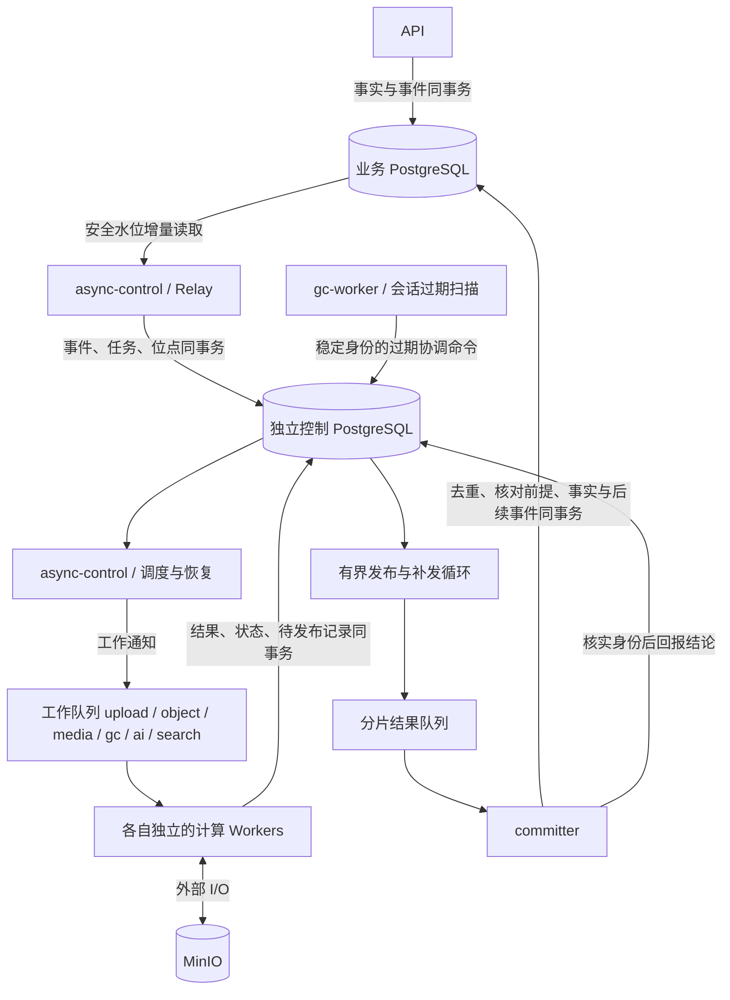

# BX YunPan 异步系统施工书

日期：2026-11-16。范围：本轮对话最终确认的异步系统整体改造。状态：**已按本文在当前工作区实现，并完成专用测试环境的核心验收；尚未部署现有业务栈**。

本文给后续新对话直接执行，完整描述目标，不依赖原对话。`ARCHITECTURE_UPGRADE_PLAN_2026-11-10.md` 和 `docs/ASYNC_CONTROL_PLANE_DESIGN_2026-11-12.md` 是历史思路与代码参考；两者与本文不一致时，按本文执行，不重新询问已确定的架构选择。实际代码、迁移编号及运行状态需要在落笔处核实，不能把历史文档描述当成已实现事实。

## 0. 新对话的执行要求

用户的目标是：**直接改代码，完成这一整套可运行、可恢复的异步系统，不再交付另一份方案，不把工作拆成等待逐轮确认的阶段。**

- 直接进入实现。可以按代码依赖顺序施工、边改边测，但不能把其中一段作为最终交付，声称剩余主体是下一阶段。
- 不先做旧系统性能基线、容量测试、全量故障演练、监控专项、长时间审计或一大套测试基础设施，再决定是否动代码。
- 必要的入口、契约、事务和依赖检查随实现进行；必要的测试库、队列和夹具直接建立。不能用“先建立基线”替代实现。
- 可靠性第一：**状态推进、重试、去重、幂等、结果交接、失败收敛**先做正确，再落实批处理、合并、分片、限流、背压和锁竞争优化。后者也在本轮交付范围内，但不能牺牲前者。
- 要编写和运行必要的单元测试、真实依赖核心集成测试、端到端冒烟及相关回归。更深入的随机性质测试、完整故障矩阵、长时间压测、跨主机容灾和容量认证留到之后。
- 用户在本轮开始时说明 Git 工作区和暂存区干净、已有备份，并授权直接修改。新对话仍应快速查看现有差异、保留新出现的用户改动；不必重新建备份、建基线或为了常规实现重复请求许可。
- 不重置业务数据、不清空 bucket、不删除数据卷、不覆盖用户配置与密钥。新增运行组件的配置和启动接线必须完成；实际运行在哪个环境、执行过哪些测试，要据实报告。
- 不实施 AI 数据独立、业务读写分离、冷热存储、生产集群部署优化。它们是后续工作，不得扩展成这次的前置项目。
- 如果遇到上下文压缩或需要续接，保留已完成代码、继续同一个完整目标；不要退回规划，也不要仅因本次上下文结束而宣布完成。

可在新对话直接使用的指令：

> 按根目录 `ASYNC_SYSTEM_CONSTRUCTION_2026-11-16.md` 直接施工，把整套异步系统做出来。不要重新分阶段规划，不要先跑性能基线或做测试铺垫。完成代码、双库迁移、进程与配置接线、核心单元/集成测试、冒烟和回归；优先保证状态推进、重试、去重、幂等和失败收敛。合理实现选择自行处理，按真实完成情况交付。

## 1. 最终目标与明确边界

最终架构是：

**业务库保存事实和事件；独立 PostgreSQL 控制库管理整套异步执行；RabbitMQ 传递工作通知及提交结果；独立计算 worker 做计算和外部 I/O；写进程统一执行后台业务提交。**

控制库需要是独立数据库、独立连接串、独立连接池、独立迁移历史，不得只把旧表改名后继续共用业务 GORM。开发/冒烟可以在同一 PG 实例创建两个数据库，但这不构成实例资源隔离；部署应支持连接到独立 PG 实例。

必须得到的行为：

1. 业务修改和对应事件在业务库本地事务内一起成功或失败。
2. 已受理的事件可靠接管；提交乱序、重复读取、Relay 接管都不漏事件。
3. 一个语义工作有一个稳定身份和一套持久预算；重投、扫描、进程重启不能刷新预算。
4. 任务执行状态只有控制库一个权威，业务事实只有业务库一个权威。
5. 已计算结果可恢复、可补发；业务提交完成之后才确认效果完成。
6. 重复结果、旧执行者、用户并发操作都不能破坏配额、引用、文件唯一性和对象生命周期。
7. 有限重试后明确停止，持久标记、输出日志；需要业务收尾的任务不能假报“失败已处理”。
8. API 的业务提交不等待控制库、MQ 或调度器；角色装配和启动校验不能重新制造这种硬依赖。
9. 线上不靠周期历史巡检维持正常链路正确性。
10. 队列消费、派发窗口、内存缓冲、数据库连接和批次都有上限。

不引入 CDC，不更换 RabbitMQ，不做跨库分布式事务，不引入通用 Saga/Workflow 平台，不把重命名、移动等现有同步操作改成异步请求。

“API 不等后台”不等于绕过业务约束。API 仍校验版本、目录、配额、命名和对象状态；异步结果承担额外的前提复核责任。

## 2. 独立进程与高可用边界

### 2.1 核心角色

| 进程 | 最终职责 | 主要依赖 |
|---|---|---|
| `api` | 同步业务操作，写业务事实与事件，签发对象存储 URL | 业务 PG、缓存、现有必要的对象存储签名/只读能力 |
| `async-control` | **Relay + 调度 + 控制恢复**：接管事件、建任务、派发、重试、失租恢复、结果补发、失败协调、隔离、预算与背压 | 业务 PG 只读、控制 PG、RabbitMQ |
| `upload-worker` | 创建/完成 multipart、正式位置复制等上传存储操作；产出类型化结果 | 控制 PG、MQ、MinIO；必要时业务 PG 只读 |
| `object-worker` | 全对象读取、SHA-256 与大小校验 | 控制 PG、MQ、MinIO；必要时业务 PG 只读 |
| `media-worker` | 解码、缩放、生成缩略图及写入字节 | 控制 PG、MQ、MinIO；必要时业务 PG 只读 |
| `gc-worker` | 对象/变体/暂存删除、multipart 中止；**上传会话过期的有限扫描兜底** | 控制 PG、MQ、MinIO、必要的业务 PG 只读 |
| `committer` | 条件提交后台业务事实、失败收敛、清理授权、派生记录发布；同事务写后续事件，回报控制库 | 业务 PG 可写、控制 PG、MQ |

新核心默认运行这些明确角色。不能重新把所有计算任务塞回一个大 worker。队列、并发、故障和水平扩容边界应与角色对应。旧 `worker` / `maintenance-worker` / `outbox-relay` 如保留命令兼容，必须映射到明确的新职责，不能同时启动一套旧状态机或旧扫描。

GC 是计算 worker 的一种。它执行字节删除，不直接修改会话、配额、引用和对象业务终态。`committer` 不负责耗时计算，也不能在持有业务事务期间调用 MinIO。

### 2.2 原有辅助角色

Web/Nginx、`aisvc` 或现有 `ai-query` + `ai-indexer`、`parser-svc`、可选 `search-indexer` 保持既有资源边界。

本轮要适配 AI/search 的事件订阅、任务领取、执行预算和回报，不能留下旧执行账本继续写业务库。AI/search 既有派生数据暂留原数据库位置，不实施数据搬迁、查询改造或模型优化。其派生数据写入是明确的兼容边界，不得因此宣称现有 AI 已没有业务 PG 写连接。

AI 现有租约要区分“派生版本发布世代”与“任务执行租约”：后者统一控制库，前者可保留维护版本发布正确性的必要条件。不得保留第二套独立任务重试权威。用户可见 `async_tasks` 的终态属于业务事实，通过写进程更新。

### 2.3 高可用

- `async-control` 多副本。Relay、调度/控制恢复分别管理生命周期和控制库租约，代码同进程，互不阻塞。第一版每个模块一主多备，保留以后按队列分配调度职责的接口。
- 租约使用数据库时间，领取/续租/推进携带 token 和状态条件；失租立即停止发起新的工作。不能只靠进程内标志防双主。
- worker 多副本并行，控制库条件领取任务；实例崩溃后租约恢复，旧执行者的回报不能覆盖新代次。
- GC 删除可以多副本并行；同类过期扫描通过独立租约单活，不能每扩一个 GC 就多跑一遍业务扫描。
- 写进程多实例承接结果分片，每分片单一活跃消费者，故障后接管。旧实例可能仍有未结束事务，因此正确性必须由业务幂等和前提校验保证。
- 实现角色接管协议与必要冒烟，不把单机多实例证据写成 PG/MQ 集群或跨主机高可用认证。基础设施 HA 部署另做。

## 3. 数据语义、归属和写权限

### 3.1 数据分类

| 数据 | 性质 | 去向与写入者 |
|---|---|---|
| 用户、目录、文件条目、分享、分享导入 | 业务事实 | 业务库，API；异步产生的文件由写进程提交 |
| 上传会话、确认分片、对象内容身份/位置/状态、引用计数、配额占用 | 业务事实 | 业务库，API 与写进程按领域不变量修改 |
| `storage_operations` 的操作意图、目标、已提交业务结果 | 业务事实/业务意图 | 业务库，API/写进程登记，写进程提交结果 |
| 用户可见 `async_tasks` | 用户作业事实 | 业务库，API 创建，写进程更新必要状态和终态 |
| `outbox_events` | 已提交业务事件 | 业务库，只追加，由 API/写进程在业务事务内写 |
| 业务效果去重凭据 | 防重复生效的业务屏障 | 业务库，和效果同事务；优先利用稳定业务行，必要时增加紧凑提交凭据 |
| 事件接管、订阅计划、任务身份、状态、租约、重试、计算结果、派发/补发、执行历史 | 执行控制数据 | 控制库 |
| `owner_content_epochs` | 缓存/分页用的加速元数据 | 业务库，随事实事务推进；不代替权限、配额判断 |
| 缩略图记录 | 小体量、绑定对象的派生结果 | 本轮仍在业务库，由写进程条件插入 |
| AI 文档、版本、分片、向量与搜索投影 | 可重建派生数据 | 本轮维持既有存放位置，按现有专用角色写；不实施 AI 数据独立 |

上传校验后创建的文件属于“晚到的事实”，不是派生数据。不能因为它由 worker 算出，就允许计算 worker 任意写入或丢失后重建。

派生数据的两个判定条件：能够由事实和字节重算，且其他业务不变量不依赖它。派生缺失不能影响文件存在性、配额和授权。

### 3.2 业务库不再承接执行控制

迁出旧 `outbox_deliveries`、`task_executions`、`task_results`、`task_failures`、`outbox_recoveries` 的运行职责。不要将它们一比一搬库后继续让业务代码跨库 JOIN。

`storage_operations` 的租约、心跳、尝试计数、下次执行时间统一进入任务模型。业务行可以保留“已登记/已提交结果”等必要语义，但不再另有一套自动领取和重试循环。

搜索的消费去重屏障必须与投影效果同事务、同数据库。它和控制库的任务完成记录作用不同，不能为追求“所有去重只有一张表”将其拆开。

### 3.3 权限与连接装配

核心计算 worker 不能持有业务写连接。业务读取优先由足够的事件/任务载荷代替；需要补查时使用明确的只读连接。

`dependencies.Open` 与配置校验按角色拆分。API 不应因控制库/MQ连接失败而无法提交业务事务；计算角色不应为了启动被迫创建完整 drive/identity 可写服务。每个库有独立连接池和超时。

不新增“所有控制操作必须请求的 RPC 服务”。领取、续租、保存结果、提交回报由各角色使用同一套控制库状态机模块直接执行，调度进程宕机不应立即中断已领取任务的续租和结果保存。

## 4. 总体架构与统一契约



Relay 是业务事件的输入；控制库还接受两种内部输入：GC 过期扫描的确定性协调请求，以及调度器的失败收敛/清理请求。它们同样经过注册契约、身份校验、去重和预算，不绕过统一状态机。

任务类型注册表集中声明：输入/结果版本、语义键生成、输入摘要、队列、分片域、重试策略、超时/截止时间、完成方式、失败收敛和补偿方式。不能让调用者任意指定 task type、queue、SQL 或业务字段修改。

完成方式有两种：

- 需要业务效果：计算结果持久化后进入提交路径，由写进程完成。
- 只写派生数据：效果在派生数据事务/外部受控发布中成功后回报任务；若同时需要更新用户作业，则另有明确的业务提交步骤，不能提前报整项业务完成。

消息携带任务 ID、契约版本、语义操作身份、输入摘要、执行代次、结果身份、分片键、必要前提、载荷/结果指针与 trace。调度元数据、trace、投递次数不应混入业务输入摘要，导致重放误判输入冲突。

## 5. Relay：只追加事件与低成本扫表

### 5.1 已确定的选择

**不用 CDC。业务 outbox 只追加，Relay 在业务主库按安全事务水位和索引增量读取，位点保存在控制库。**

- `outbox.AddTyped` 在业务事务内只写事件，不生成逐目的地投递行。
- 事件不因调用 context 没有设置 V2/search 开关而静默丢弃。业务事实事件始终保存，是否订阅由控制侧决定。
- 没有订阅者是可观察的合法接管结果，不创建只打印日志的 maintenance 任务。
- 任务延迟、GC 延迟、重试时间在控制库调度；Relay 接管不应被未来的 `available_at` 阻塞。
- 删除旧投递 NOTIFY 触发器对新链路的依赖；轮询本身保证正确性，不让每个业务事务承担必要的通知步骤。

### 5.2 安全水位

事件保存独立的自增位置 `seq` 和插入它的顶层事务号 `event_xid`（优先使用 PG 的 `xid8`）。建立窄联合索引 `(event_xid, seq)`。

Relay 在业务主库**同一个读取快照/语句**中取得安全水位并读取事件，逻辑形状为：

```sql
SELECT event_xid, seq, id, event_type, aggregate_id, payload
FROM outbox_events
WHERE event_xid < :safe_xmin
  AND (event_xid, seq) > (:last_xid, :last_seq)
ORDER BY event_xid, seq
LIMIT :batch_rows;
```

`:safe_xmin` 来自该读取快照的 `pg_snapshot_xmin(pg_current_snapshot())` 等实际可用实现，不能用另一连接、另一个时刻随便采样的值。事件行事务号使用 `pg_current_xact_id()` 等取得完整事务身份，不能用会回卷的裸 32 位事务号比较。

实现时在项目 PG 17 上用小型真实事务测试核实类型、索引、顶层/子事务、回滚与晚提交行为。这是关键正确性测试，不是性能基线或单独调研阶段。

禁止仅用 `seq > last_seq`、UUIDv7 最大值、创建时间最大值或固定“回看最近几分钟”作为不漏保证。拿号顺序不等于提交顺序；先拿小号的事务可能晚提交。

该方案可能被长期在途事务拖住安全水位。必须记录位点、水位停滞、交接延迟和长事务相关日志/指标。查询有超时，读取事务短小，不能为了 Relay 长期持有事务快照。

本轮先读业务主库。读副本涉及回放可见性和恢复中的快照语义，后续单独处理，不能只替换 DSN 就宣称安全。

### 5.3 批量接管与成本

- 增量索引范围扫描，不锁事件行，不更新事件状态，不跨业务历史表 JOIN；索引不包含大 payload。
- 起步每批约 200 条，约 1 MiB 载荷上限，均可配置；超大单事件需有明确大小策略，不能永远卡住游标。
- 控制库一个事务：事件 ID 去重入库、校验摘要、冻结订阅计划版本、确保任务和来源关系、推进 Relay 位点。
- 位点只推进到本次真正接管或持久隔离的最后一条事件。接管失败整批重读，不根据“已经取出来的最大值”抢先推进。
- 未知契约/相同身份不同输入持久隔离，输出日志；不能悄悄丢掉，也不能无限阻塞后续全部正常事件。
- 租约 token 和位点条件更新必须覆盖整个接管事务。重复读取可接受，跳过未接管事件不可接受。
- 有积压立即继续取；读空从约 100ms 退避到约 1～2s，加入抖动。控制库慢或不可用时暂停接管并退避，内存只保留有限批次。
- 正常业务库成本收敛为每事件一次插入及索引维护、一次增量读取；扇出、投递和重试全部在控制库。

### 5.4 订阅与重放

接管时存下路由/订阅计划版本。运行时开关变化不能让相同事件重放后不受控地产生另一组任务。

AI/search 关闭时记录“当前未订阅”，不能删除原事件。以后需要补索引走显式重建入口，不偷偷重放所有历史事件。

outbox 留存依据**安全接管水位 + 控制库恢复/重放窗口 + 保留时间**。不能只按事件创建日期删除，避免长事务晚提交事件被清掉。分区或分批维护可按实际表结构选择，不能为分区再引入一整套前置工程。

## 6. 控制库模型与状态机

### 6.1 必须具备的逻辑实体

物理表名可以按现有代码组织调整，但以下职责不能缺失：

| 实体 | 必要内容 |
|---|---|
| Relay 位点/模块租约 | 事件源身份、事务号/序号、版本、租约 token/到期时间 |
| 事件 inbox | 事件 ID、类型/版本、聚合与来源身份、规范化输入摘要、载荷/指针、订阅计划、接管或隔离结论 |
| 任务 | task ID、唯一语义键、类型/版本、输入摘要、队列、owner/资源身份、优先级、状态版本、执行代次、租约、运行时间、各类预算、截止时间、结果引用 |
| 任务来源关系 | 哪些事件/协调请求触发同一项工作；多来源不能刷新任务预算 |
| 执行历史 | 每次执行起止、执行代次、错误分类、结果引用；只追加，不把心跳当历史插入 |
| 持久结果 | 结果 ID、操作/输入身份、执行代次、类型化内容/指针、摘要、有效性与提交结论 |
| 待发布记录 | 工作/结果/协调消息的路由、下次发送时间、发送次数、确认与异常；可与任务模型合并实现 |
| 扫描/隔离记录 | 扫描租约与必要检查点、异常身份、停止原因、需人工处理事项 |

不能只保存控制台可见字段而遗漏恢复所需输入。也不能把控制库当日志库，真正的领取条件仍放在内存或 RabbitMQ header 中。

### 6.2 状态与转换

建议状态名如下，可调整命名但保持语义：

```text
ready -> dispatched -> running -> computed -> succeeded
                         |            |----> superseded
                         |            |----> rejected
                         +-> retry_wait -> ready

dispatched 超时未领取 -> 有限重派
running 失租 -> 有限恢复 / exhausted
computed 未提交 -> 有限结果补发，不直接重新计算
exhausted -> convergence_pending -> failed
异常输入或自动处理上限 -> quarantined / needs_attention
```

- `computed` 表示计算结果已持久化，不要求消息已经成功发出。
- `succeeded` 表示效果已提交。`AlreadyDone` 是提交回报的一种结果，归入同一个成功终态。
- `superseded` 表示业务前提已失效，结果作废，是正常终态，不当作基础设施故障反复重试。
- `rejected` 表示明确的领域规则拒绝；如果需要释放资源，必须先完成相应业务失败分支再终结该工作。
- `exhausted` 只是执行预算用完。会话、配额等尚未收尾时，必须有持久协调步骤，不能直接假定失败收敛完成。
- 协调步骤自己达到上限，标记 `needs_attention`，保留未收敛的业务事项和日志。不能不断创建“协调失败的协调任务”。

所有转换携带期望状态/版本；运行者写入检查执行代次、token 与数据库时间。成功终态不被晚到错误覆盖，旧代次不续新代次租约。

领取和续租的预算占用在控制库事务内一致更新。领取不到、已终态、重复通知等都不能再调用业务 handler。

## 7. 身份、去重、幂等与回报规则

### 7.1 四层屏障

| 层次 | 身份 | 防止什么 |
|---|---|---|
| 接管 | 原始事件 ID + 输入摘要 | 同一事件重复接管、同 ID 偷换输入 |
| 任务 | 任务类型 + 稳定业务操作/内容世代 + 流水线版本 | 不同事件/扫描重复创建同一项工作 |
| 业务提交 | 业务操作身份 + 阶段/世代 + 已提交效果 | 重复结果导致重复建文件、增引用、释放配额 |
| 外部资源 | 操作/执行身份、输出世代、确定性位置、条件操作 | 旧执行者覆盖新输出、补偿误删共享内容 |

任务语义键示例：`multipart.create:{operation_id}`、`upload.verify:{session_id}:{verification_generation}`、`thumbnail:{object_id}:{content_identity}:thumbnail-v1`、`object.delete:{object_id}:{deletion_generation}`、`upload.expire:{session_id}`。

不能把投递次数、恢复事件 ID、普通引用计数变化或无关整行版本变化放入语义键来变相刷新工作预算。任务依赖的内容版本变化、明确人工重做才产生新一代工作。

### 7.2 提交规则

写进程先验证结果契约、来源/输入身份和可提交世代；再在业务事务内：锁领域聚合、按操作身份去重、核对最小必要前提、提交效果与后续事件。

仅凭 task ID、消息自称的 owner 或 worker 自报“成功”不能直接接受。相同操作身份不同输入/结果需明确判定冲突，不能静默按成功处理。

控制库收到已提交回报时，不应因原 worker 的执行租约已过期就否认已发生的业务事实；但必须核实它对应同一操作、输入、结果/业务世代及可信的提交路径。不得实现成“任何晚到消息都能无条件把任务改成功”。

业务提交凭据与业务效果同事务保存。优先利用完成会话、存储操作结果、变体唯一键等稳定业务记录；业务行会被清理或不足以表达身份时，增加紧凑提交凭据。去重身份留存必须覆盖最长恢复/重放窗口，不能随详细日志随手删掉。

### 7.3 最小前提

| 结果 | 必要前提与处理 |
|---|---|
| multipart 创建结果 | 会话仍允许初始化；已取消/过期则不重新激活，登记该上传 ID 的中止清理 |
| multipart 完成结果 | 会话仍处于对应完成世代；已终态按已提交/作废处理 |
| 上传验证/最终创建 | 会话仍允许该步骤，目录有效，同名约束满足，内容身份一致 |
| 缩略图 | 对象内容世代和位置仍匹配，仍允许发布；不能因引用数增加就拒绝 |
| 对象删除授权 | 延迟已到、引用为零、无活跃条目、对象世代相符，原子进入禁止新增引用的删除状态 |
| 删除完成 | 对应已授权的删除世代；晚到结果不能把复活后的新世代标为删除 |
| 会话过期 | 主库复核状态与到期时间；已完成不修改，延期则更新原工作到期时间，不刷新预算 |

API 修改代表最新已提交意图，但仍遵守共享对象生命周期及唯一约束。异步过程不得持锁等待外部计算；引用不为零的对象不能被 GC 删除。

## 8. 调度：常用能力完整，不做演示版

用户要求约“八成常用能力”，不是只实现一个定时发消息的循环。以下能力都在交付范围内。

| 能力 | 必须实现的行为 |
|---|---|
| 到期与延迟执行 | 新工作、重试、对象延迟回收、会话到期都使用持久 `not_before/next_run_at`，到期才派发 |
| 分类资源预算 | upload/object/media/gc/ai/search 各自有在途上限，worker 并发和 prefetch 共同约束 |
| 基本公平 | 每 owner 有在途上限，并在活跃 owner 间有界轮转；不能持续只选中被限流的大 owner 而饿死其他人 |
| 优先级 | 业务推进、失败收敛优先；清理、派生保留最低份额，不能无限饥饿 |
| 执行超时 | 单次执行超时与整个工作的截止时间分开，按任务类型配置 |
| 重试 | 统一预算、指数退避加抖动，错误分类明确 |
| 派发恢复 | 发布失败、确认不明、已派发无人领取有持久状态与有限恢复 |
| 执行恢复 | 租约到期、worker 崩溃、最后一次执行者失联都有收敛路径 |
| 结果恢复 | 已保存结果只补发提交消息，不直接重新算一遍 |
| 失败协调 | 预算耗尽后生成确定性的领域协调步骤，写进程处理业务收尾 |
| 隔离与人工恢复 | 未知契约、输入冲突、反复崩溃、自动处理耗尽可定位、可隔离、有受控人工入口 |
| 背压 | 根据结果积压和提交压力限制对应计算任务的新派发，保留续租/回报能力 |

调度器在控制库短事务中预留派发资格/预算和派发世代，事务之外发布消息，确认后条件更新。发布期间 worker 可能已经领取，发布回写不能把 `running` 倒退成 `dispatched`。若采用其他顺序，也必须用持久派发意图和代次覆盖该窗口。

工作通知带 task ID 与必要代次/版本；worker 必须到控制库条件领取。MQ 中残留通知和重复通知本身不取得执行权。

到期扫描、租约扫描、computed 结果恢复分别有对应的状态/时间索引、批量与时间预算，不扫描全部历史任务。接管后从数据库状态恢复，不能依赖内存 timer 重建所有任务。

对外发布使用有界并发/confirm 窗口，不能一边无限堆消息一边等待，也不能在持有控制库行锁期间等待 MQ。实现正常可用的预算与公平机制即可，不做预测调度、自动重分片和复杂优先级算法。

## 9. 所有重试、重投和协调循环必须有度

### 9.1 统一策略

基础退避：`min(base * 2^(n-1), cap)`，加约 20% 抖动；计算要防整数溢出。示例：`5s -> 10s -> 20s -> 40s -> ... -> 5min 封顶`。封顶不等于无限重试，仍受次数和总期限限制。

以下可作为实现起步值，允许在不改变可靠性边界的前提下合理调整，并在配置与测试中一致表达；它们不是容量测量结果：

| 预算 | 建议起步值/规则 |
|---|---|
| 同一存储/计算工作总执行次数 | 12 次，包含首次；每次成功领取新执行代次才计数，崩溃重启不重置 |
| 发布失败、确认不明、无人领取后的派发恢复 | 独立累计，约 20 次，并受截止时间限制 |
| 失租恢复 | 独立累计上限，同时仍受总执行次数与截止时间限制；不能无限免费换执行代次 |
| 持久结果的自动补发/提交恢复 | 独立累计，约 20 次，并受提交恢复期限限制 |
| 业务失败协调与补偿清理 | 独立的有限工作，建议 12 次；不能反复创建下一层补偿刷新预算 |
| 单次超时与总期限 | 按类型配置有限值；对象延迟回收的执行期限从可运行时刻计算，不能等待 24h 后一开始就过期 |

执行失败次数、执行启动次数、基础设施恢复次数可以分列用于判断与观察，但必须有最后的整体上限；禁止某类异常被归类为“不计预算”而永久绕过边界。

永久无效输入/未知契约不普通重试。前提失效正常作废。删除目标已不存在等业务等价成功按幂等成功处理。暂时依赖错误才走退避。

### 9.2 基础设施不可用

MQ/控制库整体不可用时，连接管理采用退避和熔断，暂停受影响派发，不瞬间遍历所有任务把每条预算耗尽，也不热循环 requeue。

服务连接可以持续等待基础设施恢复；**这不等于允许同一条任务无限投递**。任务自己的已开始尝试、恢复次数与截止时间仍持久有效，恢复连接不将它们归零。

续租和结果保存不可用时，worker 在失租前取消可取消的执行；无法取消的外部调用按不确定结果和世代补偿处理，不能假定 context cancel 已撤销远端副作用。

### 9.3 达到上限

- 先持久转换到 exhausted、隔离或需人工处理，再停止自动投递；状态保存失败不能只打一条日志就 ACK 丢掉工作。
- 活跃租约尚未结束时，不能仅因已达到尝试上限提前把成功执行者判死；待结果或租约结束再处理。
- 必要失败收敛独立可恢复：会话失败、配额释放、登记清理。收敛完成才进入对应最终失败。
- 协调本身耗尽，明确记录未完成收尾，保留资源与错误，不伪造成功、不无条件释放共享对象。
- ERROR 至少包括 task ID、语义键、资源/会话/operation ID、阶段、执行代次、次数/上限、首次开始/截止时间、最后错误与 trace。
- 停止事件输出一次明确日志；后续周期输出汇总，避免每次扫描重复刷同一个 ERROR。保留按类型统计的重试、停止和需人工处理数量。
- 人工重做是显式操作，校验当前业务条件，记录原因和新操作世代；不是扫描器自动把 dead 改 ready。

## 10. RabbitMQ 的职责和消息确认

### 10.1 工作队列

工作队列负责通知与输送，控制库负责工作是否存在、能否领取、何时重试和是否终态。通知丢失可以从控制库恢复；已有未确认消息会重投，worker 必须条件领取。

沿用 RabbitMQ/quorum。各类工作分别路由到 upload、object、media、gc，以及现有 ai/search 消费角色。删除旧 `file.created`、`share.imported` 只打印日志的 maintenance 路由；保留它们真正的订阅者。

新重试只由控制库安排，不能同时跑旧 TTL retry 队列和新调度预算。MQ 的 redelivery 计数属于传输保护，不能成为第二套独立业务重试权威。

不能继续依赖新队列 `x-delivery-limit=-1` 加无界 nack/requeue。设置有限的传输投递保护和死信/隔离出口，并把传输耗尽反馈到控制库；否则 scheduler 又把同一工作无限救活，仍然是循环。

控制库异常时暂停消费/退避，不能将未知是否保存成功的工作提前 ACK。接入 DLQ/隔离的记录也需要可恢复处理；不能仅留在 broker 中无人观察。

### 10.2 结果队列与确认顺序

计算结果、任务 `computed` 状态、待发布记录在控制库同事务保存。worker 可执行快速发布，后台发布/补发循环负责恢复；无论谁发送，都使用同一个结果身份和预算。

原始工作消息在结果已可靠持久化并保证后续可恢复发布后可以 ACK，不要求一直占着计算 worker 等待业务提交。

写进程的顺序是：

```text
验证结果身份
  -> 业务事务提交（含效果去重与后续事件）
  -> 控制库回报提交结论
  -> ACK 结果消息
```

业务提交成功但回报失败，消息重投后通过业务凭据补回报。回报成功但 ACK 失败，再投也只是重复确认。不能反过来先报成功或先 ACK，再提交业务。

未知确认、重复发布、返回 unroutable、断连等要有对应持久恢复，publisher confirm 不是端到端恰好一次保证。

### 10.3 队列切换

RabbitMQ 已声明队列的部分参数不能原地修改。需要新语义、SAC 或不同声明参数时，用明确版本的新队列/交换机，避免同名声明导致 `PRECONDITION_FAILED`。

旧队列/TTL 队列的存量必须排空或导入统一任务身份，禁用旧生产者/消费者后再启用新链路；不得通过删除队列清空现存业务工作。新旧执行权威不能同时接管同一份工作。

## 11. 计算 worker 与外部副作用

### 11.1 通用执行协议

1. 从 MQ 收到通知，在控制库验证身份并条件领取任务，取得执行代次与租约 token。
2. 在有界并发池中执行，按租约续租；失租取消本地工作，禁止继续发布被视为当前代次的普通回报。
3. 计算/外部调用不在数据库事务中进行，不持有业务库写连接。
4. 保存类型化结果与可恢复发布状态；失败按控制库策略记录，不自行创建新事件刷新预算。
5. 记录必要的输出身份与不确定副作用，支持作废/崩溃后的定向清理。

事件/任务尽量携带对象 bucket/key、内容身份、大小、MIME、操作身份等完整输入。必要补查使用只读连接。以后读副本时，查不到不能直接解释为已删除，必须考虑复制落后。

大结果写控制库的有限载荷或对象存储暂存，MQ 只带引用和摘要；暂存对象保留期覆盖提交恢复窗口，不能 TTL 先删掉尚未提交的唯一结果。

### 11.2 对象存储必须单独处理幂等

控制库租约不能阻止一个已经发出的旧 MinIO 调用晚到。必须按照外部操作真实语义处理：

- 内容复制、缩略图输出使用带操作/执行世代的确定性身份或可安全条件写的目标，不能让旧执行者覆盖新的有效输出。
- 同内容共享 canonical 对象不能由单个会话的补偿直接删除。清理前关联业务对象身份和删除世代，由写进程确认所有权与引用。
- multipart create 不能假定远端支持业务幂等键；其“远端成功、本地结果未保存”窗口需要明确处理。采用可追踪的操作专属暂存命名、定向查询/恢复，以及受控的未完成 multipart 生命周期兜底等实际可行办法，不能仅写一个确定性 task ID 就宣称已解决。
- multipart complete/abort/delete 的重放依据实际返回与目标状态判断；NoSuchUpload/NotFound 等不能不分阶段地全部当成功。
- 保存不确定操作的执行输入和目标。确需检查远端时仅针对该已知操作，不把它扩展成在线全 bucket 巡检。
- 提供基础的未完成 multipart/结果暂存生命周期配置与校验，规则限于受控前缀，时长与活跃上传、晚到调用及恢复窗口相容，不能删除仍被使用的数据。

### 11.3 已知废弃输出的补偿

已知输出的清理不依赖孤儿巡检。结果作废、执行失租、用户取消时，控制系统/写进程根据操作和执行记录登记有限清理任务。

必须防止“清理已经完成，旧执行者后来又把字节写出来”的窗口：使用执行独立输出、完成/不确定状态、足够的安全等待及生命周期兜底等组合，不能仅凭任务租约过期就假定远端不会再写。

共享正式对象的补偿由业务删除授权管理；纯执行专属暂存可由控制库直接派生清理工作。补偿任务自身有预算，失败后标记待人工处理，不能清理失败再生成一个全新同义清理任务。

## 12. 写进程：先保证提交正确，再合并提速

### 12.1 领域提交

提交函数仍放 upload、objectstore、media 等领域包。`committer` 负责接收、校验、调度和事务组织，不能做通用的“消息指定表名和字段”写入器。

每类结果实现 Committed / AlreadyDone / Superseded / Rejected 等明确结论，并区分数据库瞬态错误与领域拒绝。失败释放、清理意图和业务终态必须和对应领域变更原子提交。

GC 删除授权也是领域提交：复核延迟与引用，进入 deleting、冻结删除世代、登记字节删除意图；完成后再提交 deleted。新引用/复活操作必须遵守该状态机。

### 12.2 分片与高可用

- 上传/用户业务提交以 owner 为分片键；只碰对象生命周期的操作以 object ID 为分片键。键包含明确领域前缀。
- 固定逻辑分片数量，可用 32 作为起步值，配置与消息保存布局版本；这是实现默认值，不是性能认证。
- 同一提交域在同一布局内只进入一个分片。不能把同 owner 的不同优先级分别放两个并行写消费者，再宣称同 owner 串行。
- 每个结果分片使用 quorum + 单一活跃消费者，分片内部串行提交，不同分片并行。
- **SAC 本身不保证多个实例自动均分所有分片。** 实现明确的分片分配/租约与故障接管，或其他实际可验证的均衡方案，避免一个实例抢走全部分片，其余永远待命。
- 分片独占用于减少竞争；旧消费者残留事务、消息重复和布局切换时仍靠业务事务正确性保证。
- 本轮不要求在线动态改变分片数；固定布局与可控切换即可，不能直接改模数后遗漏旧队列。

### 12.3 批处理与合并

先把单结果提交做正确，再实现小批与可证明安全的合并。起步可取 32～64 条或 5～10ms，且限制字节数、事务时间。

- 同 owner、兼容的事实提交可共用事务，版本号只推进一次，配额增减合并一次。
- 缩略图记录、同质清理结果可用多行插入/集合更新。
- 不同 owner 不为凑批塞进一个大事实事务。
- 复杂冲突提交可保留逐条路径。单条领域拒绝不拖死整个分片；批事务异常回滚后有界退回逐条定位。
- 保存点只用于已分类的单条领域分支；数据库失联、事务已中止等错误不能当作普通单条拒绝继续提交。
- 每条结果的提交身份、结论和 ACK 都可追踪，不能用“整批成功”掩盖其中未生效的消息。

### 12.4 统一预算、限流与背压

基础有界消费从第一版就必须具备，复杂性能调参不是可靠性前置条件。

统一控制写入速率、并发事务数和批次上限。预算分配给逻辑分片或由控制库保留明确额度，不能每增加一个实例就获得一整份全局额度。

提交延迟、锁等待/超时、结果积压及最老年龄超过高水位时降低速率；低于低水位并持续一段时间才逐步恢复。不能每个采样周期上下抖动。

写进程放慢后反馈调度器，减少相关工作的新计算；已运行任务允许完成并可靠保存结果。过期收尾、必要补偿不能被派生任务积压完全饿死。

续租、状态回报、结果持久化有保留连接/并发预算，不与已耗尽的普通派发/计算共用全部资源。不能因为背压导致大面积失租，反而制造更多重复工作。

## 13. 降低业务锁竞争与派生写放大

这些是同一整套交付内的优化，实施时服从正确性优先，不另立一份“以后才做”的主体计划。

### 13.1 配额占用

将热配额计数从用户身份行拆出，以 `occupied_bytes = 已用 + 活跃预留` 作为强一致准入计数。

- 上传受理：原子检查额度并增加占用，和创建会话同事务。
- 普通上传成功：预留变已用，总占用不变，不再更新配额计数热行。
- 失败/取消/过期：按会话仍未结算的预留释放一次，与会话状态改变同事务。
- 删除文件：按已有业务语义释放实际逻辑占用；秒传、分享导入等新增逻辑文件仍需原子占用额度。
- API 展示的“已用/上传中”维持原接口语义，可由占用和活跃会话预留计算；展示聚合不能成为准入判断的事实源。
- 回填旧 used + reserved，不重置、不静默截断。非负约束与幂等结算明确，不能靠 `GREATEST(...,0)` 掩盖重复释放错误。
- 用户禁用、配额修改等身份规则继续有效，不因拆表失去校验。

### 13.2 版本号拆行

API 与异步写进程的内容版本号拆成不同行，避免双方更新同一 owner 热行。可采用 `(owner_id, writer_source)` 或两个明确表；在一个 SQL 快照内组合出提交后的内容版本。

组合值可用两个单调计数之和，或显式版本对。若保留标量对外接口，回填时保持单调，不重置旧值；批量提交每 owner 只推进一次。

缓存键、目录分页 cursor、stale cursor 判定、事件中的 content epoch 与缓存失效路径必须一起适配。不能只改写路径，留下读缓存看不到后台入库。

ACL 按现有实际写入者维护，权限仍读事实表。正常读版本路径不应为了 Ensure 不断进行插入尝试；初始化在用户创建/迁移中可靠完成，缺失异常有明确处理。

### 13.3 必要锁不能删除

同 owner 串行只减少该 owner 自己的后台竞争，不消除 API 并发，也不消除不同 owner 共享内容对象的竞争。对象引用、去重内容身份、文件名唯一性与 GC 仍需必要锁和数据库约束。

API 和写进程采用一致的实际锁序；批内同类资源按稳定 ID/键排序。可从“会话 -> 内容身份锁 -> 文件名/命名空间锁 -> 目录 -> 文件条目 -> 对象行 -> 版本 -> 配额”校核现有调用链，但必须将所有涉及路径改成真正一致的顺序，不能照抄一个列表而调用顺序仍冲突。

遇到死锁/序列化失败，整事务有界重试；不得吞掉后继续 ACK。无法安全合并的批次退回逐条，不为了批量绕开锁或约束。

### 13.4 派生结果

缩略图以内容身份、类型、流水线版本唯一定位，成功发布使用条件检查加 `INSERT ... ON CONFLICT`，读不到按无结果处理。过程状态在控制库，避免在派生记录中反复更新 pending/running/lease。

“存在即成功”也要验证同键结果是否相容；不能遇到唯一冲突就掩盖不同内容。重复执行生成的输家输出要定向清理。

派生表缺失可能是没做、不需要、永久做不了；读路径可统一当作没有，控制库终态负责区分是否继续处理，不能让扫描看到缺失就永远重做。

复制了文件名、目录等可变元数据的搜索投影，继续按版本和墓碑处理乱序，不能因为把任务状态统一了就取消投影自己的版本屏障。

## 14. GC：在线扫描收窄，删除由明确意图驱动

### 14.1 最终保留的在线业务扫描

**仅保留上传会话到期清理兜底。**

创建会话时就通过业务事件登记对应的到期工作。GC 周期扫描只兜底遗漏/迁移/接管窗口，不是每个过期会话正常运行的唯一触发器。

扫描条件：处于允许按上传 TTL 过期的活跃状态，且 `expires_at <= 数据库当前时间`。至少保持现有 initializing/created/uploading 的业务语义。`completing`、`verifying` 不套普通过期扫描，其失败由任务截止时间和协调步骤收敛。

实现要求：

- 使用适合活跃状态的部分索引和 `(expires_at, id)` 有界 keyset 分页；只取必要字段，不 OFFSET、不 JOIN 历史执行账本、不访问 MinIO。
- 每轮有条数与时间上限，周期可配置，可从现有 5min 量级起步。正常到期精度主要由调度延迟任务保证，不靠扫描高频空转。
- 扫描只在控制库确保稳定身份 `upload.expire:{session_id}` 的协调工作存在，不直接改会话、释放配额或调用对象存储。
- 扫描租约与必要进度存在控制库。候选未被可靠接收前不能推进检查点，允许重扫。
- 游标绕回时不能遗漏后来变为到期或被延期的记录；查询失败和单条异常不能永久卡住后续候选。
- 同一项任务 ready/running/retry_wait/computed 时不额外发一份、不提前重试；终态成功/作废/停止时不重开、不刷新预算。
- 扫描发现“任务成功但会话仍应过期”等矛盾，标记异常而不是无条件新建任务。必须先核实原结论或显式重新安排。
- 会话延期时，在既有工作上走受控重新定时，保留身份与预算。`expires_at` 属于可核实的调度前提，不把正常延期误报成恶意输入冲突。
- 查询本身失败采用扫描级退避和汇总日志，不在每个 tick 热循环刷错。

### 14.2 当前扫描与目标对照

| 当前职责 | 最终去向 |
|---|---|
| 上传会话到期 | 保留 GC 有限扫描；写进程复核并执行过期业务分支 |
| 扫任务账本判断上传已死，再释放配额 | 移除这种业务扫描；控制库 exhausted 生成协调命令，写进程收尾 |
| 扫存储操作 pending/failed/失租并执行 | 统一调度和租约恢复派给对应 worker；不再另有存储操作扫描执行器 |
| 扫成功存储操作查会话没推进 | 持久结果补发，写进程补提交 |
| 扫对象/变体删除失败或失租 | 控制库有限重试，GC worker 执行 |
| 扫 verifying 会话补校验任务 | 可靠接管、派发恢复、失租恢复覆盖，退出周期业务补漏 |
| 扫 ready 图片缺少缩略图 | 正常靠事件与任务；历史缺失离线重建 |
| 扫对象缺少或失败 AI 索引 | 正常任务由控制系统管理；全局历史补漏离线处理 |
| 扫用户 AI 重处理作业未推进 | 任务超时、重试、结果回报、业务协调覆盖 |
| 扫全部零引用对象补回收 | 引用归零事务登记延迟回收；历史漏项离线盘点 |
| 扫失败/取消/过期会话寻找正式对象孤儿 | 退出在线，历史审计脚本以后做；本次操作已知输出的补偿必须保留 |

截至写本文时，当前代码确实默认每 5 分钟触发多类数据库扫描，有 LIMIT/部分内存游标；不能把它描述成已证实每轮顺序扫描整表，也没有证据表明它遍历整个 bucket。退出的是这种在线历史跨表巡检职责。

### 14.3 GC 的正常删除来源

- 最后一个引用被删除：业务事务写延迟 GC 事件，调度器到期后发删除授权协调步骤。
- 用户取消、上传失败或过期：写进程登记 multipart 中止、暂存删除等业务清理意图。
- 缩略图/复制输出作废：从已知操作和输出身份登记补偿，不能误删共享对象。
- 已授权删除失败或失租：由原任务预算恢复，不创建无限新身份。

对象删除顺序固定为：

```text
引用归零并登记延迟工作
  -> 到期后写进程复核实际条目、引用与对象世代
  -> 进入 deleting，阻止该世代新增引用，登记授权删除
  -> GC 删除该世代对象与变体字节
  -> 写进程提交 deleted 和后续事件
```

等待期间重新有引用则取消该次回收。不能先删字节，再到写进程才第一次检查引用。对象复活必须使用安全世代/位置，旧删除结果不能影响新的可用对象。

### 14.4 离线范围

历史孤儿对象、全 bucket 对账、引用计数重算、全局缺失派生数据补建，移出所有在线启动入口。这轮明确边界并移除在线调用；离线脚本本体按用户要求留到之后，不把编写一整套审计工具当作本轮前置或验收条件。

已知操作的目标检查、定向补偿，以及对象存储受控生命周期兜底不属于全局历史巡检，不能一并删除。

## 15. 端到端流程

### 15.1 分片上传成功

1. API 在业务事务内占用配额、创建 initializing 会话、登记 multipart.create 意图、写事件；事件包含生成任务和会话到期工作所需输入。
2. Relay 原子接管，控制库生成存储任务与到期工作。调度器按资源预算派发 multipart.create。
3. upload-worker 创建 multipart，可靠保存上传 ID 和结果。写进程复核会话仍允许初始化，提交上传 ID 与可上传状态。
4. 浏览器通过同源 `/storage` 直传分片；API 确认分片，字节不经过 Go API。
5. API Complete 在本地事务校验分片、将会话置为 completing、登记完成意图与事件。
6. upload-worker 执行合并，持久结果；写进程将会话推进 verifying，写请求校验事件。
7. object-worker 读完整对象计算实际哈希与大小，保存验证结果。
8. 写进程核对验证结果和会话。哈希不符走失败分支；内容已存在且可引用则直接准备最终提交；否则确定安全正式位置、登记复制意图并写事件。
9. 必要时 upload-worker 复制字节，持久结果；写进程最终提交对象、文件条目、引用、完成会话、内容版本及后续事件。目标目录与同名在提交时再次校验。
10. 普通成功的预留转已用不改变总占用；完成会话预留归零。登记暂存删除，发 file.created/object.ready 等事件，触发 media、AI/search 等真实订阅。
11. media-worker 生成字节，写进程条件发布缩略图记录；GC 清理暂存。每项工作自己的效果提交后才进入相应成功终态。

前端保留既有“初始化/合并后观察会话状态”的语义；必要接口字段更新与 OpenAPI 同步。不能让 API 阻塞等待整个异步链完成，也不能虚假返回已完成。

### 15.2 失败、取消、过期

- 用户取消：API 提交终止意图/业务状态及事件；晚到计算结果不能重新激活会话，已产生的上传 ID/输出有补偿去向。
- 哈希不符、目录已删、同名冲突：写进程执行领域失败分支，释放仍存在的预留一次，登记清理。不能作为瞬态错误无限重试。
- 执行耗尽/超时：控制库持久生成协调命令，写进程失败收尾；完成前保留待收敛状态。
- 正常到期：调度器触发提前登记的过期命令，GC 扫描补漏使用同一身份。
- 写进程复核已完成/已终态则幂等返回；延期则受控重新定时。确认过期才原子释放并登记清理。
- 清理失败独立重试；达到上限保留错误和待处理资源位置，不撤销已经合法完成的文件或伪造“所有字节已删”。

### 15.3 派生结果与 API 相遇

重命名、移动等不改变对象内容时，缩略图/内容索引仍可用，不能用无关整行版本将其作废。可见范围与权限始终从业务事实校验。

复制了名字/目录的投影按对应业务版本更新，删除有墓碑。对象已删除、内容位置/世代改变时，旧派生结果不能发布，已写字节进入定向清理。

### 15.4 失败协调不绕计算 worker

预算耗尽、会话过期、GC 删除授权等纯业务协调，控制库直接持久生成类型化提交命令，经结果发布路径送写进程。无需先发一个只负责转发的计算任务。

协调命令有操作身份、前提、预算、结果和父工作关系。父任务仅在收尾效果提交后进入最终失败/完成；协调失败不无限创建下一层协调任务。

## 16. 必须覆盖的故障窗口

| 故障窗口 | 必须得到的行为 |
|---|---|
| API 提交后 Relay 未读取 | 事件留在业务库，恢复后继续接管 |
| 小序号事务晚提交，大序号先提交 | 安全事务水位保证不漏小序号 |
| Relay 读到事件，控制库事务失败 | inbox/任务/位点一起回滚，整批可重读 |
| Relay 失租，旧实例仍尝试推进 | token/位点条件阻止旧实例推进 |
| MQ 发布成功但确认或状态更新失败 | 持久派发记录有限重试；重复通知不重复领取 |
| 发布回写时 worker 已运行 | 条件更新不倒退任务状态 |
| worker 崩溃或失租 | 有限恢复，旧 token 无法续租/覆盖结果；远端副作用按世代处理 |
| 最后一次执行者崩溃 | 租约结束后进入耗尽/协调，不永久卡 running |
| 外部操作成功但计算结果未保存 | 按操作真实能力定向确认/恢复，或受控补偿/生命周期兜底；不能直接假设未发生 |
| 结果保存后消息未发出 | 待发布记录补发，不重算 |
| 业务已提交、控制回报失败 | 结果重投，识别业务提交凭据，补回报 |
| 回报成功但 ACK 失败 | 重投幂等确认，不重复生效 |
| 失败协调中数据库暂不可用 | 协调保留、退避；恢复后释放资源，不丢收尾 |
| 结果作废或旧执行者晚写 | 不发布旧效果；已知输出有可恢复清理，不能误删有效新世代 |
| 同内容被不同 owner 使用 | 引用与共享 canonical 正确；单会话失败不删别人的文件字节 |
| 重复扫描遇到终态/隔离工作 | 不重开、不追加预算、不刷屏 |
| GC 与秒传/新引用竞争 | 删除授权状态和世代阻止误删；需要复活则用安全位置 |
| 队列死信/自动处理达到上限 | 控制库可见停止状态及日志，不由另一个循环无限复活 |

这是实现与核心测试的检查表，不要求本轮先搭建覆盖每格的长时间混沌测试平台。最关键窗口应使用可控小测试真实验证，其余按实现路径说明并记录更深入验证的待办。

控制库备份恢复后可以在受保留事件窗口内重新接管；任务去重和业务效果去重分别生效。不能把“从事件重建任务”当作业务效果可以重复生效的理由。跨库备份恢复、业务库故障切换的完整演练留待后续，当前保留来源身份和重放所需数据。

## 17. 代码、迁移、旧链路切换与启动接线

### 17.1 当前代码入口

以下用于快速落笔，不要求重新进行一次全库审计。名称和行为在 2026-11-16 读源码核对，后续以当前实际源码为准：

| 入口 | 需要改造的内容 |
|---|---|
| `backend/internal/bootstrap/worker.go` | 旧合并 worker、dispatcher 和多个周期扫描的装配 |
| `backend/internal/bootstrap/roles.go` | 旧拆分 relay/object/media/maintenance/upload/search 角色 |
| `backend/internal/bootstrap/aisvc.go` | AI 任务入口、派生效果与作业回报适配 |
| `backend/internal/outbox/outbox.go`、`routes.go`、`dispatcher.go`、`execution_recovery.go` | 事件只追加、订阅移控制侧、安全 Relay、移除旧投递恢复权威 |
| `backend/internal/taskqueue/taskqueue.go`、`execution.go`、`store.go` | MQ 拓扑、确认协议、任务状态机迁出业务库、移除双重重试 |
| `backend/internal/storageops/operations.go`、`execution.go` | 业务意图与执行状态分离，去掉独立执行租约和预算 |
| `backend/internal/upload/service.go`、`tasks.go` | 计算与提交拆开，multipart/验证/复制/最终提交协议 |
| `backend/internal/upload/retry_cleanup.go`、`maintenance_scan.go`、`canonical_cleanup.go` | 去掉跨账本判死、收窄过期扫描、移出在线孤儿巡检，保留定向补偿 |
| `backend/internal/recovery/reconciler.go` | 拆掉六类业务巡检；执行恢复进入控制库，核心过期兜底进入 GC |
| `backend/internal/objectstore/service.go` | 引用/对象世代、删除授权、字节执行与最终提交拆开 |
| `backend/internal/media/service.go`、`variant_write.go` | 计算输出与条件发布拆开，替换业务库执行租约 |
| `backend/internal/identity/service.go`、`ownerepoch/epoch.go`、drive/sharing 写路径 | 配额占用、版本号拆行、缓存/cursor 和共同锁序 |
| `backend/internal/platform/dependencies/dependencies.go`、`config/config.go`、`worker/role.go`、`worker/server.go` | 双库依赖、角色配置/权限、进程与队列注册 |
| `backend/cmd/*`、`deploy/*` | 新进程、双迁移入口、本地与 compose 启动、健康和配置检查 |

新增控制包和提交协议包可以按 Go 模块边界组织，但避免让领域包反向依赖整个 bootstrap 或 broker。共享的是稳定契约和状态机 API，不是全局单例。

旧 `internal/workflow`、`command_deduplications` 等未接入模型不应突然成为第二个工作流权威。可以删除确认无调用的旧代码或保留只读兼容，但不擅自清空历史表数据。

### 17.2 双库迁移

- 业务迁移与控制迁移独立目录、独立版本表、独立命令目标，启动脚本明确先后依赖。
- 读本文时实际业务迁移已到 **`000032_share_source_snapshot`**，AGENTS.md 的“当前到 000031”有滞后。施工时再次查看目录，按实际尾号追加，不覆盖已有迁移。
- 新增 outbox 事务位置、安全联合索引、必要业务提交凭据、对象世代、配额与 epoch 结构；按现存表规模选可接受的迁移写法，不能空表测试通过就宣称大表迁移无阻塞。
- 历史 outbox 行必须有明确的补位/回填与首次接管方案，不能留下 NULL 永远读不到，也不能新位点直接跳过旧已提交事件。
- 控制库从空库可迁移，已有库再次执行无重复副作用；业务升级保留当前文件、会话、对象和配额事实。
- 索引与约束和实际查询匹配。必要的小型 EXPLAIN 用来确认索引形状可以随实现做，不展开为性能基线项目。

### 17.3 旧执行状态和在途工作

必须提供可操作的切换路径，不允许“从空库能跑，所以完成”：

1. 用明确开关/脚本停止旧 dispatcher、旧 TTL 重试生产路径、旧执行 middleware 和周期恢复入口，避免双权威。
2. 以原事件/操作身份导入或衔接旧未完成工作，保留来源关系、成功/停止结论、已消耗预算、可恢复结果和必要截止时间。
3. 多个旧恢复事件属于同一语义工作时合并身份，预算不能归零。旧存储操作的尝试上限和已消耗次数也必须继承。
4. 无法可靠判定的历史输入持久隔离并报告，不能猜一个成功或重新给满预算。
5. 已完成业务效果通过业务凭据/兼容映射防重，旧结果重投不能重复创建文件或结算。
6. 新旧 MQ 拓扑有明确版本，存量消息排空或受控转换。结果和旧任务有确定处理归属，不能通过清空队列“迁移成功”。

上述是同一次交付的内部切换步骤，不是分期目标。旧表可暂留只读以保留历史，运行链路不得继续依赖它们。测试迁移与切换只操作专用数据，不据此直接修改用户运行环境。

### 17.4 配置与工具

最低需要业务写/只读连接、控制库连接及独立池配置，Relay 批次/轮询/租约配置，各队列并发/在途预算，任务超时/总期限/尝试上限，结果分片/批次/写入预算，GC 扫描周期/批次，以及有限 MQ 投递和隔离参数。

环境变量具体命名由实现统一确定，不能每个入口发明一套。按仓库约定同时更新：

- `backend/internal/platform/config/config.go` 的读取、默认值、角色化 Validate。
- `deploy/compose.yaml` 的服务与共享环境锚点。
- `deploy/.env.example` 和 `deploy/.env.no-ai.example`，两模板键保持一致。
- `deploy/init-env.sh`、`local-env.sh`、`local-run.sh`、`infra-up.sh`、`up.sh`、`build.sh`、`status.sh`、`config-check.sh` 中实际相关入口。

`deploy/.env` 仍是用户配置来源，保留现值和密钥。新增键按兼容方式补足，不打印凭据。配置示例需真正能派生宿主机 RabbitMQ/双 PG 地址，避免沿用现有 local-run 缺失 RabbitMQ 派生的坑。

Compose 和本地启动都能启动新核心角色、两套迁移，互相排除旧消费者。镜像包含新命令，优雅停止先停领取/扫描，再限时等待执行与提交退出。

健康检查区分进程存活、依赖就绪、模块租约与积压。控制库故障不应把 API 业务提交链路锁死；worker 不就绪也不能继续无限抢消息。

这属于系统可运行所需接线，不是后续生产部署优化。暂不展开 PG 主从/读写分离、RabbitMQ 多机集群、MinIO 冷热分层和容量调参。构建资源有限时使用现有受控串行构建，不并行冷构建压垮宿主机。

### 17.5 维护与最小可观测性

必须能按会话/operation ID 查到事件、任务、执行代次、结果、业务提交、清理和停止原因。沿用 trace，不增加另一个必须先部署的观测平台。

至少提供 Relay 位点与最老未接管年龄，各类任务状态/最老等待年龄，重试/失租/隔离/待收敛数，结果积压与提交延迟，GC 扫描汇总，分片活跃实例和提交去重命中等现有指标可接入的信息。

控制表不能只增不减而没有边界。实现有界低频维护：执行详情/大载荷按配置归档或清理，终态保留紧凑语义身份与停止屏障，结果保留至提交与恢复窗口结束。自动维护不清掉尚未消费/提交的结果，也不能让预算耗尽任务被历史扫描重建。

业务事件和控制 inbox 的清理窗口与接管水位、备份重放相容。真实运行数据的归档删除需遵守用户数据保护约束，不能为了测试维护功能删除当前用户数据。

## 18. 本轮验收与测试：实现后验证，不做基线铺垫

### 18.1 必须有的单元测试

围绕分支和不变量写有意义的测试，不写“函数返回自己设置的值”式镜像测试。时间和退避使用可控时钟，不靠长 sleep。

- 合法/非法状态转换、终态不回退、过期 token/旧代次写入失败。
- 语义键/规范化输入摘要、重复来源、同身份不同输入隔离。
- 退避指数增长、抖动范围、封顶、总尝试次数、截止时间、最后一次执行者崩溃。
- 任务完成模式、失败协调与补偿有界、停止任务不被扫描重开。
- 分片路由稳定、预算不随实例数放大、基本 owner 公平与优先级最低份额。
- 批内单条拒绝、批失败退回、结果 ACK 与提交结论对应。
- 各类最小业务前提、领域拒绝与瞬态错误分类。

### 18.2 必须真实验证的核心集成

使用专用业务测试库 + 专用控制测试库、独立 RabbitMQ vhost 和测试对象前缀。按当前夹具隔离程度处理，绝不能把 storageops/recovery 等会写 public 的夹具指向开发业务库。

最低覆盖：

1. Relay：事务 A 小号晚提交、B 大号先提交，同一事务多事件、回滚；重复接管和接管事务失败后重试，事件不漏，任务不重复。
2. 控制状态机：重复通知只一个执行者领取；失租接管，旧 token 不能续租/覆盖；预算与截止时间重启后不归零。
3. 结果协议：保存结果后发布失败可以补发；业务提交后回报失败可以恢复；重复结果不重复建文件、加引用、释放配额。
4. 业务收敛：哈希不符、重名/目录变化、取消/过期与晚到结果；失败/过期释放一次，清理意图不会丢。
5. GC：到期协调与扫描去重、会话延期、已完成不误过期；删除授权与新引用/对象复活竞争，旧世代不误删。
6. 外部 I/O：真实 MinIO 小文件 multipart、校验/复制、缩略图、暂存清理；针对不确定窗口的定向恢复/补偿至少有实现级证据。
7. 旧链路兼容：有旧未完成/已耗尽/已成功样本时导入不刷新预算、不重复生效；新旧拓扑不能同时控制同一工作。
8. 角色与可用性：API 的业务提交不以 MQ/控制库健康为前置；核心计算角色不写业务事实/执行账本；必要的控制/写实例接管可恢复。

这些可以合并成紧凑集成用例与一份核心冒烟脚本，不要求先造大型测试框架。缺失环境变量导致 skip 不等于覆盖了相应正确性；需要的本地依赖直接配置并执行。

### 18.3 冒烟链路

一次执行能串起：注册/登录 -> 分片上传创建 -> 实际上传 -> Complete -> 校验/复制 -> 文件完成/下载内容一致 -> 缩略图 -> 暂存清理；再覆盖秒传或分享导入的引用/配额基本回归、取消/失败/过期、引用归零后的受控回收。

测试使用短 TTL/GC 延迟和小输入，不等待真实 24h，不为冒烟做吞吐测试。可控注入一次 worker/committer 停止或提交回报失败，验证核心重复投递窗口收敛。

对接 AI/search 时覆盖启用/禁用和任务回报的基础兼容，不要求真实付费模型、真实 ES/Qdrant 容量或 AI 质量验收；明确 fake/skip 的边界。

### 18.4 构建、回归与格式

在 `backend/` 下使用仓库要求的 Go 版本：

```bash
go build ./cmd/...
go vet ./...
go test -p=1 ./...
```

开发时先跑改动相关包，核心实现完成后跑适用的后端回归。设置必要测试环境以实际执行关键集成，而不是依靠全量命令 skip 后的绿色结论。

适配现有 outbox/taskqueue/storageops/recovery/upload/media/objectstore/bootstrap、identity/drive/sharing、ownerepoch 相关测试。旧测试若验证已明确删除的架构，要替换为新语义测试，不能为了通过恢复旧双重状态机。

Go 改动按仓库工具格式化。修改 OpenAPI 后同步生成物与必要契约；HTTP handler 不依赖生成代码，手改接口描述不能遗漏。改动涉及前端才跑对应 Jest/lint/build；不为纯后端改造强行扩展前端重构。

脚本做 `bash -n`，Compose 做配置解析，检查两 env 模板键一致，执行 `git diff --check`。确认默认启动拓扑、迁移命令和帮助文本一致。

通过后转向交付，不无理由重复全量测试或扩大测试范围。

### 18.5 留到后续的验证

不以以下工作阻塞本轮实现和核心验收：旧系统性能基线、新旧 WAL/锁等待容量对比、长时间 soak、全量随机交错性质测试、完整混沌矩阵、全库历史盘点、多机网络分区、PG 故障切换/PITR、MQ 集群容灾、生产容量认证。

但“之后深入测试”不能用于推迟当前核心协议的单元/真实集成/冒烟。报告区分代码能力、实际执行测试、启动环境、未验证部署，不写超过证据的结论。

## 19. 整套交付清单

完成记录：2026-11-15 UTC。下列勾选表示当前源码实现及本轮实际验收，部署和深入验证边界见 `docs/ASYNC_SYSTEM_IMPLEMENTATION_2026-11-16.md`，不表示现有业务容器已升级。

以下全部属于同一目标。可以施工中逐项勾选，不构成分阶段发布或停工点。

- [x] 独立控制 PG、独立池、独立迁移与角色化依赖装配可用。
- [x] outbox 只追加，取消业务事务投递扇出与事件静默开关。
- [x] Relay 安全事务水位、联合索引、原子接管位点、单活接管、自适应轮询与历史事件衔接完成。
- [x] 统一任务注册契约、状态机、语义键、摘要、来源、执行代次和租约实现。
- [x] 常用调度能力完整：到期、优先级、基本公平、资源/owner 预算、重试、失租恢复、隔离、背压。
- [x] 所有自动投递/重投/补发/协调有限，指数退避、次数与期限、停止标记和日志齐全。
- [x] 计算结果持久保存，状态/待发布原子，结果丢投可恢复，成功不提前回报。
- [x] multipart、验证、复制、缩略图、GC 的计算/业务提交拆开，核心计算角色不写业务事实。
- [x] 失败收敛、取消/过期、已知输出补偿、外部调用不确定窗口有实际处理路径。
- [x] committer 单结果正确、业务效果幂等、最小前提、结果回报与 ACK 顺序正确。
- [x] 结果分片、实际分配/接管、小批/安全合并、统一写预算和基础背压完成。
- [x] 配额占用模型、版本号拆行、缓存/cursor 适配和必要共同锁序完成。
- [x] GC 删除与扫描独立预算；在线业务扫描只保留上传过期兜底，单活、有界、不刷新任务预算。
- [x] 旧在线孤儿、零引用、缺失派生等巡检从所有启动/间接调用中移除；保留定向补偿，离线审计脚本后续做。
- [x] AI/search 必要执行控制适配完成，原功能/开关兼容，未扩大到 AI 数据独立。
- [x] 旧队列、旧账本、在途任务的身份/预算/成功结论有可执行切换路径，无双权威、无清空数据迁移。
- [x] 新命令、镜像、Compose、本地启动、双迁移、env 模板、状态/配置检查接通。
- [x] 基本日志、链路定位、指标及安全留存维护可用。
- [x] 核心单元、双库/MQ/MinIO 集成、端到端冒烟和相关回归实际执行并记录。
- [x] 当前架构/启动说明及 AGENTS.md 的受影响事实同步更新，旧方案明确为历史参考。

交付时提供简洁但真实的完成说明：改了哪些核心能力、实际运行了哪些验证及结果、当前运行/部署状态、剩余的深入验证和限制。未做完的主体不得用“约八成”“具备框架”“下一阶段补齐”冒充整套完成。

## 20. 防止下一次对话走偏

- 不重新争论是否独立控制库、是否需要写进程、是否不用 CDC，以上已经确认。
- 不再把 Relay、调度拆成额外独立部署角色；它们同在 `async-control`，内部保留独立模块与租约。
- 不把所有计算 worker 合回一个进程，也不为每个小步骤新增一个转发 worker。
- 不把业务对账扫描放回控制进程；在线业务扫描只在 GC，且只做上传到期兜底。控制库的到期/失租扫描是调度机制，必须保留。
- 不重新引入每 5min 历史孤儿、全局派生缺失、全量零引用巡检。
- 不只搬表而保留 MQ、storageops、恢复扫描三套预算，也不让业务代码跨库猜执行状态。
- 不把“控制库做过了”当作业务幂等，把“租约失效”当作远端调用被撤销，把“单活消费者”当作不会重复提交。
- 不先优化批处理再补状态推进，不为了减少一行必要去重凭据牺牲正确性。
- 不先跑性能基线、建 staging、做容量调研或写更多计划书才动手。
- 不借“后续部署优化”遗漏当前新进程、双库、队列和启动脚本的必要接线。
- 不把历史方案的分阶段测量要求带回来覆盖这次的直接整套施工要求。
