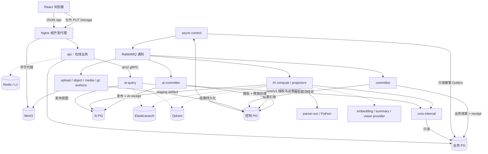
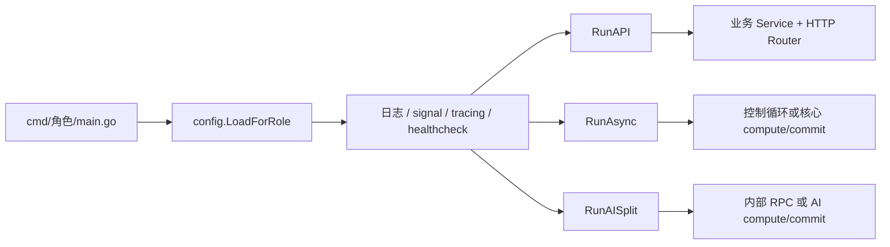
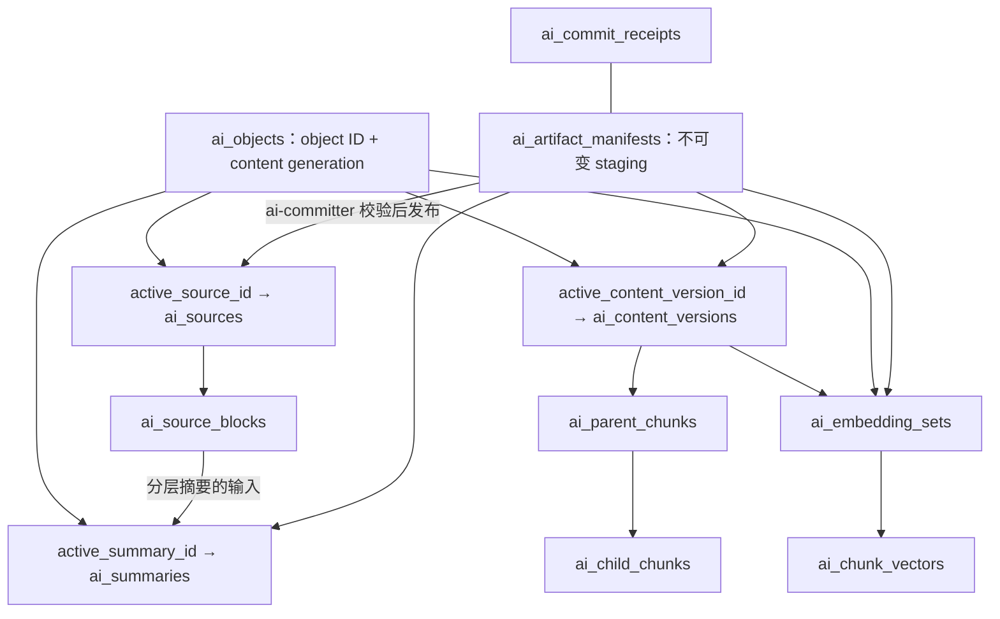
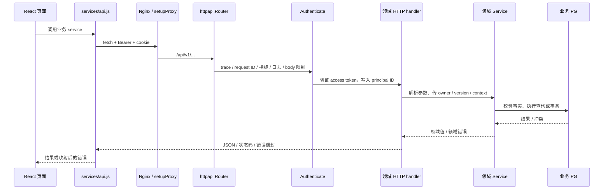
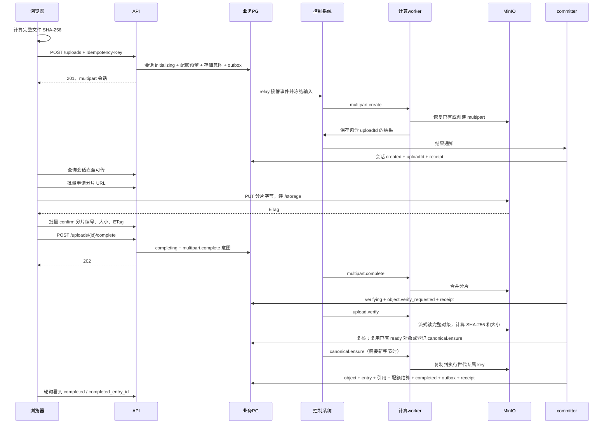
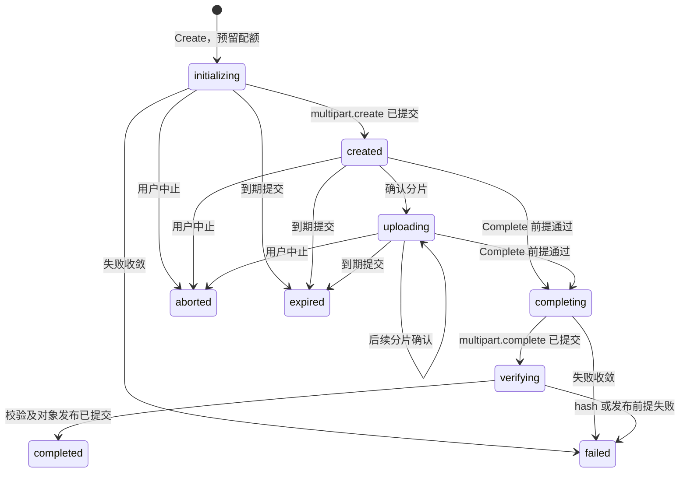
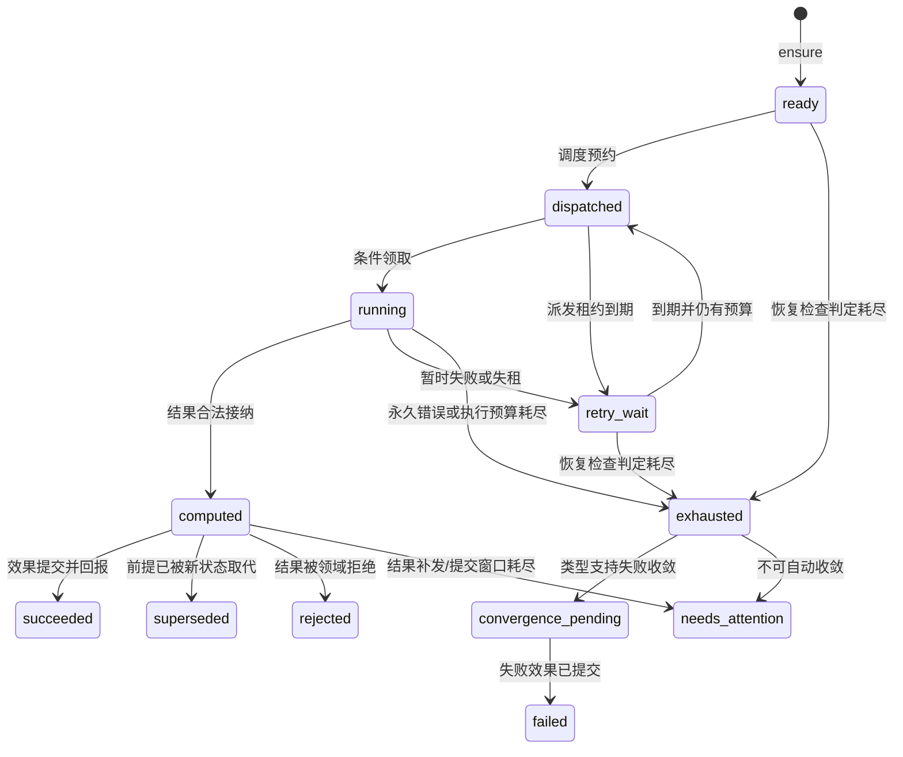
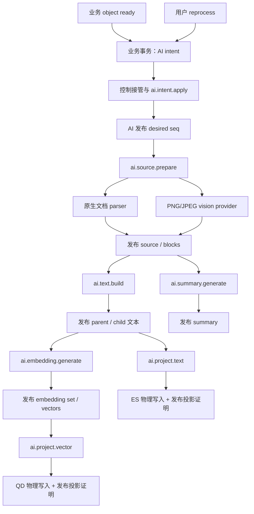
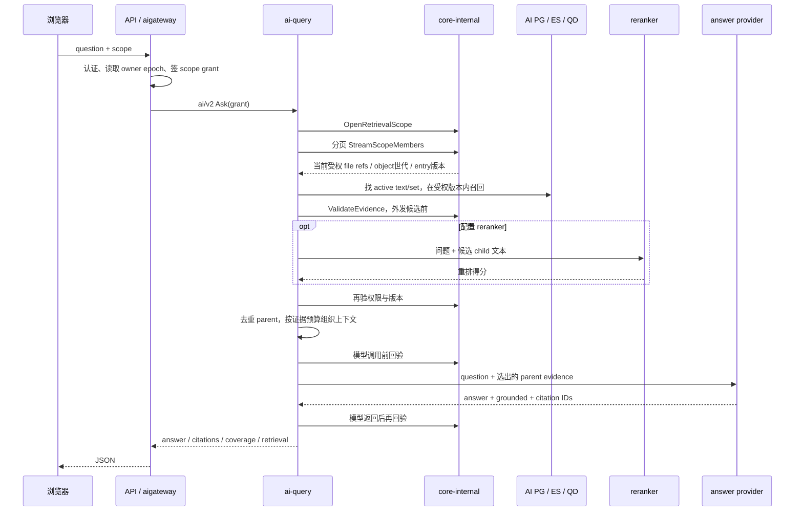

# BX YunPan 源码地图

> 核对日期：2026-11-18（UTC）。源码基线：`da945c649f56d57345d4e126a894e0e3e986a2c7`，开始核对时工作区无未提交变更。本文以当前工作区的可执行源码、SQL 迁移、路由注册和启动脚本为依据，不以 README、旧设计书、历史测试报告或代码注释单独证明实现。
>
> 这是一份代码结构与运行原理地图。文中的默认值来自代码，不能当作当前 `deploy/.env` 的实值；迁移版本指仓库文件版本，不能当作运行中数据库版本。本文制作过程没有启动服务、执行迁移、调用真实外部模型或做容量测试；第 18 节补充时运行了使用本地 HTTP/mock 的定向单元测试，结果见第 16.4 节。

## 导航
- [1. 先建立整体认识](#map-1)
- [2. 目录地图：每个目录承担什么](#map-2)
- [3. 进程地图：入口如何装配成运行角色](#map-3)
- [4. 数据地图：三套 PostgreSQL 与对象字节](#map-4)
- [5. API 原理：浏览器请求怎样变成业务事务](#map-5)
- [6. 上传全链路：从选择文件到正式可见](#map-6)
- [7. 网盘读写、缓存、配额与版本控制](#map-7)
- [8. 分享、导入、下载与删除](#map-8)
- [9. 异步系统：事实接管、执行、结果与提交](#map-9)
- [10. AI 离线链：解析、文本、向量、摘要与发布](#map-10)
- [11. AI 在线链：权限范围、搜索、RAG 与引用](#map-11)
- [12. 前端地图：页面、状态与请求组织](#map-12)
- [13. 配置、部署、迁移与可观测性](#map-13)
- [14. 按现象排查：应该沿哪条链查](#map-14)
- [15. 阅读路线与修改入口](#map-15)
- [16. 测试地图与本文核对边界](#map-16)
- [17. 当前代码里最容易读错的地方](#map-17)
- [18. 模型调用：错误分类、重试、降级与对外返回码](#map-18)

<a id="map-1"></a>
## 1. 先建立整体认识

### 1.1 这个系统到底分成哪几块

BX YunPan 是 React 浏览器应用，加上一个 Go module 内的多个独立运行角色。它同时处理四种不同的工作：

1. **在线业务**：登录、目录、文件元数据、配额、上传会话、分享与用户作业。
2. **异步执行控制**：决定任务是否能开始、谁拥有执行权、是否能重试、结果是否已提交。
3. **字节与计算**：操作 MinIO、计算 SHA-256、生成缩略图、解析文档、调用模型、写外部索引。
4. **派生内容查询**：检索已发布文本/向量，选择证据，调用回答模型。

它们有不同的事实来源，不能混成“一个 worker 从队列拿消息后随便写库”。

| 问题 | 由谁回答 | 主要证据 |
| --- | --- | --- |
| 文件属于谁、是否删除、还剩多少配额？ | 业务 PostgreSQL | `file_entries`、`file_objects`、配额表 |
| 哪个任务获得执行权、用了几次预算？ | 控制 PostgreSQL | `tasks`、`executions`、租约与预算表 |
| 当前可用的是哪个文本/向量/摘要版本？ | AI PostgreSQL | `ai_objects` 的 active 指针及发布数据 |
| 原始文件和缩略图的字节在哪里？ | MinIO | bucket 与 object key |
| 如何快速送达工作/结果通知？ | RabbitMQ | 工作队列、core/AI 结果队列 |
| 如何减少重复读和请求频率？ | L1、Redis | 元数据缓存、query embedding 缓存、限流 |
| 如何加速全文/向量召回？ | Elasticsearch、Qdrant | 经过 AI PG 证明可读的投影 |
| 如何发现内部服务副本？ | etcd + gRPC resolver | 服务注册键、TTL、地址变更 |

### 1.2 总体连接图



图中省略了注册发现、监控和部分只读连接。精确依赖见第 3 节。特别注意：**API 不打开控制 PG 和 RabbitMQ；AI 在线查询也不靠 MQ 完成一次搜索。**

### 1.3 七个容易混淆的词

| 词 | 当前源码含义 | 不能据此推导什么 |
| --- | --- | --- |
| file / entry | 用户目录中的逻辑文件，有名字、目录、owner 和版本 | 一个 entry 必然独占一份物理字节 |
| object | 按 SHA-256 + 大小识别的物理对象记录 | object ID 相同意味着永远是同一物理生命周期 |
| event | 业务事务已经记录的事实或意图 | 所有订阅者已经完成 |
| task | 控制库中一个带语义身份、预算、状态的执行单元 | 一条 MQ 消息本身就是任务事实 |
| result | 已经由控制库接纳的计算结果 | 对应业务或 AI 数据已经正式发布 |
| receipt | 效果库中与效果原子提交的证明 | 可以在效果事务提交前预先写成功 |
| job | 面向用户的一次 AI 重建请求与能力聚合状态 | 等同于某一个底层计算 task |

### 1.4 推荐怎么读

先读 API 与上传建立业务主线，再读异步系统理解“为何分成这么多步”，最后读 AI 发布与查询。只想定位代码时，看第 2、3、15 节；想理解故障时，看第 9、14 节；想理解 AI 是否能回答某个文件，看第 10、11 节。

<a id="map-2"></a>
## 2. 目录地图：每个目录承担什么

### 2.1 根目录

```text
bx_yunpan/
├── backend/                       Go module、SQL 迁移、Python parser
├── web/                           React 应用与线上 Nginx 配置
├── deploy/                        Compose、配置模板、启动/迁移/检查脚本
├── docs/                          说明与报告；包含历史快照，部分文件被忽略
├── artifacts/                     本地验证产物，不是线上代码
├── logs/                          本地日志，不是业务事实源
├── AGENTS.md                      仓库工作约定，具体实现仍需看源码
├── README.md                      产品/启动说明，部分架构描述落后于源码
├── ASYNC_SYSTEM_CONSTRUCTION_2026-11-16.md
├── AI_SYSTEM_SPLIT_CONSTRUCTION_2026-11-16.md
├── ARCHITECTURE_UPGRADE_PLAN_2026-11-10.md
└── CODEBASE_MAP.md                 本文：当前源码导航
```

根目录施工书和 `docs/` 可以解释背景，但本文没有把其中的目标状态直接当成当前实现。`.gitignore` 对 `docs/` 有白名单策略，本文放在根目录。

### 2.2 后端结构

```text
backend/
├── go.mod / go.sum                 一个 Go module 的依赖与版本
├── cmd/                            每个可执行角色的 main
├── internal/
│   ├── bootstrap/                  装配：给每个角色接哪些依赖、跑哪些循环
│   ├── identity/                   用户、密码、token、刷新会话、配额
│   ├── drive/                      目录树、文件 entry、分页、下载/预览入口
│   ├── upload/                     上传会话、分片记录、领域提交
│   ├── objectstore/                物理对象、引用数、GC 领域提交
│   ├── media/                      缩略图计算、变体发布与预览 URL
│   ├── sharing/                    分享创建/撤销/过期、公开读取、导入
│   ├── ownerepoch/                 owner 内容/ACL 版本与缓存一致性
│   ├── outbox/                     事实事件追加；还保留旧投递兼容代码
│   ├── storageops/                 存储操作意图；含旧执行兼容实现
│   ├── eventcontract/              事件类型、载荷、信封与校验
│   ├── asyncprotocol/              核心计算输入、输出、提交决策
│   ├── asynccontrol/               控制库权威、MQ、预算、租约、调度、结果
│   ├── asyncjobs/                  核心任务计划、字节计算、业务提交、导入
│   ├── aigateway/                  HTTP 到 AI v2；业务本地命令与作业查询
│   ├── core/                       AI 所需的 core/v1 只读 RPC 与重建命令
│   ├── aiprotocol/                 AI 意图、profile、授权、结果等共享值
│   ├── aisystem/                   当前 AI 计划/计算/发布/投影/查询实现
│   ├── ai/                         provider、reranker、parser、RAG 与旧 AI 实现
│   │   ├── rag/                    分块、父子片、token 估算、标题上下文
│   │   ├── parserengine/           Go 管理 Python 进程及 HTTP 适配
│   │   ├── parserrpc/              parser 的 gRPC 客户端与服务端
│   │   ├── pb/                     ai/v1 与 parser 生成代码
│   │   ├── pbv2/                   ai/v2 查询生成代码
│   │   ├── grpcclient/             旧 AI 客户端实现
│   │   └── grpcserver/             旧 AI 服务端实现
│   ├── textsearch/                 当前 PG/ES 共用的中文/混合文字词项协议
│   ├── search/                     旧搜索投影、回填与兼容工具使用的实现
│   ├── taskqueue/                  旧 RabbitMQ 任务执行层及迁移兼容
│   ├── recovery/                   旧恢复巡检，不在当前核心在线启动链
│   ├── workflow/                   保留的工作流实现，不在当前启动链
│   ├── contract/                   OpenAPI 生成代码，当前 handler 不由它驱动
│   ├── testdb/                     专用测试库/迁移 schema 辅助
│   ├── eventstream/                当前目录无实现文件
│   └── platform/                   通用基础设施，见下表
├── api/
│   ├── openapi.yaml                嵌入 API 二进制的 HTTP 契约
│   ├── spec.go / generate.go       embed 与生成入口
│   └── proto/
│       ├── ai/v1/ai.proto          旧 AI 契约及仍在用的 parser 服务
│       ├── ai/v2/query.proto       当前 AI 在线查询契约
│       └── core/v1/core.proto      core 内部授权读取契约
├── migrations/                    业务库：000001—000036
├── control-migrations/            控制库：000001—000004
├── ai-migrations/                 AI 库：000001—000010
├── archive-migrations/            旧 AI/search 表归档：000001
├── parser_worker/                 Python 原生格式解析器与 HTTP server
├── requirements-parser.txt        Python 解析依赖
├── Dockerfile                     Go 角色通用镜像构建
└── Makefile                       构建、生成、格式、lint、测试命令
```

这里的“旧”指当前默认启动路径不再调用其原有完整链路，不代表可随意删除。例如 `ai/provider.go`、`ai/rag/`、`parserrpc/`、`textsearch/` 都仍被新 AI 系统直接使用。

### 2.3 `platform/` 应该什么时候看

| 目录 | 作用 | 典型定位问题 |
| --- | --- | --- |
| [config](backend/internal/platform/config) | 环境变量加载、角色校验 | 某角色为何要求一个配置、开关从哪里来 |
| [dependencies](backend/internal/platform/dependencies) | 建连接、限制连接权限和连接池 | worker 是否拿到业务写连接 |
| [httpapi](backend/internal/platform/httpapi) | Gin Router、中间件、错误信封、探针、HTTP 指标 | 请求进来先经过什么 |
| [grpcx](backend/internal/platform/grpcx) | gRPC 超时、重试、熔断、metadata、指标 | 搜索与 Ask 的重试是否相同 |
| [serviceauth](backend/internal/platform/serviceauth) | 服务 token、签名授权、TLS 配置 | 内部 RPC 的服务身份与资源授权 |
| [registry](backend/internal/platform/registry) | etcd 注册与 resolver | 副本地址如何加入/退出 |
| [storageurl](backend/internal/platform/storageurl) | S3 预签名与同源路径 | `/storage` URL 为什么能通过签名 |
| [cache](backend/internal/platform/cache) | L1/L2、singleflight、embedding cache | Redis 故障是否阻塞核心读 |
| [dblock](backend/internal/platform/dblock) | PG advisory lock 等互斥工具 | 同名、同内容、幂等请求如何串行 |
| [tracing](backend/internal/platform/tracing) | OpenTelemetry 初始化 | HTTP、RPC、异步 span 如何连接 |
| [dbmetrics](backend/internal/platform/dbmetrics) | DB pool 与积压指标 | 数据库连接和任务积压 |
| [worker](backend/internal/platform/worker) | 保留的角色/执行与监控工具 | 旧角色定义与兼容入口 |
| [health](backend/internal/platform/health) | 探针执行 | live 与 ready 为什么不同 |
| [breaker](backend/internal/platform/breaker) | 熔断状态 | 下游故障后的快速失败和恢复 |
| [logging](backend/internal/platform/logging) | slog 输出配置 | 日志级别与格式 |

### 2.4 模块之间的真实职责分界

| 模块 | 接收什么 | 产出什么 | 核心边界 |
| --- | --- | --- | --- |
| `identity` | 用户凭据、配额变化 | 会话、token、配额事实 | 不决定异步任务执行权 |
| `drive` | owner、目录/file ID、版本 | 元数据、entry、读 URL | entry 与 object 分离 |
| `upload` | 上传元数据、分片确认、计算结果 | 上传会话状态、最终 entry 或失败 | 新链路的字节计算与领域提交分开 |
| `objectstore` | 引用变化、删除授权/结果 | 对象生命周期与引用事实 | 逻辑删除不直接等于删除字节 |
| `sharing` | 分享命令、分享 token、导入命令 | 分享事实、授权读取、导入 entry | 导入复用字节但独立占逻辑配额 |
| `asynccontrol` | Spec、通知、结果与报告 | 执行权、冻结后继、终态 | 不写业务效果，不调用对象存储 |
| `asyncjobs` | 业务事件、核心 task/result | 核心计算和事务提交 | planner、computer、committer 分工 |
| `aigateway` | 已认证 HTTP 请求 | scope grant、RPC 请求、业务 job | 不直接连 AI PG 或控制 PG |
| `core` | scope/processing grant | 受权文件列表、证据验证、短期对象 URL | AI 无需业务 SQL 权限 |
| `aisystem` | 冻结意图、artifact、受权查询 | 已发布 AI 内容、搜索结果、答案 | staging、发布、在线读取分离 |

<a id="map-3"></a>
## 3. 进程地图：入口如何装配成运行角色

### 3.1 从 `main` 到业务逻辑

三个主要装配入口是：

- [bootstrap/api.go](backend/internal/bootstrap/api.go)：`RunAPI`。
- [bootstrap/async.go](backend/internal/bootstrap/async.go)：`RunAsync`、`asyncStore`。
- [bootstrap/ai_split.go](backend/internal/bootstrap/ai_split.go)：`RunAIRole`、`RunAISplit`、`serveInternal`。



`cmd/` 主要决定“当前进程是谁”。真正决定角色拿哪些连接、消费哪些队列的是 bootstrap，判断架构必须沿调用进入 bootstrap，不能仅看二进制名字。

### 3.2 当前核心角色

| 角色 | 业务 PG | 控制 PG | MQ | MinIO | 核心工作 |
| --- | --- | --- | --- | --- | --- |
| `api` | 读写 | 无 | 无 | 客户端/签名/探针/公开分享读取 | 业务请求与事实事务 |
| `async-control` | 只读 | 普通池 + critical 池 | 发布与死信消费 | 无 | relay、scheduler、结果补发、维护 |
| `upload-worker` | 只读 | 普通池 + critical 池 | `upload` 工作通知 | 创建/完成 multipart、复制 | 返回计算结果 |
| `object-worker` | 只读 | 普通池 + critical 池 | `object` 工作通知 | 读取 | SHA-256 与大小校验 |
| `media-worker` | 只读 | 普通池 + critical 池 | `media` 工作通知 | 读原图/写变体 | 缩略图计算 |
| `gc-worker` | 只读 | 普通池 + critical 池 | `gc` 工作通知 | abort/delete/sweep | 清理字节 + 上传会话到期兜底扫描 |
| `committer` | 读写，另有只读池 | 普通池 + critical 池 | core 结果通知 | 不装配存储客户端 | 业务效果、receipt、控制报告 |

证据：[dependencies/async.go](backend/internal/platform/dependencies/async.go) 的 `OpenAsync`。只有 `role == "committer"` 才传入 `write=true`；业务只读 DSN 还会设置 `default_transaction_read_only=on`，并检查 `file_entries`、`upload_sessions` 的写权限，避免只用连接字符串命名来假装只读。

critical 池连接同一个控制库，用于续租、保存结果等关键动作。它解决普通控制查询占满连接池时关键操作被挤压的问题，不是第二套任务权威。

### 3.3 当前 AI 角色

| 角色 | 数据连接与外部依赖 | 工作 |
| --- | --- | --- |
| `core-internal` | 业务只读 PG、签名器 | 提供 `core/v1.CoreReadService` |
| `ai-query` | AI query 只读账号、core RPC、可选 Redis/模型/ES/QD | 搜索、Ask、overview、能力查询；不消费任务 |
| `ai-content-worker` | AI compute 账号、控制 PG、MQ、core RPC、parser/vision | intent/source/text/tombstone/capability；另消费 `ai-maintenance` |
| `ai-embedding-worker` | AI compute 账号、控制 PG、MQ、provider | 生成子片向量 |
| `ai-summary-worker` | AI compute 账号、控制 PG、MQ、provider | 从 source blocks 分层汇总摘要；读私有 checkpoint 视图 |
| `ai-text-projector` | AI compute 账号、控制 PG、MQ、ES | 将已发布子文本写入全文投影 |
| `ai-vector-projector` | AI compute 账号、控制 PG、MQ、Qdrant | 将已发布向量写入向量投影 |
| `ai-committer` | AI commit 账号、控制 PG、MQ | 接纳 artifact，发布版本，写 AI receipt，报告控制库 |
| `parser-svc` | gRPC、Python 子进程、可选 etcd | 格式解析服务，不直接管理任务生命周期 |

`RunAISplit` 先为非 core 角色打开 AI 角色连接和 core RPC 客户端，再按角色分支。表格列的是实际工作依赖；不能把“装配了一个客户端”推导成每个任务都会调用它。

AI 账号权限由 [ai-role-init.sql](deploy/ai-role-init.sql) 建立，运行时由 [dependencies/ai.go](backend/internal/platform/dependencies/ai.go) 的 `OpenAI` 再检查：query 不能读任意 staging；compute 不能写发布表；committer 必须有发布权限。

### 3.4 命令存在不等于当前正常运行入口

| 命令 | 当前行为 |
| --- | --- |
| `worker` | 映射 `async-control`，不再运行混合计算 worker |
| `outbox-relay` | 映射 `async-control` |
| `maintenance-worker` | 映射 `gc-worker` |
| `aisvc` | `AI_SERVICE_ROLE=query` 映射 query，`indexer` 映射 embedding worker；combined 退出报错 |
| `search-indexer` | 按显式 `AI_PROJECTION_ROLE=text/vector` 转到对应 projector；未指定会退出 |
| `migrate` | 业务/control/AI/archive SQL 迁移工具 |
| `async-import` | 停旧写者之后的核心遗留任务接管工具 |
| `async-admin` | inspect / redo 运维工具 |
| `ai-migrate` | AI 数据/作业/消息保留交接与切换校验 |
| `migrate-asynq` | 旧 Asynq 数据迁移工具，非在线调度器 |
| `search-backfill` | 使用旧 `internal/search` 的回填/状态/切换工具，非当前 AI v2 在线投影入口 |
| `tokenprobe` | token 诊断工具，非服务角色 |

同一别名和对应新角色同时启动，会增加同类进程，不能按“一个控制、一个旧 worker”理解其职责。当前默认服务选择以 [deploy/up.sh](deploy/up.sh) 为准。

<a id="map-4"></a>
## 4. 数据地图：三套 PostgreSQL 与对象字节

### 4.1 业务库：用户可见事实

| 表或表组 | 保存什么 | 常见写者 |
| --- | --- | --- |
| `users`、`refresh_sessions` | 用户身份、密码摘要、刷新会话 | API 的 identity |
| `folders` | owner 下的目录树、名字、版本、删除标记 | API 的 drive |
| `file_entries` | 逻辑文件、owner、folder、object 关系、版本 | API、committer |
| `file_objects` | 内容哈希、大小、bucket/key、引用数、生命周期与世代 | API 引用变更、committer |
| `upload_sessions`、`upload_parts` | 上传状态、预留配额、multipart ID、分片确认 | API、committer |
| `storage_operations` | 字节操作业务意图与最终结论 | API/committer 登记，committer 提交结论 |
| `object_variants` | 缩略图等派生字节的发布记录 | committer |
| `shares`、`share_imports` | 分享状态/源快照、幂等导入记录 | API |
| `outbox_events` | 与事实事务一起提交的事件/意图 | API、committer |
| `async_commit_receipts` | 核心异步效果幂等凭据 | committer |
| `user_quota_usage` | 热路径 `occupied_bytes` | API、committer |
| `owner_content_epochs`、`owner_async_epochs` | API 与后台内容版本、ACL 版本 | API、committer |
| `ai_resource_intents` | 每个 object 世代各 AI 能力的请求序号 | API、committer 产生初始意图 |
| `async_tasks`、`ai_job_requests` | 用户 AI job 与目标/结果版本 | API 建立，committer 完成 |
| `ai_split_cutovers` | AI 切换验证标记 | 迁移工具 |

`async_tasks` 这个名字容易误导：当前控制执行权在另一个库的 `tasks` 中。业务库的 `async_tasks` 在新 AI 链中承担用户作业展示，不负责 worker 领取。

### 4.2 控制库：执行事实

| 表或表组 | 在链路中的意义 |
| --- | --- |
| `event_inbox` | 事件已接管、摘要、冻结计划、隔离结论 |
| `relay_positions` | 已可靠接管到哪个 `(event_xid, seq)` |
| `tasks` | 语义身份、输入摘要、owner/resource/shard、状态、预算、期限 |
| `task_sources` | 为什么存在这个任务：事件、扫描、后继、导入或手工恢复来源 |
| `executions` | 每次 execution generation、租约 token、开始/结束、外部输出位置 |
| `results` | 被接纳的结果摘要、载荷、effect target、提交结论 |
| `task_continuations` | 针对某个已接纳结果冻结的后继 Spec；初始 blocked |
| `module_leases` | relay/scheduler/results/分片/维护模块的持有者 |
| `queue_budgets` | 全局 inflight、owner 限制、公平游标、背压 |
| `write_budget`、`write_permits` | core/AI 提交共享的写并发与速率预算 |
| `committer_members` | 按 effect target 记录在线 committer 成员 |
| `scan_positions` | 有界兜底扫描的游标 |
| `quarantines` | 协议冲突、坏消息、不可证明历史的持久隔离 |
| `ai_job_task_links`、`ai_job_aggregates` | 用户 job 对底层任务的订阅与能力聚合 |
| `ai_job_observers` | 给已冻结请求挂接迁移来的观察者，不修改原任务输入 |
| `control_settings` | 分片布局、导入/切换标记等 |

建表依据：[control-migrations](backend/control-migrations)。后续迁移会补充字段，因此查最终结构要依序读完 `000001`—`000004`，不能只读第一张建表。

### 4.3 AI 库：计算暂存与已发布内容



其他关键表：`ai_capability_status` 保存每种能力最新构建观测；`ai_projection_targets` 和 `ai_projection_states` 保存外部投影目标及完成证明；`ai_orphan_projections` 保存需要收回的未接纳外部输出；`ai_migration_*` 保存交接证据。

query/compute 主要读取 `ai_published_*` 视图。视图排除 tombstone 或未发布状态，但**当前版本的最终选择还需要 `ai_objects` 的 active 指针**。不能把视图里任意历史 published 版本当成当前版本。

`ai_summary_checkpoints` 是 `ai_artifact_manifests` 的受限视图，只暴露摘要节点。它不代表 query 可以读 staging，也不等于摘要已经发布。

### 4.4 三库之间没有跨库事务

每个重要边界都采取“先在本库持久化，再在另一库推进”的结构：

```text
业务事务：事实变化 + outbox_events
    ↓ 只读 relay
控制事务：inbox + 冻结计划 + task/source + relay 位点
    ↓ compute
控制事务：接纳 result + 冻结后继
    ↓ committer
效果事务：业务效果/AI 发布 + receipt
    ↓ report
控制事务：结果已提交 + task 终态 + 后继释放
```

这里的“效果事务”属于业务库或 AI 库，取决于 `effect_target`。失败窗口通过重复送达和 receipt 恢复，不靠跨库 JOIN、两阶段提交或 MQ ACK 原子包含数据库事务。

### 4.5 对象身份、内容世代和执行世代

| 标识 | 防止哪种混淆 |
| --- | --- |
| `file_entries.id` | 不同用户逻辑文件或一次重新创建 |
| `file_objects.id` | 一个内容寻址对象记录 |
| `content_generation` | 同一对象删除后重新存活的新一代字节 |
| `gc_generation` | 引用归零的不同回收周期 |
| `tasks.semantic_key` | 同一业务语义工作重复创建 |
| `tasks.generation` | 同一任务不同次实际执行 |
| `dispatch_generation` | 同一任务不同次派发通知 |
| `token` | 同一代执行租约的当前持有者 |
| `input_digest` / `result_digest` | 同身份被替换输入/结果 |
| AI 的 source/text/vector/summary seq | 旧能力结果晚到覆盖新请求 |

这些版本分别保护不同边界，不能用一个统一 `version` 代替全部。

<a id="map-5"></a>
## 5. API 原理：浏览器请求怎样变成业务事务

### 5.1 请求主路径



HTTP handler 手工注册在 [httpapi/router.go](backend/internal/platform/httpapi/router.go) 的 `/api/v1` group 中。它们没有通过 `internal/contract` 的生成 server 接口自动挂载。

### 5.2 全局中间件顺序

`NewRouter` 中依次安装：

1. `otelgin`：恢复上游 trace context，创建 HTTP server span；探针等路由有采样过滤。
2. `RequestID`：读取或生成 `X-Request-ID`，写响应头和 RPC 上下文。
3. Outbox context：带入兼容事件/搜索开关值。
4. metrics：按请求统计。
5. access log：记录路由、路径、状态、耗时。
6. recovery：捕获 panic，返回标准 500。
7. request body 限制。
8. 具体路由再安装 JWT 认证、AI body 限制或目录并发门限。

目录 children 的并发门限在 `RunAPI` 中按 `Postgres.MaxOpenConns / 2` 设置，至少为 1；满时立即返回 503 与 `Retry-After: 1`，不在 handler 内无限排队。它是单 API 进程门限，不是全部副本的统一预算。

### 5.3 身份认证为何有两种 token

| token | 生成与保存 | 使用方式 |
| --- | --- | --- |
| access token | Ed25519/EdDSA JWT，含 issuer、subject、audience、期限；前端存在模块内存中 | `Authorization: Bearer ...` |
| refresh token | 32 字节随机数的 URL-safe 编码；DB 保存 SHA-256 摘要 | `HttpOnly`、`SameSite=Strict` cookie；路径 `/api/v1/auth` |

密码采用 Argon2id，见 [identity/password.go](backend/internal/identity/password.go)。JWT 默认 access TTL 为 15 分钟，refresh 默认 30 天，实际由配置决定。

前端 [services/api.js](web/src/services/api.js) 在遇到一次 401 时，通过共享 `refreshPromise` 合并同时发生的刷新请求，然后最多重放原请求一次。刷新 cookie 命令另有 `http.CrossOriginProtection` 检查，所以代理保留原始 Host 对正确判断 Origin 很重要。

服务端 `Rotate` 以 refresh family 的 advisory lock 串行，再锁当前会话行：正常轮换会撤销旧 token 并签发后继；发现已撤销 token 被复用，则先提交整个 family 的撤销，再返回认证失败。

JWT 认证中间件主要验证签名和 claims；具体资源是否属于该 owner、是否删除，需要领域 SQL 再判断。登出撤销 refresh token 不等于所有已签发 JWT 立即消失。

### 5.4 完整 HTTP 路由分区

下面除探针/文档外，路径均以前缀 `/api/v1` 开始。参数和细节以各 `RegisterRoutes` 与 handler 为准。

| 分区 | 方法与路径 | 作用 / 关键规则 | 源码 |
| --- | --- | --- | --- |
| 身份 | `POST /auth/register`、`POST /auth/login` | 签发 access + refresh cookie | [identity/http.go](backend/internal/identity/http.go) |
| 身份 | `POST /auth/refresh`、`POST /auth/logout` | cookie 轮换/撤销；logout 还要求认证 | 同上 |
| 用户 | `GET /users/me`、`GET /users/me/quota` | 当前用户、逻辑用量和预留配额 | 同上 |
| 目录 | `GET /folders/root` | owner 根目录 | [drive/http.go](backend/internal/drive/http.go) |
| 目录 | `GET /folders/:folderId/children` | keyset 分页、cursor、limit、sort | 同上 |
| 目录 | `GET /folders/:folderId/breadcrumb` | 面包屑 | 同上 |
| 目录 | `POST /folders` | 建目录 | 同上 |
| 目录 | `PATCH /folders/:folderId`、`POST /folders/:folderId/move`、`DELETE /folders/:folderId` | 重命名、移动、删除；版本前提 | 同上 |
| 文件 | `GET /files/:fileId` | 文件元数据及可选 AI 状态 | [drive/file_http.go](backend/internal/drive/file_http.go) |
| 文件 | `PATCH /files/:fileId`、`POST /files/:fileId/move`、`DELETE /files/:fileId` | 需要数值 `If-Match` | 同上 |
| 字节入口 | `GET /files/:fileId/download-url`、`GET /files/:fileId/preview` | 受权读取/预览 URL 或不支持状态 | 同上 |
| 上传 | `POST /uploads` | 创建上传；要求 `Idempotency-Key`；201 可能仍在 initializing | [upload/http.go](backend/internal/upload/http.go) |
| 上传 | `GET /uploads`、`GET /uploads/:uploadId` | 活跃会话与进度 | 同上 |
| 上传 | `DELETE /uploads/:uploadId` | 业务中止并登记清理，不同步删除字节 | 同上 |
| 上传 | `POST /uploads/:uploadId/parts/presign` | 批量签分片 PUT URL，最多 20 个 | 同上 |
| 上传 | `POST /uploads/:uploadId/parts/confirm` | 批量登记 ETag/大小，最多 100 个；支持 `view=delta` | 同上 |
| 上传 | `POST /uploads/:uploadId/complete` | 校验已确认分片，登记完成意图，202 | 同上 |
| 分享 | `GET /shares`、`POST /shares`、`GET /shares/:shareId` | 列表、创建、详情 | [sharing/http.go](backend/internal/sharing/http.go) |
| 分享 | `PATCH /shares/:shareId`、`DELETE /shares/:shareId` | 更新期限、撤销 | 同上 |
| 分享 | `POST /shares/:shareId/import` | 登录用户导入；幂等键 + `X-Share-Token` | 同上 |
| 公开分享 | `POST /public/shares/resolve` | 分享 key 换短期 access token | 同上 |
| 公开分享 | `GET /public/shares/content` | 验证分享并返回内容入口 | 同上 |
| 公开分享 | `GET /public/shares/file`、`HEAD /public/shares/file` | Go 受权流式读取；支持 ServeContent | 同上 |
| 搜索 | `POST /search` | `name / fulltext / semantic / hybrid` 四种模式 | [aigateway/http.go](backend/internal/aigateway/http.go) |
| AI | `POST /ai/ask` | 同步 Ask RPC，带 scope | 同上 |
| AI | `GET /ai/files` | AI 文件工作区/选择文件分页入口 | 同上 |
| AI | `GET /files/:fileId/ai` | overview、各能力状态、摘要与版本 | 同上 |
| AI | `POST /files/:fileId/ai/reprocess` | 业务本地写入 job/intent，202 | 同上 |
| AI | `GET /ai/jobs/:taskId` | 读取本用户 job 与能力结论 | 同上 |
| 系统 | `GET /health/live`、`GET /health/ready`、`GET /metrics` | 存活、依赖就绪、指标 | [httpapi/router.go](backend/internal/platform/httpapi/router.go) |
| 契约 | `GET /openapi.yaml`、`GET /docs` | embed 的 YAML 与 ReDoc 页面 | 同上 |

### 5.5 状态码不等于后台完成度

- 创建上传返回 201，只表示业务会话已创建；若响应是 `initializing`，multipart 尚未准备完成。
- Complete 返回 202，表示接受异步完成请求；不是 hash 已通过，也不是 entry 已创建。
- AI reprocess 返回 202，表示用户 job/intent 已记录；具体能力还要经过多个 task。
- DELETE 返回 204 可能只完成逻辑事实变化；后续 GC 是另外的链。
- 409 常用于资源版本、幂等输入或名称冲突；422 常用于输入/cursor 格式错误；429 可表示配额或限流，需看 error code。

错误通常采用：

```json
{
  "error": { "code": "drive.conflict", "message": "..." },
  "request_id": "..."
}
```

AI scope 错误还可能携带失效文件等详情。修改 HTTP 接口时，handler、前端调用与 `backend/api/openapi.yaml` 都需核对；改生成代码本身不会自动改当前路由行为。

### 5.6 API 调 AI 的超时、重试与熔断

当前 v2 链通过 [grpcx/client.go](backend/internal/platform/grpcx/client.go) 做总超时和有限重试。Ask、semantic/hybrid Search 可能产生模型费用，默认不重放；fulltext Search 与其他无模型读取可按 read attempts 重试，且只对允许的 Unavailable 错误重试，所有尝试共用一个总 context budget。

熔断按 RPC method 分组，Search 还按 mode 分组，避免回答模型故障把全文查询一并熔断。Request ID 与 trace context 通过 HTTP、gRPC metadata 和异步 trace 字段传递。不要用 `bootstrap/api.go` 后半段保留的旧 `newAIClient` 策略解释当前 ai/v2 调用。

### 5.7 `/storage` 路径与签名如何配合

[storageurl.Presigner](backend/internal/platform/storageurl/presigner.go) 按公开 endpoint/Host 计算 S3 签名，再加浏览器可见的 `/storage` 前缀；Nginx/开发代理转发时去掉此前缀并保留 Host，让 MinIO 收到签名时的 bucket/key 路径和 Host。路径或 Host 重写错误会导致 SignatureDoesNotMatch，即使 MinIO 用户名密码本身正确。

API 内部 storage client、浏览器 presigner、core 给内部 compute 签的短期 URL 使用不同可达地址：前者可用 Docker 服务名，浏览器必须可达公开地址，内部 AI 则通过 core 提供的授权 URL 读取。它们指向同一对象，也不能互相随意替换地址。

<a id="map-6"></a>
## 6. 上传全链路：从选择文件到正式可见

### 6.1 先区分控制请求与文件字节

浏览器向 API 发的是小型 JSON：文件名、目标目录、SHA-256、大小、分片编号、ETag。实际分片通过预签名 URL 向 `/storage` PUT，由代理转给 MinIO。API 负责授权和状态；upload/object worker 执行存储调用与校验；committer 发布业务结果。

这里还有一个容易遗漏的区别：普通文件下载也是预签名直读，但**公开分享下载会经过 Go 的分享权限网关**，见第 8 节。不能把“上传不经过 Go”扩展为“系统所有文件字节都不经过 Go”。

### 6.2 一次正常分片上传的时序



图把多次 MQ 与控制回报压缩了。每个计算结果都先落控制库，再由结果通道驱动 committer；worker 不直接把会话推进到 completed。

源码主线：[前端上传编排](web/src/services/multipartUpload.js) → [HTTP handler](backend/internal/upload/http.go) → [会话服务](backend/internal/upload/service.go) → [任务计划](backend/internal/asyncjobs/planner.go) → [计算](backend/internal/asyncjobs/compute.go) → [提交组织](backend/internal/asyncjobs/committer.go) → [上传领域提交](backend/internal/upload/async_commit.go)。

### 6.3 Create：为什么第一次响应可能还不能上传

`upload.Service.Create` 做以下事情：

1. 规范化文件名，验证 hash、正大小、MIME、幂等键、目标目录归属。
2. 在事务中按 `owner + Idempotency-Key` 加 advisory lock。相同键、相同输入返回既有会话/文件；相同键、不同目录、文件名、hash、大小或 MIME 返回冲突。
3. 按 `SHA-256 + size` 和目标文件名加锁，检查现有 entry 及未到期的同名活跃会话。
4. 尝试 `FindOwnedWith`：当前用户已有可用对象时走秒传。
5. 普通上传创建 `staging/<user>/<session>` 会话，状态为 `initializing`；预留配额，记录 `multipart.create` 存储意图和上传到期事件。
6. 事务提交即返回。此时尚未调用 MinIO 创建 multipart。

只有 worker 计算出 uploadId，committer 将其写回并推进为 `created`，才能申请分片 URL。前端因此需要等待初始化完成。

**秒传有归属限制。** 不是知道任意文件 hash 就能直接引用其他用户的字节。Create 查的是当前 owner 已拥有的 ready 对象；分享导入有单独的授权路径。秒传仍创建 entry、加引用、增加逻辑用量、推进 owner epoch、发出 `file.created`，并保留 completed 会话作为幂等结果。

### 6.4 分片、确认与 Complete 各证明什么

| 阶段 | 实际证明 | 尚未证明 |
| --- | --- | --- |
| 浏览器算 hash | 客户端声明内容身份 | 存储端收到的字节符合声明 |
| presign | owner、会话、状态、编号通过校验，允许短期 PUT | 分片已上传 |
| PUT 成功 + ETag | MinIO 接受对应分片请求 | 完整文件 SHA-256 正确 |
| confirm | API 记录客户端报告的分片编号、大小和 ETag | 服务端已逐片读回校验 |
| Complete 202 | 分片记录齐全且连续、大小和编号符合计划，完成意图已落库 | 合并完成或 entry 可见 |
| verify 结果 | worker 从对象存储流式读出的实际 hash 与大小 | 业务提交时前提仍然成立 |
| completed | committer 已创建/复用 object、建 entry、结算配额 | 缩略图和 AI 必然准备完成 |

分片计划从 **10 MiB** 起步；若分片数超过 10,000，逐次翻倍 part size。presign 每批最多 20 个编号；confirm 每批最多 100 条。最后一片按剩余字节计算，不能按普通片大小验证。确认和 delta 响应见 [parts.go](backend/internal/upload/parts.go)。

### 6.5 会话状态地图



这张图展示主要边；具体合法状态集合以各方法的条件更新为准。`Abort` 对 completing、verifying、completed 返回冲突；用户不能在合并/校验中途把会话随意改成 aborted。重复 Complete 对 completing/verifying/completed 可返回既有状态。

### 6.6 校验通过后为什么还可能复制一次

`upload.verify` 只读 staging 并计算 hash/size，不直接发布文件。committer 再锁内容身份：

- 已存在可用对象：在事务中直接完成 entry、引用和配额结算。
- 没有可复用 ready 对象：登记 `canonical.ensure`，交给 upload worker 复制字节。

复制输出形如 `objects/compute/<operation>/<task>/g<generation>`。它包含任务与执行世代，避免失租旧 worker 的迟到写覆盖新执行输出。worker 在写之前记录 output manifest；committer 验证 key 必须处于获准目标前缀。

并发上传相同内容时，不以“谁先把文件拷到固定 hash key”决定归属。最终提交会重新查 `SHA-256 + size`：新建 object、复用已发布 object，或把已 deleted 且零引用的 object 以 **content_generation + 1** 恢复。竞争落败的私有输出显式登记清理。

### 6.7 最后一次业务事务做了什么

`finishAsync` 校验目标目录和冲突，然后在同一个业务事务里：

- 建 `file_entries`，为 object 增加引用。
- 把本会话预留额度转换为逻辑占用，清零 `reserved_bytes`。
- 把会话置为 completed，写完成的 object/entry ID。
- 推进 owner content epoch。
- 写 `file.created`、`object.ready`；这些事件继续推动派生处理。
- 登记 staging 清理；外层 committer 同事务写 `async_commit_receipts`。

因此“文件已上传”和“文件已出现在目录里”的分界点是这次事务提交。缩略图和 AI 的推进发生在后续任务中。

### 6.8 失败与遗留字节如何处理

`multipart.create` 在 S3 层本身不幂等。计算实现会在会话专属 key 下有界查找已有 multipart，再决定是否创建；查找分页有上限。Complete 收到 `NoSuchUpload` 时，允许通过已合并对象的 size 判断是否处于“合并已成功、响应丢失”的窗口，完整 hash 仍留给 verify。

终止会话会释放预留、登记已知 uploadId 的 abort 和延迟 multipart sweep。staging 清理与正式对象/缩略图计算输出使用不同规则：前者可配 lifecycle；后者需要 output manifest、提交状态及安全宽限证明，不能按一个统一前缀 TTL 删除。到期控制任务之外，代码还保留有界的上传到期扫描作兜底。

<a id="map-7"></a>
## 7. 网盘读写、缓存、配额与版本控制

### 7.1 目录不是 MinIO 的文件夹

目录关系由 `folders.parent_id` 和 `file_entries.folder_id` 表示。重命名和移动修改业务 PG 的 entry/folder 元数据，不需要把 MinIO 对象改名或复制。对象字节 key 与用户看到的目录路径没有一一对应关系。

[drive.Service](backend/internal/drive/service.go) 管目录、entry 查询与元数据修改；[FileManager](backend/internal/drive/files.go) 组织文件删除、对象引用、配额以及下载预览。`objectstore.Service` 不负责决定某用户是否能访问某 entry。

### 7.2 列目录的完整读路径

```text
GET /folders/:folderId/children
  → authenticate 得到 owner
  → 校验目录仍属于 owner 且未删除
  → 从业务 PG 读取当前 content/ACL epoch
  → 校验 cursor 的目录、排序及 epoch
  → 首屏查 L1/Redis；后续页直接有界 SQL
  → SQL 联合读取目录项与文件项，按稳定顺序 keyset 翻页
  → 刷新文件 AI 状态（如启用）
  → 再读 epoch，确认读取过程中版本没有变化
  → 返回 folders / files / has_more / cursor
```

默认页大小 50，范围 1–100；当前支持 `name_asc` / `name_desc`。cursor 编码了版本、owner/目录 scope、内容/ACL epoch、条目种类、名字、ID 和排序，不是 offset。名称相同或排序键相近时，用稳定键继续定位。

`ErrInvalidCursor` 表示格式、scope 或排序不匹配；`ErrCursorStale` 表示目录数据版本已改变。前端应重新从首屏读取，不能带旧 cursor 硬接新版本数据。详情见 `childrenPage`、`loadChildrenPage`、`encodeChildCursor`。

### 7.3 缓存一致性的关键在版本，而非广播删 key

[ownerepoch.Current](backend/internal/ownerepoch/epoch.go) 用同一 SQL 语句读取：

```text
有效 content epoch = owner_content_epochs.content_epoch
                    + owner_async_epochs.content_epoch
ACL epoch          = owner_content_epochs.acl_epoch
```

API 写者更新前一内容计数，带 `ownerepoch.Background` 的后台提交更新后一内容计数；查询组合二者，减少前后台争用同一计数热行。批提交可在同一事务内按 owner 合并 bump。

首屏 key 包含 owner、folder、有效 content epoch、ACL epoch、limit、sort。写事务一旦提交了新 epoch，各 API 副本下次查询会自然进入新 key；本进程 `clearFolder` / `clearFile` 是补充优化。缓存命中前后仍读已提交版本，权限和配额也不拿 Redis 的陈旧值作最终依据。

缓存实现见 [platform/cache/json.go](backend/internal/platform/cache/json.go)：有界 L1、Redis L2、加载合并与过期。不能因为用了缓存就省略事实库的 epoch/权限查询。

### 7.4 并发修改如何避免覆盖别人

重命名、移动、删除携带资源 `version`（HTTP 通过 `If-Match`）。service 锁定当前资源、检查 owner/删除状态和版本，再做更新并 `version + 1`。同一个版本的两个并发修改，后提交者不能无声覆盖先提交者。

PG advisory lock 解决跨 API 副本的复合业务互斥，例如上传幂等键、内容身份、目录目标文件名和异步 receipt。行锁解决已有行的并发修改；唯一约束负责最后一道结构性保护。入口见 [platform/dblock](backend/internal/platform/dblock)、`drive.Service` 和领域提交代码。

### 7.5 配额算逻辑引用，不算去重后的磁盘占用

| 值 | 含义 | 权威来源 |
| --- | --- | --- |
| quota_bytes | 用户允许占用的上限 | `users` |
| occupied_bytes | 已用逻辑字节 + 未结算上传预留 | `user_quota_usage` |
| reserved_bytes | 尚未结算会话的预留 | `upload_sessions` 汇总 |
| used_logical_bytes | occupied − reserved | 查询时组合 |
| 物理 MinIO 占用 | 包括对象、分片、变体和待清理输出 | 不等于上述任一用户配额值 |

[identity.changeQuota](backend/internal/identity/service.go) 用带条件的 SQL UPDATE 做 admission：用户 active、结果非负且不超过 quota 才成功；没有通过“先查余额、再无条件加用量”完成准入。

正常上传先预留整个 size，完成时从 reserved 转为 logical；失败/中止释放预留。秒传和分享导入虽然不再上传一份字节，仍增加用户逻辑用量。删除 entry 释放逻辑用量，但字节是否回收还取决于全局引用数和 GC。

### 7.6 文件夹删除的实际能力边界

当前 `DeleteWithContext` 只允许删除空目录：存在未删除子目录或文件就返回 not-empty；根目录也不能按普通目录删除。不能把一个 DELETE 接口理解成已实现递归删除全树。

目录移动需要检查目标归属、名称冲突和树关系，防止把目录移动到自身后代。入口集中在 `drive.Service.MoveWithContext`。

<a id="map-8"></a>
## 8. 分享、导入、下载与删除

### 8.1 分享有长期标识与短期访问凭据两层


创建分享时保存 key 的 HMAC hash，Resolve 用 key 换取短期签名 access token，其有效期受到分享 expires_at 限制。token 中的签名证明凭据未被改写，PG 的当前分享状态证明它此刻仍能使用，两者缺一不可。相关实现：[sharing/service.go](backend/internal/sharing/service.go)、[management.go](backend/internal/sharing/management.go)。

### 8.2 为什么公开分享没有直接给 MinIO URL

公开 `content` 返回 `/api/v1/public/shares/file?...` 权限网关。每次 GET/HEAD 都重新验证 share 和 token，再由 Go 获取对象并调用 `http.ServeContent`。这样撤销后新的请求会失败，不留下可反复使用的公开存储 URL。

网关设置 no-store、no-referrer、nosniff 和 sandbox 等响应头；预览只放行代码明确允许的 MIME。锁在开始流式输出前释放，所以**已经受权并开始的传输可以在撤销/到期后完成**。这是当前实现的具体时间边界，不能宣称撤销会切断所有正在传输的连接。证据见 [sharing/http.go](backend/internal/sharing/http.go) 的 `content` / `file` 和 service 的 `authorize`。

### 8.3 分享导入如何保证既授权又幂等

导入请求需要登录态、share ID、目标目录、`Idempotency-Key` 和 `X-Share-Token`。服务先读分享与源 entry，事务中再进行以下核验：

1. 锁定本用户/分享/幂等键及内容身份。
2. 对源 entry 和 share 加共享锁，确认源仍存在、分享未撤销。
3. 用数据库时钟重新验证 token 和分享有效期，覆盖“预检通过、等待锁时到期”的窗口。
4. 重复幂等键若目标目录一致，返回此前导入 entry；目标目录不同则冲突。
5. 创建本用户 entry、增加 object 引用和逻辑用量、推进 epoch，写 import 记录及事实事件。

这条路径不重传字节，不调用模型，也不是把源用户的 entry 改 owner。导入后是独立逻辑 entry，共享同一个物理 object；源 entry 后来删除，并不自动删除已导入 entry。

### 8.4 私有下载与预览

私有下载先按 owner 查 file，再查 ready object，签发短期 GET URL，设置 attachment 文件名。签出的 URL 在自身到期前是一份存储访问凭据；它与公开分享的逐请求权限网关具有不同的撤销边界。

图片预览优先使用已发布缩略图；没有可用变体时返回 unsupported，当前代码不会为了列表预览回退读取超大原图。文本/PDF 等按 `previewKind` 走允许的 inline 预签名 URL。缩略图链见 [media/async.go](backend/internal/media/async.go) 和 [media/service.go](backend/internal/media/service.go)。

### 8.5 删除一个文件不等于立即删除字节

[FileManager.Delete](backend/internal/drive/files.go) 在一个事务中：

- 校验 owner、version，写 entry tombstone；重复删除已有 tombstone 可幂等返回。
- 给源 entry 的历史 shares 标记 `source_deleted_at`，保留历史元数据。
- 递减 object 引用，释放用户逻辑用量，推进 epoch，写 `file.deleted`。
- 如果引用降为零，再写 `object.gc_requested`。

随后 GC 分成“授权删除”和“执行删除”两段：

```text
object ready，reference_count = 0
  → 延迟窗口到期
  → committer 检查 content_generation、gc_generation、key、真实活跃引用
  → 置 deleting，写 AI tombstone，并登记 object.delete
  → gc-worker 删除这一世代的对象和变体字节
  → committer 提交 deleted 和 receipt
```

授权阶段还会再次判断 `gc_eligible_at + gcDelay`，未到期可 reschedule。同内容后来重新使用会改变前提，迟到的旧 GC 任务不能仅凭 object ID 删除新世代字节。证据见 [objectstore/async_commit.go](backend/internal/objectstore/async_commit.go)、[asyncjobs/planner.go](backend/internal/asyncjobs/planner.go)。

<a id="map-9"></a>
## 9. 异步系统：事实接管、执行、结果与提交

### 9.1 四个角色，各自负责一种决定

| 层 | 输入 | 输出 | 不在这一层决定的事 |
| --- | --- | --- | --- |
| 事实事务 | 用户操作或领域状态变化 | 业务事实 + outbox | 哪个 worker 正在执行 |
| 控制系统 | 已提交事件与冻结的订阅计划 | 带预算/租约的 task、执行、接纳结果 | 文件最终归属、配额、AI active 指针 |
| 计算 worker | 冻结输入、合法执行 token | 类型化结果、字节输出或 staging artifact | 自行写业务事实或发布 AI 数据 |
| committer | 控制库已接纳的结果 | 效果事务 + receipt，再回报控制库 | 在事务锁内调用 MinIO/模型 |

RabbitMQ 在这四者之间传递通知。真正任务输入、预算、执行权和结果在控制 PG，不藏在 MQ delivery 或 Redis 锁里。

### 9.2 从业务事务到控制接管

[Outbox AddTyped](backend/internal/outbox/compat.go) 在调用者业务事务中追加 typed event。存储意图通过 [storageops](backend/internal/storageops) 的 Enqueue 与相应事件一起持久化。它们不要求 API 同时连上 MQ 或控制 PG。

[Relay.Read](backend/internal/asynccontrol/relay.go) 的核心条件是：

```sql
WHERE event_xid < pg_snapshot_xmin(pg_current_snapshot())
  AND (event_xid, seq) > (:last_xid, :last_seq)
ORDER BY event_xid, seq
LIMIT :rows
```

为何不能只记最大 seq？例如 T1 先拿到较小 seq 但迟迟未提交，T2 拿到较大 seq 并先提交；如果 relay 看见 T2 后把最大 seq 向前推进，T1 后提交时就可能永远落在位点后面。当前代码先用同一语句的 xmin 排除仍可能晚提交的事务，再按 `(event_xid, seq)` 推进。代价是长事务可能阻挡安全水位推进；这是一致性与可见延迟之间的明确选择。

Relay 在控制事务之外有界读取业务数据、构造计划；随后在**同一个控制事务**里：验证 relay 模块 token、校验位点版本、保存 event_inbox 与完整冻结计划、ensure task、保存 task source / observer，最后更新位点。事务失败不会留下“位点已过、任务没接管”的半成品。

无法识别的契约、非法输入或过大事件会持久隔离并留下原因；普通数据库错误会返回并重试，不把临时故障直接当成无事发生跳过。

### 9.3 任务身份与消息身份为什么分开

`ensure` 使用 semantic key 生成稳定 task ID，并保存规范化 JSON 的 input digest。同一 semantic key、同一输入会收敛到同一个 task，可拥有多个 `task_sources`；同一身份却带不同输入会隔离，不能覆盖旧任务。

| 字段 | 解决的问题 |
| --- | --- |
| semantic_key | 这件业务工作在语义上是否已经存在 |
| input_digest | 同一个语义身份是否被换了输入 |
| dispatch_generation | 这是第几次派发预约，旧 MQ 通知能否继续领取 |
| generation + token | 这是第几次实际执行，谁现在持有合法执行权 |
| lease_until | 合法执行权到哪个数据库时刻为止 |
| result_id + result_digest | committer 正在提交的是否为接纳的那个结果 |
| effect_target | 效果该进 core、AI，还是无需独立效果事务 |
| receipt | 对应结果是否已经在效果库里原子提交 |

Notice 是指向这些事实的线索，接收方还要回控制库比对。不能仅凭消息里的 task ID/自带参数直接执行领域写入。实现见 [model.go](backend/internal/asynccontrol/model.go)、[store.go](backend/internal/asynccontrol/store.go)。

### 9.4 当前核心任务注册表

| kind | queue / 执行者 | 计算阶段 | 效果阶段 |
| --- | --- | --- | --- |
| multipart.create | upload | 创建/恢复 multipart | 会话写 uploadId、created |
| multipart.complete | upload | 合并分片 | 会话 verifying、发 verify 事件 |
| canonical.ensure | upload | 复制到执行专属输出 | 发布/复用 object，完成 entry |
| upload.verify | object | 读 staging，算 SHA-256/size | 比对声明、决定复用或复制 |
| thumbnail | media | 生成缩略图 | 校验对象世代并发布 variant |
| multipart.abort / multipart.sweep | gc | 中止已知或专属 key 下遗留 multipart | 记录结论/清除已知 uploadId |
| staging.delete / variant.delete / output.delete | gc | 删除获准 key | 存储意图或输出清理结论 |
| object.delete | gc | 删除已获授权的对象/变体 | 提交 deleted |
| upload.expire | commit | 不需要字节计算 | 检查到期，释放预留并登记清理 |
| object.authorize_delete | commit | 不需要字节计算 | 检查零引用、延迟、世代，授权 deleting |
| failure.converge | commit | 控制生成收敛结果 | 领域失败/预留/清理收敛 |

`commit` 是控制直接准备 command result 的特殊队列，正常链路没有一个等待拉取这些工作通知的 commit-worker。AI 当前类型见第 10 节。注册表还含 `ai.index`、`ai.reprocess`、`search.project` 等兼容类型；不能据此把旧消费链当成新在线链路。

`CoreRegistry` 给不同类型配置 timeout/lifetime、优先级、是否允许失败收敛；运行时的数值预算由启动配置注入 Store。新增 kind 时要同步契约、planner、compute、领域提交与必要的失败/清理策略。

### 9.5 调度：有消息可发也不一定立即发

[Reserve](backend/internal/asynccontrol/scheduler.go) 先锁该队列 `queue_budgets` 行，以数据库事实统一计算全局预算：

1. dispatched 和 running 一起计入 inflight，避免“发出很多消息但尚未领取”绕过并发预算。
2. computed / convergence_pending 结果堆积到阈值，或存在提交老化，触发背压。
3. 背压恢复同时要求结果积压下降和恢复时间到达，避免阈值附近频繁开关。
4. 先按 owner 轮转，再在 owner 内挑任务；达到 owner limit 的 owner 在 SQL 中排除。
5. 优先级周期性反转，为低优先级保留进展机会；再按 due time 和 ID 稳定选取。
6. not_before、deadline、attempts、dispatches、暂停状态和模块 token 都参与条件。
7. 事务先持久预约 dispatched、dispatch_generation、预算，再发布 MQ 通知。

发布失败或 confirm 丢失不需要猜测是否送达：预约过期后由控制恢复，重复通知到 worker 仍需通过 generation/state 检验。

### 9.6 MQ 拓扑和 ACK 的真实含义

[broker.go](backend/internal/asynccontrol/broker.go) 声明持久 direct exchange，默认前缀 `bx.async.v1`：

```text
bx.async.v1.work.<queue>       工作通知
bx.async.v1.result.00..31      core 效果结果
bx.async.v1.result.ai.00..31   AI 效果结果
bx.async.v1.dead               传输保护耗尽后的隔离入口
```

默认分片数 32，实际布局受控制库布局检查约束。结果队列启用 Single Active Consumer，且 core/AI 分离；工作和结果使用 quorum 队列、有限长度、delivery-limit、dead-letter 及发布确认。当前声明没有依赖旧 TTL 重试队列实现业务重试。

**工作 ACK**：该通知已被合法处理；通常意味着结果或失败结论已持久保存，也可能是通知已过期/重复。**结果 ACK**：效果提交、控制回报成功后可移除通知。两者都不等于“所有业务和所有后继能力全部完成”。

死信消费者先持久隔离，再 ACK；对当前 work 会压缩进一步派发预算，对未提交 result 会置 needs_attention。它不是自动无限重开的重试入口。

### 9.7 worker：领取、续租、计算、接纳结果

[RunWorker](backend/internal/asynccontrol/runtime.go) 的顺序是：

```text
校验通知格式
  → Claim：锁 task，核验 dispatched / dispatch_generation / digest / deadline
  → generation + 1，attempts + 1，生成新 token，登记 executions
  → 带 timeout 计算，同时按 lease/3 续租
  → SaveResult 或 Fail（用保留控制池）
  → ACK 工作通知
```

续租失败会取消计算 context。SaveResult 必须满足当前 task 仍 running，generation/token 一致且 lease 尚未过期；旧 worker 即使真的完成了 I/O，也不能覆盖控制库已接纳的新状态。

接纳时保存 result、将 task 推进 computed、记录执行结束，并用可信 planner 冻结 continuations，事务内一起完成。无需独立效果的类型可直接 succeeded；有 core/AI 效果的类型必须等待相应 committer。

### 9.8 核心状态机



此外有 quarantined、结果隔离、due 前提 reschedule 等边。`exhausted` 是恢复处理中间态，`Terminal()` 没把它列为最终终态；`needs_attention` 停止自动执行，但保留结果供核对。完整状态判定以 `model.go` 与各条件 UPDATE 为准。

### 9.9 committer 为什么要先写 receipt，再回报控制库

一次 core 提交执行：

1. `LoadResult` 比对 task/result/notice 和 digest。
2. 在业务事务内按 semantic key 加 advisory lock。
3. 已有 receipt：严格比对 input/result digest 与 result ID，一致就复用结论。
4. 没有 receipt：执行对应领域提交；只做业务 SQL，不能在事务内发 MinIO 或模型请求。
5. 同事务写 `async_commit_receipts`，提交业务事务。
6. `Control.Report` 将 result 标记 committed、推进 task 终态，并释放允许的冻结后继。
7. 消费框架 ACK 结果通知。

两库之间没有原子事务。receipt 专门覆盖第 5 与第 6 步之间的故障：效果已成功而控制回报没成功，重收结果时从 receipt 恢复结论，避免重复建文件、重复扣配额。若先向控制库报告成功再提交业务效果，就会出现控制认为完成而效果不存在的窗口。

小批提交见 [batch.go](backend/internal/asyncjobs/batch.go)：只对允许的类型按 shard key 分组，稳定锁顺序，在同事务合并 owner epoch / quota；整组失败再逐条回退。不是所有结果都强行塞进大事务。

### 9.10 有限重试、失租与 computed 的区别

| 预算或时限 | 限制什么 | 不能拿它替代什么 |
| --- | --- | --- |
| max_attempts | 实际执行尝试 | 派发次数 |
| max_dispatches | 通知派发预约 | 模型/字节计算次数 |
| max_recoveries | 失租等恢复次数 | 永久延长任务寿命 |
| deadline / timeout | 总有效窗口 / 单次执行时长 | 只靠进程本地计时保证权威 |
| max_result_sends / commit_deadline | 已算好结果的提交恢复 | 重新计算一个结果 |

**computed 只补发提交通知，不重新计算。** 暂时失败走指数退避加抖动；永久错误或预算耗尽转到有限收敛/人工关注。系统不会通过成功历史扫描把停止任务重新变回 ready。

模块租约在控制库：relay、scheduler、results、扫描和维护各有生命周期，失租就取消模块；执行续租/结果回报有保留控制连接池。分片提交使用成员存活、模块租约、SAC 和写许可共同约束，见 [shards.go](backend/internal/asynccontrol/shards.go)。它们不是 Redis 选主。

### 9.11 冻结后继为什么不能在重启后重新算一遍

SaveResult 时把可信 planner 给出的后继完整 spec、digest 和 accepted result ID 写进 `task_continuations`，初始 blocked。效果 Report 的控制事务才把它们 ensure 为 child task 并改 released；父结果不是 succeeded 时 suppressed。

这样进程重启或配置变化不会对同一个已接纳父结果临时生成另一套后继。后继 ensure 失败会回滚父结果控制确认与兄弟释放，不会留下“父已确认，但部分后继悄悄消失”。这是 AI source→text→vector/projector 可靠串联的基础。

### 9.12 输出追踪、历史维护与管理命令

[outputs.go](backend/internal/asynccontrol/outputs.go) 跟踪计算产生的物理输出，让“失租执行产生字节却没结果”也有回收线索。清理不能只看对象创建时间，还要排除活跃执行、已接纳未提交结果和已发布引用，并等待安全宽限。

控制历史维护对输入/执行/已提交大结果做有界压缩，保留语义身份屏障、停止结论和未提交结果。业务 outbox 清理还受 relay 已接管位点、当前安全 xmin 和 retention 同时约束，见 [scan.go](backend/internal/asynccontrol/scan.go)、[maintenance.go](backend/internal/asyncjobs/maintenance.go)。

离线 `async-import` 要求旧写者停止，继承旧执行预算、成功/停止结论，逐条持久处理旧 MQ 消息；不能 purge 后假定迁移完成。`async-admin inspect` 用于查当前 task；`redo` 校验当前前提、留下原因并创建子任务，保留原停止任务。相关入口：[import.go](backend/internal/asyncjobs/import.go)、[legacy_mq.go](backend/internal/asyncjobs/legacy_mq.go)、[admin.go](backend/internal/asyncjobs/admin.go)。

### 9.13 用故障窗口检验自己是否理解

| 崩溃位置 | 持久状态 | 后续如何推进 |
| --- | --- | --- |
| 业务事务前 | 无新事实 | 客户端按幂等键重试 |
| 业务提交后、relay 前 | outbox 存在 | relay 继续接管 |
| task 预约后、MQ 发布前 | dispatched 有租约 | 到期恢复，重新派发 |
| 字节计算后、SaveResult 前 | 可能有执行专属输出 | 失租恢复；未接纳输出按规则清理 |
| SaveResult 后、工作 ACK 前 | computed/result 存在 | 重复工作通知不能再次领取 |
| 效果事务提交前 | 没有 receipt 或事务回滚 | 重试同一接纳结果 |
| 效果提交后、Control.Report 前 | 效果和 receipt 已存在 | 命中 receipt，补回报 |
| Report 后、结果 ACK 前 | 任务终态与后继已释放 | 重复结果识别后 ACK |
| 自动提交恢复耗尽 | needs_attention、结果保留 | 核对事实/receipt/预算，走管理流程 |

<a id="map-10"></a>
## 10. AI 离线链：解析、文本、向量、摘要与发布

### 10.1 当前 AI 的分层方式

AI 是单独的数据域与进程集合，不是 API handler 中的一次模型调用。当前主实现是 `aisystem`，它复用 `ai` 包里的 provider、parser、reranker、RAG 等能力。旧 `ai.Service` 仍有大量代码，阅读时要先看 bootstrap 是否接入它。



每个“发布”都要经过 artifact → 控制接纳 result → ai-committer → receipt → 控制 Report。上图箭头表示依赖，不能理解为计算函数直接改下一能力的 active 指针。

### 10.2 自动准备与手动重建从哪里发出

**首次 ready**：`outbox.AddTyped` 的兼容/派生逻辑遇到对象 ready，调用 [ReadyAIIntent](backend/internal/outbox/ai_intent.go)。同一业务事务建立 `ai_resource_intents` 并发 `ai.intent_requested.v2`；以 object + content_generation 建稳定请求身份，已存在则不重复初始化。

**用户重建**：HTTP `POST /files/:fileId/ai/reprocess` → [core.RequestReprocess](backend/internal/core/command.go)。API 本地校验文件所有权、ready 和能力支持，在业务事务写用户 job、请求详情、各能力 seq 与 intent。API 不为这一步连接 AI PG 或控制 PG。

targets 支持 `source`、`text`、`vectors`、`summary`、`projection_text`、`projection_vector`；空 targets 按 `all` 展开，vectors/summary 随开关决定是否加入。幂等键与 owner 决定 job ID，请求 digest 还包含 file、targets 和 profile；相同键不同请求冲突。

seq 推进有依赖关系：重建 source 同时推进 text/vector/summary；重建 text 同时推进 vector；单独重建 vectors 或 summary 保留各自输入依赖。明确 target 不代表会重复原始字节读取，planner 会冻结可复用的 source/content/set 指针。

### 10.3 一份 AI 输入实际冻结了什么

[aiprotocol.Input](backend/internal/aiprotocol/model.go) 携带以下身份：

- object ID、content_generation、hash、size、有效 media type、lifecycle revision。
- 请求 ID、用户 job/observer、requested targets，各能力 seq。
- parser、chunker、embedding/summary/vision provider、model、revision、维度、prompt 与开关组成的 profile。
- source/content version/embedding set 等不可变输入引用。
- 投影 namespace、后端集合、文本/向量 target epoch。
- 处理授权 processing grant；旧迁移场景还携带已消耗预算。

grant 的签名/到期时间用于授权，不应改变内容语义身份；`spec` 计算 semantic key 时移除了 processing grant 以及直接 job/owner 字段。多个用户请求可观察共享工作，job 到 task 的关系通过控制表维护。

### 10.4 AI 怎样拿到原始字节

AI compute 没有业务 SQL 池，也不按任意 object ID 自行读取业务表。控制 planner 用处理私钥签发 `core-processing-v1` grant，绑定 intent、输入身份、object、content generation、hash、action 和 deadline。

`ai.source.prepare` 调 `core.GetObjectForProcessing`。core 验证服务身份与 grant，再从业务只读库确认 object 仍 ready、引用大于零、世代/hash 一致，签发最多 3 分钟且不越过授权 deadline 的读取 URL。AI 读取后再次检查 size 与 SHA-256，防止“授权的是 A，实际拿到的是 B”。

字节读取在计算阶段，不在 AI 发布事务中。代码有对象字节上限；超限返回资源限制错误，不靠悄悄截断当作完整文档。证据：[core/service.go](backend/internal/core/service.go) 的 `GetObjectForProcessing`、[aisystem/compute.go](backend/internal/aisystem/compute.go)。

### 10.5 source、text、vectors、summary 是四个独立产物

| 能力 | 输入 | 产物 | 是否必须调用模型 |
| --- | --- | --- | --- |
| source | 原始对象字节 | 规范化 source blocks、位置、质量、warnings、coverage | 原生文本/文档不需要；PNG/JPEG vision 需要 |
| text | 已发布 source blocks | content version、parent chunks、child chunks | 不需要 |
| vectors | 已发布 child chunks | embedding set、每个 child 的向量与输入 hash | 需要 embedding provider |
| summary | 已发布 source blocks | 文档摘要、tags、语言、覆盖/处理数量 | 需要 summary provider |
| projection_text | 已发布 child 文本 | ES 文档与完成证明 | 不需要 |
| projection_vector | 已发布 vectors | Qdrant points 与完成证明 | 不需要重新 embedding |

所以文本检索可以先可用，向量或摘要可以稍后完成/失败。关闭向量不会让 child 文本消失；摘要不是依赖 semantic 召回截几片再概括，而是直接沿 source 做分层摘要。

### 10.6 parser 的两层进程与真实格式边界

[bootstrap/parser.go](backend/internal/bootstrap/parser.go) 装配 parser-svc；Go [parserengine](backend/internal/ai/parserengine) 管理 Python `parser_worker.server` 子进程、就绪与请求适配，再由 [parserrpc](backend/internal/ai/parserrpc) 暴露 gRPC。当前 parser RPC 仍位于 ai/v1 proto；“v1 proto 存在”不等于旧 AI 在线服务仍是主链。

Python [parsers.py](backend/parser_worker/parsers.py) 先按真实字节识别，再 dispatch：

| 格式 | 实际实现 | 位置/结构信息与限制 |
| --- | --- | --- |
| 文本、JSON、代码/配置等 | 文本解码与内容验证 | 编码、source offsets；无效编码/内容会失败 |
| PDF | pypdf 原生文本提取 | 页码、空页比例、page limit；没有通用扫描页 OCR 链 |
| DOCX | python-docx | 段落、标题路径、表格等 |
| CSV | Python csv | 表头、行列与表格片 |
| XLSX | openpyxl | sheet、单元格/表格范围与合并信息 |
| PNG / JPEG | Go vision 适配器，不交 Python 文档 parser | 受图像字节/像素限制，生成文字 source |
| PPTX、旧 DOC/PPT 等 | 当前没有对应完整 parse dispatch | 识别到文件类型也可能明确 unsupported |

文件名回退只在 core 侧将安全的代码/配置扩展名对应的 octet-stream 冻结为有效文本 MIME，不向 AI 暴露文件名来决定原文内容。格式探测支持某个名称，不能代替 `parse_document` 中存在实际处理分支。

source prepare 丢弃 parser 自带的 chunks，保留 sections；父子片由统一 Go 实现生成。空 sections 或全空文本会报质量失败。解析存在空页或截断标记时 coverage 会是 partial，后续不会把它升级成“完整原文”。

### 10.7 父子片为什么同时存在

[rag/parent_child.go](backend/internal/ai/rag/parent_child.go) 当前默认 `parent-child-v4`：

- parent 是给回答模型的较完整上下文，普通文本目标约 1600、硬上限 2400 个估算 token。
- child 是更细的召回单位，目标约 400、硬上限 600 个估算 token。
- v4 对普通子片与父片边界使用约 50 token 连续重叠，表格走保留表头/行位置的专门切分，并处理尾部重叠。
- 每个 child 保存 parent ID、父文本内连续 start/end、source block 范围和位置；发布时验证 child 确实等于 parent 对应连续子串。
- heading path 单独保留。当前文本词项和 embedding 输入可带标题上下文，但不会把原文正文就地重写成归一化搜索串。

这里的 token 是 `mixed-script-estimate-v1` 的估计，不是模型 tokenizer 的精确计费值。旧 v1–v3 算法仍可处理已冻结的旧输入，不能在旧结果恢复时无声换成 v4。

例：一个文档的“故障恢复”章被切为多个 parent，每个 parent 再分 children。检索命中某个 child 后，Ask 回取它的 parent；引用保留 child 的精确位置，模型看到的是较完整 parent。child 没有 embedding 时仍可参加全文召回。

### 10.8 embedding 与摘要计算的具体约束

embedding 按批调用 provider，为每个 child 记录输入文本 hash，验证返回数量、数值有效性、非零长度和 **1024 维**，并作 L2 归一化。发布时再核对完整 child 数量、child 归属和 hash。当前 schema/验证使用固定 1024 维，不能仅改一个环境变量就认为任意维度模型已适配。

摘要从 source blocks 生成约 6000 估算 token 的 parts，逐片摘要，再将上一层**全部**结果继续归并直到一条；总调用数有预算，预算不足明确失败，不把尾部丢掉后宣称完整覆盖。产物保存 source block count、processed count、coverage 与各叶子摘要。

当前还有 [summary_checkpoint.go](backend/internal/aisystem/summary_checkpoint.go)：节点身份绑定 task、冻结 input digest、算法层级、位置与确切文本 hash。同一 task 不同执行 generation 可复用已完成节点；换 source/model/prompt 或显式新 task 不借旧节点。checkpoint 写 staging 并有 hash/完整性验证，**它不是已发布摘要**。

模型 HTTP 返回失败后是否重试、哪些失败直接停止，以及在线问答与离线构建的不同处理，集中见[第 18 节](#map-18)。

### 10.9 artifact、result、published 三个阶段的区别

```text
计算完成
  └─ AI PG：ai_artifact_manifests（staging，完整数据 + hash + 行数/字节数）
       └─ 控制 PG：results（引用 artifact 的小型类型化结果）
            └─ ai-committer：验证接纳结果与 artifact 完整对应
                 └─ AI PG：写版本表 / 内容行 / active pointer / receipt
                      └─ 控制 PG：Report，释放冻结后继
                           └─ query 从 ai_published_* 视图看到内容
```

manifest 校验包括 task、generation、input digest、object/世代、kind、typed output ref、complete、数据 hash、行数和字节数。仅“staging 有一行”不意味着能被查询。SQL 权限把 query 限在发布视图，compute 限在允许的 staging 写入，只有 ai-committer 有发布权限。

发布逻辑：[publish.go](backend/internal/aisystem/publish.go)。AI 迁移和角色初始化脚本是数据库边界证据，不能只凭 Go struct 字段判断连接具有哪些权限。

### 10.10 desired seq 与 active pointer 为什么都要保留

`ai_objects` 为 source/text/vector/summary 分别保存 desired seq 和 active 指针。desired 表示“现在想构建到哪次请求”，active 表示“最后一次通过发布、当前可读的哪个版本”。

假设摘要 S5 已成功，用户请求 S6，但 S6 失败：失败会更新最新构建观察，**不会把 S5 的 active 指针清掉**。用户可同时看到“仍有可用摘要”和“最新构建失败”。若迟到的 S4 成功或失败回来，seq 条件阻止它压过 S6 的观察。

发布 text/summary 还要求冻结 source 等于当前 active source；发布 vector 要求其 content version 等于当前 active content。text 换新时清除旧 active embedding set 并退休旧 set，避免拿新文本配旧向量。旧版本有退休时间和宽限，而不是立即全删。

### 10.11 ES/Qdrant 为什么要单独 projector

[Projector.Project](backend/internal/aisystem/projection.go) 从已发布 AI PG 数据构造外部写入。ES 使用文本/schema/词项版本；QD 使用 provider/model/revision/dimension 兼容配置。target 名/身份包含 namespace、epoch 与配置，外部文档引用不可变 content/set/child 身份。

projector 先写物理数据，随后产出带 target identity、count、hash、config digest 的 manifest；ai-committer 再核对 AI PG 源行并发布 `ai_projection_states`。target 只有覆盖当前应服务的数据、且未被更高 epoch/retired 取代才可 active。

因此 ES bulk 或 QD upsert 成功只是物理写入成功；AI PG 的完成/active 证明才允许在线读。外部请求失败、部分结果、schema 不兼容或 coverage 不足时不能拿不完整投影冒充完整结果，查询会整条分支回退 PG。外部投影不承接文件名/目录权限权威。

### 10.12 AI job 如何变成用户可见完成状态

一个用户 job 可以观察多个共享底层 task。控制库 `ai_job_aggregates` / task links 聚合请求目标的结论；全部目标终止后生成 `ai.job.finish` 核心效果任务。核心 committer 才写业务 `ai_job_requests` 的能力结果/版本引用和 `async_tasks` 的用户 job 状态。

可能得到 succeeded、partial_success 或 failed，不能以“某一个 embedding task 成功”代表整个用户重建完成。HTTP `GET /ai/jobs/:taskId` 查的是当前用户的业务 job，而不是向浏览器直接暴露控制任务表。证据：[jobs.go](backend/internal/aisystem/jobs.go)、[committer.go](backend/internal/asyncjobs/committer.go)、[aigateway/http.go](backend/internal/aigateway/http.go)。

### 10.13 AI 的退休、墓碑与清理

object 删除授权产生 tombstone。AI 发布墓碑会清空 active 指针、标记对应版本 retired，后继 projector 再清外部物理数据。即使外部删除尚未完成，在线查询也必须通过 AI PG 当前 active 与 core 权限核验。

`ai.artifact.gc` 由控制任务调度，当前由 ai-content-worker 同时消费 maintenance 队列。清理先检查控制库是否仍有活跃任务/未提交结果，再在 AI 事务中清安全 artifact/退休版本；代码设有多日宽限和有界游标批次。active、未提交结果关联产物、墓碑及 receipt 具有保留约束。见 [cleanup.go](backend/internal/aisystem/cleanup.go)。

<a id="map-11"></a>
## 11. AI 在线链：权限范围、搜索、RAG 与引用

### 11.1 四种搜索模式走不同路径

| mode | 主路径 | 模型调用 | 不可用时的行为 |
| --- | --- | --- | --- |
| name | API 内 core.NameSearch → 业务 SQL | 无 | AI 关闭仍可使用 |
| fulltext | ai-query → 已发布 child 词项召回，PG 或 ES | 无 | ES 无证明/异常时回 PG；PG 也失败才返回不可用 |
| semantic | ai-query → query embedding → 兼容向量，PG 或 QD | embedding（缓存可命中） | 没有可用兼容向量/embedding 时不可用，不伪装成全文 |
| hybrid | 文本与向量召回后融合 | 可调用 embedding | 一支不可用可用另一支，返回 degraded / reasons；两支都失败则错误 |

fulltext 并非原始 bytes 上的全文穷举，而是在已发布 content version 的 child 上检索。HTTP 搜索返回有界文件结果和证据，不是目录列表那种持续翻页游标。实现入口：[aigateway.search](backend/internal/aigateway/http.go)、[Query.Search](backend/internal/aisystem/query.go)。

### 11.2 一次 Ask 的端到端时序



这是一条同步 RPC 请求链，不经过 RabbitMQ 创建一个“问答作业”。MQ 主要让离线内容准备好，在线查询读取准备后的发布数据。

### 11.3 scope 不是前端传几个 ID 就可信

scope 支持 all、selected、folder；selected 规范化去重后为 1–50 个文件。folder 可选择是否包括子目录。API 用私钥签 scope grant，包含 principal、scope、content/ACL epoch、request ID、action 和到期时间；当前 grant 有效期 2 分钟。

core 用公钥验证 grant 并读业务 PG 当前 epoch。selected 中任何文件无权限/不存在，或 folder 无效，会明确报 scope 错误；不会静默把它降成全盘。目录范围由业务 SQL 解析，外部索引不维护授权副本。

`StreamScopeMembers` 每页最多 200，keyset cursor 绑定 snapshot/filter/sort；分页前后检查 epoch。query 将已受权 file refs 对应到同世代的 AI active content，全部范围还有 `AI_SCOPE_MAX_FILES` 的资源预算（代码默认 10,000），超限明确报错，不能把只取前一页解释为完整 scope。

这里的 snapshot 是由 principal/scope/epoch 派生的逻辑身份，并不是跨两个数据库维持一个长期 MVCC 事务；一致性依靠逐阶段 epoch/entry/object 回验和不可变 AI 版本引用。

### 11.4 PG 与 ES 为什么能使用一致的中文词项

[textsearch/lexical.go](backend/internal/textsearch/lexical.go) 定义 `zh-lexical-v1`：NFKC、转小写、汉字单字/相邻双字词项、非汉字字母数字串，以及稳定 ASCII 编码。AI SQL 迁移镜像这一词项协议；ES 写入和查询也使用它，减少默认英文 tokenizer 与中文分词差异。

标题上下文参与当前词项与 embedding 输入，原始 child/parent 正文及 source location 独立保留。查询要看 schema/config digest，不能把旧 epoch 的索引名换一下就视为已升级。

### 11.5 外部命中还要过哪些关

1. 从 AI PG 发布视图选择 active target，检查当前文本 schema 或向量模型配置兼容。
2. 检查本批受权 content/set 的完整 coverage；任一缺失整条分支回 PG。
3. 外部检索请求本身带受权版本过滤；不是全索引先取 top-K，再在内存删越权项。
4. 结果返回 child IDs 后，回 AI PG 查询发布 child、parent 和 content 身份，确保仍属于允许版本。
5. 若命中无法证明当前成员身份，外部分支退回 PG，并在 retrieval metadata 留下 stale/degraded 原因。
6. 内容发给 reranker/回答模型之前，以及结果返回之前，向 core 重验 entry/object/世代/epoch。

shadow 模式用 PG 服务结果，采样比较外部召回，仅记录差异；它不是自动把外部结果混入线上输出。证据：[projection.go](backend/internal/aisystem/projection.go)、[query.go](backend/internal/aisystem/query.go)、[shadow.go](backend/internal/aisystem/shadow.go)。

### 11.6 融合、重排与父片预算

hybrid 用 reciprocal rank fusion，代码对两支中的第 n 个候选累加 `1 / (61 + n)`，并在最终截断前保留各分支较宽候选。这样一条在两支都排第二的证据可能超过只在单支排第一的证据。

Ask 可对 child 候选调用 reranker；重排异常保留原召回并标 degraded。随后按 parent 去重，把 child 扩为较完整父文本，在 token 和 parent 数量预算内挑选证据。多文件 selected 先做软性覆盖，再按相关性补充，避免某一长文挤满候选；没有“每文件最多两片”的硬编码规则。

当前 Ask 基础预算为 8000 估算 evidence token、最多 12 个 parent；selected 为 12000/24。候选预算受 selected 文件数和 rerank 配置影响，上限 240，实际 parent 上限还受 rerank top-K 约束。具体值见 `Query.Ask`，它们不能当作模型完整上下文窗口或精确计费 token。

### 11.7 引用证明到什么粒度

citation 包含 file ID/name、object content generation、source version、content version、parent ID、child ID、excerpt 和 source location。位置可携带页码、sheet、行列、标题路径、source offsets、encoding 等。

一个物理对象可能在当前 owner 下有多个逻辑 entry；召回内容可去重，返回引用保留合法 file alias，不能把去重对象当成只有一条用户文件。模型只看被选的 evidence ID 与父文本；返回 citation 还要求 provider 声明 grounded 且引用 ID 在输出集合里，不能凭模型随口写的文件名构造引用。

### 11.8 回答和覆盖声明的边界

没有相关证据时返回“当前范围内没有找到相关文本证据”，不调用回答模型。selected 中某文件没有已发布 text，当前实现会返回明确的 text_unavailable 范围错误；有 text 却没被证据预算选中时，coverage 可列 `missing_evidence_file_ids`。

Ask 返回 `coverage.mode = retrieved`、`exhaustive = false`。即使用户选了全部文件，也只代表限定检索范围，不代表所有段落都送入模型。需要穷尽性审查/逐条比对时，不能把普通 RAG 的一句回答当作“已检查全文每个位置”。

### 11.9 query embedding 缓存不缓存权限

[embedding_cache.go](backend/internal/aisystem/embedding_cache.go) 的 key 包含 provider/model/revision/dimension、归一化方式与问题文本，缓存的是派生问题向量；不缓存用户 scope、授权文件列表或最终回答。模型切换不会复用旧几何空间，Redis 失败可退回 provider。内容检索与证据回验仍按本次 grant 执行。

### 11.10 内部 RPC 的信任边界

[serviceauth](backend/internal/platform/serviceauth) 的服务 token/method 前缀控制“哪个内部调用者能调用哪些 RPC”；scope/processing grant 控制“这一次调用可以读谁、哪些资源、哪个世代、多久”。etcd resolver 负责找副本，不负责给用户授权。TLS 是否启用由当前配置决定，不能从代码支持 TLS 推导部署已经启用。

当前契约分两组：[ai/v2/query.proto](backend/api/proto/ai/v2/query.proto) 提供 Search、Ask、GetOverview、BatchCapabilities；[core/v1/core.proto](backend/api/proto/core/v1/core.proto) 提供范围展开、文件引用、证据回验和处理读取授权。HTTP DTO、gRPC proto、业务 SQL 模型是三层结构，需要分别理解。

<a id="map-12"></a>
## 12. 前端地图：页面、状态与请求组织

### 12.1 入口与目录

```text
web/
├── public/                         HTML 模板与公共静态文件
├── src/
│   ├── index.js                    React root，Ant ConfigProvider/theme，全局 CSS
│   ├── App.js                      AuthProvider → TransferProvider → Router
│   ├── contexts/
│   │   ├── AuthContext.js          会话恢复、当前 user、登出/失效通知
│   │   └── TransferContext.js      跨页面上传状态、恢复、并发、暂停/取消
│   ├── pages/
│   │   ├── Login.js                登录/注册
│   │   ├── Drive.js                网盘目录、文件操作、上传入口、预览
│   │   ├── Transfers.js            上传队列与恢复操作
│   │   ├── Shares.js               分享管理
│   │   ├── AIWorkspace.js          AI 文件工作区与能力入口
│   │   └── AIAsk.js                范围选择、提问、答案与引用
│   ├── components/                 分享/导入/移动/摘要/索引/搜索弹窗与选文件器
│   │   └── design/ProductUI.js     产品共用展示组件
│   ├── services/
│   │   ├── api.js / auth.js        fetch、token、刷新合并、错误、身份 API
│   │   ├── drive.js                目录/文件 API 与上传总流程
│   │   ├── multipartUpload.js      presign → PUT → confirm 的流水线
│   │   ├── uploadPart.js           分片请求、进度、ETag、超时
│   │   ├── uploadRequest.js        上传控制请求与有限重试
│   │   ├── uploadScheduler.js      全局 PUT/hash/control/poll/pending gates
│   │   ├── uploadPolicy.js         浏览器并发和批量预算
│   │   ├── fileHash.js             hash worker 生命周期
│   │   ├── polling.js              状态不变退避、进展重置
│   │   ├── ai.js                   Search/Ask/overview/reprocess/job/list
│   │   └── share.js                分享 API
│   ├── workers/hash.worker.js      hash-wasm 增量 SHA-256
│   ├── styles/                     product.css、tokens.js
│   ├── theme.js / index.css        Ant theme 与基础样式
│   ├── setupProxy.js               开发同源代理
│   └── *.test.js                   页面、组件与服务测试分散在对应目录
├── nginx-app.conf                  构建后的 SPA、API、storage 代理
├── Dockerfile                      Node 构建 → Nginx 静态服务
└── package.json                    CRA scripts 与依赖
```

### 12.2 页面路由与 Provider 为什么这样放

[App.js](web/src/App.js) 注册 `/login`、`/drive`、`/transfers`、`/shares`、`/ai`、`/ask`。PrivateRoute 等 AuthProvider 完成恢复，再决定展示页面或跳登录。TransferProvider 位于页面路由之外，因此切换页面不会把正在上传的任务卸载掉。

这不等于关掉浏览器还能传文件：真正 PUT 由当前页面进程执行。前端 localStorage 保存的是会话和任务元数据，没有持久化浏览器 File 的完整字节。

### 12.3 HTTP 客户端不把 token 当持久业务状态

[services/api.js](web/src/services/api.js) 将 access token 保存在模块内存，每次 fetch 加 Bearer；refresh 依靠 HttpOnly cookie，带 `credentials: include`。401 时多个并发请求共享同一个 refreshPromise，刷新成功只重放原请求一次；refresh 401 清登录态并通知 AuthContext。

返回错误保留 status、业务 code、Retry-After、details、invalidFiles，再由中文映射显示。页面不应只凭一个通用 message 区分 quota、版本冲突、scope 失效或上传 hash 不一致。

### 12.4 浏览器上传有自己的预算层

当前 [uploadPolicy.js](web/src/services/uploadPolicy.js) 的数值如下；这是**一个页面进程**的预算，不是服务端集群容量：

| 维度 | 当前值 | 目的 |
| --- | --- | --- |
| 活跃文件 | 4 | 控制同时读取/发送的文件数 |
| 每文件 PUT | 4 | 单文件分片并行 |
| 页面总 PUT | 8 | 多文件不能各自叠满网络连接 |
| hash | 2 | 限制完整文件读取/CPU 并发 |
| presign 批量 | 20 | 减少控制请求 |
| confirm 批量 / 等待 | 8 / 250 ms | 在吞吐和确认延迟间合并 |
| 每文件 / 页面待确认片 | 16 / 32 | PUT 成功而 DB 确认尚未完成时施加背压 |
| 控制 / 轮询并发 | 4 / 4 | 避免状态请求挤占连接 |
| 后台 completing/verifying 数量 | 16 | 限制等待后台完成的积压 |
| 请求尝试 / 控制超时 / 分片超时 | 4 / 15 s / 120 s | 有限恢复，不无限忙重试 |

[uploadScheduler](web/src/services/uploadScheduler.js) 用共享 gate 实现，释放函数幂等，排队请求可取消。前端预算、控制库 queue/owner 预算、worker 实际并发和 PG 写预算是不同层，不能改一个值就认为整条链已经扩容。

### 12.5 PUT、待确认与可恢复状态

`multipartUpload` 区分：网络已发送、PUT 成功但 API 未确认、数据库已确认。成功 PUT 的 ETag 在当前页面内保留，confirm 成功才释放 pending permit；同页面重试先重放保留的 ETag，再决定是否补传字节。不确定 PUT 的重试前会查 durable confirmation，已确认的不重发。

页面刷新后，TransferContext 合并按 user 分隔的 localStorage 与 `GET /uploads?status=active`。completing/verifying 可继续后台轮询；created/uploading 需要用户重选 File，核验名字、大小和 SHA-256，再只传缺片。切换用户时中止旧控制器、清内存任务，避免旧用户上传状态被新用户接管。

暂停主要停止前端继续派发新片，保留可继续的会话；取消还要请求业务 Abort。取消遇到 completing/verifying/completed，要服从服务端状态而不是在本地强标“字节已经删除”。网络不确定时保留 cancel_pending 以便核对。

### 12.6 进度 99% 的真实含义

分片传完后进入异步 completing/verifying，前端显示 99%，轮询直到 completed 才显示 100%。等待后台阶段释放传输文件槽，允许下一文件开始，但受后台积压预算限制。`createPollDelay` 在状态不变时退避，有进展时重置，避免每个会话永久按固定高频轮询。

### 12.7 AI 页面如何连接后端

AIWorkspace 通过 `/ai/files` 拉业务受权文件与能力；AIIndexModal 发 targets 重建并轮询用户 job；FileSummaryModal 读 overview 中已发布摘要；AIAsk 用 AskFilePicker 明确选择 all/selected 范围，展示 scope_invalid、缺证据文件、degraded 和 citation。相关请求集中在 [services/ai.js](web/src/services/ai.js)，权限结论仍由服务端产生。

### 12.8 样式与代理应该去哪里改

主题变量与产品样式集中在 `styles/tokens.js`、`styles/product.css`、`theme.js`，部分页面使用 Emotion，功能组件用 Ant Design。动画依赖存在于 package，不代表每个页面都运行同一套动画。

开发代理在 [setupProxy.js](web/src/setupProxy.js)，生产代理在 [nginx-app.conf](web/nginx-app.conf)。生产 SPA 使用 index.html 回退；静态 hash 资源长期缓存，HTML no-store；`/storage/` 禁止请求/响应缓冲并去前缀，`/api/` 保留 Host 并转发 request ID。改同源路径必须连同 presigner 一起核对。

<a id="map-13"></a>
## 13. 配置、部署、迁移与可观测性

### 13.1 配置从哪里来，在哪里决定合法性

```text
deploy/.env（本地部署配置来源）
  ├─ deploy/compose.yaml 的 environment / anchor → 容器环境
  └─ deploy/local-env.sh → 翻译宿主机 endpoint → local-run / local-frontend
        ↓
config.LoadForRole(role)
  → 通用配置 + Async/AISplit 等分组读取
  → 按角色校验必需依赖、权限/隔离、资源与超时预算
  → bootstrap 装配实际客户端/连接/循环
```

Go 本身读进程环境，不直接解析 `deploy/.env`；脚本承担文件加载。已有外部 DSN 与容器内服务名的宿主机翻译规则在 local-env.sh，不能另写一份配置绕过这些规则。

主要源码：[config.go](backend/internal/platform/config/config.go)、[async.go](backend/internal/platform/config/async.go)、[ai_split.go](backend/internal/platform/config/ai_split.go)。新增变量要同时检查对应 Go loader、Compose 环境传递、`.env.example`、`.env.no-ai.example`，不能仅在某个 shell 里 export 就算部署支持。

### 13.2 默认值与运行配置必须区分

以下为**代码默认值**，本文没有读取实际部署密钥或把 `deploy/.env` 的运行实值写入地图：

| 配置组 | 默认值举例 | 源码位置 |
| --- | --- | --- |
| API | `HTTP_ADDR=:8081` | config.go |
| 用户 | 默认 quota 10 GiB | config.go |
| 上传 | session TTL 24 h | config.go |
| 私有读 URL | TTL 10 min | config.go |
| 对象 GC | 延迟 24 h | config.go |
| AI 总开关/provider | true / fake | config.go |
| AI 对象字节预算 | `AI_MAX_OBJECT_MIB=32` | config.go |
| 能力开关 | vectors / summary / ask 默认 true | ai_split.go |
| 在线 RPC 超时 | query 10 s / ask 60 s / core read 5 s | ai_split.go |
| scope/摘要预算 | 10,000 文件 / 128 次摘要调用 | ai_split.go |
| 控制连接 | 普通 8、空闲 2、critical 2 | async.go |
| relay | 200 行 / 1 MiB；轮询 100 ms–2 s | async.go |
| 核心租约/并发 | lease 30 s；worker 2；queue inflight 8；owner 2 | async.go |
| 停止预算 | attempts 12、dispatches 20、recoveries 12、result sends 20 | async.go |
| 提交 | window 24 h；batch 32 行 / 1 MiB / 5 ms | async.go |
| 历史与输出 | detail retention 7 d；output safety 1 h；staging 14 d | async.go |

某个类型的 timeout、AI 固定契约 lifetime、queue budget 已持久配置，以及 Compose override 还会影响最终行为。配置校验存在不代表当前服务进程已加载该值；需要运行态 `config-check` 和角色实际状态才能确认。

### 13.3 一套 Compose 不等于一个进程

[up.sh](deploy/up.sh) 默认选择核心显式角色与独立迁移。AI_ENABLED=true 时再选择 AI PG、core-internal、query、committer、content/embedding/summary worker；parser 按其开关加入。ES/QD projector 和后端随 search 配置/参数加入，observability 与 Redis split 是额外 profile。

`--distributed-workers`、`--ai-split` 当前是默认形态的兼容参数。`--aisvc-replicas` 在脚本里映射为 ai-query 副本数，不能按旧名称理解为扩容一个混合 AI 执行进程。

构建工具链也要分来源：`go.mod` 写 Go 1.25.0，当前后端 Docker 构建默认 Go **1.25.13**；前端 Docker 默认 Node **22.23.0**，构建后用 Nginx 提供静态站点。参考：[backend/Dockerfile](backend/Dockerfile)、[web/Dockerfile](web/Dockerfile)、[build.sh](deploy/build.sh)。

### 13.4 `up.sh` 包含切换动作，不能当成纯粹启动按钮

当前脚本执行配置初始化/校验、必要构建，停止旧/现有写者，保留容器、队列和卷；然后先完成迁移/只读角色初始化，AI 开启时调用 upgrade prepare，最后启动显式角色。

这意味着读懂脚本比照抄一串 `docker compose up` 更重要：迁移顺序、旧写者 fencing、导入/切换标记和新写者启动是一个流程。本文没有执行这个流程，也没有因此宣布部署已切换。

### 13.5 四组迁移各自管什么

| 目录 | 当前仓库 up 版本 | 负责的内容 |
| --- | --- | --- |
| [migrations](backend/migrations) | 000001–000036，共 36 | 业务 schema、历史兼容、quota/epoch、async receipts、AI intent/job、切换标记 |
| [control-migrations](backend/control-migrations) | 000001–000004，共 4 | task 权威、预算/结果/后继、AI 控制聚合与 observer |
| [ai-migrations](backend/ai-migrations) | 000001–000010，共 10 | AI 独立 schema、发布视图、索引/投影、清理、中文词项、标题上下文、checkpoint |
| [archive-migrations](backend/archive-migrations) | 000001，共 1 | 旧 AI/search 表的独立归档 |

业务 000036 建立切换标记，不自动把旧表搬走。数据库当前版本必须查询实际 schema_migrations；目录最大编号只能证明仓库提供了哪个版本。

### 13.6 三种不同的迁移/导入不要串错

- **SQL migrate**：改变指定库 schema，不自动说明历史任务已接管。
- **async-import**：核心旧异步权威交接；先停旧写者，继承预算和结论，保存处理证据后 ACK 旧消息。
- **AI upgrade**：独立 AI 历史清点、rebuild-plan、handoff、enqueue-intents、verify、cutover-check、archive。它保留旧 computed 的证据，不能证明则隔离；不是把已算结果丢掉重新跑核心导入。

[ai-upgrade.sh](deploy/ai-upgrade.sh) 的 prepare 需要 `AI_LEGACY_WRITERS_STOPPED=true`，verify 检查发布状态，archive 在 verify/cutover-check 后才跑归档迁移。归档 down 恢复旧表/FK，不逆向把新 AI 数据转换回旧实现。相关实现还在 [aisystem/migration.go](backend/internal/aisystem/migration.go) 和 [cmd/ai-migrate](backend/cmd/ai-migrate)。

### 13.7 常见操作入口及其作用

下面是源码提供的命令参考，不表示本文执行过：

| 命令 | 用来确认/执行什么 |
| --- | --- |
| `./deploy/status.sh` | 容器及 Web/API/storage 代理链路 |
| `./deploy/config-check.sh` | 运行容器配置是否与 `.env` 一致 |
| `./deploy/logs.sh <服务>` | 对应服务日志 |
| `./deploy/local-run.sh <角色>` | 从单一配置派生宿主机环境，再 go run 对应入口 |
| `./deploy/local-run.sh migrate version` | 业务库迁移版本 |
| `./deploy/local-run.sh migrate control version` | 控制库迁移版本 |
| `./deploy/local-run.sh migrate ai version` | AI 库迁移版本 |
| `./deploy/local-run.sh reader-init` | 业务只读角色初始化 |
| `./deploy/local-run.sh ai-reader-init` | AI query/compute/commit 角色初始化 |
| `./deploy/local-frontend.sh` | 同源代理下的宿主机 React 开发服务 |
| `./deploy/ai-upgrade.sh inspect` | 历史 AI 交接检查 |

Web/API/MinIO Console/RabbitMQ 管理端口的模板默认分别是 3000/8081/9001/15672；实际绑定以配置和运行状态为准。宿主机 worker metrics 默认分角色分配 18083–18100，详见 local-run.sh；调用环境中的 `WORKER_METRICS_ADDR` 可以覆盖。

### 13.8 live、ready 和 degraded 分别在说什么

API live 仅证明进程在响应。ready 检查 draining 状态与业务依赖 probe：业务 PG、对象存储；Redis 作为 advisory probe 出故障时报告 degraded。API 没有控制 PG/MQ 的 readiness 依赖，因此“API ready 但新上传 initializing 不动”是可能的，必须进一步检查异步角色。

worker 与 AI 角色有各自 monitor/ready，检查本角色的 DB/MQ 等依赖；parser 还有 Python warmup。ready 通过不等于模型每种输入都成功，也不等于 ES/QD coverage 完整。

实现入口：[httpapi/router.go](backend/internal/platform/httpapi/router.go)、[dependencies.go](backend/internal/platform/dependencies/dependencies.go)、[asynccontrol/monitor.go](backend/internal/asynccontrol/monitor.go)、`bootstrap/ai_split.go` 的 `splitMonitor`。

### 13.9 日志、指标与 trace 应该围绕哪些身份查

HTTP 先定位 request_id；异步再串 event ID、semantic_key、task_id、generation、result_id；AI 加 request/job/object/content generation/version ID。一次用户 job 会跨多个 task，不能只用单个 worker 的日志判断整条链已经成功。

控制指标包含 `bx_async_tasks`、最老状态年龄、execution starts、lease recoveries、dispatches、result sends、module active、relay 水位和 quarantine 数；receipt hits 帮助观察重复结果恢复。DB pool 指标看连接等待与占用，不能只看 CPU。

trace 路径覆盖 HTTP、gRPC、异步 compute/commit 和 AI source/retrieve/rerank/answer 等阶段。Prometheus 配置与告警规则位于 [deploy/prometheus](deploy/prometheus)，Grafana 数据源配置位于 [deploy/grafana/provisioning](deploy/grafana/provisioning)，OTel Collector 配置位于 [deploy/otel/config.yaml](deploy/otel/config.yaml)，由 Compose 的 observability profile 挂载；是否已启用要看实际 profile/环境，不能从文件存在推断。

<a id="map-14"></a>
## 14. 按现象排查：应该沿哪条链查

### 14.1 上传现象 → 状态 → 第一定位点

| 现象 | 先查什么事实 | 再沿哪条链走 |
| --- | --- | --- |
| POST /uploads 成功但不能 presign | 会话是否 initializing、create 意图是否存在 | outbox → relay inbox/位点 → multipart.create task → upload-worker → receipt |
| PUT 403 / 签名失败 | URL 到期、公开 Host、`/storage` 去前缀、编号/uploadId | presigner → Nginx/setupProxy → MinIO 响应 |
| PUT 成功但进度不增 | ETag 能否读取、pending 确认、confirm error code | uploadPart → multipartUpload confirm → upload_parts |
| 一直 completing | multipart.complete 的状态/结果 | compute 是否已合并、committer 是否回写 verifying |
| 一直 verifying | upload.verify / canonical.ensure 及 receipt | 实际 hash/size、复制输出、目标目录/名称前提、提交回报 |
| 文件 visible 但无缩略图 | object generation、thumbnail task、variant 记录 | media compute → private output → media CommitAsync |
| 取消后仍见分片 | 会话终态、abort/sweep/staging.delete due time | gc-worker、清理任务及安全宽限 |
| 409 名称/内容冲突 | 既有 entry、同名活跃会话、请求幂等输入 | Create 与 finishAsync 的最终前提，不能一律当网络故障重试 |

### 14.2 异步现象 → 控制事实

| 现象 | 检查重点 | 关键源码 |
| --- | --- | --- |
| outbox 增长而 task 不增长 | relay 模块租约、位点、安全 xmin、长事务、隔离计划 | relay.go |
| ready 不派发 | not_before、deadline、暂停、queue/owner inflight、背压、MQ Ready | scheduler.go |
| dispatched 久不 running | MQ 路由、目标角色、dispatch generation、租约恢复 | broker.go / runtime.go |
| 同一 task 多个执行日志 | generation/token/lease；哪些执行的结果被接纳 | store.go / executions |
| computed 不完成 | result sends、commit deadline、目标 committer、效果库/receipt | scheduler.go / committer.go / publish.go |
| 业务已成功但控制未成功 | 找严格匹配的 receipt，核对回报失败 | core/AI receipt 路径 |
| needs_attention | 停止原因与已耗预算、未提交 result、quarantine | inspect / admin；不能直接改 ready |
| 后继没出现 | parent outcome、冻结 continuation blocked/released/suppressed | continuations.go |

### 14.3 AI 现象 → 能力与查询证明

| 现象 | 首先分辨 | 进一步定位 |
| --- | --- | --- |
| 文件名能搜、内容不能搜 | name 是 core SQL；text 可能没发布 | AI intent → source → text → active content |
| 全文可用、semantic 不可用 | 向量开关、active set、模型/revision/维度兼容 | embedding task、query embedding、quota/error code |
| summary 有内容但 latest build failed | active 旧成功与最新构建观察并存 | desired seq、active pointer、capability status |
| ES/QD 有数据但 query 走 PG | target/schema/model/coverage 未证明 | projection targets/states、retrieval reasons |
| 内容已删除但 ES 还能查到 | 物理清理可能尚未完成 | online 是否仍通过 core + active 检验；不要仅看外部索引 |
| Ask scope_changed | 请求期间 owner epoch/entry/object 改变 | 刷新文件范围，重新请求；不能沿用旧 grant |
| selected 文件报 text_unavailable | 文件受权但缺当前可用 text | 单独检查该文件 source/text 能力 |
| 有 answer 却没引用 | 无可用证据、provider grounding/citation 输出或过滤 | Ask evidence、provider 返回与 citation ID 验证 |
| job partial_success | 不同 targets 各有结论 | 用户 job → 控制 task links → 各能力 result/receipt |
| 摘要重试看似很快 | 命中同 task 的不可变 checkpoint | checkpoint hash/input/model/source 是否一致 |

排查时先查主事实，再查控制和输出；不以 MQ 队列长度或日志最后一行作为唯一完成证明。业务、控制和 AI 数据查询需分别连接对应库。

<a id="map-15"></a>
## 15. 阅读路线与修改入口

### 15.1 分阶段读，避免从旧代码里迷路

| 阶段 | 建议顺序 | 读完应该能回答 |
| --- | --- | --- |
| 1. 在线请求 | cmd/api → bootstrap/api → httpapi → identity/drive HTTP → service | 谁认证、谁查归属、谁开事务、谁返回错误 |
| 2. 文件生命周期 | upload Create/parts/Complete → asyncjobs planner/compute → upload CommitAsync | 为什么 202 后还没文件，何时结算配额 |
| 3. 异步控制 | outbox → relay → store/scheduler → runtime → committer/receipt | 重复、失租、晚提交、回报失败怎样恢复 |
| 4. AI 内容 | aiprotocol → intent → aisystem planner/compute/publish → SQL views | source/text/vector/summary 为什么独立发布 |
| 5. AI 在线 | aigateway → core scope → aisystem query/projection → reranker/provider | 内容外发前验证什么，答案引用怎么来 |
| 6. 前端状态 | App/AuthContext → api → TransferContext → drive/multipartUpload → AI 页面 | 页面、服务端状态与字节进度如何对应 |
| 7. 部署与故障 | config/dependencies → compose/up/local-env → tests/monitor | 代码支持、实际启用、测试证明分别到哪 |

### 15.2 功能修改时应同时检查哪些入口

| 想修改什么 | 主文件 | 必须联动检查 |
| --- | --- | --- |
| 增加 HTTP 接口或字段 | 领域 `http.go`、service | 路由注册、OpenAPI YAML、前端 service、错误契约 |
| 改上传状态/分片协议 | upload service/parts/model | planner 冻结输入、compute、CommitAsync、前端恢复/取消 |
| 新增核心异步 kind | asynccontrol model、asyncprotocol | planner、compute、committer 分派、领域提交、预算、失败收敛/输出清理 |
| 新增业务事件 | eventcontract、outbox 调用点 | 事件载荷验证、relay 订阅计划、旧输入兼容 |
| 改缓存读写 | drive service、platform/cache | ownerepoch bump、cursor 版本、权限/配额事实读 |
| 改逻辑删除/GC | drive files、objectstore | 引用、content/gc generation、存储意图、AI tombstone、receipt |
| 改 AI parser | parser_worker、parserengine/parserrpc | MIME allowlist、profile revision、source coverage/location、资源上限 |
| 改切片 | ai/rag/parent_child | frozen chunker version、child 连续性验证、embedding 输入、索引 schema 与 citations |
| 换 embedding 模型 | provider/config/profile | 固定维度、revision、归一化、query cache、active set 与 QD target 兼容 |
| 改摘要算法 | aisystem summary/checkpoint | 节点身份/算法版本、调用预算、source coverage、发布验证 |
| 改 ES/QD 映射 | projection / projection_schema | target identity/epoch/config digest、coverage、查询 proof、retire 清理 |
| 改 Ask 范围/预算 | aigateway、aiprotocol Scope、core、query | selected 上限、分页、外发回验、覆盖元数据、前端 picker |
| 改内部 RPC | api/proto、core/query/parser server | 服务 auth、generated pb、timeout/retry、etcd resolver |
| 增加配置 | config 对应 loader | Compose anchor、两个 env 模板、角色校验、local-env 翻译 |

### 15.3 可直接进入的源码索引

- 在线总装配：[bootstrap/api.go](backend/internal/bootstrap/api.go)，[httpapi/router.go](backend/internal/platform/httpapi/router.go)。
- 上传事实/状态：[upload/service.go](backend/internal/upload/service.go)，[parts.go](backend/internal/upload/parts.go)，[async_commit.go](backend/internal/upload/async_commit.go)。
- 对象与缩略图：[objectstore/service.go](backend/internal/objectstore/service.go)，[objectstore/async_commit.go](backend/internal/objectstore/async_commit.go)，[media/async.go](backend/internal/media/async.go)。
- 目录/分页/删除：[drive/service.go](backend/internal/drive/service.go)，[drive/files.go](backend/internal/drive/files.go)，[ownerepoch/epoch.go](backend/internal/ownerepoch/epoch.go)。
- 分享：[sharing/service.go](backend/internal/sharing/service.go)，[sharing/management.go](backend/internal/sharing/management.go)，[sharing/http.go](backend/internal/sharing/http.go)。
- 控制入口：[bootstrap/async.go](backend/internal/bootstrap/async.go)，[asynccontrol/relay.go](backend/internal/asynccontrol/relay.go)，[scheduler.go](backend/internal/asynccontrol/scheduler.go)，[store.go](backend/internal/asynccontrol/store.go)，[runtime.go](backend/internal/asynccontrol/runtime.go)。
- 核心任务：[asyncjobs/planner.go](backend/internal/asyncjobs/planner.go)，[compute.go](backend/internal/asyncjobs/compute.go)，[committer.go](backend/internal/asyncjobs/committer.go)，[batch.go](backend/internal/asyncjobs/batch.go)。
- AI 业务意图：[outbox/ai_intent.go](backend/internal/outbox/ai_intent.go)，[core/command.go](backend/internal/core/command.go)，[aiprotocol/model.go](backend/internal/aiprotocol/model.go)。
- AI 装配/内容：[bootstrap/ai_split.go](backend/internal/bootstrap/ai_split.go)，[aisystem/planner.go](backend/internal/aisystem/planner.go)，[compute.go](backend/internal/aisystem/compute.go)，[publish.go](backend/internal/aisystem/publish.go)。
- AI 在线：[aigateway/http.go](backend/internal/aigateway/http.go)，[core/service.go](backend/internal/core/service.go)，[aisystem/query.go](backend/internal/aisystem/query.go)，[projection.go](backend/internal/aisystem/projection.go)。
- Parser/模型/RAG：[parser_worker/parsers.py](backend/parser_worker/parsers.py)，[ai](backend/internal/ai)，[ai/rag](backend/internal/ai/rag)。
- 前端总入口：[App.js](web/src/App.js)，[TransferContext.js](web/src/contexts/TransferContext.js)，[api.js](web/src/services/api.js)。
- 启动与边界：[deploy/up.sh](deploy/up.sh)，[compose.yaml](deploy/compose.yaml)，[local-env.sh](deploy/local-env.sh)，[ai-role-init.sql](deploy/ai-role-init.sql)，[async-reader-init.sql](deploy/async-reader-init.sql)。

<a id="map-16"></a>
## 16. 测试地图与本文核对边界

### 16.1 从哪里找相关测试

下表说明**源码中现有用例的位置和关注点**，不表示本文执行过这些用例，也不表示其依赖环境当前可用。

| 范围 | 测试入口举例 | 用例关注点 |
| --- | --- | --- |
| 控制权威 | [asynccontrol/integration_test.go](backend/internal/asynccontrol/integration_test.go)、[boundaries_test.go](backend/internal/asynccontrol/boundaries_test.go) | 安全 relay 水位、原子接管、身份/世代 fence、并发领取、预算、公平、停止与 redo |
| MQ 执行 | [runtime_integration_test.go](backend/internal/asynccontrol/runtime_integration_test.go) | broker 与 worker/结果运行环节 |
| 核心提交 | [committer_integration_test.go](backend/internal/asyncjobs/committer_integration_test.go) | quota 合并、重复结果、回滚逐条回退、receipt 冲突、已 computed/停止任务保留 |
| 上传/存储/分享 | upload、objectstore、media、sharing 下的 `*_test.go` | 并发、状态/权限/版本、存储行为和生命周期 |
| AI 发布防御 | [publish_defense_test.go](backend/internal/aisystem/publish_defense_test.go) | artifact 篡改、receipt 失败回滚、伪造 child 范围 |
| AI 查询边界 | [query_parity_test.go](backend/internal/aisystem/query_parity_test.go)、[adversarial_query_test.go](backend/internal/aisystem/adversarial_query_test.go) | 分支召回/文件聚合、词项排序、quota 降级、非法外部命中不能进入模型 |
| AI 摘要恢复 | [summary_checkpoint_test.go](backend/internal/aisystem/summary_checkpoint_test.go) | 跨执行恢复、输入隔离、篡改与清理证明 |
| AI 进程崩溃 | [crash_process_test.go](backend/internal/aisystem/crash_process_test.go)、[ack_process_test.go](backend/internal/aisystem/ack_process_test.go) | 并发发布、SIGKILL、提交/ACK 窗口 |
| core 授权 | [core/service_test.go](backend/internal/core/service_test.go) | grant claims、live 引用、短期读取 URL、不可用文件不建 job |
| 核心真实依赖 | [async_core_integration_test.go](backend/internal/bootstrap/async_core_integration_test.go) | 显式角色、只读权限、HTTP/MQ/MinIO/PG 链 |
| AI 真实依赖 | [ai_split_integration_test.go](backend/internal/bootstrap/ai_split_integration_test.go) | 三库/服务身份/etcd/parser/投影链，测试 provider 可为 fake |
| 真模型 | [real_models_test.go](backend/internal/aisystem/real_models_test.go) | 单独 opt-in 的 provider 能力；不是 fake 链路自然附带的证明 |
| Python parser | [test_parsers.py](backend/parser_worker/test_parsers.py) 中的 ParserTests、ParserHTTPTests | 原生格式、结构、质量、编码、HTTP 路由与请求体上限 |
| 前端 | 对应页面/组件/service 的 `.test.js` | 认证、范围选择、列表、上传调度/恢复、接口契约 |

### 16.2 如何理解测试的环境门槛

集成用例按 `TEST_*` 环境变量开启，没设置时可能 skip。常见业务/控制/AI 三库、RabbitMQ、MinIO、Redis、ES/QD，核心 bootstrap 额外要求 `TEST_ASYNC_CORE=true` 与只读 DSN；AI bootstrap 要 `TEST_AI_SPLIT=true` 和真实依赖地址。

这些夹具有的建立独立 schema/vhost，有的仍需目标库 public 中已迁移的基础表。不能因为某包隔离良好就把整个全量测试指向开发/生产库；应使用专用测试库。真模型测试另有显式配置门槛，不应在普通文档核对中顺手触发。

### 16.3 代码提供的检查命令

在 `backend/`：

```bash
go build ./cmd/...
go vet ./...
go test -p=1 ./...
python3 -m unittest parser_worker.test_parsers -v
```

在 `web/`：

```bash
npm run lint
CI=true npm test -- --runInBand
npm run build
```

改 proto 后使用 `make proto` / `make proto-check`；改 OpenAPI 后按生成指令更新生成物，并同时检查手工 handler。当前仓库没有 `.github/` CI 配置，不能把“本地命令存在”说成“流水线自动跑过”。

### 16.4 本次制作地图实际做了什么

- 只读核对当前工作区的入口、bootstrap、权限/配置、handler、领域服务、任务控制/计算/提交、AI 发布/查询、SQL、前端与启动脚本。
- 对照当前迁移文件确认业务 36、控制 4、AI 10、归档 1；核对主干调用入口和文中源码链接。
- 检查文档导航锚点、代码块、源码路径和 Markdown 结构，确认只新增根目录本文。
- 初版没有运行上述应用测试。补充第 18 节时，执行了下列现有定向用例，三个包均通过；模型服务由本地 httptest/mock 代替，不依赖真实 provider、PG 或 MQ。执行环境为 Go 1.25.7 linux/arm64，本次没有变更工具链。
- 没有运行全量应用测试、应用构建、SQL 迁移、容器启动、真实外部模型调用或压力测试；本文不报告这些动作通过。

补充核对时在 `backend/` 实际执行：

```bash
go test -p=1 ./internal/ai ./internal/aisystem ./internal/aigateway \
  -run '^(TestProviderMapsFreeTierQuotaError|TestProviderMarksInvalidRequestAsPermanent|TestIndexerClassifiesVisionFailures|TestModelBuildErrorRetainsRetryClassificationWithoutResponseDetails|TestSummaryReducesAllPartsWithinSharedBudget|TestQuotaAndScopeBudgetRemainDistinctHTTPFailures|TestParseAnswerResultTreatsNonJSONAsUngrounded)$' \
  -count=1 -v
```

这些用例证明所覆盖的本地分类/映射分支；不证明真实 provider 返回过这些响应，也不证明数据库任务重试、跨进程故障恢复或真实模型可用性。文中其余未执行分支的结论来自源码核对。

这份地图回答“当前源码怎样组织并实现流程”。实际部署是否跟上当前提交、账户授权是否已应用、队列和数据库是否健康、真模型效果与容量如何，需要各自的运行证据。

<a id="map-17"></a>
## 17. 当前代码里最容易读错的地方

| 看见的东西 | 应如何理解 | 直接核对点 |
| --- | --- | --- |
| 根目录旧方案、旧 docs、README 架构图 | 背景/历史，不是当前调用链的替代证据 | cmd → bootstrap |
| `worker` / `outbox-relay` | 兼容控制角色，不是混合字节计算 | bootstrap/worker.go、roles.go |
| `aisvc` / `ai-indexer` / `search-indexer` | 窄别名或要求显式投影角色，combined 已退役 | cmd、bootstrap/aisvc.go |
| `internal/ai` 很大 | 部分为旧服务，部分为当前复用能力 | RunAISplit 实际构造的对象 |
| `taskqueue`、`recovery`、旧 storageops 执行函数仍存在 | 兼容/导入/测试代码存在不证明在线仍调用 | RunAsync 与其 compute/committer |
| `internal/workflow` | 有代码但未接入当前正常启动链 | bootstrap 调用与 imports |
| `storage_operations.lease_*` | 旧执行字段仍为交接/兼容保留，当前执行权在控制 tasks | asyncjobs planner 与 asynccontrol |
| 业务 `async_tasks` | 用户 job 展示；不负责新 worker 领取 | core/command、ai job finish |
| Redis coordination | 缓存/限流等依赖；不拥有异步模块/执行租约 | asynccontrol module_leases |
| `object.ready` | 核心字节/引用已发布；AI intent 只是后续准备入口 | outbox/compat.go、ai_intent.go |
| 上传 Complete 202 | 接受完成意图，尚未验证/发布 | upload 状态机 |
| worker 返回成功 | 可能仅是 computed；还要效果事务与 receipt | SaveResult → committer → Report |
| MQ ACK | 此通知可移除；不是跨库原子提交或全部下游完成 | runtime、shards、receipts |
| AI manifest/checkpoint | staging；不自动可查询 | publish、ai_published 视图与账号权限 |
| 一种能力 ready | 不代表四种能力全 ready | desired seq、active pointer、capability status |
| 图片缩略图 ready | 不代表 vision source/text 已准备好 | media 与 ai.source.prepare 是两条链 |
| parser 能识别 PPTX | detect 不等于 parse dispatch 已实现 | parser_worker/parsers.py |
| ES/QD 里有文档 | 没有 active/coverage/模型证明时仍不能作为线上召回源 | projection catalog 与 external() |
| Ask 选择了 50 文件 | 限定范围，不保证逐段穷尽阅读 | Query.Ask coverage/budget |
| API ready | 业务服务可接请求，异步/AI 仍可能积压或失败 | 各角色 readiness 与控制状态 |
| migration 目录已到最新编号 | 只证明仓库有文件，不能证明运行库已迁移 | 实际 migration version |
| 测试名含 Real / integration | 需看环境门槛、fake provider、实际执行结果 | 对应测试源文件 |

读新行为时最可靠的顺序是：**入口确实装配它 → 输入身份与权限成立 → 状态事务实际提交 → 异步结果被接纳 → 效果 receipt 存在 → 查询能证明可见**。只看到其中一个中间产物，不能省略剩余边界。

<a id="map-18"></a>
## 18. 模型调用：错误分类、重试、降级与对外返回码

### 18.1 先拆开三个问题：谁调用、谁重试、谁返回错误

当前默认链路复用 [ai/provider.go](backend/internal/ai/provider.go) 中的 Provider，但由 `aisystem` 决定业务行为。不能从旧 `ai.Service`、旧 `ai/http.go` 或旧 `ai/grpcclient` 的重试规则推导当前行为。

| 层次 | 当前入口 | 管什么 | 应用代码中的主动重试 |
| --- | --- | --- | --- |
| 外部模型 HTTP | `dashScopeProvider.post`、`httpReranker.post` | POST、context/HTTP timeout、读响应、解码 | 没有按状态码重发的循环；一次调用只发起一次 `client.Do` |
| 离线 AI task | `Computer.Compute` → `RunWorker` → `Store.Fail` | source/视觉、文档向量、摘要构建 | 判定永久失败与预算；可恢复错误写 retry_wait，稍后由控制调度重新执行 |
| 内部 gRPC | `grpcx.ClientInterceptors` | API → ai-query、AI → core/parser | 只允许部分无模型读取有限重试；Ask、semantic/hybrid 不主动重放 |
| 在线查询业务 | `Query.retrieveScoped` / `Query.Ask` | 本次请求是否降级或失败 | 向量失败可让 hybrid 走文本；rerank 失败保留原排序；回答失败结束本次请求 |
| 对外 HTTP | `aigateway.HTTP.fail` / `rate` | 输出项目错误码和 HTTP 状态 | 不把 provider 状态码直接透传给浏览器 |

这里的“没有重试循环”指项目主动实现的模型请求策略，不把 HTTP 重定向或底层连接行为当作业务重试保证。也不能把任务的 `max_attempts` 理解为一次 HTTP 调用内部的重试次数。

例如离线 embedding 遇到上游 429，当前 worker 会结束这次 Compute、持久写失败和下次可运行时间、ACK 工作通知。等到时间且预算允许后，控制系统再派发一次 task；它不会占着 worker 在同一函数里睡几秒后连续打模型。

### 18.2 哪些模型调用走这套入口

| 能力 | 当前调用链 | 外部接口 | 调用特征 |
| --- | --- | --- | --- |
| 文档向量 | `ai.embedding.generate` → `Computer.Compute` → `Provider.Embeddings` | `POST /embeddings` | 每批最多 10 个 child，顺序处理批次；要求 1024 维 |
| 问题向量 | Search/Ask → `embedQuery` → `Provider.Embeddings` | 同上 | 每次一个问题；缓存命中可省掉模型请求 |
| 图片视觉 | `ai.source.prepare` → `ParseVisionImage` → `ExtractImage` | `POST /chat/completions`，使用 vision model | PNG/JPEG 预处理后以 data URL 发送；不走 Python 文档 parser |
| 摘要 | `ai.summary.generate` → `summarizeTask` → `Enrich` | `POST /chat/completions`，使用 chat model | 要求内容为 JSON；分层归并并保存完成节点 checkpoint |
| 回答 | `Query.Ask` → `Provider.Answer` | 同上 | 发送已授权证据，解析 answer/grounded/citations |
| 重排 | `Query.Ask` → `Reranker.Rerank` | `POST /reranks` 或 `/rerank` | 单独适配器和超时，失败可降级 |

装配证据：[bootstrap/ai_split.go](backend/internal/bootstrap/ai_split.go)。该文件为 Computer 配置 Vision/Embedding/Summary Provider，为 Query 配置 Provider/Reranker。默认模型名来自配置：embedding 为 `text-embedding-v4`、vision 为 `qwen3-vl-plus`、chat 为 `qwen-plus`；这里只描述代码默认值。

### 18.3 外部模型 HTTP 返回码如何分类

[providerAPIError.Unwrap](backend/internal/ai/provider.go) 的真实规则是：先检查特定 quota code，再判断 HTTP 是否为 4xx 且不属于 408/409/429。以下“重试”均指**离线任务仍有预算、有效租约和执行前提时**，不是在线请求自动重打。

| 上游结果 | Provider 分类 | 离线任务处理 | 典型含义或边界 |
| --- | --- | --- | --- |
| 400 | permanent | 第一次合法记录失败后即 exhausted，不继续自动 Compute | 参数、模型名、批量或请求不被接受；项目不再细分具体 400 code |
| 401 / 403 | permanent | 同上 | 凭据/权限拒绝；修正配置后需新工作或显式恢复流程 |
| 404 | permanent | 同上 | endpoint/model 不存在等 |
| 402、413、422 及其他 4xx，排除下面三项 | permanent | 同上 | 统一归为不可用同一输入自动恢复；不意味着项目理解了每家 provider 的全部语义 |
| 408 | 未标 permanent | retry_wait，稍后重试 | 请求超时类响应 |
| 409 | 未标 permanent | retry_wait，稍后重试 | 当前规则把所有上游 409 作为可重试；不根据 body 再判断冲突性质 |
| 429，且不是下面的特定 quota code | 未标 permanent，也未标 quota | retry_wait，稍后重试 | 限流或其他 429；**不是自动等同 `ai.quota_exhausted`** |
| 500 / 502 / 503 / 504 等 5xx | 未标 permanent | retry_wait，稍后重试 | 服务端/代理暂时失败 |
| 非 2xx，错误 code 恰为 `AllocationQuota.FreeTierOnly` | quota + permanent | 不继续自动 Compute | 此规则优先于 HTTP 判断；在线可映射专门额度错误 |
| 连接失败、DNS/TLS/读取失败、HTTP timeout | 普通 Go error，未标 permanent | 通常 retry_wait；失租时由控制恢复处理 | 适配器没有逐一列出全部网络错误，只要未命中永久分类就进入普通重试预算 |
| 响应超过 8 MiB，或 2xx body JSON 解码失败 | 普通 error，未标 permanent | 通常 retry_wait | 这也是当前实现的一处粗粒度分类 |

provider 可读取 body 顶层的 `code/message`，或嵌套 `error.code/error.message`；嵌套字段存在时优先使用。只有非 2xx 才构造 `providerAPIError`。2xx 内嵌一个错误对象不会自动按其中 code 进行上述 quota 分类，而是继续走成功 DTO 的解码与内容验证。

**目前没有读取 provider 的 `Retry-After`，没有按 Token/RPM/TPM 或账户余额建立不同退避策略。** 所有可重试的离线模型错误使用同一套控制任务退避。除 `AllocationQuota.FreeTierOnly` 外，没有一张覆盖其他余额耗尽、内容审核、模型过载等 provider code 的细分表。

### 18.4 为什么模型返回 200，任务仍可能错误

HTTP 成功只说明拿到了响应，不代表模型输出能进入发布链。

| 返回内容问题 | 当前检测点 | 离线后果 |
| --- | --- | --- |
| embedding index 不连续、数量不等于输入、维度不等于配置 | `Provider.Embeddings` 返回普通 error | 包装成 `embedding.unavailable`，可按 task 预算重试 |
| Provider 已返回 nil error，但 Compute 拿到数量不符或非法向量 | `Computer.Compute`，向量须为 1024 维、有限数、非零范数 | `asynccontrol.ErrInvalid`，永久失败 |
| chat 响应没有 choices | `Provider.chat` 返回普通 error | embedding 以外调用按自身链路处理；摘要可重试，视觉通常为可重试的 vision.failed |
| 摘要内容不是可解析 JSON | `Provider.Enrich` 返回 JSON error | `summary.unavailable`，可重试 |
| 摘要 JSON 合法但 summary 为空 | `summarizeTask` / `summarizeParts` | `ai.summary.empty`，永久失败 |
| 摘要节点/归并数量超出调用预算 | `summarizeParts` | `ai.summary.call_budget_exceeded`，永久失败 |
| 视觉响应为空白 | `extractVisionSummary` | `ai.parse.quality_failed`，永久失败 |

因此当前分类取决于**错误在哪一层被构造**。例如维度不符由真实 DashScope adapter 先发现时是普通 error；若其他 Provider 实现返回 nil error、再被 Compute 检出非法向量，则是 ErrInvalid。不能把它们一概写成“所有输出格式错误永久失败”或“所有 200 都成功”。

在线回答还有单独的宽容分支：`parseAnswerResult` 遇到**非 JSON 的消息内容**会将其作为 answer 返回，grounded=false、无引用；如果 JSON 合法但 answer 为空，则返回 error，在线链最终通常是 `503 ai.answer_unavailable`。未知 citation ID 会被滤掉，不把它们视为可信证据。这个行为不同于外层 HTTP 响应 JSON 本身无法解码。

### 18.5 视觉模型如何把错误转换成 ParseError

[ParseVisionImage](backend/internal/ai/service.go) 被新 content worker 复用。它先验证/压缩图片，再调用 vision，接着把文本转为 source sections。

| 条件 | 产生的业务 code / 标记 | 是否允许自动重跑 Compute |
| --- | --- | --- |
| Provider 为 nil | `ai.vision.unavailable`，Retryable | 允许，受任务预算限制 |
| 图片超过 10 MiB 或像素限制（当前 content worker 传入 4000 万像素） | `ai.parse.resource_limit`，ResourceLimit | 不允许 |
| 图片字节损坏、无法解码，或模型输出空文本 | `ai.parse.quality_failed`，Permanent | 不允许 |
| 格式/能力不支持，例如 fake Provider 的视觉调用 | `ai.parse.unsupported`，Unsupported | 不允许 |
| context 被取消或 deadline exceeded | `ai.parse.timeout`，Retryable | 仍持有合法租约时记录普通失败；失租后由 Recover 决定，不允许旧 worker 改新世代 |
| Provider 带 permanent 标记，例如普通 401/403 | `ai.vision.rejected`，Permanent | 不允许 |
| 其余 provider / 网络 / 解码错误 | `ai.vision.failed`，Retryable | 允许，受任务预算限制 |
| 视觉文本后续切块触发截断上限 | `ai.parse.chunk_limit`，Permanent | 不允许 |

注意：worker 的最终判定函数是 `IsPermanentComputeError`，它检查 ErrInvalid、ProviderPermanent、ParsePermanent、ParseUnsupported、ParseResourceLimit。它**不要求每个可重试 error 都显式设置 Retryable=true**；普通 error 没命中这些停止条件，也会走普通重试预算。

### 18.6 离线任务具体重试多少次、等多久、怎样停止

源码主线：[runtime.go](backend/internal/asynccontrol/runtime.go) → [Store.Fail](backend/internal/asynccontrol/store.go) → [Recover / Reserve](backend/internal/asynccontrol/scheduler.go)。

```text
条件 Claim，attempts + 1、generation + 1、取得 token
  → Compute（模型 post 没有内置重试循环）
     ├─ 成功 → SaveResult → computed → ai-committer 发布
     └─ 失败 → IsPermanentComputeError
          ├─ true 或 attempts 已达上限 → exhausted
          └─ false 且仍有预算 → retry_wait + not_before
  → 失败结论持久写入后 ACK 当前工作通知

到期后控制调度：retry_wait → dispatched → 新一轮 Claim/Compute
停止后控制恢复：exhausted → needs_attention，并生成能力失败观察
```

AI 注册类型当前没有设置核心领域的 Converge 标记，所以停止后走 needs_attention；source/text/vector/summary 失败由 `Planner.Failure` 创建 `ai.capability.finish` 子任务，交给 ai-committer 写发布能力状态。不要把 exhausted 当成已经完成全部失败善后的最终状态。

| 配置/契约 | 当前代码默认 | 真正含义 |
| --- | --- | --- |
| `ASYNC_MAX_ATTEMPTS` | 12 | 最多实际领取执行 12 次，**包含第一次**；永久错误可第一次即停止 |
| `ASYNC_RETRY_BASE` / `ASYNC_RETRY_CAP` | 5 s / 5 min | 指数退避基础值和上限 |
| 退避抖动 | ±20%，结果不超过 cap | 第 n 次失败约 `min(5s × 2^(n-1), 300s)` 后再加有界抖动 |
| `ASYNC_MAX_DISPATCHES` / `ASYNC_MAX_RECOVERIES` | 20 / 12 | 派发预约、失租恢复也分别有限制，可能先于 attempts 耗尽 |
| AI 类型 Timeout / Lifetime | 30 min / 24 h | 当前 `aisystem.Register` 固定契约；不是给单次 HTTP 30 分钟 |
| `AI_REQUEST_TIMEOUT` | 90 s | 每次 chat/embedding/vision HTTP client 的预算，仍服从更短的上层 context |

无抖动的退避基准依次为 5、10、20、40、80、160、300 秒，后续封顶。到期仅代表重新具备调度资格；owner 公平、队列预算、背压、暂停和 deadline 都可能继续限制执行，不能承诺整点重试或一定跑满 12 次。

attempts 是**整个 task 的执行次数**：一个 task 内可能有多次模型调用。文档 embedding 各批中途失败时，已经完成的批次只在这次 Compute 的内存中；下一次从头读 children 并重新调用，当前没有逐批 embedding checkpoint。摘要则有持久 checkpoint，可复用同 task、同冻结输入下已完成节点；调用预算在每次 summarizeParts 中重新计数，缓存节点也占遍历预算，不能把 128 当成整个任务生命周期的绝对付费调用上限。

模型可能已处理请求但客户端超时，或者计算完后 SaveResult 因失租/存储故障未接纳；下一轮仍可能再次调用模型。项目没有给 provider 请求传递幂等键，也没有持久的每请求计费账本。**已被控制接纳为 computed 后**，则只补发结果通知和恢复提交，不重新调用模型。

### 18.7 在线调用：失败、降级和重试分别发生在哪里

在线 Search/Ask 没有把这次模型错误转成离线重试任务。请求结束后用户再次发问，是新的在线请求。

| 在线场景 | 错误后的当前行为 | 对外通常表现 |
| --- | --- | --- |
| fulltext | 不调用 embedding/answer 模型 | 文本分支正常即可成功；ES 失败可回 PG |
| semantic 的 query embedding 失败/向量不可用 | 本次失败，不自动换全文模式 | 普通错误 `503 ai.semantic_unavailable`；识别到 quota 则专门 429 |
| hybrid 的 query embedding 失败，但文本分支成功 | 保留文本结果，标记 degraded | 200，`retrieval.reasons` 有 `vector.unavailable`；特定 quota 另加 `vector.quota_exhausted` |
| hybrid 两支都失败 | 本次失败 | `503 ai.unavailable`，此分支不会再专门保留 vector quota 的 429 语义 |
| Ask 的向量召回失败，但文本可用 | 检索按 hybrid 退回文本，然后仍可继续回答 | 回答模型成功才有成功答案，不能因检索降级就保证整个 Ask 成功 |
| Ask 重排失败/返回不完整分数 | 保留重排前候选顺序，标记 degraded | 能继续时 200，原因 `rerank.unavailable` |
| Ask 无任何可用证据 | 不调用回答模型，返回缺证据说明 | 200，无可信引用；这不是模型故障 |
| Ask 回答模型失败 | 结束本次请求，不编造一个成功回答 | 普通错误 `503 ai.answer_unavailable`；特定 quota 则 429 |

重排器的非 2xx 只构造普通 `reranker returned status N` 错误，没有复用 providerAPIError 的 quota/permanent 细分。其请求/响应解码、score 数量/index/有限性检查失败也都走“重排不可用”；即使上游是 401/429，这条可选链仍以降级为主。若共同 context 已超时，后续回验或回答也可能失败，不能理解成“重排失败必然返回 200”。

### 18.8 内部 RPC 的重试和熔断，不能套到模型 HTTP 上

[splitClientOptions](backend/internal/bootstrap/ai_split.go) 实际接入 [grpcx.ClientInterceptors](backend/internal/platform/grpcx/client.go)。

| 内部调用 | 主动最大尝试 | 可触发下一次尝试的状态 |
| --- | --- | --- |
| ai/v2 Ask | 1 | 无 |
| ai/v2 semantic / hybrid Search | 1 | 无，避免整次模型链重放 |
| ai/v2 fulltext Search | `AISVC_SEARCH_MAX_ATTEMPTS`，默认 3 | 只对 gRPC Unavailable；不是任意错误 |
| GetOverview、BatchCapabilities、core 只读 RPC | 同上 | 只对 Unavailable |
| parser RPC | 1 | 解析重试交给控制任务预算 |

3 次是包含首次的总次数。重试共用最初创建的总 context，默认 RPC 退避基础 20 ms、cap 1 s，实际随机在当前退避值的一半至全部之间。DeadlineExceeded、ResourceExhausted、InvalidArgument 等不会触发这层下一次主动尝试。

内部 RPC 熔断按 method 分组，Search 还按 mode 分组；Unavailable、DeadlineExceeded、Internal、Unknown 计为失败样本。默认 10 秒窗口、至少 20 个样本、失败率达到 50% 后打开 5 秒，再允许半开探测；配置要求的成功探测数默认 3。打开时直接返回 Unavailable，不调用下游。ResourceExhausted 等业务错误不计为这类熔断失败；hybrid 若内部降级后返回成功，也不会因其一次 embedding 错误自动让外层 RPC 熔断。

Provider HTTP 适配器本身没有独立的模型熔断器。因此当前存在的是内部 RPC 熔断和控制任务预算，不能说“所有模型调用都有按 provider/model 隔离的熔断保护”。

### 18.9 同样是超时，为什么有时 503、有时 504

预算沿调用 context 逐层取更短者，不是把各层超时时间相加。

| 预算 | 代码默认 | 覆盖范围 |
| --- | --- | --- |
| `AI_QUERY_TIMEOUT` | 10 s | API 发往 ai-query 的查询 RPC |
| `AI_ASK_TIMEOUT` | 60 s | API Ask handler/RPC 的总预算，包含召回、重排、回验、回答 |
| `CORE_INTERNAL_TIMEOUT` | 5 s | 一次内部 core 只读 RPC 的预算 |
| `AI_REQUEST_TIMEOUT` | 90 s | 单次 embedding/chat/vision HTTP 请求的上限 |
| `AI_RERANK_TIMEOUT` | 30 s | 单次重排 HTTP 请求的上限 |
| AI task Timeout | 30 min | 离线一次 Compute，可包含多个批次/摘要节点 |

例如 API Search 总预算默认只有 10 秒，不能因为 embedding client 默认 90 秒，就认为在线查询会等模型 90 秒。Ask 的 60 秒同理还包含全部前置步骤。

provider HTTP 自己返回 timeout error 时，Query 通常把它转成 semantic/answer Unavailable：可能是 **503**，hybrid 还有机会降级成功。API 看到的内部 gRPC 状态若是 **DeadlineExceeded**，才由 `HTTP.fail` 映射为 **504 ai.query_timeout**。同一场实际时间耗尽还受哪个边界先返回影响，源码没有承诺所有模型超时一律 504。

### 18.10 对外 HTTP 返回码与项目 code 对照

当前在线 HTTP 权威入口是 [aigateway.HTTP.fail](backend/internal/aigateway/http.go)，不能把旧 [ai/errmap.go](backend/internal/ai/errmap.go) 的整张映射表直接当作新网关规则。新链复用了其中 quota 的 gRPC ErrorInfo 与 HTTP 映射，但网关其余状态由自己的 switch 决定。

| HTTP | 项目 code | 当前触发条件 |
| --- | --- | --- |
| 200 | 成功响应，可带 retrieval.degraded/reasons | 正常或可接受降级；不保证每个模型都调用成功 |
| 202 | job 接受响应 | reprocess 已写业务 job/intent；模型可能尚未执行 |
| 400 | `ai.invalid_scope` | 参数/scope 无效、gRPC InvalidArgument |
| 404 | `drive.not_found` | 资源或 job 不可访问、gRPC NotFound |
| 409 | `ai.scope_invalid` / `ai.scope_changed` / `ai.idempotency_conflict` | 文件前提失效、epoch 改变、同一幂等键输入冲突 |
| 422 | `ai.capability_*` / `ai.scope_too_large` | 文件/配置不支持目标能力；或查询范围超预算 |
| 429 | `ai.rate_limited` | 本项目 API 的用户请求频率限制，在模型调用前拒绝 |
| 429 | `ai.quota_exhausted` | 内部 ResourceExhausted 带 Domain=`ai.yunpan`、Reason=`ai.quota_exhausted`，通常源于特定 provider quota code |
| 503 | `ai.semantic_unavailable` | 单独 semantic 不能完成向量检索 |
| 503 | `ai.answer_unavailable` | 回答模型未配置/调用失败 |
| 503 | `ai.unavailable` | AI 关闭、RPC 不可用/熔断、其他未专门处理的错误等；此 fail 的兜底也是 503 |
| 504 | `ai.query_timeout` | 网关收到内部 gRPC DeadlineExceeded |

`ResourceExhausted` 没有上述 quota ErrorInfo 时，新网关默认按 **422 scope_too_large** 处理，不默认当 429。上游模型普通 429 在 Query 中也不会自动获得 quota 标记，单独 semantic/answer 通常得到 503。这是 provider HTTP code、gRPC code、项目 code 必须同时读的原因。

用户自己的 JWT 认证失败可以在认证中间件返回 401；provider 凭据 401 是另一层错误，不代表用户需要重新登录。当前新网关的 AI rate/quota 分支没有写 `Retry-After`，provider 返回的这个头也没有透传；旧 `ai/http.go` 里的 `Retry-After: 60` 不属于这条默认 v2 链。API 限流 Redis 出错时 `rate` 当前选择放行，不能把它解释成必定返回限流错误。

### 18.11 离线错误最终在哪里看，是否保留原始模型返回码

离线构建在 POST reprocess 返回 202 后才执行，不能再把后来模型的 400/429 改写到原 HTTP 响应上。

| 观察位置 | 当前保存/返回的东西 | 能否看到原始上游状态 |
| --- | --- | --- |
| 控制 `tasks.last_error` / execution error | embedding/summary 使用 `modelBuildError`：`embedding.rejected/unavailable`、`summary.rejected/unavailable` | 这两类包装保留错误链供本次分类，但 Error() 不暴露原始 code/message/status；不是完整持久 HTTP 错误档案 |
| 视觉的 ParseError | `ai.vision.*` / `ai.parse.*`，Error() 可附 cause | Provider 的 Error() 至多包含 provider code/status，不打印其 Message；不是与 embedding 完全同一套字符串 |
| AI `ai_capability_status` → overview | latest build state/error code/source task | 失败观察统一成 `ai.source.build_failed`、`ai.text.build_failed`、`ai.vector.build_failed` 或 `ai.summary.build_failed` |
| 业务 job → `GET /ai/jobs/:taskId` | HTTP 200，body 包含 failed/partial_success、capability_outcomes、版本引用等 | 不是把 provider 原码透传；当前 `ai.job.finish` 不逐条填入原始模型错误到 job 的 error_code/error_message |

source 永久失败会给依赖的 text/vector/summary 生成对应失败观察；text 失败会影响 vector。迟到失败仍受各能力 seq fence 保护，不能抹掉更新的成功。已有 active 成功产物在新一轮失败后仍可保留，因此“有可用摘要”和“最新构建失败”可以同时成立。

排查建议从 request/job ID 找控制 task，再看 kind、attempts/max_attempts、dispatches、recoveries、state、last_error、deadline/not_before；不要只看浏览器收到的 202 或 job 轮询 HTTP 200。当前 API 返回的通用 failed code 往往不足以区分 provider 鉴权、坏参数、网络与模型服务故障，这是可观测性上的实际限制。

### 18.12 用三个例子贯通整条分类链

**例一：离线向量模型返回普通 429。** `post` 构造 providerAPIError，但不标永久，也不标额度耗尽 → Compute 包装成 `embedding.unavailable` → worker 将合法失败写成 retry_wait → 默认第一次退避约 4–6 秒 → 控制预算允许时再次执行。若一直失败，最多执行到预算/时限停止，随后写 vector 的失败观察。后续轮询 job 仍是 HTTP 200，失败写在 body。

**例二：视觉模型返回 403 + AllocationQuota.FreeTierOnly。** Provider 标记 quota + permanent → ParseVisionImage 变成 `ai.vision.rejected` → IsPermanentComputeError=true → 不继续自动调用视觉模型 → 控制停止并发布 source 及其依赖能力的失败观察。这是后台构建，不会补发一个 429 给已经返回 202 的 reprocess 请求。

**例三：在线 semantic 和 hybrid 的问题向量均遇到上游 503。** 两者都不会在这次请求内主动重打 embedding。semantic 返回 `503 ai.semantic_unavailable`；hybrid 若文本分支正常，就返回 200 和降级原因。Ask 同样可利用文本继续，但回答模型若再失败则最终是 `503 ai.answer_unavailable`，不能把文本降级当成整次问答必定成功。

本节描述的是**当前已经实现的规则及其局限**。未实现的 provider code 细分、Retry-After 支持、逐模型限流/熔断、embedding 批次 checkpoint 或更完整的错误档案，不应从通用“支持重试”四个字中推导出来。
