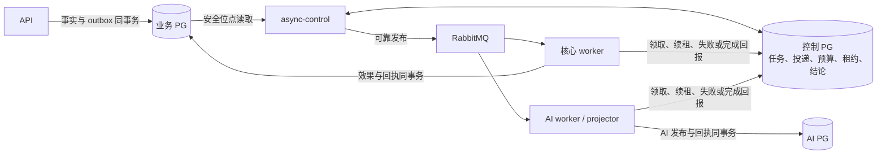

# 控制 PG 简化与读写削减计划

日期：2026-11-19。本文保留为原计划和验收基线；当前代码、迁移工具、专用环境验证及未完成的运行验收见 [PG 简化实施记录](PG_SIMPLIFICATION_EXECUTION_2026-11-19.md)。文中“尚未实施”“未来”等措辞描述计划编写时的状态。

本轮目标是：在保留可靠接管、有限重试、租约恢复和领域幂等的基础上，减少每个任务对控制 PG 的访问，取消通用的“保存计算结果—接纳结果—恢复提交”中间协议，最终收敛为 10 张在线业务表。

本文是本轮施工依据。[上一轮异步协调裁剪计划](ASYNC_COORDINATION_SIMPLIFICATION_PLAN_2026-11-19.md)及其实现报告是现有 v2 的基线，不将其中已完成事项重复列为本轮成果。11-16 两份施工书继续作为历史基线。本文中的目标协议、表结构和流程均未落地；此前的测试结果不作为本轮验收结果。

AI 专项补充：[AI PG 简化实施计划](AI_PG_SIMPLIFICATION_PLAN_2026-11-19.md)。后续已确定取消 AI 通用 staging/release；本文第 1.2、10 节据此同步，AI 具体实施、存量保护与验收以该专项计划为准。

## 1. 已确定的范围

### 1.1 本轮要做

1. 控制 PG 继续作为唯一的任务执行与业务重试权威，保留任务身份、投递、累计预算、期限、执行租约、终态和必要的后继协调。
2. 新协议任务退出控制库 `results`、`executions`、`task_continuations` 的在线读写；不再统一保存可供恢复提交的计算结果。
3. 把 `task_deliveries` 的当前投递状态并入 `tasks`，保留发布与执行各自独立的 token、租约和代次条件。
4. 核心 worker 自己完成外部 I/O 与业务事务；AI worker/projector 自己操作 AI PG 并发布。领域效果和领域回执继续同事务。
5. 调整回执身份、后继登记、AI 作业汇总、废弃输出清理、管理工具、配置、交接和观测，接住被移除机制原有的必要职责。
6. 清理旧调度机制的在线依赖；完成存量交接后，将退役表及必要历史证据归档，在线 schema 最终保留本文列出的 10 张业务表。

### 1.2 本轮边界

- 未提交的计算在崩溃后允许按原预算重新执行。此次明确放弃新协议下“所有计算结果先统一持久保存，之后只恢复提交”的保证。
- 不在业务库或 AI 库另建一套通用结果暂存系统来替代控制库 `results`。既有领域专用恢复能力可以继续使用，但不成为所有任务的统一前置步骤。
- AI PG 的最终目标是取消通用 staging/release，由 worker 直接写成果、切 active 指针并写稳定回执；active/desired、墓碑、父子片、摘要专用 checkpoint 和查询隔离继续保留。`ai_artifact_manifests` 在存量交接后退役，具体步骤见 AI 专项计划。
- `ai_job_task_links`、`ai_job_aggregates` 本轮留在控制 PG，继续服务用户 AI 作业终局；不同时实施作业管理迁往 AI PG。
- API、在线检索/问答、parser 能力及前端交互保持现有职责。API 不增加控制 PG 或 MQ 的启动、readiness 硬依赖。
- 保留 RabbitMQ、现有领域 worker 划分、独立控制数据库及 AI/业务 SQL 隔离。不同权限角色不借本轮合并。
- 历史已接纳结果、停止结论、已耗预算和外部输出证据必须交接；不能把新任务允许重算的规则追溯用于丢弃旧结果。

## 2. 当前源码基线

本次编写时核对的是工作区源码和迁移文件，未查询运行库或认证部署状态。

| 项目 | 当前工作区事实 |
|---|---|
| 业务迁移 | 到 `backend/migrations/000036_*` |
| 控制迁移 | 到 `backend/control-migrations/000005_worker_commit.*`，定义 21 张业务表 |
| AI 迁移 | 到 `backend/ai-migrations/000011_vector_index_scan.*`，定义 18 张业务表；AGENTS.md 中“到 000007”的描述已落后 |
| 执行链路 | `RunWorker` → `execute` → `Compute` → `SaveResult` → `BeginCommit` → 领域 `Apply/Publish` → `Report` → ACK |
| 核心提交 | `asyncjobs.Committer.Apply` 调用 `AcceptedResult` 后，在业务事务内校验并写效果及 `async_commit_receipts` |
| AI 提交 | AI worker 使用 `AI_COMMIT_DSN` 写 staging，并在本进程调用 `Publisher.Publish`；当前仍要求控制接纳结果 |
| 后继 | `SaveResult` 时冻结到 `task_continuations`，`Report` 时释放 |
| 输出清理 | `executions.outputs` 保存计算代次的外部输出；`RecoverOutputs` 登记定向清理任务 |
| AI 作业 | `jobs.go` 关联任务并汇总；当前通过 JOIN `results` 读取输出版本引用 |
| 退役依赖 | `queue_budgets` 仍被旧 AI 迁移工具引用；`ai_job_observers` 由迁移工具写、在线回调读 |

当前 worker 自行提交已经实现；本轮削减的是 worker 内部仍保留的通用结果交接协议及其控制读写。

## 3. 目标架构和正常流程



1. API 在业务事务内写业务事实和 outbox。字节仍经预签名 URL 直达 MinIO。
2. Relay 沿用同语句快照的 `xmin` 与 `(event_xid, seq)` 安全读取。inbox、冻结的订阅契约与输入、任务/来源、投递意图、位点在控制事务中原子接管。
3. 发布器领取到期且未可靠发布的任务通知，在事务外发布 MQ，完成路由检查和 publisher confirm，再条件回写发布状态。
4. worker 在控制 PG 一次领取事务中检查身份、投递代次、期限和预算，取得执行 token、代次和租约。
5. worker 先查领域回执。已存在匹配结论时，直接使用该结论补控制确认；没有回执才执行计算或外部 I/O。
6. 计算结果直接交给领域提交函数。外部 I/O 在事务外；领域事务校验当前前提，写入效果和回执。新路径不调用控制 `SaveResult/BeginCommit/AcceptedResult`。
7. worker 从领域持久结论生成最小完成描述。控制 PG 在一次完成事务中校验当前执行凭据、设置终态、登记必要后继及投递意图，并完成 AI 作业汇总。
8. 控制完成持久化后 ACK。失败回报和重新投递也必须先持久化恢复依据，再 ACK 原通知。

从 worker 视角，正常首次成功路径的目标是 **一次领取事务、一次完成事务**。长任务另有续租；失败、领域主动延期、隔离和最终回执核对另计。该目标不包含 Relay 接管和发布器的必要持久化，也不表示整个系统每任务只有两次 SQL。

## 4. 最终控制库表结构

目标在线 schema 保留以下 10 张业务表；`schema_migrations` 是迁移工具元数据，另计。归档 schema/离线备份中的历史表不计入在线模型，也不能被普通 worker 读写。

| 保留表 | 用途 | 边界 |
|---|---|---|
| `tasks` | 稳定任务身份、类型化输入、状态/outcome、执行和发布预算、期限、执行租约、当前投递状态、父任务关系 | 不保存计算结果正文或待提交结果，不用 JSON 字段变相恢复 `results` |
| `event_inbox` | 可靠接管、事件身份/摘要去重、冻结订阅契约和输入 | 输入计划与输出后继分开；终态详情仍有界维护 |
| `task_sources` | 事件、扫描、后继和人工 redo 等来源关系 | 多来源不创建重复语义任务，也不重置预算 |
| `relay_positions` | 业务 outbox 安全接管位点 | 继续约束业务 outbox 留存 |
| `module_leases` | relay、必要扫描和维护职责互斥 | 不恢复调度选主、结果分片或写许可 |
| `scan_positions` | 上传过期等已存在有界扫描的游标 | 不增加全库/全 bucket 巡检 |
| `control_settings` | 协议激活、导入和交接标记 | 退役旧分片布局、结果轮转键 |
| `quarantines` | 冲突、未知输入及无法自动处理情况的有界证据 | 隔离不等于丢弃输入或业务失败已收尾 |
| `ai_job_task_links` | 用户 AI 作业和底层任务的关联 | 可增加必要的小型版本引用，避免 JOIN 通用结果表 |
| `ai_job_aggregates` | 请求能力集合、作业终局及唯一终结命令身份 | 不承担计算结果或模型响应暂存 |

其余 11 张现表的处理：

| 当前表 | 目标处理 | 退出前必须完成 |
|---|---|---|
| `task_deliveries` | 当前状态并入 `tasks` | 发布与执行凭据隔离，早消费/晚 confirm/失租发布者竞态回归 |
| `results` | 退出新协议在线链路，历史保留到交接完成后归档 | 回执身份改造、历史已接纳结果处理、AI 后继/作业/GC 查询全部解耦 |
| `executions` | 退出在线链路 | 外部输出清理线索接住，普通执行明细迁往日志/trace/指标 |
| `task_continuations` | 退出在线链路 | 后继由领域回执恢复，完成和后继登记同事务，契约版本可重放 |
| `queue_budgets` | 退役归档 | 改造 `aisystem/migration.go` 的旧迁移引用及相关夹具 |
| `committer_members` | 退役归档 | 核对迁移/工具/测试依赖；不恢复独立 committer |
| `write_budget` | 退役归档 | 核对残留依赖 |
| `write_permits` | 退役归档 | 核对残留依赖 |
| `ai_job_observers` | 历史迁移兼容结束后退役归档 | 历史作业及未来后继关联全部完成或等价保留，在线回调不再读取 |
| `coordination_handover` | 归档保留 | v1→v2 证据和后续交接工具可离线读取 |
| `coordination_messages` | 归档保留 | 旧 MQ 消息处理证据、原文和结论可核查 |

10 张表是最终在线目标。兼容阶段允许旧表继续存在；不能为达成表数，在依赖仍运行时强行移走数据。

## 5. `tasks` 和发布状态合并

### 5.1 保留的状态

- 生命周期继续为 `pending / running / done / stopped`，outcome 区分成功、过时、拒绝、领域失败、隔离和需要人工处理。
- 保留任务执行代次、token、lease、not_before、累计尝试/发布次数、期限、父任务及审计关系。
- 删除新路径的通用 compute/commit 分阶段状态、`result_id`、独立提交预算/窗口、结果发送次数及旧恢复预算策略。历史字段在交接完成后再移出在线模型。
- 最终回执核对需要一个受限的只读执行模式，仍由 `tasks` 管理；它不能携带待提交结果，也不能重新执行领域效果。
- `layout_version/shard/priority` 等旧分片与调度字段先核对身份/导入依赖，再归档退役。对象世代、契约版本、稳定资源身份和输入摘要继续保留。

### 5.2 发布字段

在 `tasks` 中保存当前 `dispatch_generation`、发布状态、到期时间、发布 token、发布租约、确认时间和累计发送次数。具体列名在协议阶段固定。

1. 发布 token 和执行 token 各自独立，禁止复用。
2. 发布领取只改变发布字段和发布预算，不把任务改成 running。
3. 发布器的完成回写必须匹配发布 token、投递代次和发布状态，不能改执行状态；早已被消费的通知使晚 confirm 成为无操作。
4. worker 条件领取时原子确认当前通知已消费。重复、过时、终态或另一有效执行者的消息经过持久状态判断后 ACK。
5. 尚未到期的早到通知，只有重新登记未来待发布状态后才能 ACK，不能遗失到期投递。
6. 已确认在 MQ 排队的通知不因等待较久而周期重发；到任务期限时由控制库作到期处理。
7. 合并后的任务行会更热；发布查询索引、字段更新范围和锁竞争必须与现有拆表版本对照。只锁短事务，MQ I/O 不持有行锁。

## 6. 领域回执、幂等和计算重做

### 6.1 回执按逻辑任务稳定识别

当前核心回执以 `semantic_key` 定位，但验证 `result_id/result_digest`；AI 回执以计算结果 ID 定位。移除控制结果后，必须先改变这些假设。

- 新核心回执以逻辑操作身份和 `input_digest` 识别；新 AI 回执以稳定任务身份和 `input_digest` 识别。必要时复用现有 ID 列生成不随尝试代次改变的回执 ID，并增加唯一约束。
- 回执保留实际提交的 outcome、必要版本引用和可核查摘要。计算代次可以记录，但不把每个代次解释为独立业务效果。
- 领取后、计算前先查回执；领域事务取得语义锁后再次查回执，封住并发提交窗口。
- 相同逻辑任务、相同输入，多个合法计算结果竞争时，以领域内第一个满足前提并成功提交的结果为唯一结论。其他执行者读取并返回这一结论，不以自身不同的模型输出覆盖它。
- 相同身份但输入摘要冲突必须隔离。新的用户请求、内容世代或 desired seq 仍通过各自身份与领域版本条件区分。
- 历史回执保留旧含义；不能为了兼容新 ID 规则把旧回执删除或覆盖。

### 6.2 最小完成描述

领域回执应能重建：逻辑任务身份、输入摘要、outcome、发布的必要版本引用，以及恢复同一后继所需的最小字段。规则由任务契约决定。

控制完成接口接收这一描述，核对任务身份与当前执行凭据。它不另存原始计算输出、文本、向量、模型响应或通用 manifest；后继必要引用直接成为后继的类型化输入，AI 作业必要版本引用进入现有作业关联记录。

领域回执及其语义屏障继续保留，不随通用计算结果或控制详情一起清空。后继确认前所需的版本引用必须可恢复；归档和清理不得让同一逻辑任务重新产生效果。

### 6.3 失租和晚到提交

控制租约决定谁可以被领取和回报，不是跨库事务锁。删除控制接纳步骤后，更不能仅凭一次“提交前查控制租约”保证领域正确性。

领域事务继续检查会话/操作状态、对象世代、引用、配额、目录命名前提；AI 继续检查 desired seq、依赖版本、active 指针和墓碑。外部输出使用受约束的代次专属 key/版本。旧进程的结果只能在该逻辑任务的当前领域前提仍成立且没有终局结论时参与同一幂等竞争，不能覆盖新业务版本或已提交结论。

取消、过期、失败收尾和正常成功必须围绕原逻辑操作身份串行，持久化领域终局。先提交的有效结论决定后续行为；已收尾的操作拒绝晚到成功，已成功的操作不再释放一次配额或改成失败。

## 7. 重试、预算和停止

控制 PG 继续主导全部业务重试。RabbitMQ 仅负责通知交付、积压分发和未 ACK 重投，worker 不增加独立业务重试账本或 TTL 重试链。

| 项目 | 目标规则 |
|---|---|
| 执行预算 | 每次普通领取累计一次；覆盖计算和领域提交，失租不返还次数 |
| 发布预算 | 发布前持久消耗，confirm 不明允许同身份重发，累计次数不重置 |
| 总期限 | 从任务原期限约束；重启、重投、扫描及交接不刷新 |
| 失败退避 | 在控制事务中保存错误、下次时间和新投递代次，然后 ACK 原通知 |
| 回报丢失 | 下次先读取领域回执，再补完成；无需恢复控制库计算结果 |
| 最后一次崩溃 | 最多一次有界、只查回执的核对；不再计算或提交效果 |
| 核对受阻 | 若无法在有限发布机会/核对期限内确认，停止自动执行并标为 needs_attention，不推断为业务失败 |
| 失败收尾 | 只有适合自动收尾的领域操作才登记稳定身份的有限命令；命令检查原操作回执和领域状态，接住成功/取消/过期竞争 |
| 人工 redo | 新建审计子操作，验证当前业务前提；原停止理由、预算和回执不重置 |

最终回执核对的次数、领取标记和期限在控制 PG 条件更新；不允许每次重启重新获得一次核对。核对通知仍受有限发布约束。若发布预算已经用完，保留不确定结论进入人工处理，不能无界补发，也不能在没有证据时触发破坏性失败补偿。

上传过期等领域主动延期只沿用已有、明确的延期契约和当前业务到期事实；延期不能重置累计尝试、发布次数或把停止任务重新打开。

## 8. 后继和 AI 用户作业

### 8.1 后继由持久领域结论驱动

1. 当前 `freezeContinuations/releaseContinuations` 退出新协议路径。
2. 后继规则按已冻结的任务契约/计划版本选择，输入来自本次领域回执。部署必须保留未完成任务需要的契约处理能力；不能在重放时任意使用新的规则或当前 active 指针。
3. 原子边界放在控制完成事务：确认父任务、幂等登记子任务和来源、登记投递意图、更新作业关联，再进行作业终局判断。
4. 后继身份由父逻辑任务、规则版本和固定后继序号/类型确定。重复回报不重复创建，不重置子任务预算。
5. 领域已提交而控制确认失败时，下一执行者从同一回执恢复版本引用和结论，重新登记同一组后继。
6. 过时/拒绝/失败结果按领域固定规则抑制正常后继或登记有限失败终结命令；不会再运行的能力必须有终局结论，不能让用户作业永久等待。

不增加控制结果表、blocked 后继表、通用 DAG/Saga 或 AI outbox 平台来替代 `task_continuations`。必要的固定领域后继仍由可信代码定义，MQ 消息不能指定任意处理器或 SQL。

### 8.2 两张 AI 作业表继续保留

- `ai_job_task_links` 保留多对多关系；完成事务保存必要的小型输出版本引用，消除 `jobs.go` 对 `results.body` 的 JOIN。
- `ai_job_aggregates` 保留 requested targets、终局 outcomes 和唯一 `ai.job.finish` 命令身份；并发回报只终结一次。
- 父任务完成、后继任务关联必须先完整登记，再判断作业是否结束，避免在后继尚未出现时提前结束作业。
- `ai.job.finish` 仍由 gc-worker 的 `core-command` 消费者写业务用户作业；AI worker 仍无业务 SQL 连接。
- 历史 `ai_job_observers` 涵盖迁移工具退出后才生成的后继。先完成这些关联的闭包和历史作业终局，再退出在线读取；未完成时该表属于过渡依赖，不能宣称已经达到最终 10 表。

## 9. 核心领域与废弃输出清理

`executions` 不能只按“执行日志”删除。当前 `RecordOutput/RecoverOutputs` 是定向清理入口，必须先有替代路径。

### 9.1 受约束输出的优先方案

当前 canonical copy 和 thumbnail 的输出 key 可由类型化输入、任务 ID、执行代次确定。优先使用这项已有约束：

1. 在可信领域代码中固定每类任务的输出地址推导规则、最多输出数量和外部 I/O 最长时间；规则版本纳入任务契约。
2. 普通失败或失租回收时，在控制重试/停止事务中登记该失败代次的确定性清理命令，再切换执行凭据。正常成功路径不额外写控制输出清单。
3. 清理使用稳定任务身份、延迟和有限预算，覆盖外部请求晚到窗口；删除前读取业务事实，保护已经被采用的对象/变体。
4. 多次失败的输出按已知代次有界处理，不借机做全 bucket 扫描。任务输入只有在必要清理命令已持久接管后才可归档。
5. 对不能可靠推导的输出，先复用所属领域已有的操作意图记录保存必要地址；没有可靠清理依据的类型暂不退出旧机制。
6. 并发执行者在计算后命中另一代次的赢家回执，或者领域拒绝采用本次输出时，必须在领域事务内登记本次未采用输出的定向清理意图。不能因为逻辑任务已成功，就遗漏失败方已经生成的字节；登记失败则不能假装该次处理已完整收尾。

替代设计不得在控制 PG 建另一张每代次输出/结果暂存表。已有历史 `executions.outputs` 仍按实际内容交接，不能假设旧输出全部符合新地址规则。

### 9.2 各领域适配

| 类型 | 必须保留或适配 |
|---|---|
| multipart create | 操作专属 key、未知创建成功找回、晚到 multipart sweep；重试不无条件新建 |
| multipart complete/abort | NoSuchUpload 与对象事实核对、幂等完成/中止、会话终局竞争 |
| 哈希/大小验证 | 未提交崩溃可重新读取校验；领域提交复核会话、对象及当前前提 |
| canonical copy | 代次专属输出、先提交者回执、同内容竞争、安全对象世代及废弃复制清理 |
| thumbnail | 对象世代与变体版本校验，保护已发布变体，清理未被采用的输出 |
| 对象 GC | 业务先授权 deleting，事务外删除对应世代字节，再条件提交 deleted |
| 失败/过期/取消 | 配额和引用只结算一次，正常成功与收尾竞争有持久领域结论 |
| 维护 | 业务 outbox 留存继续受安全接管位点约束；会话过期扫描保持有界 |

## 10. AI PG 的必要适配

AI PG 当前仍有 18 张业务表。按 [AI PG 专项计划](AI_PG_SIMPLIFICATION_PLAN_2026-11-19.md)取消通用 staging/release；保留成果版本、active/desired、查询隔离和领域恢复能力。最终在线目标为 15 张业务表，兼容期间保留旧证据。

1. `Computer.Compute` 的新路径返回类型化计算值，在当前进程直接交给 AI 领域事务；不写通用 AI artifact，也不先存控制 `results`。摘要节点迁往专用 `ai_summary_nodes`，保持断点复用。
2. 新 AI 提交入口退出对控制 `AcceptedResult` 的调用。采用第 6 节的稳定领域回执身份，在 AI 本地事务中校验内容完整性、当前 desired seq、依赖版本、墓碑和领域终局，然后原子写成果、切指针、写回执。旧 `Publisher.Publish(Task, Result)` 仅供存量兼容。
3. 计算前和发布事务内均检查回执；并发计算者返回同一已提交赢家，不能因各自产生不同摘要而覆盖已发布结果。
4. 初始 intent 使用的 source/content/embedding 指针等后继依据，也必须写进本次领域回执；回报重试不能读取已变化的当前指针来改写后继。
5. `cleanup.go` 当前依赖 `results` 判断未提交产物，必须同步改造。新协议使用任务执行/终态、领域回执、active/retired 引用及安全宽限证明清理；历史 accepted 产物继续按旧证据保护。
6. ES/Qdrant 投影继续先写外部版本，再在 AI PG 发布覆盖证明与回执。查询仍需要 active/coverage 证明，失败回退 PG；不能只凭外部写请求成功就开放查询。
7. `ai_orphan_projections` 在外部写入前登记必要清理线索，接住原 artifact 提供的孤儿发现能力；退休版本与摘要节点的安全保留逐项核对。无法证明安全的产物保留并给出处理线索，不以移除结果表代替清理证明。
8. 既有摘要分段 checkpoint 是领域特定能力，可继续复用。本轮不新增所有 AI 类型统一的“接纳结果、只恢复提交”协议，不承诺模型调用只发生一次。

## 11. 代码和配置修改入口

| 位置 | 本轮变更 |
|---|---|
| `internal/asynccontrol/model.go`、`store.go` | 任务/投递字段、稳定契约、预算、只读核对和新协议；退役结果与执行明细模型 |
| `internal/asynccontrol/execution.go`、`runtime.go` | 领取 → 查领域回执 → 执行/提交 → 完成；取消通用结果保存/开始提交/接纳证明读取 |
| `internal/asynccontrol/scheduler.go` | 从 `tasks` 发布字段领取与条件回写，合并状态后的失租/期限/发布耗尽恢复 |
| `internal/asynccontrol/relay.go` | 保持安全水位及原子接管，适配内嵌投递状态和计划契约版本 |
| `internal/asynccontrol/continuations.go` | 退出结果驱动冻结/释放；保留类型化 effect target 和工作队列定义，接入完成事务的可信后继规划 |
| `internal/asynccontrol/outputs.go`、`scan.go` | 退出执行表输出清单，接入确定性定向清理；移除旧结果/执行表维护 SQL |
| `internal/asyncjobs/committer.go`、`compute.go`、`asyncprotocol` | 分离回执读取与领域执行入口；按逻辑任务幂等，计算结果直接交领域提交 |
| upload/objectstore/media 的异步提交函数 | 保留领域锁、版本、配额、引用、对象世代及安全收尾 |
| `internal/aisystem/compute.go`、`publish.go`、`planner.go`、`jobs.go`、`cleanup.go` | AI 直接发布、稳定回执、后继重放、无 `results` 的作业汇总与清理证明 |
| `internal/aisystem/migration.go` | 去掉旧 queue budget 假设，适配历史 observers 和协议化交接 |
| `internal/bootstrap/async.go`、`ai_split.go` | 装配领域回执查询和提交接口、控制完成回调，退出旧输出维护接线 |
| `cmd/async-admin`、交接/导入工具 | inspect 展示新任务/投递字段及领域回执；redo 和历史证据读取保留 |
| `platform/config`、dependencies、部署脚本与模板 | 协议 fence、队列前缀、退役参数、角色校验和连接池核算；保留续租/完成保留池 |
| Prometheus/Grafana/测试夹具 | 移除结果暂存/阶段/执行表指标，增加完成回报、重算、回执命中、停止及定向清理指标 |

提交窗口等旧参数只有在引用完全退出后才退役；MinIO staging 生命周期、安全宽限和历史兼容校验仍须独立核算，不能直接删除时间参数导致既有输出提前过期。新增参数同步 Go 配置、Compose 锚点和两个 env 模板，模板键集合保持一致。实际 `deploy/.env` 保留现值和密钥。

## 12. 数据迁移与协议切换

### 12.1 新增版本，保留旧证据

- 当前是 v2。本轮采用可识别的新协调协议，计划命名为 v3，并使用与 v2 隔离的工作通知前缀，例如 `bx.async.v3`；最终名称在协议阶段固定。文档名称不表示协议已实现或激活。
- 使用新增迁移，不改写已执行的历史 SQL。当前控制下一个编号候选为 000006；业务/AI 回执若需要扩展约束，分别追加各自迁移，实施时重新核对编号。
- 扩展阶段先增加字段/索引/回执兼容能力；收缩阶段在旧代码与数据依赖清零后再做。大量表/索引变更需在专用数据量上评估锁和耗时。
- 扩展现有交接工具，不重新运行最早的核心 `async-import`，不重复 AI 历史归档，也不引入第二套任务权威。
- 协议标记必须约束新旧启动链及数据库写者。停止所有旧 worker/协调写者，等待租约结束后再交接；新旧消费者不得同时处理同一任务。

### 12.2 按旧任务状态交接

| 存量 | 交接规则 |
|---|---|
| 无接纳结果、等待执行 | 保留任务身份、输入、到期时间、已耗预算和期限，迁移当前投递状态 |
| 仍有有效租约 | 先停写者并等待退出/失租，不能直接授权另一协议提交 |
| 已接纳但未提交的 `results` | 在可核查旧协议窗口内处理完，或使用显式兼容工具将该原结果提交/隔离；不得直接删除后改为重算 |
| 领域已有回执、控制未确认 | 校验身份、保留原效果结论、补确认和同一组后继；禁止重新计算替代证明 |
| 冻结但未释放的后继 | 核对父领域结论，按冻结计划完成释放或抑制；保留子任务身份和预算 |
| 已完成/已停止 | 保留原结论和语义屏障，不按新默认值刷新预算；停止不等于重新待执行 |
| `executions.outputs` | 按原地址和代次登记可核查清理意图，保护赢家输出，再归档旧明细 |
| 历史 AI observers | 覆盖尚未生成的后继，完成作业关联与终局；未处理完则保留过渡依赖 |

旧计算预算、提交预算、发布预算及各自期限分别保存原值和已耗值。统一执行预算只接受经证明不会增加剩余自动机会的映射；已有结果仍按原提交边界处理，不能直接套新默认次数或用新期限续命。无法等价映射的任务先完成旧语义处理或保留隔离。

不能安全解释的旧结果或旧后继保留在隔离/归档证据中，并明确人工处理，不假装已完成全量交接。未解决这些依赖前，不执行对应物理收缩迁移。

### 12.3 MQ、表和字段的退出

旧通知按条核对，先持久记录转移/隔离证据，再 ACK；不 purge、不删业务 bucket、不删卷。旧 v1/v2 交接证据可追加到归档记录或扩展既有交接表，过渡表不进入最终在线模型。

确认无旧写者、无在线表引用、无待兼容结果和未交接输出后，用单独收缩迁移将退役表/字段移入归档。移动时核对 FK、视图、trigger、角色权限和工具搜索路径；归档证据包含原身份、预算、结果摘要和处理结论，普通在线账号不读写归档。

恢复默认采用停止新写者、保留事实/回执/消息并向前修复。除非反向转换经过单独验证，不能启动旧镜像或运行 down migration 来解释新任务、回执和投递状态。

## 13. 施工顺序

以下是未来实施的依赖顺序。本次仅编写计划，所有实施项均未完成。

| 阶段 | 工作 | 阶段出口 |
|---|---|---|
| P0：基线 | 固定任务场景，盘点表/字段/代码依赖及旧数据类别，记录当前控制 SQL/事务/WAL/延迟 | 可对照的基线及完整交接清单 |
| P1：协议与扩展 | 固定任务/回执/后继契约、稳定身份、预算与 fence；先新增兼容字段和索引 | 重复提交、最后一次崩溃、晚到 confirm 的协议用例通过 |
| P2：核心试点 | 在专用环境选一类可安全重放的核心任务，取消控制结果步骤；再覆盖所有核心类型及定向清理 | 无 checkpoint 的成功/失败/崩溃链路正确，控制读写减少 |
| P3：AI 适配 | AI 回执稳定身份、直接发布、完成后继、作业汇总和 GC 解耦 `results` | AI 本地发布及全部失败/过时/停止终局可恢复 |
| P4：投递合并 | `task_deliveries` 状态内嵌 `tasks`，同步发布器、领取和恢复 | 所有发布/消费竞态通过，任务行热点对照完成 |
| P5：交接与回归 | 专用旧库夹具升级、旧结果/后继/消息处理、中断重入、全量回归及读写对照 | 交接可重入、预算不增加、无孤立职责 |
| P6：收缩与交付 | 依赖清零后退役归档表/字段，同步文档/配置/观测和最终报告 | 在线 10 表、旧证据可查、实际部署与未验证范围分开报告 |

阶段可在同一代码分支逐步完成，但协议激活和真实数据切换必须作为明确步骤执行。生产迁移、交接和启动不包含在“写计划书”这项任务中。

## 14. 验证与读写削减验收

### 14.1 正确性与故障窗口

| 场景 | 必须证明 |
|---|---|
| 安全接管 | 晚提交事件不漏；接管中断可重入；来源去重不刷新预算 |
| 发布竞态 | confirm 丢失、失租发布者晚回写、消费者先完成、未来通知早到均不丢任务或倒退状态 |
| 重复/并发执行 | 同一任务、同一输入只有一个领域终局；不同输入冲突隔离 |
| 未提交崩溃 | 不依赖控制结果恢复；允许有限重算，外部未知成功按领域规则找回 |
| 领域提交后崩溃 | 下次先命中原回执、不再次修改效果，补同一结论和后继 |
| 最终核对 | 耗尽后最多一次只读核对；回执缺失/不可查明确停止，不无界重试或伪造业务失败 |
| 晚到与收尾 | 失租、取消、过期、失败收尾及成功竞争下版本、配额、引用和墓碑正确 |
| 后继与作业 | 完成/后继同事务；回报重复/部署重放不改变契约；部分失败及不会运行的后继有终局 |
| 输出清理 | 复制/缩略图晚到输出可定向处理，赢家字节受保护；无全 bucket 巡检 |
| AI | staging 不对查询开放；旧 desired seq/墓碑拒绝；投影需覆盖证明；既有摘要 checkpoint 按实际能力验证 |
| 交接 | 原已接纳结果不丢弃重算，旧预算/回执/停止结论保留，消息先留证据再 ACK，中断重跑无重复效果 |
| 权限与部署 | AI 仍无业务 SQL，query 仍限权；API 不依赖控制/MQ；新旧协议写者 fence 生效 |

沿用并调整现有集成与故障用例，不以整包删除旧测试替代行为说明。对新协议“未提交可重算”和旧协议“已接纳结果保留”分别断言。

### 14.2 性能与读写对照

对核心普通命令、multipart complete、哈希验证、复制/缩略图、AI 内容生成、AI 投影分别记录：

- 控制 PG 的 SELECT/INSERT/UPDATE/DELETE 次数、事务次数、更新行数及 WAL bytes。
- 事件接管、发布、worker 领取/续租/完成/失败、AI 作业汇总、维护分别计量，不能把工作移到另一循环后只报 worker 数字。
- 单任务完成延迟、吞吐、锁等待、数据库连接峰值，以及领域库/MinIO/模型重复调用量。
- 首次成功、重复通知、提交后回报失败、失租重算四类路径分别统计，AI 大小、模型替身及依赖版本保持可比。

基线和新协议在专用资源上使用相同样本与并发；可用会话级 instrumentation、专用实例统计和 `pg_stat_statements` 等计量，不重置用户数据库的全局统计。不在缺少基线时预写降幅。

验收要求：新协议正常路径无 `results/executions/task_continuations` 在线读写，无 `SaveResult/BeginCommit/AcceptedResult` 控制往返；普通 worker 首次成功达到一次领取事务和一次完成事务的目标。系统总控制写入/WAL 应给出同场景实际对照，不能用表数减少代替性能证据。若个别场景因后继/清理增加成本，单列原因和实测结果。

### 14.3 执行检查

未来实施后按实际变更执行后端 build、vet、相关包与真实依赖集成、适当的 race 以及全量回归：

```bash
cd backend
go build ./cmd/...
go vet ./...
go test -p=1 ./internal/asynccontrol ./internal/asyncjobs ./internal/aisystem ./internal/bootstrap -count=1
go test -race -p=1 ./internal/asynccontrol ./internal/asyncjobs -count=1
go test -p=1 ./... -count=1
```

使用满足仓库要求的 Go 版本。真实集成只指向跑过迁移的专用业务/控制/AI 测试库及独立 vhost/bucket/schema；环境缺失的 skip 单列，不视为通过。另执行真实迁移 CLI、交接重入、Compose/模板/脚本静态检查及必要核心/AI smoke。没有前端/parser 行为变更时不扩大其实现范围。

## 15. 完成标准与交付

- [ ] 新协议任务不再在控制 PG 保存计算结果或计算代次明细，不再经过统一恢复提交阶段。
- [ ] 回执按逻辑任务稳定识别，回报失败可恢复原领域结论；允许重算不导致重复效果。
- [ ] 控制 PG 继续唯一管理发布、执行重试、租约、期限与有限停止；无另一套重试权威。
- [ ] 结果驱动冻结后继退出，完成与必要后继/作业登记同事务且可重放。
- [ ] 现有配额、引用、世代、desired/active、墓碑、投影证明和权限边界保持有效。
- [ ] `executions` 的外部输出清理职责及历史线索已接住，失败收尾没有悬空。
- [ ] 所有历史已接纳结果、冻结后继、回执、预算、停止及消息处理证据完成保留数据交接。
- [ ] 最终在线 schema 仅保留第 4 节的 10 张业务表，迁移工具元数据另计，归档证据可离线核查。
- [ ] 控制 SQL/事务/WAL 有真实前后对照，必要的领域重算代价和任务行锁竞争被单列。
- [ ] 配置、部署、admin、观测、文档和夹具同步，退役参数与在线 SQL 无残留。
- [ ] 最终报告分开列出代码/迁移变更、实际测试、实际部署、剩余兼容数据及未验证范围。

本文件交付时仅完成计划编写及文档一致性检查。未执行上述未来实施检查、数据库变更、协议切换、旧表归档、镜像构建或生产部署。跨主机 HA、集群容灾、容量和付费模型质量不由本轮文档或后续单机 smoke 推导。
