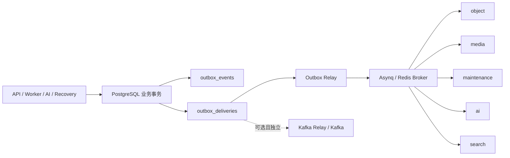

# Asynq 迁移 RabbitMQ：难度评估与改动说明

评估日期：2026-09-21。状态：方案评估，尚未实施迁移。

配套执行计划：[RABBITMQ_MIGRATION_PLAN.md](RABBITMQ_MIGRATION_PLAN.md)。

## 1. 结论

**可以迁移，整体难度中等偏高。业务主体可以保留，但这是一项任务执行基础设施迁移，不能按“替换 MQ SDK”估算。**

当前使用的是 `github.com/hibiken/asynq v0.26.0`。Asynq 同时提供 Redis 队列、任务路由、并发控制、重试、延迟执行、超时、任务 ID 冲突检测、失败归档和监控接口。RabbitMQ 可以承担可靠消息传输，其中部分任务执行语义仍需由应用负责。

建议保留 PostgreSQL 事务 Outbox、业务状态机、对象存储操作租约、AI 版本控制和搜索投影机制，将 Asynq 相关类型收敛到过渡适配层，再接入 RabbitMQ。最终移除 Asynq，Redis 继续承担缓存、协调锁和限流。

按一名熟悉 Go、PostgreSQL 和 RabbitMQ 的工程师估算：

| 交付层次 | 工作量 | 能证明什么 |
| --- | --- | --- |
| 单条任务链路原型 | 2-3 人日 | 可以发布和消费，不代表迁移完成 |
| 全部任务、可靠性、部署、切换及回滚演练 | 16-24 人日 | 具备可交付的迁移版本，约 3-5 个工作周 |
| 额外的跨主机 HA 与生产容量验证 | 另加 3-5 人日起 | 依赖真实节点、故障注入和负载环境，不包含在上述应用迁移估算中 |

估算包含下文两项联动问题、失败任务处置和兼容期工具；不包含大规模历史积压的实际清理时间、基础设施采购及新发现的独立业务缺陷。默认 GC 延迟为 24 小时，旧队列自然排空可能额外增加日历时间。

迁移的主要收益是独立的消息基础设施、路由和消费可观测性，以及采用 quorum queue 后的复制能力。**不能据此承诺吞吐一定提高、延迟一定下降或实现 exactly-once。** 当前 Outbox 批次、确认方式、消费者预算和 AI/存储瓶颈仍会决定实际性能。

## 2. 本次依据与边界

- 读取的是当前工作区，包括已有未提交改动；参考 HEAD 为 `998baa3fef384bd10c1ae9c70152fca79248b268`。HEAD 本身不能完整代表此次评估代码。
- 检查了生产者、Outbox、全部五类业务队列、消费者、恢复机制、配置、迁移 SQL、部署和监控代码。
- 直接导入 Asynq 的 Go 文件共 17 个，其中生产文件 12 个、测试文件 5 个。另有路由、配置、恢复、SQL 和脚本使用 Asynq 语义，实际改动会超过这 17 个文件。
- 本次仅新增评估和计划文档；没有修改应用代码、数据库、部署配置、容器或队列内容。
- 执行了现有代码的针对性测试，结果见第 10 节。没有进行新 RabbitMQ 实现的端到端、故障或容量测试。

运行环境只读检查结果：

| 项目 | 实测结果 |
| --- | --- |
| 当前 Docker context 的运行容器 | `rabbitmq`，镜像 `rabbitmq:4-management` |
| 容器内实际 RabbitMQ 版本 | `4.3.6` |
| vhost / 队列 | 仅 `/`；`list_queues` 未返回队列 |
| 网络和数据目录 | Docker `bridge`；`/var/lib/rabbitmq` 挂载 volume |
| 端口 | 宿主发布 `5672`、`15672`；绑定所有接口 |
| 本项目应用运行状态 | 此次 `docker ps` 未见本项目 API、Worker、PostgreSQL、Redis 等运行容器 |

上述 RabbitMQ 可以作为后续联调候选，但未核验其应用账号、权限、持久性策略、资源预算和项目网络连通性。当前运行容器也不在项目 Compose 中，不能直接假定应用容器能通过 `rabbitmq:5672` 访问它。后续应明确使用外部 Broker 还是 Compose 管理的 Broker，并固定版本或镜像摘要。

## 3. 当前真实链路



业务代码通过 `outbox.AddTyped`、`AddEnvelope` 等在业务事务中创建事件和目的地记录。主要生产者不直接连接 Asynq。Relay 对 `outbox_deliveries` 做短事务 claim，提交后调用 Broker，再以 `lease_token` 条件更新发布状态。

`published` 只表示消息已交给 Broker，**不表示业务已执行成功**。消费成功分别由业务表、`event_consumptions`、搜索 checkpoint 等表达。

源代码入口：

| 位置 | 当前职责 |
| --- | --- |
| `backend/internal/outbox/outbox.go:184`、`compat.go:94` | 业务事务中的事件和 delivery 写入 |
| `backend/internal/outbox/routes.go:54`、`:73` | 搜索与普通任务的显式路由 |
| `backend/internal/outbox/dispatcher.go:209`、`:266` | claim、Asynq 入队、确认和失败退避 |
| `backend/internal/platform/worker/server.go:48` | Asynq Server、handler 注册、基础 context、停止 |
| `backend/internal/bootstrap/worker.go:29`、`roles.go:32` | 合并和拆分 Worker 启动 |
| `backend/internal/bootstrap/aisvc.go:40`、`:175` | 合并 AISvc 和独立 AI Indexer |
| `backend/internal/recovery/reconciler.go:69`、`:303` | 按业务状态恢复丢失任务，并限制重复恢复 |

### 3.1 队列和任务范围

| 逻辑队列 | 当前任务 / 来源 | 消费进程 | 迁移关注点 |
| --- | --- | --- | --- |
| `object` | `object.verify.v1` | `object-worker` 或合并 `worker` | 最后一次失败会调用 `FailVerification`，涉及预占配额释放 |
| `media` | `media.thumbnail.v1`、`media.thumbnail_requested.v1` | `media-worker` 或合并 `worker` | 对象重复读写、确定性缩略图 key、记录唯一性 |
| `maintenance` | `object.gc.v1`、`storage.operation_recover.v1`；文件创建和分享导入确认任务 | `maintenance-worker` 或合并 `worker` | GC 延迟、零引用复查、存储操作租约 |
| `ai` | `ai.index.v1`、`ai.reprocess.v1` | `ai-indexer` 或合并 `aisvc` | 长任务、限流、永久错误、重建任务 ID、外部调用可能重复 |
| `search` | `search.project.v1`，文件/目录/分享/对象等事件的投影 | `search-indexer` | 事件 ID 去重、版本、删除 tombstone、外部索引 checkpoint |

搜索由 `SEARCH_INDEX_ENABLED` 控制，AI 有独立开关。旧事件名称仍作为 handler 别名注册，迁移期间必须继续解析旧任务和旧 destination。

拆分角色按队列独立消费。合并 `worker` 当前默认消费 media/object/maintenance；搜索已有独立入口。`ai-query` 不消费 MQ，不能因为共用依赖初始化而被强制要求连接 RabbitMQ。

### 3.2 当前依赖 Asynq 的行为

| 行为 | 当前实现 | RabbitMQ 迁移要求 |
| --- | --- | --- |
| 入队去重 | `TaskID(event_id + ":" + destination)`；冲突视为已入队 | `message_id` 只是元数据；使用业务幂等和消费记录处理重复 |
| 发布重试 | PostgreSQL delivery `attempt/available_at`，有上限的指数退避间隔 | 保留，与消费者执行重试分开计数 |
| 执行重试 | `MaxRetry` 默认 8；使用 Asynq 默认退避 | 首次执行加最多 8 次重试；应用显式传递 retry metadata |
| GC 延迟 | 入队时 `ProcessAt(now + OBJECT_GC_DELAY)`；默认 24h | 持久化到期时间，到期才发布；迁移旧任务时保留原到期时间 |
| 执行超时 | `OUTBOX_TASK_TIMEOUT` 默认 30m | Go context deadline、业务取消传播；与 Broker ACK timeout 分别配置 |
| 永久失败 | handler 返回 `asynq.SkipRetry` 后归档 | 显式 Permanent 错误、失败记录与 DLQ，不能直接当成功 ACK |
| 并发 | `WORKER_CONCURRENCY` 默认 8；合并模式队列加权 | worker pool + QoS/prefetch；RabbitMQ 队列优先级不能等价代替跨队列权重 |
| 停机 | Asynq `Shutdown`；当前使用库默认 8s 等待 | 停止收消息、有限等待、取消任务、关闭旧 channel 交回未确认消息 |
| 队列状态 | `asynq.Inspector` 每 5 秒采集 | RabbitMQ 队列指标和应用指标重新映射 |

代码没有使用 Asynq Scheduler、Group 或复杂任务链 API。周期清理和恢复通过 Go ticker 实现，可以保留。唯一显式 `ProcessAt` 用在 GC，这缩小了调度迁移范围。

## 4. 可以复用的部分及其限制

1. **事务 Outbox 和 claim 租约。** 保留 `FOR UPDATE SKIP LOCKED`、`lease_token` 和事务外网络发送。更换 transport 不需要重写全部业务事务。
2. **上传和对象状态机。** 上传完成事务重新锁定 session，避免重复创建文件和扣配额；`storage_operations` 有操作幂等键和租约。重复读取对象、网络调用仍可能发生。
3. **缩略图幂等基础。** 已完成检查、确定性对象 key 和记录冲突保护可以复用；不能宣称重复消息完全没有计算或 I/O 成本。
4. **AI 版本/租约。** 有文档版本和 lease fencing，仍需重放及并发测试；外部模型调用不能通过 RabbitMQ 获得 exactly-once 保证。
5. **搜索消费记录。** `search/projector.go:108` 使用 `ConsumeOnce`；外部索引另有 checkpoint。它不是自动包住所有 handler 的通用幂等中间件。
6. **业务恢复扫描。** 当前覆盖上传校验、缩略图、AI 索引/重建、GC、存储操作六类；不等于所有搜索事件、死信和所有历史消息都能从现态完整恢复。

`ConsumeOnce` 仅在消费标记与 PostgreSQL 副作用同事务提交时提供相应保证。对 MinIO、模型服务、ES/Qdrant，不能先插入完成标记再做远程操作，必须延续现有业务状态机和 fencing。

## 5. 必须纳入迁移的两项联动问题

### 5.1 业务 task_id 被消息元数据覆盖

当前 `outbox/dispatcher.go:448` 的 `payloadWithTrace` 无条件执行 `fields["task_id"] = fields["event_id"]`。

但 `eventcontract/payloads.go:117` 的 `AIReprocessRequestedV1.TaskID` 是业务 `async_tasks.id`。生产者 `ai/service.go:267` 写入该 ID，消费者 `ai/tasks.go:36` 读取它，并在 `ai/service.go:279` 按此 ID 更新业务任务。查不到行时函数返回 nil，可能出现消息执行成功而原重建任务没有推进。

这是当前代码的字段冲突，本轮静态确认，未修改、未做完整运行复现。迁移必须保留业务 payload 的 `task_id`，将 transport message ID 放到 AMQP `MessageId` 或独立元数据结构中。补充“创建 AI 重建任务 -> 投递 -> 消费 -> 原任务进入终态”的回归验证。

### 5.2 transport 不止在连接层写死

`Routes`、`SearchRoutes`、`targetFromDelivery`、claim 查询、`dbmetrics/backlog.go:32` 都明确使用 `asynq`。`000022_hot_path_indexes.up.sql:27` 附近的两个 Outbox 部分索引也只覆盖 `transport='asynq'`。

另外，兼容补投函数会为 pending/failed 事件重新生成 delivery。只更改环境变量或只更新旧行 transport，会造成新任务仍写 Asynq、旧 transport 被重新补出、重复投递或 RabbitMQ 租约扫描不走预期索引。

因此迁移包含统一路由策略、兼容补投、指标、索引及旧数据交接；不能使用全表 `UPDATE transport` 代替切换方案。

## 6. 建议目标方案

### 6.1 边界和消息结构

采用 AMQP 0-9-1 和 `github.com/rabbitmq/amqp091-go`，实现版本在开发起点固定。新增小型 `internal/taskqueue` 契约和 `internal/platform/rabbitmq` 适配层，业务 handler 不直接依赖 AMQP delivery/channel。

建议契约包含 `Task`、`Handler`、`Publisher`、Retryable/Permanent 分类、执行重试上下文。`Task` 提供独立 `MessageID`、`EventID`、`Type`、`Destination`、`Payload`、`RetryCount`、`MaxRetry`、`Timeout`、`Trace`，具体接口在 P0 冻结。

保留事件类型、业务 JSON 字段和逻辑 destination；稳定消息 ID 采用 `event_id:canonical_destination`。AMQP `Type` 放任务类型，`MessageId` 放消息标识，header 放重试/超时和 W3C trace。兼容适配层支持原 `_trace` 及搜索所需事件元数据。

API/gRPC 对外协议及前端正常流程无需因 Broker 变更而改变。异步失败和状态查询必须保持原业务语义。

### 6.2 RabbitMQ 拓扑

| 组件 | 建议 |
| --- | --- |
| 主 exchange | durable direct exchange：`yunpan.tasks.v1` |
| 工作队列 | `yunpan.object.v1`、`yunpan.media.v1`、`yunpan.maintenance.v1`、`yunpan.ai.v1`、`yunpan.search.v1` |
| 路由键 | 分别为 `object`、`media`、`maintenance`、`ai`、`search`；业务 task type 放元数据 |
| 重试 | 独立 retry exchange，按逻辑队列和固定延迟档位建立 retry queues |
| 失败留存 | 独立 dead-letter exchange 和每类队列的 DLQ；应用写入可查询的失败记录 |
| 存储和确认 | durable quorum queues、持久消息、publisher confirms、mandatory return 处理、手动消费 ACK |

`object.ready` 的媒体、AI、搜索仍保留独立 delivery，由 Outbox 分别发布。这样各目的地的发布与失败状态继续可审计；不在本轮将其改成无法直接对应 delivery 状态的隐式广播。

单节点 quorum 只能用于单机功能验证。生产容忍单节点故障需要至少三个独立故障域中的节点及多数派，不能把同一宿主上的三个容器当成主机级 HA。

### 6.3 确认、重试与延迟

**发布：** claim 提交后发送，只有收到正向 publisher confirm 且消息没有被 mandatory return，才能标记 delivery 为 published。发送返回 nil 不能代表 Broker 持久化；confirm 超时或连接断开属于结果未知，按原消息身份重试并容忍重复。

amqp091-go 的 return 和 confirm 通知经不同 Go channel 暴露，不能假定 `select` 一定先读 return。适配层必须协调同一次发布的状态，并用“无 binding 但收到 confirm”测试证明不会误报成功。采用有界的在途发布窗口，避免逐条同步等待 confirm 导致明显吞吐上限。

**消费：** 业务结果及其必要的持久记录完成后 ACK；handler panic 转为受控失败。断线重投时执行幂等检查。delivery tag 只属于接收它的 channel，不能跨重连 channel 确认。

**执行重试：** 推荐首版采用应用显式计数和固定 TTL 档位，如 30s、2m、10m、30m。失败后将下一次尝试发布到对应 retry queue，确认接收后再 ACK 原消息；发布结果未知时保留原消息，允许出现重复。初始 RetryCount=0，最多重试 8 次。档位策略与当前 Asynq 的随机退避不同，是需要验证并记录的行为变化。

retry queue 到工作队列的转移也必须可靠：源队列启用 quorum `dead-letter-strategy=at-least-once`、`overflow=reject-publish` 并配置 DLX。RabbitMQ 默认 dead-letter 策略并不自动提供这个保证。所有消息使用固定档位，避免在同一 TTL 队列混放任意等待时长形成队头延迟。

本机 4.3.6 所属版本已支持 quorum 原生 delayed retry，可作为减小拓扑规模的备选。它不是 Asynq MaxRetry/SkipRetry 的直接等价物；4.3 的 `basic.nack` 与 `basic.reject` 对 delivery-count 的影响也不同。本计划先使用显式重试协议；采用原生方案前须单独冻结和测试版本语义。

**终态：** 永久失败和重试耗尽写失败审计记录，再经确认发布到 DLQ，最后 ACK。上传终态必须完成 `FailVerification` 和配额释放。若写业务终态失败，不得先 ACK；最终处理应可幂等重试。Broker delivery-limit 触发的 DLQ 也要有可恢复的处置入口，不能静默绕过业务失败处理。

失败记录与 Recovery 要有一致规则：永久错误不能被定时扫描无限重新生成任务；更换业务版本、修复配置后的人工重放可以重新授权执行。普通重试链的次数与 transport redelivery 次数分别统计，不承诺外部调用次数严格等于 9。

**GC 长延迟：** 推荐将到期时间留在 PostgreSQL。新 GC 首次由 Relay 调度时，以该时刻加 `OBJECT_GC_DELAY` 固定 `not_before`，`available_at` 同时满足该下限；不在每轮发布重试时重新增加 24h。采用首次调度时刻，接近当前 Asynq 从入队时开始等待的行为，避免把等待起点直接前移到业务事件创建时刻。到期后再发布 RabbitMQ，减少长延迟消息交接成本。旧 Asynq scheduled GC 仍按原 NextProcessAt 排空，不能立即转换成 ready 消息。首次调度结果必须持久化，Broker 故障后固定到期时间而不再次顺延属于明确的行为变化。

### 6.4 超时、预算与恢复

- RabbitMQ ACK timeout 与任务执行 timeout 分开。当前任务默认 30m；RabbitMQ quorum 默认 ACK timeout 也为 30m，直接沿用容易冲突。建议起点为任务 30m、ACK timeout 40m，并把本地排队和最终提交余量计算进去。
- 每个逻辑队列建立有界 worker pool，prefetch 起点取该队列的执行并发数。合并模式各队列并发预算之和不得超过进程 `WORKER_CONCURRENCY`，不能每个 consumer 都拿到完整预算。
- 停机先停止新消费，给已开始任务有限完成窗口，再取消并交回未确认消息；禁止仅因 context 超时就释放执行槽、确认消息，而旧 handler 仍在执行。
- 明确连接/channel 重建、拓扑重声明、confirm 未决集处理、consumer cancel、心跳、TLS、连接 blocked 状态。选定客户端版本的自动恢复能力需核验，不能当成应用协议的替代品。
- 保留现有 Redis 协调锁与 rate limiter。本轮不同时重做 leader election。过渡期 Relay 的选主锁按 transport 分开，同一 transport 的副本共享一把锁；否则一个持锁 Relay 会长期阻止另一种 transport 投递。RabbitMQ 切换完成后，才移除独立 Redis Broker 的运行依赖。

## 7. 文件级改动说明

以下为拟改动清单，不表示已实施。预计约 30-45 个现有文件需要调整，另新增适配层、测试、数据库迁移和运维工具；这是工作量范围而非最终 diff 数量。

| 模块 / 文件 | 拟改动 |
| --- | --- |
| `backend/go.mod`、`go.sum` | 引入 AMQP 客户端；兼容期保留 Asynq，完成退役后删除 |
| 新 `backend/internal/taskqueue/` | Broker 无关的任务、handler、发布器和错误契约 |
| 新 `backend/internal/platform/rabbitmq/` | 拓扑、发布确认、消费、重试、重连、停机及 Broker 指标 |
| `internal/outbox/dispatcher.go` | 隔离 Asynq API、按 transport claim、可靠发布、GC 到期控制 |
| `internal/outbox/routes.go`、`outbox.go`、`compat.go` | 可配置任务 transport、统一 logical destination、旧路由保护、payload 字段保留 |
| `internal/platform/worker/server.go`、`role.go` | 统一 worker 接口、角色消费队列、并发预算和两个后端的过渡适配 |
| `internal/upload/tasks.go` | 通用任务解析、retry metadata、重试耗尽业务回调 |
| `internal/media/service.go`、`objectstore/tasks.go` | 去除 Asynq handler 签名，保留业务方法 |
| `internal/ai/tasks.go`、必要的 `ai/service.go` 联动 | 永久错误分类、业务 task_id、AI 任务终态和重复处理验证 |
| `internal/search/projector.go` | 通用消息元数据提取，保留消费标记与外部索引 fencing |
| `internal/bootstrap/worker.go`、`roles.go`、`aisvc.go` | 后端选择、relay/worker 装配；合并和拆分入口全覆盖 |
| `internal/bootstrap/api.go` 及其他事件生产入口 | 写入 transport 配置传播，兼容消费进程产生新事件的场景 |
| `internal/platform/config/config.go`、`dependencies/dependencies.go` | RabbitMQ 配置、按角色连接、探针；Redis Cache/Coordination 继续存在 |
| `internal/platform/worker/metrics.go`、`tracing.go` | 去掉 Inspector 耦合，重映射指标、保留 W3C trace |
| `internal/platform/dbmetrics/backlog.go`、Outbox metrics | 新旧 transport 分开观测；区分正常定时等待与超期积压 |
| `internal/recovery/reconciler.go` | 了解延迟、执行/终态记录和迁移代次，避免误恢复及毒消息复活 |
| 新增 `backend/migrations/<next>_*` | GC 到期时间、失败留存/迁移审计、RabbitMQ 索引；按实施时最新编号追加 |
| `deploy/compose*.yaml`、`.env*.example`、部署脚本 | Broker 内外部模式、角色后端、健康检查、端口、预算与停机时间 |
| `deploy/prometheus/` | ready/unacked/retry/DLQ、confirm、重连、消费者缺失和积压告警 |
| 测试及新迁移工具 | 当前 Asynq 耦合用例改为公共契约用例；新增 RabbitMQ 故障验证和只读队列盘点 |

历史 migration 000009/000022 保持原样，通过新迁移增加能力。为 RabbitMQ 新增 partial index 或设计通用 transport 前缀索引，并在实际积压量上 EXPLAIN 验证。不能仅因为 transport 是 varchar 就认为数据库层完全无需调整。

Kafka 仍是独立、可选的长期事件通道。本次替换范围为 Asynq 任务链路，不把 Kafka 迁移混入此计划；共享 Outbox 方法变化必须覆盖 Kafka 回归。

## 8. 迁移方式比较

| 方式 | 优点 | 主要成本 / 风险 | 建议 |
| --- | --- | --- | --- |
| 短暂停写，旧队列彻底排空，再全部切换 | 交接关系最简单 | scheduled GC 默认等 24h，retry 也可能很久；需能接受窗口 | 无积压的开发环境适用 |
| 全量部署兼容版本，新任务切 RabbitMQ，旧任务继续 Asynq 排空 | 保留旧 scheduled/retry/active 的执行语义，支持逐步退役 | 兼容期维护双后端；所有事件生产进程必须同步采用新写路由 | **有业务数据时推荐** |
| 批量导出 Asynq 再导入 RabbitMQ | 缩短旧 Broker 保留时间 | 要保存 payload、原业务 ID、已用重试次数、到期时间和任务状态；active 归属难处理 | 仅积压无法自然排空时另做工具 |
| 同一任务同时发布两个 Broker | 对比直观 | 两边真实执行，增加重复 AI 调用与 GC 风险 | 不作为业务灰度方式 |

推荐模式也应保留一次短暂的生产者切换屏障：暂停 relay 和新业务写入/恢复生产，部署一致路由后恢复。这样不需要在本轮引入无停机的动态路由控制系统。切换期间允许异步积压，不能允许任务无归属。

不能以 `pending=0` 判断排空。必须检查 active、scheduled、retry、aggregating、archived 等全部状态，确认哪些需要执行、哪些已归档待处理；只在完成审计后退役旧服务。Redis 缓存和协调功能继续使用，数据卷不会因为本轮迁移而删除。

## 9. 风险排序

| 优先级 | 风险 | 阻断上线的验证要求 |
| --- | --- | --- |
| P0 | confirm/return 处理错误导致 Outbox 提前 published | 无 binding、确认丢失、Broker 重启均不得丢任务 |
| P0 | Asynq TaskID 去重能力消失 | 同一消息重复/并发投递不重复扣配额、不错误删除对象、不覆盖新索引版本 |
| P0 | AI 重建业务 task_id 被覆盖 | 原 `async_tasks` 记录正确进入终态 |
| P0 | GC 延迟丢失或过早执行 | 旧新任务均不早于到期时间；新增引用能阻止删除 |
| P0 | 上传最终失败处理被跳过 | session 终态、配额释放、清理补偿可证明收敛 |
| P0 | 新旧路由或 Recovery 重复补任务 | 相同事件/逻辑目的地具有唯一执行归属，永久错误不会无限复活 |
| P1 | retry/DLQ 转发丢失、未知消息无留存 | 断线窗口可重试或可查询，人工重放有审计 |
| P1 | 长任务触发 ACK timeout、停机时旧任务仍运行 | 超时与停机测试无错误 ACK，旧执行结果受业务 fencing 保护 |
| P1 | Broker 断线后 consumer 未恢复 | 自动恢复连接、拓扑、QoS、订阅；有消费者数告警 |
| P1 | 指标/索引仍只看 Asynq | 两种 transport 的积压可见，RabbitMQ 扫描计划可接受 |

## 10. 本轮验证记录

执行目录：`backend/`；Go：`go1.25.7 linux/arm64`。

```bash
env -u TEST_POSTGRES_DSN -u TEST_REDIS_ADDR GOMAXPROCS=2 \
  go test -p 1 -count=1 -v \
  ./internal/outbox ./internal/platform/worker ./internal/bootstrap \
  ./internal/recovery ./internal/eventcontract ./internal/platform/config
```

结果：退出码 0；6 个 package 完成，顶层测试 **39 PASS、17 SKIP、0 FAIL**。跳过项需要 `TEST_POSTGRES_DSN` 或 `TEST_REDIS_ADDR`，包括真实事务幂等、lease takeover、Redis 确认窗口和 Recovery 集成测试。本轮显式清空这些变量，避免评估过程连接并写入用户数据库。

这说明当前路由/契约/基础装配等针对性测试通过，不说明数据库并发恢复或 RabbitMQ 迁移已验证，也不抵消第 5 节中现有测试未覆盖的字段冲突。

只读基础设施命令：`docker ps`、受限字段的 `docker inspect`、`rabbitmq-diagnostics -q server_version`、`rabbitmqctl -q list_vhosts name`、`rabbitmqctl -q list_queues name type messages_ready messages_unacknowledged consumers`。未读取消息内容或凭据。

## 11. RabbitMQ 官方语义参考

本轮已读取官方文档源文件及 Go 客户端说明；下列链接便于实施时再次核验固定版本。

- [Consumer Acknowledgements and Publisher Confirms](https://www.rabbitmq.com/docs/confirms)：发布确认和消费确认独立；mandatory return；重投和 channel delivery tag。
- [Quorum Queues](https://www.rabbitmq.com/docs/quorum-queues)：复制、默认 dead-letter 保证、at-least-once 配置、delivery-limit、4.3 delayed retry。
- [Consumers](https://www.rabbitmq.com/docs/consumers)：ACK timeout 默认 30m；4.3 起该机制针对 quorum queues。
- [amqp091-go](https://github.com/rabbitmq/amqp091-go)：AMQP 0-9-1 客户端及 return/confirm 通知顺序边界。

文档是语义依据，不是本项目实现的验证结果。开发阶段仍须按固定 Broker/客户端版本完成配套计划中的故障测试。
