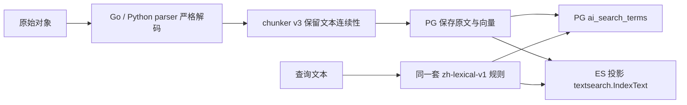

# 中文解析、切块与 PG / ES 检索链路

本次完成代码、迁移脚本和隔离验证，尚未部署到现有服务。日期按北京时间记录。

## 处理链路

原文与搜索表示分开保存。parser 和 chunker 不为搜索而改写原文中的全角字符或大小写；PG / ES 的派生索引和查询统一使用 NFKC、转小写及中文单字/双字规则。

## Parser 与 chunker

| 环节 | 修复与对齐 |
| --- | --- |
| Go / Python 文本解码 | 支持 UTF-8（去 BOM）、带 BOM 的 UTF-16/32；普通文本在严格 Unicode 解码失败后可回退到 GB18030，并检查编码往返一致性。UTF-16/32 不猜测无 BOM 的输入，避免 GBK“中文搜索”被解成其他文字 |
| 非法内容 | 两种 parser 都拒绝禁止的 C0 控制字符、空白文本和非法 JSON；JSON 不使用 GB18030 回退，避免默默修补损坏输入 |
| 内置 DOCX | 格式 run 中的 `w:t` 直接拼接，显式保留 `w:tab`、`w:br`、`w:cr`；不再把“中文搜索”拆成“中文 搜索” |
| chunker | `MakeTypedChunks` 升到 `document-chunker-v3`；文本块内部按连续 rune 窗口取片，overlap 也取自同一段源文本，避免插入空格破坏跨边界词语 |
| 中文边界 | 优先段落、换行和句末，再考虑 `，、：` 等分句边界；没有合适边界时按预算切分，并保证向前推进 |
| 预算与结构 | 默认 600 个估算 token、overlap 60、最多 256 块；保留标题、表格及位置元数据。显式设置 token 预算时允许 overlap 为 0。超出块数上限拒绝发布部分文档 |

修复例：`中华人民共和国` 在预算 5、overlap 1 时，旧逻辑可能生成 `中华人民共` 和 `共 和国`；新逻辑保留连续的 `共和国`，检索词不会被额外空格破坏。

实际 chunker 实现版本已加入 bootstrap 的 pipeline 指纹，独立使用 AI Service 的默认 pipeline 也包含该版本；配置和 Compose / env 示例默认值同步为 v3。旧版本文档下一次执行索引任务时会生成新版本，不会因为模型没变就跳过；这不会自动为所有历史对象创建重处理任务。

## PG 与 ES 的共同检索约定

共享约定为 `zh-lexical-v1`，Go 实现在 `backend/internal/textsearch/lexical.go`，SQL 实现在迁移 31 的 `ai_search_terms`。真实 PG 契约测试逐项比较两者输出。

1. 对派生文本和查询执行 NFKC、转小写，统一全角英文、圈号数字及兼容字符。
2. 索引连续中文的单字及重叠双字：`中文搜索` 对应 `中 / 中文 / 文 / 文搜 / 搜 / 搜索 / 索`。
3. 多字中文查询使用双字 AND：`中文搜索` 要求 `中文 / 文搜 / 搜索`；单字查询使用单字。空白或标点分隔的中文片段分别分析，再要求全部词项。
4. 非中文的连续字母和数字作为词项，空白、标点分隔。词项编码为 ASCII key，避免 PG / ES 的原生分析器再把它们分成不同结果；超过 96 UTF-8 字节的长词使用 SHA-256 key，SQL 使用内置函数，无须额外扩展。

中文范围显式包含 `〇`、基本汉字、扩展 A、兼容汉字和 U+20000–323AF；两端范围一致。双字 AND 是关键词基线，并不强制所有词项在同一处组成完整短语，完整查询的连续命中用于提高排序权重。

PG 保留原 `content`、`content_tsv` 和向量；迁移 31 增加 stored generated column `content_search_tsv` 与 GIN 索引 `idx_ai_chunks_search_fts`。新查询使用同一 SQL 函数生成查询词项，排序结合词项距离、规范化后的完整查询命中与稳定的相同分数排序。迁移可为旧 chunk 自动生成新检索表示，无须调用 Embedding。

ES 写入原文 `content`，同时写入 `content_normalized`、`content_search` 和 `lexical_version`。新 mapping 的 `content_search` 只用 whitespace analyzer 读取编码后的词项，不依赖独立的 CJK 分词器或插件；单写、批写与 backfill 使用同一文档生成函数。查询必须命中全部共享词项，完整短语只提高评分。

兼容查询仅用于没有 `content_search` 的旧 ES 文档，防止旧查询放宽新文档的 AND 条件。新文档写入旧 standard mapping 也已验证，但旧数据仍需回填才能获得完整规范化召回和一致规则；`PrepareEpoch` 不会给已经存在的旧索引补上所有新 mapping 或文档字段。

## 已执行验证

使用真实 PostgreSQL 17 / pgvector、Elasticsearch 8.19 与 Qdrant 容器，数据库和索引均为本次独立生成的测试资源。最终结果：

- `GOMAXPROCS=2 PYTHONDONTWRITEBYTECODE=1 go test -json -p=1 -count=1 ./internal/ai/... ./internal/search/... ./internal/textsearch ./internal/platform/config`：遍历 11 个包，10 个测试包通过，生成代码包 `pb` 无测试；228 项通过（含子用例），0 失败、0 用例跳过。真实 ES / Qdrant 契约测试已启用。
- `python -m unittest parser_worker.test_parsers -v`：独立虚拟环境，17 项通过，0 跳过。
- `GOMAXPROCS=2 go build -p=1 ./cmd/aisvc ./cmd/parser-svc ./cmd/search-indexer ./cmd/search-backfill`：通过。
- 迁移验证：先到 30，插入旧 chunk，再升级 31，确认“中文搜索”“pg”“1号”可命中；down-one 返回 `30|f` 后重新升级成功。

`TestChineseParserToSearchPipeline` 启动真实 Python worker，并与 Go 内置 parser 分别跑 GB18030、UTF-16BE、UTF-8、含格式 run 的 DOCX 和干扰文档。长文本让“共和国”跨切块边界，检查原文、连续切片和 token 预算；每个 chunk 还比较 Go 与 SQL 的词项表示，再调用实际 `Service.Search`，比较 PG / ES 返回的文件集合。ES 回退关闭，避免 PG 回退掩盖 ES 问题。

检索覆盖多字、单字、中文空格分隔、中英混搜、全角英文、`①号 / 1号`、缺失词、纯标点、分散单字干扰，以及 ES 新 mapping、旧文档和旧 mapping 回填。两种 parser 还验证了非法 Unicode、长文本混入 C0 控制字符、GB18030 JSON、非法 JSON、空白文本的拒绝行为。

其他回归包括 PG 的其他用户、删除文件、非活动文档版本过滤与文件/MIME 范围，ES 失败后回退 PG，以及 chunker 升级后实际发布新文档版本。EXPLAIN 仅证明 GIN 路径可用（只在该探针关闭顺序扫描），不代表小表默认会选择 GIN。

原有并发 tombstone 测试曾在较早回归出现一次 ES 409，最终完整回归通过；本次未修改其重试策略。

最终本地证据：[chain-verification.json](../artifacts/ai-chinese-search/20261106/chain-verification.json)、[Go 日志](../artifacts/ai-chinese-search/20261106/chain-go-tests.jsonl)、[Python 日志](../artifacts/ai-chinese-search/20261106/chain-python-tests.log)，同目录保留本轮迁移和回滚日志。

复跑需要已迁移至 31 的独立库 `TEST_POSTGRES_DSN`、`TEST_SEARCH_ES_ENDPOINT`、`TEST_SEARCH_QDRANT_ENDPOINT`；完整 parser 链路另需 `TEST_CHINESE_PARSER_WORKER=1` 和装有仓库 `requirements-parser.txt` 的 Python 环境。测试索引自动移除，验证完成后只删除本轮生成的测试库。

## 生效顺序与边界

本次核对时业务库为 `schema_migrations=23, dirty=false`、`ai_chunks=0`，现有服务仍使用旧镜像及 `SEARCH_INDEX_EPOCH=v3`。本轮没有切换业务库迁移、运行镜像或真实 `.env`；工作区其他改动继续保留。

1. 发布前核对业务库 23 到源码 31 的全部迁移差异；新 PG 查询依赖迁移 31。此迁移增加 stored generated column 并建立索引，会重写表、占用额外空间并持有表锁，需要按实际规模安排窗口。
2. 构建发布相关 `aisvc`、`parser-svc`、`search-indexer` 和回填程序；核对真实 `.env` 中固定的 `PARSER_CHUNKER_VERSION` 并更新到 v3，示例与 Compose 默认值不会覆盖显式配置。先保留当前读 epoch 做兼容验证。
3. 对旧解码结果损坏、DOCX 已被插空格或需要换用新 chunker 的文档，从原始对象重新解析、切块和计算向量，再发布新的文档版本；仅 FTS 迁移或 ES 回填无法恢复已经损坏的原文。
4. 对原文与 chunk 本身正确的文档，用新 `search-backfill` 回填到未使用的新 ES epoch，复用已有向量。按现有流程核对结果、处理回填期间的增量，并协调写入与读取的 `SEARCH_INDEX_EPOCH` 切换；控制表 activate 不会自动修改运行服务的环境变量。
5. 保留旧 epoch 以便回退读取配置；回滚迁移 31 前先回退依赖新列的查询代码，旧 `content_tsv` 仍保留。

估算 token 不等同于模型的真实 tokenizer。本次未加入词典分词、同义词、简繁转换或扫描 PDF OCR；自然语言问题仍可用 hybrid 向量召回。未进行大规模语料相关性、跨机部署或容量认证。
