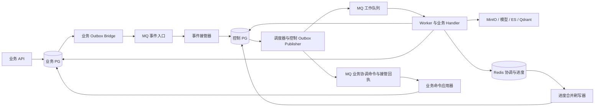
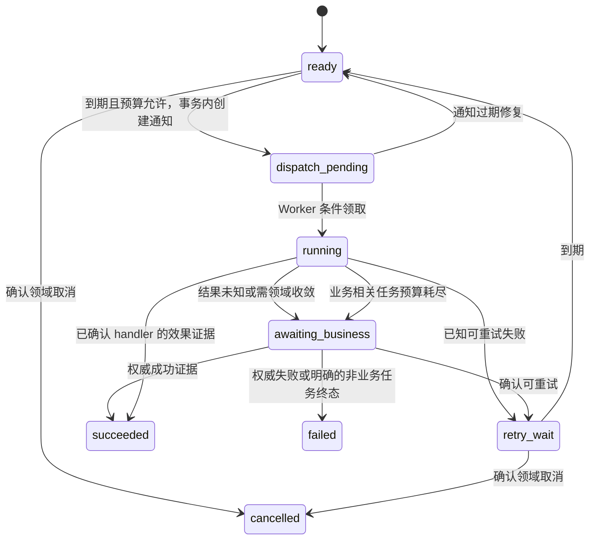

# BX YunPan：业务 PG 与异步控制系统分离设计

日期：2026-11-12，Asia/Shanghai。状态：**设计提案，待评审，尚未实现或部署**。

源码基线：提交 `2bd4439982cef5bebf00d008961a3b6d38fd66d3` 加当前工作区修改。核查时已有 8 个修改文件，包含依赖工厂、配置和上传代码；本提案以读取到的工作区源码为准，不把历史架构计划视为当前实现。本文参数是隔离环境起始值，不是实测容量。

建议先评审第 3、5 节的不变量与数据归属，再看第 8–10 节的交接/完成/租约协议，以及第 19–20 节的迁移与验收。第 22 节用当前上传链路串起这些设计。

## 1. 结论与方案边界

采用“业务事实留在业务 PG，通用执行控制迁入独立 PG，RabbitMQ 传递通知，Redis 承担可重建协调和可合并状态”的结构。先保持上传、配额、逻辑文件、物理对象引用的本地事务，再逐步迁出派发和扫描负担。

实施分两层：

1. **执行控制分离**：迁出 `task_executions/task_results/task_failures`，重构跨库恢复，保留业务库里的事务 Outbox、delivery 和存储操作日志。
2. **事件接管与派发分离**：业务只事务性记录事件及一次交接状态；控制系统可靠接管事件、确定订阅计划、创建任务，承担目的地扇出、定时、重试及回执。业务库不再逐目的地维护完整投递生命周期。

第二层是本文的完整目标。第一层是可单独验收的阶段，不能标为完整目标已交付。CDC 是第二层之后可替换事件提取器的能力，不与分库强行捆绑。

本次不要求拆分核心业务数据库，不引入跨业务域 Saga，不更换 RabbitMQ，不把所有心跳改成 Redis 权威，不迁走 AI 业务数据。它们可以独立评估，不能计入此次改造的降压收益。

**降压来自两部分：把控制负载迁走，以及减少无效任务、状态变更、扫描和事务提交。分库本身主要分散负载，不保证系统总写入减少。**

## 2. 当前源码事实及影响

| 当前事实 | 源码依据 | 对方案的影响 |
|---|---|---|
| 共享依赖只有一套 GORM/SQL 连接池 | [dependencies.go](../backend/internal/platform/dependencies/dependencies.go)，`Set/Open` | 增加显式 Business/Control 依赖，不能只替换一个 DSN |
| `taskqueue.Store` 自己领取、续租、保存终态，handler 在其间执行 | [store.go](../backend/internal/taskqueue/store.go)，`Middleware`；[execution.go](../backend/internal/taskqueue/execution.go) | 业务事务与通用任务回执原本分开提交，第一层不拆开核心业务事务 |
| Outbox 在业务事务内同时生成事件与逐目的地 delivery | [outbox.go](../backend/internal/outbox/outbox.go)，`addEnvelopeWithSearch/addDeliveriesWithSearch` | 第二层需停止逐目的地业务侧写入，改为一次交接 |
| Relay 已有通知唤醒、退避、短事务领取和 token 防护 | [dispatcher.go](../backend/internal/outbox/dispatcher.go)；[notify.go](../backend/internal/outbox/notify.go) | 保留可靠性机制，优化逐行更新与逐条确认；通知不是持久日志 |
| 任务 MQ 已为 RabbitMQ，使用 quorum 队列、持久消息、发布确认与手动 ACK | [taskqueue.go](../backend/internal/taskqueue/taskqueue.go)，`declareTopology/publish/handleDelivery` | 继续复用传输；源码声明 quorum 不能证明运行环境具有多节点容错 |
| 当前 Publisher 单个 gate 串行发布并等待确认 | 同上，`publisher/openPublisher/publish` | 批量数据库操作之外，还要改有界发布窗口，否则派发仍串行 |
| 已发布 delivery 的恢复 JOIN `task_results/task_executions` | [execution_recovery.go](../backend/internal/outbox/execution_recovery.go)，`RecoverPublishedBatch` | 分库后重写恢复协议，不能跨库逐条查询替代 JOIN |
| 上传终态恢复依赖任务 dead 回执 | [retry_cleanup.go](../backend/internal/upload/retry_cleanup.go)，`retireStoppedVerifications` | 需要可靠终态通知及业务侧条件收敛 |
| recovery 在事务内检查任务状态、调整 delivery，使用同库任务锁 | [reconciler.go](../backend/internal/recovery/reconciler.go)，`ensureWithPolicy` | 两个数据库里的同名 advisory lock 不提供原来的互斥 |
| `storage_operations` 有独立操作租约、续租和 12 次操作预算 | [operations.go](../backend/internal/storageops/operations.go)；[execution.go](../backend/internal/storageops/execution.go) | 第一层迁出通用任务租约后，业务库仍有这部分控制写入 |
| maintenance 每副本启动清理、恢复和孤儿扫描；部分消息 handler 只记日志 | [roles.go](../backend/internal/bootstrap/roles.go)，`RunMaintenanceWorker` | 扫描器独立分片/选主；删除空转消费时同时更新路由、恢复和监控语义 |
| 搜索消费已有同事务去重与外部发布 checkpoint | [projector.go](../backend/internal/search/projector.go)；[consumption.go](../backend/internal/outbox/consumption.go) | 保留效果所在库的去重和 checkpoint，不把它们当通用控制表迁走 |

以上为源码观察。本轮没有采集运行数据库的负载、版本、容器副本数或连接数，不能断定 `task_*` 已经是实际最大瓶颈。

## 3. 必须成立的不变量

| 编号 | 不变量 | 保障位置 |
|---|---|---|
| I1 | 业务提交与产生异步意图一起成功或失败 | 业务 PG 本地事务 |
| I2 | 控制系统确认接管前，业务侧保留可恢复的事件 | 交接记录、接管回执与留存策略 |
| I3 | 相同消息可重复送达；同一业务操作不能重复产生不可重复的业务效果 | 稳定操作身份、业务事务幂等与资源端条件写 |
| I4 | 业务效果提交前不能记录任务业务成功 | 业务结果证据、控制终态协议 |
| I5 | 失联、超时、回执缺失都表示结果待确认，不能直接推断业务失败 | 查询主库结果、外部结果探测、reconcile 协议 |
| I6 | 旧执行者不能覆盖新版本或新物理世代的资源 | 业务状态条件、资源端版本与 fencing |
| I7 | 重投、重建通知、扫描恢复不能重置同一操作的重试预算 | 控制任务身份、业务操作预算 |
| I8 | 内存队列、批次、未确认窗口、Redis 待刷状态和扫描都有上限 | 各级背压与容量预算 |
| I9 | 控制库或 Redis 故障不会让业务 API 必须同步连接它们才能提交本地事务 | 按角色依赖装配、本地 Outbox、入口积压准入 |
| I10 | 备份恢复或切换后，不允许旧控制终态直接成为业务事实 | 恢复世代、业务结果对账与有界重放 |

系统提供至少一次消息传递，并通过本地原子提交实现指定业务效果的防重。不宣称跨 PG、RabbitMQ、Redis、MinIO 的全局 exactly-once。活性依赖故障恢复、容量足够以及人工处理永久失败；毒消息可以进入隔离态，不承诺无限自动重试。

## 4. 完整目标拓扑与职责



业务 API 只要求业务 PG 及该接口实际需要的业务依赖可用。控制 PG 不加入全部 API 的启动和 readiness 硬依赖。异步相关查询可返回最后已持久化的投影或明确“状态暂不可用”，不能把控制库故障伪装成任务失败。

接管器、调度器、控制 Publisher 原则上只持有控制库凭据。Worker 的通用执行框架只操作控制库；业务 handler 通过类型化依赖操作业务库及外部资源。第一阶段保留 Go 包内调用，不要求为了分库增加业务 RPC。

增加进程角色不代表必须一开始全部独立部署：可以同二进制、分角色启动，先保证数据和依赖边界。物理实例独立才提供 PG 资源隔离，同机实例仍受共享 CPU、磁盘和内存限制。

## 5. 数据归属与权威

| 数据 | 业务 PG | 控制 PG / Redis |
|---|---|---|
| 用户、配额、目录、文件、对象引用、上传状态 | 权威 | 控制侧只携带必要标识，不能据缓存授权 |
| `outbox_events` | 事务性事件/命令意图；新模式以不可变载荷为主 | `event_inbox` 保存接管身份及必要载荷 |
| 逐目的地派发 | 过渡期保留旧 `outbox_deliveries`；目标只保留一次交接状态 | 订阅计划、任务实例、控制 Outbox |
| `event_consumptions`、搜索 checkpoint | 留在业务效果所在库 | 通用任务回执不能替代它们 |
| 用户可查询的 `async_tasks` 业务作业 | 继续作为业务作业意图及产品状态 | 控制任务通过 operation ID 关联，终态投影异步更新 |
| `task_executions/results/failures` | 迁移后退出通用执行路径 | 第一阶段迁入；后续统一为任务实例、结果及尝试历史 |
| 存储操作意图、目标 key、provider upload ID、领域状态 | 第一阶段全部保留 | 第二阶段仍保留必要领域事实 |
| 存储操作租约及续租 | 第一阶段保留 | 后续按单个操作类型拆出，不能直接删业务租约 |
| 通用定时、重试、投递错误、执行租约 | 目标退出业务库 | 控制 PG 权威 |
| 进度、运行时活跃时间 | 不作为完成依据 | Redis 高频状态，控制 PG 低频投影 |
| 限流令牌、可重建并发许可 | 无需逐次落库 | Redis + Lua；硬资源上限仍由连接池和部署预算约束 |

业务状态 `completed` 与控制状态 `succeeded` 可以短暂不同。对用户是否存在文件、扣了多少配额、对象能否 GC 等判断，查询业务权威。通用“执行已完成”不能自动证明每个外部效果已发布；handler 必须给出其成功证据。

## 6. 身份、去重、幂等和顺序

### 6.1 四类身份

| 身份 | 含义 | 重试时是否变化 |
|---|---|---|
| `event_id` | 某次已提交的事件 | 传输重发不变；新的事实可产生新 ID |
| `operation_id + effect_type + generation` | 一个逻辑业务效果 | 同一效果恢复时不变 |
| `task_id` | 一个订阅者对指定操作/事件的执行任务 | 重试、通知丢失、进程崩溃时不变 |
| `dispatch_id / run_seq` | 某次投递通知、某次执行接管 | 新通知/接管可变化，不成为业务幂等键 |

当前 `event_id:destination` TaskID 作为 legacy 身份继续支持。迁移中的任务不重算 ID。新任务通过注册的 semantic key 生成稳定 ID，并保存 legacy alias。不能把不同恢复事件直接视为不同业务操作。

每次接管保存规范化输入摘要。摘要包含契约版本及影响业务效果的输入，不含 trace、重投次数和发送时间。相同身份、不同摘要进入冲突隔离，不静默覆盖。规范化算法随契约版本固定，不能只依赖任意 JSON 字段顺序。

事件摘要与效果摘要分开：前者验证同一 event 的内容没有被改写；后者判断多个事件是否请求同一效果。不能把 source event ID 放进效果摘要后，又期待不同恢复事件能够合并。同一 task 的输入保持不可变；更新目标版本产生新任务或明确的新世代，并按规则把旧快照任务标为 superseded，不能覆盖旧 task payload 破坏身份校验。

### 6.2 按当前 handler 定义业务效果键

| 工作 | 推荐效果身份 | 需要保留的领域保护 |
|---|---|---|
| multipart create/complete/abort | 存储操作 ID / 原幂等键 | 上传会话状态、provider upload ID、操作预算 |
| 对象校验与上传最终确认 | upload session + 校验策略世代 | 上传终态、文件唯一约束、配额和引用事务 |
| 缩略图 | 物理对象世代 + 变体类型 + 转换版本 | 确定性输出或世代 key，变体状态条件 |
| AI 索引 | object + document generation + pipeline/model version | active version 发布条件、旧版本隔离 |
| 搜索投影 | index epoch + 聚合 ID + 目标版本 | 服务端版本条件、checkpoint、tombstone |
| 对象 GC | GC 意图 ID + 对象物理世代 | 引用归零重验、删除状态与世代绑定 |

对象聚合版本可能因为增加引用变化，不能不加分析地把每次版本变化都当成新 AI 内容任务。效果键由业务 handler 注册，通用框架不推断业务等价性。

### 6.3 去重不等于业务幂等

`event_inbox` 防止同事件重复建任务；`task_id` 防止重复领取；业务 receipt/状态条件防止不同通知导致重复效果；外部资源版本防止旧执行者覆盖新结果。四层各有边界，不能拿一条 Redis SETNX 替代全部。

任务消息可能乱序。快照投影允许按版本收敛；配额增减、引用增减等命令不允许简单取最新覆盖。删除、ACL 撤销和物理 GC 有独立优先级，不能无限 debounce。全局有序不是默认目标，必要顺序限定在业务聚合内。

快照类合并只适用于可从权威库重建完整目标状态的任务：可在控制事务中选出同资源最新目标，终止尚未执行的旧目标；已经执行中的旧目标仍依靠外部版本条件防护。事件审计与 source-task 关联继续保留。不能把“只执行最后一条”推广到增量命令或跳过删除 tombstone。

UUIDv7、created_at 和自增 ID 都不能直接充当“所有较小 ID 均已提交”的全局交接水位。长事务可以晚提交。普通 Relay 查询持久待交接状态；CDC 使用提交位置及源实例/时间线标识。

## 7. 建议的数据模型

下面是逻辑模型，不是可以直接上线执行的 migration。实际迁移编号在实现时重新确认；当前源码有 `000001` 到 `000031`。

### 7.1 业务库

- `outbox_events`：保留现有稳定事件契约，添加显式生产模式/交接协议版本。新模式不在业务事务内生成每个 worker 的 delivery。
- `outbox_handoffs`：每事件、每逻辑入口一行，记录待发送、租约、发送结果、控制接管确认。只有接管成功才能进入正常清理条件。
- `business_command_inbox`：控制命令 ID、输入摘要、处理结果和时间，与业务处理同事务提交。
- `business_operation_receipts`：仅对现有业务行不足以长期证明结果的关键效果增加。键为 operation/effect/generation，保存输入摘要、结果引用和结果版本。可以复用上传 completed 状态、存储 operation、搜索 checkpoint 的 handler 不再机械增加一份完整结果日志。
- 必要的 `business_execution_fences`：只在资源保护确实需要时增加，记录操作接受的控制平面世代与执行序号。心跳不更新此表。

`business_command_inbox` 不是通用任务历史表。业务库保留少量低频可靠性交接记录，是减负方案的明确成本。

### 7.2 控制库

| 表 | 关键字段与约束 |
|---|---|
| `event_inbox` | `(producer,event_id)` 唯一；payload hash、契约版本、不可变订阅计划、接管时间 |
| `task_instances` | task ID 主键；semantic key 唯一；operation/resource generation、队列、输入摘要、状态、deadline、next_run_at、dispatch_seq、run_seq、lease token/expiry、失败预算、业务结果引用、state_version |
| `task_source_events` | event → task 的关联及 legacy alias；支持多个事件归入同一逻辑任务 |
| `control_outbox` | message ID 唯一；类型、目的地、task ID、dispatch seq、载荷、可发送时间、发布租约/token、发布状态 |
| `task_attempt_history` | `(task_id,run_seq)` 唯一；一次执行的开始/结束、错误分类、结果引用；不逐心跳追加 |
| `task_progress_snapshots` | task/执行世代/进度版本；独立于任务权威终态 |
| `recovery_requests` | 逻辑请求 ID 唯一、原因、预算归属、确认进度；不通过新 TaskID 重置预算 |

`task_instances` 的语义唯一性不能只依靠一个未校验原文的短 hash；存储规范化键或完整摘要并在冲突时核验输入。业务资源 ID 在控制库是契约引用，不建立跨库外键。

`control_outbox` 的传输状态和 `task_instances` 的执行状态分别负责消息发送与任务执行，不互相替代。目标模型不再同时维护三个内容相同的终态权威；旧 `task_results` 通过兼容视图/适配层退出，迁移阶段先保持语义不变。

### 7.3 任务状态机



未知契约、输入冲突和毒消息进入独立 `quarantined` 状态及告警流程。隔离不自动修改业务配额或删除文件。资源已被更高版本替代时记录 `superseded` 结果；它是否视为成功，由任务契约定义。

每次状态转换使用期望状态、state version 和所属 token 条件。状态机不能被 Redis 进度刷写器修改。无业务副作用的任务可以直接 failed；会影响配额/上传等领域终态的任务，执行预算耗尽与业务失败必须分别处理。

## 8. 业务事件到控制系统的可靠接管

### 8.1 本地事务与接管协议

1. 业务 PG 事务修改业务数据、写 `outbox_events` 和一次 `outbox_handoffs`，一起提交。
2. Bridge 以短事务批量领取 handoff，在事务外发布到事件入口。收到有效 RabbitMQ 发布确认后，小批更新发送状态。
3. 接管器批量消费，在**控制 PG 一个事务**里写 `event_inbox`、固定订阅计划、幂等创建任务与接受回执的 `control_outbox`。
4. 控制事务提交后 ACK 入口消息。提交结果未知时重新确认，或者保留未 ACK 消息让它重投。
5. 控制 Publisher 发送接受回执，业务应用器幂等把对应 handoff 标为 accepted。

**MQ 发布确认只证明传输接管，不等于控制库已经接管。** 业务事件在 accepted 前保留；超过接管确认等待时间可以按原 event ID 重发。控制 Inbox 冲突时复用任务，并支持限频重新发送同一份确定性接受回执。

接管回执携带精确 event ID 集合、源身份和协议版本。批量确认按这些 ID 更新，不能拿最大 ID 直接确认所有较小 ID。accepted 之后，控制库负责恢复任务和重新生成执行通知。

handoff 的 accepted 是单调确认：接管回执可能比 Bridge 的发送状态回写更早到达，晚到的发送成功/失败只能更新仍属于自己 token 的非 accepted 行，不能把 accepted 降回 sent/pending。交接重试与任务重试分别计数。

accepted 表示控制系统已经持久保存原事件、订阅计划或明确隔离原因，不表示工作已经完成。对于不可执行的未知契约，只有原载荷和隔离记录已可靠保存、并有后续修复入口时才允许 ACK；不能先丢载荷再登记一个错误计数。接管回执重发只更新传输状态，不创建新 task 或重置失败预算。

### 8.2 订阅计划与无消费者事件

控制侧注册 `event type → task contracts`，接管时保存 route plan 版本与生成的目的地集合。重投不得因当前 feature flag 不同而任意改变已接管计划。

领域事件可以合法没有订阅者，记录明确的 `accepted_no_subscribers`，不能靠制造空转 maintenance 任务完成确认。必须执行的命令缺少 handler/配置时进入 blocked/quarantine，不能把“功能关闭”当作业务操作已成功。

新增订阅者的历史回填有显式 replay job、范围和预算，不在普通接管重试时偷偷补建历史任务。

### 8.3 发布与接管故障窗口

| 故障 | 处理 |
|---|---|
| 业务事务回滚 | 不存在已提交事件，不产生任务 |
| MQ 已接收，Bridge 发送状态未落库 | 以同 event ID 重发，Inbox 去重 |
| 控制事务已提交，入口 ACK 丢失 | 重投只核验摘要和补发接受回执，不重建任务 |
| 接受回执丢失或业务应用器失败 | 控制 Outbox 重试；业务侧超时重发入口触发回执修复 |
| 控制接管成功后 MQ 工作通知丢失 | 控制调度器根据持久任务状态重建通知 |
| 完整控制库数据丢失 | 按第 16 节灾备恢复；普通重复投递机制不等于灾备能力 |

### 8.4 消息方向和 ACK 边界

保留现有 6 类业务工作队列；新增系统消息入口使用独立版本、权限和消费预算，不能伪装成普通 maintenance ping。

| 消息 | 方向 | ACK 前必须持久化 | 是否再生成业务事件 |
|---|---|---|---|
| 业务事实/工作意图 | 业务 Outbox → 控制接管 | 控制 Inbox、任务或隔离记录、接受回执 | 按订阅计划创建任务 |
| 事件接管回执 | 控制 Outbox → 业务交接应用器 | 业务 handoff 条件更新 | 通常不生成，避免回执递归 |
| 工作通知 | 控制 Outbox → Worker | 控制终态、retry_wait、awaiting_business 或已确认重复 | 业务 handler 按本地事务产生领域事件 |
| 业务协调命令 | 控制 Outbox → 业务应用器 | 业务 Inbox、条件业务效果、结果回复 Outbox | 产生一次确定性结果回复 |
| 权威业务结果 | 业务 Outbox → 控制接管 | Inbox 去重、结果版本校验、控制状态推进 | 直接处理控制结果，不再派生同一协调任务 |

接管回执可以直接依赖 handoff 主键和 accepted 状态实现幂等，不必为每份重复回执额外插一行业务命令历史。业务协调命令则必须使用 Inbox 与业务效果的本地原子提交。所有系统消息都要验证生产者、契约、目标资源和迁移世代，MQ 消息不能自行授予配额或 GC 权限。

## 9. 执行、业务提交与完成协议

### 9.1 正常流程

1. 控制调度器原子选择到期 ready 任务，推进 dispatch seq，写工作通知到控制 Outbox，状态变为 dispatch_pending。
2. Publisher 发布通知。通知携带 task ID、控制平面世代、dispatch seq、输入摘要及必要契约信息。
3. Worker 从控制库条件领取，校验任务、通知序号、due time、输入摘要及状态；生成租约 token 并推进 run seq。RabbitMQ payload 不是可越过控制状态机的执行授权。
4. Handler 执行外部处理或业务事务。业务 PG 修改与对应业务幂等/结果证据一起提交；生成的新领域事件仍写本地 Outbox。
5. Worker 将可证明的结果保存到控制 PG，同事务写尝试终态及必要通知。控制成功以后才 ACK 工作消息。

领取失败的旧 dispatch 通知可直接 ACK；活跃任务的重复通知也可以 ACK，因为控制库仍保存任务和租约，失联扫描负责重建通知。不能只 ACK 并假设另一个 RabbitMQ 消费者一定还活着。

上述 ACK 需要已经确认通知确实过期、重复或任务已有终态。控制库查询失败、提交结果未知、task 异常缺失时不能当作普通重复 ACK；应保留消息或持久隔离并触发身份对账。过期通知的身份与原因要可观测。

Publisher 回写与 Worker 执行存在并发：通知发布后 Worker 可能已进入 running，Publisher 不得把它覆盖回 queued。传输确认只更新所属控制 Outbox 行；任务执行状态由任务状态机独立推进。

同一 task 同时最多一个有效 dispatch 序号。修复 dispatch_pending 前先检查当前控制 Outbox：尚在待发/合法发布租约中时重试原通知；已确认但长时间无领取时才创建新 dispatch 并使旧序号失效。不能因 MQ 背压不断制造新通知，形成调度自激。

### 9.2 业务效果防重

对需要额外 receipt 的关键业务效果，业务事务示意：

```text
BEGIN
  以稳定 operation/effect/generation 键检查或插入 receipt
  相同键且输入不同：拒绝
  已有已提交结果：返回原结果
  锁定需要修改的业务聚合，检查合法状态与目标版本
  执行业务修改
  写结果引用；必要时写 business.operation_outcome 事件
COMMIT
```

receipt 与效果必须在同一事务。事务内部不能持锁等待模型、MinIO 或外部索引请求。现有唯一约束和状态机继续发挥作用；通用控制库不能替代用户配额约束、文件唯一性或物理对象引用约束。

并发防重以唯一约束和事务为基础：使用 `INSERT ... ON CONFLICT DO NOTHING RETURNING` 等方式取得效果身份；冲突后核验已有摘要和结果。只有先查不存在、再无条件执行业务，不能防并发重复。若效果失败，receipt 必须随事务回滚，不能留下一个已处理标记。

### 9.3 结果未知与业务终态

业务 COMMIT 响应丢失时，先按稳定操作 ID 查询业务主库结果。查到成功则补控制回执；确认未提交且状态允许才重试；查询失败保持 awaiting_business，不能立刻释放配额或发起补偿。

控制任务达到重试上限后，涉及领域状态的处理为：

1. 控制事务进入 awaiting_business，并写 `business.reconcile_operation` 命令到控制 Outbox。
2. 业务应用器在业务事务内插入 command Inbox、检查现有结果及状态。
3. 已成功则返回成功证据；仍有合法业务执行者则返回待确认并安排持久后续检查；只有满足领域超时/失败条件时才结束业务、释放预留、记录必要清理意图。
4. 业务结果与对应回复事件在业务 PG 同事务提交；控制侧幂等消费结果，收敛终态。

失败命令携带预期业务世代和版本，不能撤销后来成功的新操作。结果事件有 operation ID 和 outcome version，终态投影不能被较旧的失败通知覆盖。

不为每个进度或无副作用任务增加业务往返。需要终态收敛的 handler 在注册时声明 `OutcomeResolver`；其结果依据可以是现有领域行，不必全部新增 receipt。

### 9.4 协调命令必须区分重复投递和新一次观察

同一 `command_id` 的重复投递，由业务 Inbox 返回原处理结果，不重新产生业务效果。若原回复是 pending，控制系统应在持久化的下一次检查时间发送新的 `reconcile_seq`，形成新的 command ID，但继续使用同一 operation/effect 身份。

否则会出现“永久拿到第一次 pending 回复”的活性问题，或者通过换命令 ID 重新产生业务效果。协调轮次受单独预算、deadline 和退避控制；回复携带观察到的业务版本。控制侧接收结果在同一事务内去重、校验版本并推进任务状态；过时结果可以留审计但不能覆盖新终态。

## 10. 重试、租约、旧执行者与外部副作用

### 10.1 一个层次一个明确预算

- 发布失败：增加传输重试，不消耗业务执行失败预算。
- 每次实际领取：增加 run seq，作为执行世代，不直接等同于业务失败次数。
- 已知业务执行失败：按策略增加 failure count，持久化 next_run_at。
- 崩溃、取消、依赖连接故障：单独记录基础设施重试和总 elapsed deadline，避免无限故障循环，也不任意耗尽业务预算。
- 已有 `storage_operations.MaxAttempts=12` 仍是领域操作预算；恢复消息不能重置它。
- 人工重放保留审计、原操作身份与历史预算。真正的新业务请求使用新操作身份，不能通过随意换 TaskID 逃过失败终态。

完整目标采用**控制 PG 调度重试**。Worker 在控制事务中写 retry_wait、时间、预算后 ACK 原消息；到期由调度器创建新通知。现有 RabbitMQ TTL 重试队列在兼容期保留，退出时单独排空和转换，不能同时让两套机制独立增加重试次数。

延迟任务的 not_before/deadline 在创建逻辑工作时固定，重投不会重新起算。GC 延迟使用领域意图确定的时间边界，业务执行时仍重验删除条件；两个 PG 的时钟差可能影响调度时间，不能让控制时钟成为跳过领域安全检查的依据。deadline 到达后的动作由任务契约定义：停止新尝试、确认未知结果或发起领域协调，而非统一直接取消业务。

### 10.2 执行租约

第一阶段和完整目标初版都保留控制 PG 作为任务租约权威。Redis 心跳只作观察或辅助准入，不替代 PG 的过期判定。对 PG 内完成的短任务，允许注册更轻执行模式，但必须单独证明短事务防重和恢复行为。

续租按批执行，每行同时匹配 task ID、run seq、token、running 状态及尚未过期。数据库返回未更新的任务必须停止其执行。失去租约后不允许继续把自身结果写为成功。

等待终态批次提交期间，任务仍属于运行中：保持必要续租，或验证剩余租期足够覆盖提交期限。不能先停止续租，再把结果放进可能长期阻塞的缓冲。终态事务结果未知时保留稳定提交身份并查询确认，不能直接 ACK 或清空内存中唯一的待确认信息。

```text
LeaseTTL >= 3 × HeartbeatInterval
            + 允许的续租数据库延迟
            + 停止宽限
            + 调度抖动余量
```

这些时间需要故障注入校准，不能仅通过延长 TTL 掩盖数据库拥塞。续租和终态提交使用预留资源，不与新任务准入共用一个会被耗尽的无界队列。保留现有“不响应取消的 handler 导致进程退出”的最后防线。

### 10.3 控制租约不能跨库保护业务资源

在控制库校验 token，随后到业务库写入，中间仍存在时间窗口。业务资源必须有自己的状态/版本条件。

需要严格 fencing 的关键操作，在业务侧登记被接受的 `(control_incarnation, run_seq)` 并在最终提交时锁定/检查。新执行者登记成功后，旧执行者不能覆盖它。登记和业务写入按同一业务行锁顺序串行化；不能宣称“控制 TTL 一到，旧事务在另一个库里立即失效”。

业务库恢复出旧快照或控制库世代重建时，先暂停执行并更新可接受世代；新世代建立前禁止新旧 Worker 并行。执行世代是资源接受的有序许可，UUID 本身不提供单调大小关系。

run seq 仅在同一 task 内有序；多个 task 修改同一资源时，必须使用资源自己的版本/fence，不能比较两个无关 task 的 run seq。incarnation 的切换通过业务侧登记和写入者隔离授权，不能由收到任意新 UUID 的 Worker 自行提升。

### 10.4 存储操作需要第二次、按类型的改造

当前通用任务租约保护 TaskID；`storage_operations` 租约保护逻辑存储操作，恢复事件换 ID 后也能互斥。两者现阶段不能直接二选一。

后续迁走存储操作续租时，保留业务库内的操作意图、目标物理世代、结果及领域预算；执行租约迁控制库，并为具体类型补足资源保护：

- Create：进程崩溃可能留下未知 provider upload ID，保留枚举/过期清理能力。
- Complete：超时先确认对象状态，不把超时直接解释为失败。
- Copy/Ensure：继续按物理世代 key 与校验结果收敛；复制成功、业务提交失败时登记清理意图。
- Delete/GC：业务侧重新确认引用、删除状态和物理世代；只删除旧世代指定 key。新的引用/复活不能复用即将删除的物理 key。
- ES/Qdrant：保留当前服务端版本、epoch/tombstone/checkpoint 保护，不以“只有一个 Worker”替代资源端防旧写。

MinIO 等外部系统不支持任意 PG 事务。存在未知结果时先探测，保留可恢复中间态。对不支持 fencing 的外部请求，不能声称租约取消能撤销已经发送的调用；需要确定性效果、隔离世代、结果探测和孤儿清理共同兜底。

## 11. 批量路径设计

### 11.1 六个批量边界

| 边界 | 批量方式 | 可靠性条件 |
|---|---|---|
| 业务交接领取 | `FOR UPDATE SKIP LOCKED` + 集合更新/RETURNING | 短事务、逐行 token |
| 控制事件接管 | 一批 Inbox、任务及接受回执同控制事务提交 | 每事件独立唯一键；提交后才 ACK |
| 控制调度 | 批量选择到期任务，更新 dispatch seq 并写控制 Outbox | 状态条件、队列预算、确定性消息身份 |
| MQ 发布 | 有界未确认窗口，单 channel owner 管理序号 | mandatory return 与 confirm 一一关联 |
| 租约续租 | `UPDATE ... FROM (VALUES ...) ... RETURNING` | 返回缺失者按失租处理 |
| 终态提交 | 小批条件更新 + 尝试结果 + 控制 Outbox | 控制事务提交后才确认对应消息 |

批次同时受行数、序列化字节数、最大等待时间限制。大载荷不能靠固定行数批次绕过内存预算。数据库慢时暂停新任务，不能无限增大批次或把终态无限缓存在内存。

批量领取 SQL 形态示意：

```sql
WITH picked AS (
  SELECT task_id
  FROM task_instances
  WHERE queue = $1 AND state = 'ready'
    AND next_run_at <= clock_timestamp()
  ORDER BY next_run_at, task_id
  LIMIT $2
  FOR UPDATE SKIP LOCKED
)
UPDATE task_instances t
SET state = 'dispatch_pending',
    dispatch_seq = t.dispatch_seq + 1,
    state_version = t.state_version + 1
FROM picked p
WHERE t.task_id = p.task_id
RETURNING t.task_id, t.dispatch_seq, t.state_version;
```

返回行对应的控制 Outbox 在同一个控制事务内批量插入。示意 SQL 不含全部 deadline/取消/准入条件，实现时必须补齐。不能先提交任务状态，再另开事务生成通知。

批量中单条输入冲突应定位到具体行，隔离该消息并让其他消息继续；数据库整体不可用则不 ACK。禁止把失败批次在无限递归拆分中重复执行。批量提交结果未知时，以相同消息/操作身份核验或重试。

### 11.2 RabbitMQ Publisher 改造

现有单条同步发布接口扩展为批量/异步确认接口。每个 publisher channel 有单一 owner goroutine，维护 `(channel incarnation, publish sequence) → dispatch message` 映射；设置可配置最大未确认条数和字节数。

- 发布前注册序号，支持 RabbitMQ multiple ACK/NACK。
- mandatory return 按消息/dispatch 身份关联；不能把“收到 confirm ACK”直接当成已路由成功。
- 返回与确认事件须按协议关系处理，不能因为两个通知 channel 的 select 顺序丢掉 return。
- channel 关闭时所有未确定消息视为 unknown，通过控制 Outbox 稳定身份重新发送。
- 仅对确认成功且没有 return 的消息批量写发送完成；条件包括该 Outbox 行的 lease token。
- 晚到的发布确认不得覆盖任务 running/terminal 状态。

批量 ACK 消费端默认使用逐消息 ACK，或仅确认同一 channel 已连续完成的序号前缀。不同任务并发完成时，不能随便 `Ack(multiple=true)` 确认仍在执行的较早消息。

## 12. Redis + Lua 与异步刷写

### 12.1 允许的职责

Redis 承担令牌桶、可重建并发许可、短期热点状态、进度和非计费统计。关键意图、业务幂等、重试预算、权威终态、物理删除条件不以 Redis 为唯一记录。关键数据不通过普通 dirty key 后写 PG 的方式承诺已成功。

Lua 只保证脚本期间不与其他命令交错；不提供跨 PG 提交，也不在任意运行时错误后自动回滚前面已经执行的 Redis 写入。脚本先校验参数、key 类型及范围，再做变更；Redis Cluster 下参与脚本的 key 必须属于同一 hash slot。

### 12.2 进度合并协议

进度身份包含 task ID、control incarnation、run seq 和单调 progress version。脚本拒绝旧执行世代、过期更新和非法进度范围，更新最新快照并登记 dirty version；终态由 PG 权威判定，进度不能把任务改回 running。

刷写器流程：

1. 有界读取 dirty 快照，按同任务/执行世代合并。
2. 对控制 PG 的独立进度表执行版本条件 UPSERT；不能更新 `task_instances.state`。
3. 提交后，通过 Lua 仅清除与已刷 version 相同的 dirty 标记。
4. 刷写期间若出现更高版本，保留新 dirty 标记。失败不清除，退避重试。

如使用 Stream，消费组 ACK 放在 PG 提交之后；支持 pending 重领，不能在仍有未确认项时无条件裁剪 Stream。高频快照优先使用有界 dirty 集合合并，避免每次心跳都制造永久 Stream 条目。

进度表 UPSERT 必须匹配当前允许的执行世代；旧 Worker 重试刷写不能覆盖新任务进度。终态显示优先于 Redis 残留进度。计费/配额增量不适用“取最后一个值”；精确计数需要独立防重模型，本文不把它们纳入普通进度缓冲。

Redis 重启允许丢失或回退少量进度，Worker 下次上报重建。若某类数据要求接受后不丢，必须在 PG 或经过明确持久化确认的日志里先有记录，不能套用本段的可丢进度语义。AOF 和副本降低风险，不自动消除异步复制故障窗口。

### 12.3 Redis 故障与准入

Redis 准入模式默认在失联时暂停领取新的高成本任务；续租、结果提交和业务结果确认不依赖 Redis 成功。可配置静态预算模式，但必须经过部署总预算验证，不能故障时悄悄放开所有限制。

Redis 并发许可使用唯一 token、TTL、续约与 compare-release。旧 Worker 释放许可不得删除替代执行者的许可。Redis failover 可能丢许可，因此它只控制软准入；真正的连接硬上限由本地池和已批准副本预算保证。需要严格全局许可时使用控制 PG 原子许可记录，并计入其负载。

## 13. 全链路背压

### 13.1 五级预算

| 层级 | 观测与限额 | 超限行为 |
|---|---|---|
| API 发起新异步操作 | owner/全局新工作速率、Outbox 未接管数及最老年龄 | 在业务提交前拒绝新发起，返回可重试错误；已接受操作继续收敛 |
| 业务 Bridge → MQ 入口 | MQ 字节数、接管延迟、发布未确认窗口 | 暂停/减速发送，事件留业务库 |
| 接管器 → 控制 PG | 事务延迟、池等待、控制任务积压、磁盘余量 | 降批次/限速，保留未 ACK 入口消息 |
| 调度器 → Worker | 队列权重、owner 公平性、控制/业务 PG 等待、供应商预算 | 减少新通知和新执行，保留待执行状态 |
| Worker → PG / 外部资源 | 每类并发、速率、字节、终态/续租预留 | 有界等待或退避，不能无界建 goroutine |

业务 Outbox 也是有限存储。控制系统长期不可用时，入口最终必须限制新增工作，不能承诺无限接受。API 使用缓存预算可以低开销准入，但该阈值只是软阈值；若要求精确硬上限，需要在业务本地事务内预留容量额度，并接受额外写入与热点成本。

RabbitMQ 工作队列及入口配置字节/条数上限与 reject-publish，禁止用 drop-head 静默删除可靠工作。队列限制不是唯一恢复机制：控制库保留任务，业务库保留未接管事件。死信和重试路径也计入总容量。

### 13.2 调节规则

使用高低水位和迟滞：持续多个观测窗口超高水位，降低新任务并发/速率；持续低于低水位才缓慢增加。起始控制器可采用乘法降速、加法恢复，设置最小/最大值及冷却期，不一开始引入复杂自动控制。

隔离环境可从以下明确规则起步：每 2 s 采样；连续 3 个高压窗口把新启动速率减半；持续 10 个低压窗口后每窗口只恢复一个执行槽，直到配置上限。高压由任一依赖超时/池等待越界、续租余量不足或事务延迟突破已登记 SLO 触发；低压要求这些条件全部恢复。缺少关键压力指标视为不可安全增速。具体延迟阈值在 P0 基线后登记，不能拿本文任意常数当生产 SLO。

压力信号使用连接池等待率、PG 事务分位延迟、业务 API 延迟、队列最老年龄和失败率的组合。队列变长不能单独触发 Worker 无限扩容。API 流量高时先压低 AI 回填、历史重放、维护扫描；删除安全、必要恢复及终态提交有独立保留预算。

队列之间采用加权公平调度，队列内部按 owner 的速率/并发配额轮转，历史回填使用低权重。未获得准入的任务只延后调度，不记为执行失败，也不消耗业务重试预算。owner ID 来自受信生产契约，仅作调度身份，业务权限仍由领域侧确认。

领取新任务前才消耗普通准入许可；正在执行任务的续租、控制终态和领域结果提交通过保留通道完成。暂停调度后不应触发大规模失租和重复执行。

控制接受回执、业务结果确认和必要协调命令使用保留发布/消费额度，不能全部排在普通索引积压之后；否则源事件无法清理、控制任务等待业务回复、业务侧又因积压停止接收，可能形成资源循环等待。预留额度同样有上限和可观测性。

### 13.3 连接与资源预算

分别对两个 PG 校验：

```text
Σ(角色副本数 × 该角色连接池上限)
+ LISTEN/CDC/维护专用连接
+ 管理、监控、迁移与故障处理预留
<= 该实例可用连接上限
```

连接数不是 CPU/IO 承载能力。每类任务另设执行并发与吞吐预算；外部 I/O 期间不持业务数据库连接。续租/终态预留池也计入上述总数，不能隐藏增加连接。

配置检查在部署前拒绝超预算副本组合。PgBouncer 可以作为连接管理增强，但 LISTEN、session 锁及 prepared statement 行为要单独验证，不能假定 transaction pooling 对现有所有路径透明。

## 14. 恢复系统的拆分

### 14.1 控制恢复

控制库负责：未发控制 Outbox、dispatch_pending 超时、running 租约过期、retry_wait 到期、awaiting_business 未收敛、接受回执补发。每类基于 due time 和状态局部索引，按扫描预算取到期项。

修复同一任务复用原 task/operation 身份及预算。通知丢失只生成新 dispatch，不创建新的业务操作。发布重试、执行重试和业务协调分别记账。

### 14.2 业务恢复

业务库负责领域事实：长期 verifying 的上传、缺少变体/索引的资源、已终止上传的预留释放、存储操作结果与会话状态未收敛、孤儿 canonical 及世代安全 GC。

扫描器通过本地 Outbox 发幂等 `ensure_work/reconcile` 请求，控制侧决定复用任务、查询结果、重发通知还是保持终态。不能把“业务状态还没变化”直接解释为“再建一个新 TaskID”。

现有 `RecoverPublishedBatch`、`HasActiveDelivery`、`retireStoppedVerifications` 分别替换为控制恢复、交接确认和领域结果收敛，不再在业务事务内网络查询控制库并长时间持锁。必要的状态查询采用有界批量接口或本地终态投影，查询结果仍受业务版本条件保护。

P2 保留旧 direct-to-worker 派发期间，必须提供队列级恢复适配：事务外批量取得控制事实，未知则退避；决定重发时复用原 TaskID，由控制 Store 最终原子仲裁领取及预算。允许查询后状态变化导致重复通知，但不能允许业务恢复器自行覆盖控制状态或重置预算。可靠终态通知和业务协调应用器在 P2 就需要可用，不能等 P3 再补。

### 14.3 扫描器与消费者独立扩容

新增独立 scanner 角色，按类别/资源 hash 分片，或每类别选主。扫描租约保证接管，数据唯一键和业务状态条件保证重复安全。不能随着每个 maintenance consumer 增加而重复启动整套全量扫描。

扫描游标存控制状态，业务检查进度可以周期持久化；支持回绕及迟到记录，不能把一个易失游标当作数据永不遗漏的证明。维护扫描设置每轮行数、查询时间、修复数量及每秒 SQL 预算；错误退避，避免故障期间扫描放大。

积压统计由少数 collector 周期采样并缓存，不让每个副本的每次 Prometheus 抓取都重扫全部控制历史。

## 15. PG 写入、索引与留存治理

1. 删除确认无业务效果的 maintenance 消费，保留领域事件与合法无订阅语义。旧消息通过兼容 handler 排空，不能删除队列丢弃历史工作。
2. `not_before` 在创建控制任务/通知时固定，兼容修复不进入每批派发热路径。
3. 控制领取合并重复预读和条件更新；数据库时间可在集合 SQL 内获取，避免每任务额外往返。
4. 结束兼容窗口后，停止同时维护旧事件状态和目的地状态。实施前确认旧 writer、relay 和恢复程序都已退出。
5. 纯业务 PG 短任务可单独设计事务内完成；涉及外部副作用的任务继续分阶段持久化，不能为了少一次提交把网络调用放进事务。
6. 高频控制表按表配置 autovacuum，控制必要索引数与长事务，观察 dead tuples、锁和 checkpoint I/O。

建议局部索引覆盖 ready/retry due time、running lease expiry、未发送控制 Outbox、未接管业务 handoff。索引必须以当前版本和生产样本执行计划验证。lease_until 等索引列每次续租都变化，不能假定仅调 fillfactor 就会获得 HOT 更新。

活动任务表先保持全局 task ID 唯一性；尝试历史、进度历史、审计按时间归档/分区。PostgreSQL 分区表的唯一约束受分区键限制，不能直接把活动表按时间分区后仍假设 task ID 天然全局唯一。

去重留存必须覆盖明确允许的自动重试、人工重放、备份恢复和源事件保留窗口，并加安全余量。无法限定历史重放时，不应承诺有限 TTL 的通用去重永久有效；关键领域唯一性、终态与 tombstone 需要更长或永久保留。

清理业务事件需满足：控制已 accepted、最低留存到期、未处于迁移/PITR 对账保留范围。清理控制结果需同时考虑业务已收敛及允许重放窗口。删除详细日志与删除防重身份是两件事，允许先删大 payload，保留紧凑身份和结果引用。

accepted 不证明接管记录已经进入控制库备份。对于无法从业务现态重建的命令，源事件清理还需覆盖已演练的控制 PITR 恢复范围，或有独立归档副本。必须事先定义可恢复水位和保留时长；同时超出备份 RPO 与事件留存范围的数据，不在可保证重建的边界内。

## 16. HA、灾备与故障边界

两套 PG、RabbitMQ 的持久化与复制策略必须分别声明 RPO/RTO。若要求已确认操作在单节点故障后不丢，确认点需要达到相应同步持久化策略；异步复制可能造成“业务消息已发出，但提升后的业务库缺少事实”。应用幂等不能恢复所有已经丢失的唯一事实。

业务库/控制库分别故障时：

| 故障 | 行为 |
|---|---|
| 业务 PG 不可用 | 停止新的领域效果；控制端退避，不持续空转执行或直接判业务失败 |
| 控制 PG 不可用 | 暂停领取；未完成消息保留；已有业务提交后等待回执修复 |
| Redis 不可用 | 新高成本任务按准入策略暂停；必要续租和结果提交继续；进度可重建 |
| RabbitMQ 不可用 | 两侧 Outbox 保留待发；发布退避，依赖积压预算限制新工作 |
| 外部模型/MinIO 不可用 | 分类退避与未知结果确认；API 核心读写按实际依赖降级 |

灾备恢复步骤：

1. 暂停旧调度器/Worker，隔离旧写入者，保留 MQ 消息。
2. 恢复业务与控制数据，建立新的 control incarnation；对需要 fencing 的业务资源登记新世代。
3. 从允许保留范围内重放事件，先对账业务结果，再恢复执行。不能因控制快照有 succeeded 就跳过对旧业务快照的确认。
4. 对业务快照领先、控制快照落后的操作，复用业务结果补回执；反向情况按业务意图和资源事实重新确认。
5. 不确定的外部效果进入探测/人工修复，不能盲目扣费、增引用或删除。

必须单独演练主备切换、网络分区和不同时间点恢复。本文与现有单机 Compose 都不构成跨主机 HA 证明。

## 17. CDC 的接入位置

默认先完成可验证的 Outbox Bridge。CDC 之后替换第 8 节的事件提取部分，业务事务、接管 Inbox、任务与结果协议不变。

- 只输出已经提交的事件 INSERT；过滤 handoff/状态更新，避免反馈循环。
- 初始快照与增量接续必须形成一致边界；以提交 LSN 和源实例身份管理进度。
- 如果 CDC 先写 MQ，按声明的传输持久化确认推进位点，业务事件仍保留到控制 accepted。
- 如果适配器直接批量写控制库，Inbox、任务与接续位置在控制本地事务里持久化，确认位点只能在提交后推进；重启允许重复。
- 不能凭“用了 Debezium/某连接器”推断 RabbitMQ 发布确认、位点和主备切换已经满足协议。连接器能力需单独 PoC。
- 监控 slot 保留 WAL 字节、最老事件、磁盘余量；CDC 停止时按源磁盘预算限流。slot 丢失需快照/有界重放流程。
- PG 主备切换要验证逻辑槽、源身份/时间线和位点接续；不假定当前配置已支持自动 failover slot。

CDC 有逻辑解码和 WAL 保留成本。只替换扫描、仍照常更新全部旧 delivery 时，收益有限。其主要降压收益需要结合一次交接和控制侧扇出实现。

## 18. 对当前代码的改造清单

新增路径均为建议，尚未创建。

| 位置 | 改造内容 | 验收重点 |
|---|---|---|
| `platform/config` | Business/Control DSN、按角色池、批量与租约、准入、队列容量、执行模式 | 默认兼容、预算检查、配置冲突拒绝 |
| `platform/dependencies` | 显式 `BusinessDB/ControlDB`；只打开角色所需依赖 | API 不因控制库不可用启动失败 |
| `platform/worker/server.go` | 分离执行 Store 与业务 handler 依赖，不再用单个可选 DB 暗指全部职责 | 错库写入可被测试/类型边界发现 |
| `taskqueue` | 保留 AMQP 适配，拆出执行 Store/调度接口、批量 Publisher、ACK 策略 | confirm/return/unknown、并发与停机 |
| 拟新增 `internal/asynccontrol` | 事件接管、任务状态机、控制 Outbox、调度、恢复、结果确认 | 状态不变量、稳定预算、无业务表 JOIN |
| 拟新增 `internal/asynccontract` | 控制通知、接管回执、reconcile、结果契约 | 版本兼容与身份摘要 |
| `eventcontract` | 保留业务事件，必要时增加 operation correlation；注册业务结果事件 | 旧消息解码及双版本窗口 |
| `outbox` | 业务 writer 与 source Bridge；过渡期保留旧 delivery | 新旧模式明确隔离、交接不漏 |
| `outbox/execution_recovery.go` | 任务恢复迁控制侧；删除跨库 JOIN 假设 | 已成功/运行中/超时/未知窗口 |
| `recovery`、`upload/retry_cleanup.go` | 领域扫描发幂等协调意图；可靠终态应用 | 配额与预留不重扣、不误释放 |
| `storageops` | 第一层保持；第二层逐类型拆执行控制 | provider 未知结果、世代、孤儿清理 |
| `search/projector.go`、AI、media | 注册效果身份、OutcomeResolver 和外部保护要求 | 重复、乱序、旧执行者 |
| 拟新增 `platform/admission` | 本地有界预算、Redis Lua 准入、迟滞调节 | 失联不无限放行、不阻塞终态 |
| 拟新增 `platform/progress` | Redis 快照/dirty version 与控制 PG 刷写 | 新更新不误删、旧世代不回写 |
| `platform/dbmetrics` | 双库连接池、SQL/积压采样、批量和背压指标 | 指标本身不产生重复重扫 |
| `bootstrap`、`cmd` | 按角色装配接管器、调度器、scanner、业务命令应用器 | 生命周期和依赖关闭顺序 |
| `migrations`、部署脚本 | Business/Control 分开迁移、版本记录、角色权限与预算验证 | 迁移锁、扩展/收缩和可恢复切换 |

业务库与控制库迁移各自有独立版本表和入口，不能让任意 API/Worker 启动时自动迁移两套库。新表展开优先；大表索引按在线方案单独执行，避免把事务性 migration 与 `CREATE INDEX CONCURRENTLY` 混成无法执行的脚本。

建议配置明确区分：`ASYNC_EXECUTION_STORE=business|control`、`ASYNC_INGRESS_MODE=legacy_direct|control_admission`、`ASYNC_RETRY_OWNER=legacy_mq|control`。启动校验拒绝不受支持的组合。兼容期开关按队列和迁移世代固定，不由每个进程临时猜测。

支持的迁移组合依次是 `business + legacy_direct + legacy_mq`、`control + legacy_direct + legacy_mq`、`control + control_admission + control`。P2 的 legacy 通知允许由兼容 Store 首次幂等创建控制执行记录；完整目标的新通知必须先有已接管任务，异常缺失按第 9 节处理。相同队列不能让两种解释同时拥有执行权。

## 19. 分阶段实施、切换与回滚

| 阶段 | 工作 | 完成门槛 |
|---|---|---|
| P0 负载基线与契约 | 测量业务/控制 SQL、WAL、扫描与热点；为 6 类队列注册身份、结果证据和预算 | 有可重放基线、权威归属表、故障断点清单 |
| P1 同库减负 | 空转任务清理、批量 SQL、Publisher 有界窗口、scanner 分离、静态背压 | 同库故障回归通过，证明减少了哪些调用 |
| P2 双库执行控制 | 独立控制实例与迁移；任务 Store 分离；终态协调和恢复重构 | 双库独立故障、未知提交和旧租约测试通过 |
| P3 接管与派发分离 | 控制 Inbox/订阅计划/控制 Outbox，一次业务交接，控制重试接管 | 逐队列切换，旧 TTL/预算没有双重执行权 |
| P4 批量调优与 Redis | 批续租/终态、进度合并、Lua 准入、动态背压 | 高低水位、Redis 重启及积压上限演练通过 |
| P5 存储控制与可选 CDC | 逐类型外部操作 fencing；按负载收益决定 CDC | 世代/孤儿/未知副作用与位点恢复验证通过 |
| P6 完整 staging 与容量 | 目标迁移、连接与并发预算、完整 staging、容量与恢复测试 | 给出实际吞吐/延迟/恢复和成本，不推断生产 HA |

P0 同时调查收益，避免迁走的表只占很小负载。P2 可先部署为同实例隔离数据库做功能验证，但资源隔离验收必须用独立实例。不得把该功能验证写成业务 PG 已降压。

### 19.1 推荐切换方式：逐队列、有界停消费

1. 展开新 schema 与兼容代码，完成隔离环境演练；新执行器先不领取正式任务。
2. 为目标队列暂停旧领取和相关恢复扫描，等待在途任务收敛或取消并确认旧执行者退出。API 可继续写业务 Outbox，积压受预算限制。
3. 迁移该队列未完成记录、执行身份摘要、预算、到期时间、重放窗口内终态、legacy alias；保留原 TaskID。未知运行中状态按明确的接管规则处理，不能清零重试。
4. 对账源/目标数量、摘要、终态与业务结果；登记迁移世代，启用唯一的新执行权。
5. 恢复目标队列消费与新恢复器，验证在途及积压收敛，再迁下一队列。
6. 旧表先只读保留，观察期结束后再收缩。详细日志清理不与切换同批执行。

普通布尔开关不足以防止旧进程误启动。增加按队列的执行权租约/迁移世代，并用实际消费入口、部署隔离和业务资源 fence 共同阻断旧执行者。跨库同名锁不是执行权机制。

P3 接管协议使用不同入口版本/队列或明确 legacy 标记隔离。不能一条事件同时由旧 Relay 直接扇出、又由新接管器独立创建新身份任务。影子模式只比较路由、身份和计划，不执行第二份业务效果。

### 19.2 回滚

- P1 可按兼容代码回滚，保留已有数据。
- P2/P3 回滚先停新领取与恢复，确认新 Worker 退出，再导回增量终态、预算、未知状态及 alias。只把 DSN 切回旧库会丢控制事实。
- 新状态不能表达为旧模型时，保留兼容代理或继续使用新 Store，不能强行反向迁移。
- 旧程序不能忽略新世代、新物理 key 或新业务结果协议；发生不可逆契约变化后只能向前修复。
- Redis 准入与进度可关闭并回到经过预算验证的静态模式；不能因此移除控制租约或丢弃关键任务。
- 切换不删卷、不清空 MQ、不删除旧任务。回滚检查包括业务配额/预留/引用与外部对象结果。

## 20. 验证矩阵与验收标准

### 20.1 正确性与故障注入

| 测试 | 必须观察到的结果 |
|---|---|
| 相同入口消息并发送达；相同身份不同载荷 | 单份接管/任务；不同载荷隔离 |
| 不同恢复事件指向相同业务操作 | 复用任务/效果身份，预算不重置 |
| MQ 发布成功后状态回写失败 | 稳定身份重发，效果不重复 |
| 控制接管提交后 ACK 丢失 | 重投不重建任务，接受回执可恢复 |
| 业务提交后控制库断开 | 业务结果存在，恢复后补回执，不重复扣配额/引用 |
| 业务 COMMIT 响应未知 | 主库确认结果，不能直接失败补偿 |
| 旧 Worker 在失租后返回；发布确认晚于执行 | 旧控制写被拒绝；新任务状态不被降级 |
| 重试耗尽与业务成功并发 | 以业务状态/世代条件收敛，不误释放预留 |
| 控制恢复、业务扫描并发 | 不无界创建新任务、不重置预算、不丢恢复 |
| Redis 重启/失联、Lua 参数错误、旧许可释放 | 新准入按策略收缩；关键终态/续租继续；新许可不被误删 |
| 进度读取后又更新、刷写提交后崩溃 | 新 dirty 保留；重刷不覆盖新世代或终态 |
| 批量中毒消息、部分 publish NACK/return、channel 关闭 | 精确确认各条，未知消息可重发，无误 ACK |
| 并发消费乱序完成 | 不用 multiple ACK 提前确认未完成任务 |
| 压力升高与准入暂停 | 领取下降，续租/终态有资源，不出现自激重试风暴 |
| MinIO 调用超时、复制成功后业务失败、GC 与新引用并发 | 探测/恢复收敛，不删新世代或共享对象 |
| ES/Qdrant 旧写与 tombstone 并发 | 资源端版本/epoch 保护，结果无越权与复活 |
| 新旧执行器切换/误启动、回滚 | 同一队列唯一执行权，预算与终态不丢 |
| 业务/控制不同时间点恢复、MQ 重放旧消息 | 建立新世代后对账，旧控制 succeeded 不掩盖业务缺失 |

现有 `taskqueue/hardening_test.go`、`outbox/execution_recovery_test.go`、`upload/retry_cleanup_test.go` 和 MinIO/搜索集成测试作为回归基础。双库、双故障和切换矩阵属于新增验证，不能用现有同库测试通过代替。

### 20.2 容量与降压验收

比较相同业务数据、相同输入速率和错误条件下的旧/新路径，先验正确性，再测稳定区间与过载恢复。至少包括上传全链路、目录混合读写、AI 索引、搜索投影、GC、历史重放和依赖故障后的积压排空。

采集：

- 业务 PG：每业务操作 SQL/事务数、SQL 总耗时、WAL、磁盘延迟、锁等待、连接等待、dead tuples 和 autovacuum。
- 控制 PG：接管/调度/领取/续租/终态吞吐和延迟，热点队列及索引维护。
- MQ：ready/unacked、字节、最老年龄、发布确认与 return、重投和拒绝发布。
- Redis：准入拒绝、许可年龄、dirty 数量/字节、刷写延迟、旧版本拒绝和恢复事件。
- 业务结果：端到端完成延迟、API 分位延迟、配额/预留/引用差异、索引与对象一致性。

按表观察 `pg_stat_user_tables` 等指标；按 SQL 观察 `pg_stat_statements` 的时间和可用 WAL 统计。整实例 LSN 差包含其他并发流量，不能当成某一张表的精确 WAL。压力测试要记录背景任务及数据规模。

验收先建立工作负载及目标数值，再以结果决定是否推进；本文不预设“降低 70%”等无基线比例。必须报告业务库负载是否下降、控制实例与 MQ/Redis 新增成本，以及恢复时间是否符合目标。只提高峰值吞吐但破坏尾延迟或故障恢复，不算通过。

## 21. 起始参数与成本模型

以下仅用于隔离 staging 起步，实施前结合每类任务重新配置：

| 参数 | 起始建议 | 约束 |
|---|---|---|
| 入口接管批次 | 最多 64 条、1 MiB、等待不超过 20 ms | 大载荷单独计费，单条限制另定 |
| 调度批次 | 每队列最多 32 条 | 还受全局/owner 准入预算限制 |
| Publisher 未确认窗口 | 最多 64 条、2 MiB | 多 channel 总和有上限 |
| 控制终态批次 | 最多 32 条、等待不超过 10 ms | ACK 等提交；超时退避，禁止丢缓冲 |
| 批续租 | 最多 128 条，额外等待不超过 1 s | 匹配每行 token，失败及时停止 |
| 初始 heartbeat / lease | 15 s / 90 s | 必须满足第 10 节不等式与故障恢复目标 |
| 进度持久化 | 同任务最多约 1 次/s，终态另走可靠路径 | 只对允许合并的状态，不保证 Redis 进度不丢 |
| 恢复扫描 | 每类每轮有界，最初 30–60 s 周期 | 关键失租接管按 lease 到期独立调度 |

批次等待不等于端到端 SLA，任务类型可以覆盖。prefetch 与本地队列按有效执行并发和内存预算设置，不能所有队列统一放大。上述值不代表当前环境已经配置或验证。

设事件率 E、平均扇出 F、活跃长任务 N、续租间隔 H：旧路径业务库中除领域操作外，还包含约 E 级事件、E×F 级目的地记录及多次状态更新、N/H 级通用续租和任务终态等负担。目标把 E×F 级派发与通用执行移到控制实例，业务库主要保留 E 级事件与交接、必要的领域结果和存储操作。

这是工作量分类，不能把各类 SQL 数量直接相加等同 CPU/WAL，也不能据此线性推导延迟。F 很小、领域事务或 AI 数据占主导时，控制分离收益可能有限；存储租约未迁时，其续租仍算业务库负载。

| 成本类别 | 主要变化 |
|---|---|
| 应用改造 | 双依赖、中等规模执行 Store 改造；高成本恢复/终态协议与切换 |
| 持久化 | 新 Inbox、控制 Outbox 与身份留存；减少业务库逐目的地控制写入 |
| 网络 | 完整目标增加事件接管及必要结果通知；控制往返与业务事务分离 |
| 运维 | 独立 PG 的连接、备份、HA、监控、迁移和恢复演练 |
| 可靠性 | 核心本地事务保留；跨库结果最终收敛、控制故障独立处理 |
| 收益上限 | 由实际控制负载占比与是否同时减少无效工作决定 |

建议评审按以下默认决策展开：保留核心业务事务；第一层先迁通用执行控制；完整目标采用一次事件接管与控制侧扇出；控制 PG 保持租约权威；Redis 先做准入与进度；重试最终统一由控制 PG 调度；存储操作按类型迁移；CDC 在收益和恢复能力明确后接入。

本文交付的是当前工作区的改造设计与验收边界。未执行 schema 变更、代码实现、双库部署、故障注入或容量测试。

## 22. 当前上传链路如何落到目标设计

以非秒传上传为例，沿用现有领域状态和外部操作日志：

1. `upload.Service.Complete` 在业务事务内把会话变成 completing，创建稳定 multipart.complete 操作与本地 Outbox 意图。浏览器收到的是已接受处理，文件尚未完成校验。
2. 控制接管器根据操作身份创建 upload 队列任务；上传 Worker 领取控制租约后执行当前 multipart 收敛逻辑。第一层仍保留 storage operation 业务租约。
3. MinIO Complete 超时先探测对象。业务侧记录 operation succeeded，再把会话推进 verifying 并写校验事件；现有“外部操作已成功、业务状态未收敛”的窗口继续由领域恢复处理。
4. 校验任务读取和校验对象、准备 canonical 世代。最终业务事务继续一起完成 CreateFile、AddReference、CommitQuota、upload completed，并写 file.created/object.ready 等事件。通用控制迁库不会拆开这个事务。
5. 若第 4 步提交后控制库失联，文件与配额已经正确；重投先检查上传已完成，返回原 file/object 结果，补控制回执。不能重新增加引用或扣配额。
6. 新的业务事件进入控制系统，由固定订阅计划创建 media、AI、search 等任务。file.created 不再为了日志确认专门生成 maintenance 空转任务。
7. 校验多次失败后，控制侧进入 awaiting_business。业务协调应用器确认上传仍属于目标世代且未完成，再结束会话、释放 reserved、写 staging/canonical 清理意图。若已完成，则发回成功证据。
8. 旧复制请求晚到或对象需要复活时，继续采用 generation-specific key 与正常 GC。任务失租本身不能撤回已发送的 MinIO 请求，也不授予直接删除 canonical 的权限。

核心用户语义保持明确：处理已接受、上传已完成、索引已就绪分别有自己的状态；进度只作观察。API 不因为 Redis 显示 100% 或控制任务先前标记 succeeded 就跳过业务状态确认。

### 22.1 Handler 接口边界

当前 handler 主要返回 error，目标适配层需要表达四类不同结果，才能避免把所有 nil/error 都直接映射为业务成败：

| 结果类别 | 携带内容 | 控制动作 |
|---|---|---|
| 已确认效果 | operation/effect/generation、证据引用、结果版本 | 条件提交 succeeded |
| 已知可重试失败 | 错误分类、建议退避、是否消耗执行预算 | retry_wait |
| 结果未知 | 待查询操作身份、外部请求身份、最迟确认时间 | awaiting_business，不立即补偿 |
| 已知不可重试/已被替代 | 领域依据、版本、是否需要业务收敛 | failed、superseded 或业务协调 |

建议注册结构包含 TaskContract、SemanticKey、ExecutionPolicy、Execute、OutcomeResolver 和 ResultApplier。业务 adapter 自己管理业务本地事务；控制框架不能把 ControlDB 的事务对象传入业务服务，也不能通过参数类型相同就隐式替换连接。

先用 adapter 包装现有 upload/media/AI/search handler，逐类声明证据与策略，再逐步替换返回结构。未完成身份和结果声明的 handler 保留兼容模式，不纳入自动切换范围。
