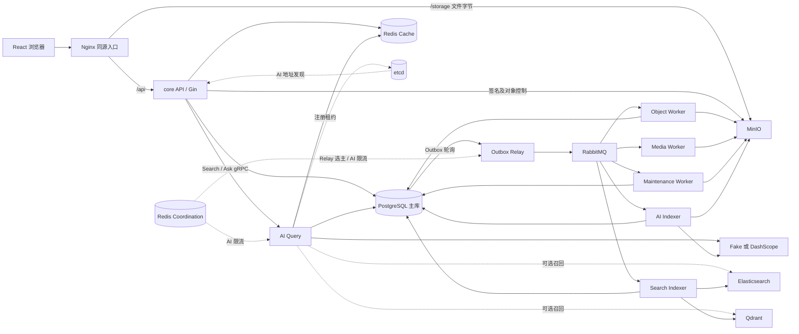
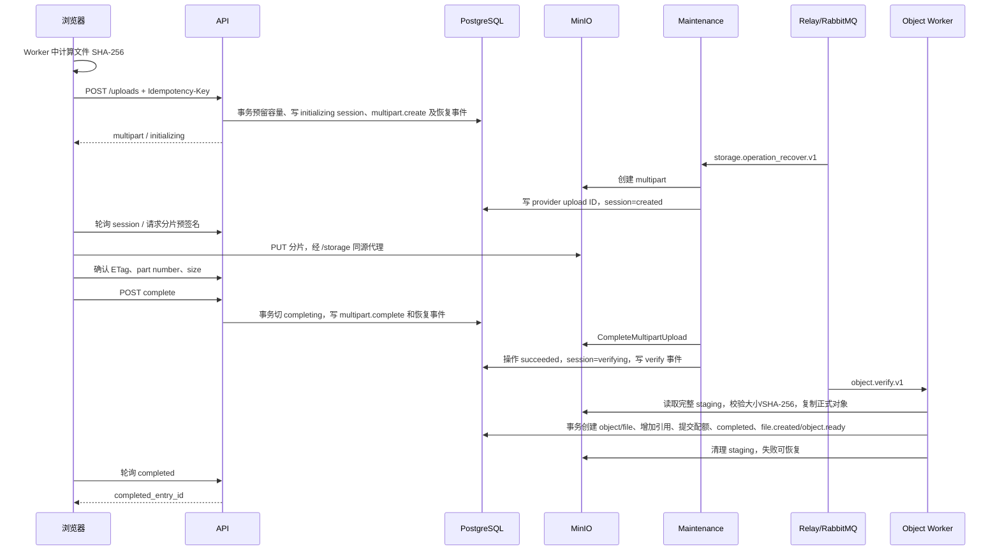
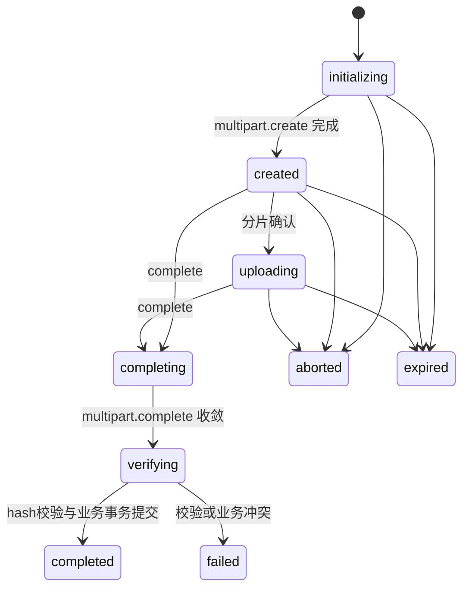
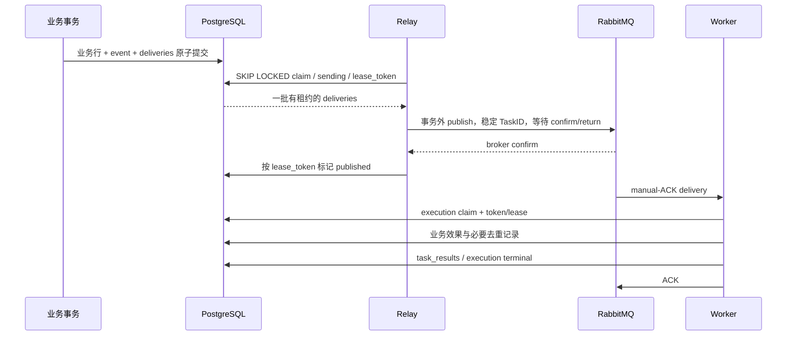
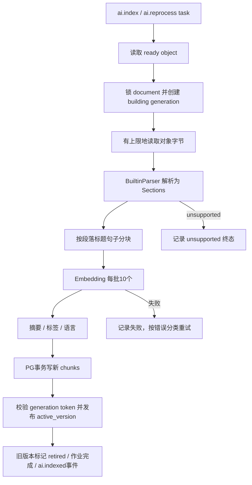

# BX YunPan 当前源码事实报告

> 基准日期：2026-11-03，Asia/Shanghai。基准提交：`ef0fc2362a286976848c8bf3640113f841cd6473`。
>
> 本报告重新从当前工作区的 Go、SQL migration、Proto、JavaScript、CSS、Dockerfile、Nginx 和部署脚本梳理，未引用既有 README、设计文档、交接报告、历史测试产物或历史记忆。文中的“当前”指该源码快照，不代表正在运行的容器或线上环境。
>
> 配套证据：[源码文件指纹](facts/2026-11-03/source-manifest.json)、[本次测试结果](facts/2026-11-03/validation.json)。本次新增事实文档、证据文件及其 Git 忽略规则例外，没有修改业务实现、执行数据库迁移或启动部署。

## 阅读导航

1. [项目定位与架构结论](#1-项目定位与架构结论)
2. [代码组织与进程装配](#2-代码组织与进程装配)
3. [中间件的实际职责](#3-中间件的实际职责)
4. [数据库模型与约束](#4-数据库模型与约束)
5. [HTTP、身份与配额](#5-http身份与配额)
6. [目录与文件元数据](#6-目录与文件元数据)
7. [上传与对象存储完整链路](#7-上传与对象存储完整链路)
8. [下载、预览与媒体处理](#8-下载预览与媒体处理)
9. [分享与导入](#9-分享与导入)
10. [删除与垃圾回收](#10-删除与垃圾回收)
11. [事件、Outbox 与 RabbitMQ](#11-事件outbox-与-rabbitmq)
12. [恢复扫描与失败窗口](#12-恢复扫描与失败窗口)
13. [AI 文档索引](#13-ai-文档索引)
14. [检索与 RAG 问答](#14-检索与-rag-问答)
15. [搜索投影与外部索引](#15-搜索投影与外部索引)
16. [服务发现、重试与熔断](#16-服务发现重试与熔断)
17. [缓存与分页一致性](#17-缓存与分页一致性)
18. [前端概览](#18-前端概览)
19. [部署与可观测性](#19-部署与可观测性)
20. [实现边界与源码问题](#20-实现边界与源码问题)
21. [验证记录与结论边界](#21-验证记录与结论边界)
22. [源码阅读索引](#22-源码阅读索引)

## 1. 项目定位与架构结论

这是一个带身份认证、目录管理、分片上传、文件分享、预览、AI 内容索引和 RAG 问答的私有网盘。Go 后端统一使用一个 Go module；React 单页应用通过同源 Nginx 访问 API 和对象存储。

准确的架构描述是：**共享 PostgreSQL 的模块化核心服务，配合可独立部署的后台任务角色和 AI gRPC 服务，通过事务 Outbox 驱动异步派生处理。**

- 核心 `api` 进程同时承载 identity、drive、upload、sharing，以及 AI 查询适配与重建命令。它们之间是 Go 函数调用及本地数据库事务。
- AI 存在实际的进程间 gRPC 边界，可把在线查询与离线索引拆成 `ai-query`、`ai-indexer`。它们仍共享核心 PostgreSQL、对象模型和部分 Go 业务包。
- 对象校验、缩略图、维护和搜索投影可以由独立 worker 进程消费各自队列，也保留合并 worker 模式。
- 所有业务事实、配额、上传中间态、消息投递状态和执行回执仍落在 PostgreSQL；MinIO 保存文件字节。Redis 缓存、ES、Qdrant 是加速或派生层。
- 现有代码具备多实例处理所需的锁、租约、幂等和版本隔离机制；Compose 默认基础设施是单节点。源码无法证明跨机器高可用、灾备恢复或生产容量。
- 目录、身份、分享尚未拆成具有独立数据库的微服务；`workflow` 状态机虽然存在，却未接入生产业务启动链路，不能把它写成已运行的 Saga 编排平台。

图展示可拆分的代码拓扑。默认 `worker` 合并 Relay/Object/Media/Maintenance；默认 `aisvc` 合并 AI Query/Indexer。搜索投影另行启用。

**依据**：[API 装配](../backend/internal/bootstrap/api.go)、[后台角色装配](../backend/internal/bootstrap/roles.go)、[AI 角色装配](../backend/internal/bootstrap/aisvc.go)、[共享依赖](../backend/internal/platform/dependencies/dependencies.go)。

## 2. 代码组织与进程装配

### 2.1 工程结构

| 位置 | 实际内容 |
| --- | --- |
| `backend/cmd` | 11 个可构建入口，业务服务与维护工具分开 |
| `backend/internal/bootstrap` | 手工构造服务依赖、注册 HTTP/gRPC handler、启动后台循环及停机回收 |
| `backend/internal/{identity,drive,upload,objectstore,sharing,media,ai}` | 核心领域实现；普遍直接持有 GORM handle，没有统一 Repository 层 |
| `backend/internal/{eventcontract,outbox,taskqueue,recovery,storageops,ownerepoch}` | 消息协议、可靠投递、执行状态、恢复扫描、存储操作日志与缓存世代 |
| `backend/internal/search` | PostgreSQL 投影、ES/Qdrant 适配、回填及版本控制 |
| `backend/internal/workflow` | 持久化工作流与命令去重基础库，目前无生产调用入口 |
| `backend/internal/platform` | 配置、依赖连接、日志、HTTP/gRPC 中间件、Redis、锁、etcd、监控和追踪 |
| `backend/api` / `internal/contract` / `internal/ai/pb` | 内嵌 OpenAPI、生成类型、Proto 与生成的 gRPC 代码；实际 HTTP 路由仍由手写 handler 注册 |
| `backend/migrations` | `000001` 至 `000024`，各含 up/down SQL |
| `web/src` | React 页面、认证/传输 Context、API 访问层、哈希 Worker 与设计样式 |
| `deploy` | Compose、启动/构建/本地运行脚本、检查脚本、Prometheus/OTel 配置 |

快照中有 **119 个非测试 Go 文件、22,473 行**，包括生成代码；**73 个 Go 测试文件、9,753 行**。统计范围与 SHA-256 见指纹清单；代码行数不等同于手写业务代码量。

`go.mod` 声明 Go `1.25.0`。核心技术是 Gin、GORM/PostgreSQL、MinIO Go SDK、AMQP 0-9-1、go-redis、etcd client、gRPC、JWT、Argon2id、Prometheus 和 OpenTelemetry。依赖表中的间接 MySQL driver 不代表业务使用 MySQL；实际连接统一通过 PostgreSQL driver 创建。

### 2.2 入口、角色和队列

| 可执行入口 / 部署服务 | 核心启动函数 | 职责 / 消费队列 |
| --- | --- | --- |
| `cmd/api` / `api` | `RunAPI` | Gin HTTP API，默认 `:8081`；不消费任务队列 |
| `cmd/worker` / `worker` | `RunWorker` | 合并 Relay、上传清理和恢复循环，消费 `object/media/maintenance` |
| `cmd/outbox-relay` | `RunOutboxRelay` | 轮询 Outbox、发布 RabbitMQ、恢复丢失执行；不消费业务队列 |
| `cmd/object-worker` | `RunObjectWorker` | `object`，上传后完整性校验与正式落盘 |
| `cmd/media-worker` | `RunMediaWorker` | `media`，图片缩略图 |
| `cmd/maintenance-worker` | `RunMaintenanceWorker` | `maintenance`，GC、存储操作恢复、定时清理与业务恢复扫描 |
| `cmd/search-indexer` | `RunSearchIndexer` | `search`，构建本地及可选外部搜索投影 |
| `cmd/aisvc` / `aisvc` | `RunAISvc` → combined | gRPC 查询服务 + `ai` 队列索引消费 |
| 同一 `cmd/aisvc` / `ai-query` | `AI_SERVICE_ROLE=query` → `RunAIQuery` | 仅在线 gRPC Search/Ask/兼容 Reprocess，不消费 `ai` |
| 同一 `cmd/aisvc` / `ai-indexer` | `AI_SERVICE_ROLE=indexer` → `RunAIIndexer` | 仅消费 `ai`，不注册在线 gRPC 地址 |
| `cmd/migrate` | `main` | `up`、`down-one`、`version` 数据库迁移工具 |
| `cmd/migrate-asynq` | `run` | 读取停止后的旧 Asynq Redis 数据，默认只验证，`--apply` 时暂存到 PostgreSQL |
| `cmd/search-backfill` | `main` | `backfill/status/activate/rollback` 索引管理工具；主 Compose 没有单列此服务 |

服务入口遵循 `config.Load → logging/tracing → signal.NotifyContext → bootstrap.Run*`。进程收到 SIGINT/SIGTERM 后取消上下文；后台组和 RabbitMQ 消费器会等待自己的 goroutine，再关闭 DB/Redis，防止依赖先关闭、后台继续写入。

`dependencies.Open` 对各角色使用同一套依赖工厂：PG、Coordination Redis、Cache Redis、RabbitMQ broker handle、MinIO client 和公开 URL presigner。**只有 PostgreSQL 在该工厂中主动 Ping**；其余 handle 的创建不等于远端已经可用。AI Query 即使不索引，也没有完全裁掉对象存储等依赖。

## 3. 中间件的实际职责

| 中间件 | 代码中的用途 | 事实边界 |
| --- | --- | --- |
| PostgreSQL 17 + pgvector + pg_trgm | 用户、目录、文件引用、配额、上传状态、AI 文档/分块/向量、Outbox、执行回执、搜索投影、工作流基础表 | 全部运行角色使用主库连接；没有读副本路由、业务分库分片实现 |
| MinIO / S3 | multipart、staging 原始字节、正式内容寻址对象、图片变体、预签名读写 | 文件本体不在 PG；PG 与 S3 没有原子提交，靠操作日志和恢复收敛 |
| RabbitMQ | 5 个工作队列、确认发布、手动 ACK、重试队列、DLQ | 当前运行任务系统；消息不是唯一事实来源 |
| Redis Coordination | Relay leader lock；AI RPC 的按 owner 限流 | 锁/限流可重建；Redis 故障时 Relay 默认停止取得领导权，AI RPC 限流则放行 |
| Redis Cache | 目录/文件读模型、查询向量的 L2 缓存 | 可关闭；业务读取与授权仍回验 PG；可与 Coordination 分实例 |
| 进程内缓存 | 目录/文件 JSON 的有界 LRU；query embedding 的有界 map | 不共享进程状态，不能替代 PG epoch 与权限检查 |
| etcd | AI 在线实例 lease 注册、Watch 发现、gRPC resolver | 不用于文件元数据、数据库主从选举或应用配置中心 |
| Elasticsearch | 可选 chunk 全文索引、文件元数据投影；适配器还实现向量查询 | 当前 `RetrievalRouter` 的文本端接 ES，向量端接 Qdrant；名称搜索仍走 PG |
| Qdrant | 可选 chunk 向量索引、墓碑记录 | `UpsertFile` / `TombstoneFile` 是空实现，不承担用户文件 ACL 权威 |
| DashScope | 可选真实 Embedding、摘要/标签、图片文字和视觉描述、问答、重排 | `AI_PROVIDER` 默认 `fake`；默认配置不能当作真实模型效果证据 |
| Prometheus / Grafana | HTTP、worker、数据库连接池、积压、缓存、发现指标；RabbitMQ 指标抓取 | 抓取配置与代码指标暴露并非完全覆盖，见第 19、20 节 |
| OpenTelemetry Collector / Jaeger | 请求、gRPC、SQL、异步任务及 AI 阶段 trace | 默认 tracing 关闭；外部模型 HTTP 没有自动成为完整第三方分布式 trace |
| Nginx | 静态 SPA、同源 API 代理、MinIO 字节代理、健康检查 | 文件流经 Nginx/MinIO，不经过 Go API body |

**依据**：[依赖工厂](../backend/internal/platform/dependencies/dependencies.go)、[任务 broker](../backend/internal/taskqueue/taskqueue.go)、[外部索引适配](../backend/internal/search/external.go)、[Compose](../deploy/compose.yaml)。

## 4. 数据库模型与约束

### 4.1 数据分层

| 层次 | 表 | 核心关系 |
| --- | --- | --- |
| 身份与容量 | `users`、`refresh_sessions` | 用户配额及 refresh token family |
| 网盘命名空间 | `folders`、`file_entries` | owner → folder 树 → 文件条目；条目引用全局物理对象 |
| 物理对象 | `file_objects`、`object_variants` | hash/size 对象及 thumbnail 变体 |
| 上传 | `upload_sessions`、`upload_parts` | 上传状态、预留容量、provider upload ID、已确认分片 |
| 分享 | `shares`、`share_imports` | 分享指向文件条目，导入建立新 owner 文件引用 |
| 业务异步任务 | `async_tasks` | 当前主要承载用户可查询的 `ai.reprocess` 作业状态 |
| AI 内容 | `ai_documents`、`ai_document_versions`、`ai_chunks` | 一个 object 一个 document，多 generation，active 指针选出发布版本 |
| 事件与执行 | `outbox_events`、`outbox_deliveries`、`event_consumptions`、`outbox_recoveries`、`task_executions`、`task_results`、`task_failures` | 业务事件、每目的地投递、消费去重、恢复审计、执行租约、终态与失败详情 |
| 兼容迁移 | `legacy_task_imports` | 旧任务迁入的幂等记录 |
| 缓存世代 | `owner_content_epochs` | 用户级 content/ACL epoch |
| 搜索派生模型 | `search_index_versions`、`search_content_projections`、`search_file_projections`、`search_projection_checkpoints` | 版本、内容/文件投影、外部发布进度 |
| 未接入业务的基础库 | `workflow_instances`、`workflow_steps`、`command_deduplications` | 持久化状态转换、补偿状态、命令请求哈希去重 |

`file_entries` 是用户看到的逻辑文件；`file_objects` 是物理内容。两个用户可以通过分享导入引用同一个 object，各自承担逻辑容量。

### 4.2 会直接影响产品行为的约束

- 每个 owner 只能有一个未删除根目录。
- 同 owner、同 parent 的有效目录名不重复；同 owner、同 folder 的有效文件名不重复。目录和文件分别建索引，**不是一个统一的跨类型名称约束**。
- `file_objects` 的 `(sha256,size_bytes)` 全局唯一，`object_key` 唯一。
- `file_entries(owner_id,object_id)` 在未删除行上唯一：**同一用户不能在多个目录保留同一物理内容的多个有效条目**。
- 上传幂等键唯一范围是 `(user_id,idempotency_key)`；创建服务还比较 folder、文件名、hash、size、MIME，防止一个键绑定不同请求。
- 分享导入唯一键是 `(user_id,share_id,idempotency_key)`；AI 用户作业是 `(task_type,dedupe_key)`。
- 用户行约束 `used_logical_bytes + reserved_bytes <= quota_bytes`，且各容量非负。
- `ai_chunks.embedding` 固定 `vector(1024)`，全文列由 `to_tsvector('simple', content)` 生成，分别有 HNSW cosine 和 GIN 索引；不是中文专用分词器。
- 当前 schema 需要最新 `000024` 才包含任务执行租约表；“仓库有 24 份迁移”不能推导运行库已在版本 24。

### 4.3 迁移演进的当前结果

`1–7` 建立业务/AI 表与用户内容唯一约束；`8–10` 增加 trace、投递表与聚合版本；`11–14` 增加存储操作及恢复日志；`15–16` 增加 AI generation 和 owner epochs；`17–21` 增加搜索投影、工作流基础表、checkpoint 和 backfill cursor；`22` 增加热点索引与 delivery 发送租约；`23–24` 增加 RabbitMQ deadline/重试预算、任务结果/失败/迁移审计与执行租约。

迁移由独立 `cmd/migrate` 调用 golang-migrate；业务启动没有 `AutoMigrate`。迁移锁依赖该库的 PostgreSQL driver，应用自己的 Redis leader lock 不保护 migration。

**依据**：[业务建表](../backend/migrations/000004_object_upload_outbox.up.sql)、[内容唯一索引](../backend/migrations/000007_single_user_file_object.up.sql)、[AI 表](../backend/migrations/000006_ai_search.up.sql)、[全部迁移](../backend/migrations)、[迁移入口](../backend/cmd/migrate/main.go)。

## 5. HTTP、身份与配额

### 5.1 HTTP 请求入口

调用链为 `cmd/api → bootstrap.RunAPI → httpapi.NewRouter → domain.HTTP → Service → GORM/S3`。Gin 中间件依次设置 OTel、request ID、Outbox feature context、HTTP metrics、访问日志、panic recovery 和 body 限制。错误主体统一为 `{error:{code,message},request_id}`。

默认普通请求 body 上限 1 MiB、header 上限 64 KiB；Search/Ask 的 JSON body 另限 64 KiB。HTTP server 设置 ReadHeaderTimeout/IdleTimeout，没有统一的 handler 总时限；AI 调用另有 gRPC 总预算。

实际注册的业务路由如下，前缀均为 `/api/v1`：

| 领域 | 路由 |
| --- | --- |
| 认证 | `POST /auth/register`、`/auth/login`、`/auth/refresh`、`/auth/logout` |
| 用户 | `GET /users/me`、`GET /users/me/quota` |
| 目录 | `GET /folders/root`、`GET /folders/:folderId/children`、`GET /folders/:folderId/breadcrumb`、`POST /folders`、`PATCH /folders/:folderId`、`POST /folders/:folderId/move`、`DELETE /folders/:folderId` |
| 文件 | `GET /files/:fileId`、`PATCH /files/:fileId`、`POST /files/:fileId/move`、`DELETE /files/:fileId`、`GET /files/:fileId/download-url`、`GET /files/:fileId/preview` |
| 上传 | `POST /uploads`、`GET /uploads`、`GET /uploads/:uploadId`、`DELETE /uploads/:uploadId`、`POST /uploads/:uploadId/parts/presign`、`POST /uploads/:uploadId/parts/confirm`、`POST /uploads/:uploadId/complete` |
| 分享 | `GET/POST /shares`、`GET/DELETE /shares/:shareId`、`POST /shares/:shareId/import` |
| 公开分享 | `POST /public/shares/resolve`、`GET /public/shares/content` |
| AI | `POST /search`、`POST /ai/ask`、`GET /files/:fileId/ai`、`POST /files/:fileId/ai/reprocess`、`GET /ai/jobs/:taskId` |

此外有 `/health/live`、`/health/ready`、`/metrics`、`/openapi.yaml`、`/docs`。OpenAPI 被嵌入并公开，但没有通过生成的 server 接口统一强制校验全部手写 handler。

### 5.2 身份链路

注册：归一化用户名/邮箱 → Argon2id 密码哈希 → PG 事务 → 按稳定顺序对登录标识取 advisory lock → 检查用户名/邮箱共享命名空间 → 创建 user、根目录、owner epoch 和 refresh session → 返回 access token，并设置 refresh cookie。

登录支持用户名或邮箱。对旧数据中的跨列同名，代码按密码挑选候选账号；匹配不唯一时拒绝。禁用账号无法登录。

- 密码哈希：Argon2id，64 MiB 内存、3 次迭代、2 threads、随机 16-byte salt。
- Access token：JWT EdDSA/Ed25519；由配置 signing seed 的 SHA-256 派生私钥，各 API 副本相同配置即可验签。默认有效 15 分钟，校验 issuer、audience、签名和时间声明。
- Refresh token：32-byte 随机值编码；数据库仅存 SHA-256，默认 30 天。Cookie 为 HttpOnly、SameSite=Strict，路径 `/api/v1/auth`，Secure 随配置。
- Refresh rotation 按 family advisory lock 和当前 session 行锁串行化。复用已撤销 refresh token 时，撤销整个 family；代码先提交撤销，再返回认证失败。
- Refresh/Logout 在 cookie 操作前调用 Go `http.CrossOriginProtection`；代理必须保留包含端口的原始 Host。
- 常规 Authenticate 仅验证 access JWT，不逐请求查 user 状态或 refresh session。Logout 撤销当前 refresh session，已签发 access token 在到期前仍可验签。

### 5.3 容量核算

默认用户 quota 10 GiB。普通上传先通过条件 UPDATE 预留容量；验证成功时在同一事务释放 reserved、增加 logical usage；取消、到期、验证失败释放 reserved。分享导入增加目标用户 logical usage；删除文件减少 logical usage。

容量按用户逻辑文件大小计费，**不是 MinIO 实际占用**；staging、重复写入窗口、缩略图和索引也不在 `used_logical_bytes` 中。配额检查依赖 PG 条件更新和数据库 CHECK，不靠 Redis 分布式锁。

**依据**：[HTTP router](../backend/internal/platform/httpapi/router.go)、[身份 HTTP](../backend/internal/identity/http.go)、[身份服务](../backend/internal/identity/service.go)、[Token](../backend/internal/identity/token.go)、[密码哈希](../backend/internal/identity/password.go)。

## 6. 目录与文件元数据

目录和文件按 owner 隔离。Root/Folder/File/Breadcrumb/Children 查询都从业务表确认身份范围或可见性。文件读模型要求条目未删除且物理 object 为 `ready`，并可左连接 AI status。

重命名、移动、删除通过 `If-Match: <正整数 version>` 传乐观版本，事务内取行锁并检查当前版本，成功后递增版本；旧版本返回 409。这里使用纯数字版本头，不是带引号的标准 ETag 字符串。

目录移动对整个 owner 的树操作取 PG advisory lock，再检查目标不是自己/后代；后代检查用递归 CTE。目录删除仅允许空目录，根目录不能删除或移动；没有递归删除整棵树或回收站恢复路由。

文件移动只改 `folder_id/version`，不会重新上传、复制 S3 对象或重新扣配额。文件名/目录名按 trim 和 lowercase 归一化，不做完整 Unicode 文件系统语义归一。

当前目录 HTTP 已走 `ChildrenPage`，不是旧 `Children` 的全量列表。默认 50、最多 100，目录在前，文件在后，各自按数据库 collation 的 normalized name 与 UUID 排序。缓存和 cursor 的细节见第 17 节。

元数据写操作在事务内 bump owner epoch，并尝试写类型化事件。文件/目录更新、删除和分享权限变化类事件受 `OUTBOX_V2_EVENTS_ENABLED` 控制，**默认关闭时业务写入仍会提交，但相应新事件不产生**。

**依据**：[drive service](../backend/internal/drive/service.go)、[HTTP 版本解析](../backend/internal/drive/http.go)、[文件操作](../backend/internal/drive/files.go)、[事件开关](../backend/internal/outbox/compat.go)。

## 7. 上传与对象存储完整链路

### 7.1 API 是控制路径，文件字节直接到存储

图中 Relay 发布的 operation recovery 与 maintenance 定时扫描都可能驱动同一存储操作，PG 租约负责消除并行所有权。字节上传实际路径为浏览器 → Nginx `/storage/` → MinIO。

### 7.2 创建、幂等与“秒传”实际行为

Create 校验 filename、64 位小写 hex SHA-256、正数 size、MIME 长度和 1–128 byte 幂等键；**零字节文件当前被拒绝**。它先验证目标目录，再在事务中：

1. 锁住用户幂等键，已有 session 必须与本次请求全部关键参数一致；不一致返回 conflict。
2. 锁住目录文件名，检查有效文件及未过期活跃 session 同名冲突。
3. `FindOwnedWith` 只查用户已持有的相同 hash/size 的 ready object，不允许用一个别人的 hash 直接获取内容引用。
4. 没有可复用对象时，写 staging key `staging/<user>/<session>`、预留配额、创建 `initializing` session、持久化 `multipart.create`，通过确定性恢复 Outbox 通知维护 worker。

源码存在 `mode=instant` 分支，但 `FindOwnedWith` 要求当前用户已有有效引用，而 `CreateFile` 与数据库唯一索引又禁止同 owner 重复 object。因此在当前唯一约束成立的普通新请求中，此分支会撞到 `upload.file_exists`，**不能描述成“同用户可在任意目录无限秒传副本”**。已经完成的幂等 session 仍可重放其既有结果。

物理去重仍然成立：不同上传在完整校验后通过 `(sha256,size)` 归并物理对象；它不等于客户端可以跨用户凭 hash 免传。

### 7.3 分片、状态和完成语义

初始 part size 为 10 MiB；若将超过 10,000 片则倍增。预签名 PUT 的默认 TTL 为 15 分钟。确认分片持久化 `(session_id,part_number)`、ETag、size、checksum，可重复 upsert；这是客户端确认记录，不是独立的服务端逐片 SHA 校验。

`Complete` 锁 session，要求记录的分片数量等于计划数量且有 provider upload ID；它只切到 `completing` 并登记存储操作，不等待完整文件校验。重复 complete 对 completing/verifying/completed 返回当前状态。

verifying/completing/completed 不允许普通 abort。到期扫描只处理 initializing/created/uploading，默认 session TTL 24 小时、扫描周期 5 分钟；不是所有中间状态到期后自动放弃。

### 7.4 校验、正式对象与存储操作日志

Verify 流式读取 staging，重新计算**整文件** SHA-256 和实际大小。通过后生成初始正式 key `objects/sha256/<前两位>/<hash>`；复活已删除对象时用带旧版本数字的 generation key，防止旧删除请求误删新字节。

正式复制在数据库业务事务外执行；`storage_operations` 记录操作类型、幂等键、来源/目标、状态、attempt、available_at 和 lease token。支持 `multipart.create/complete/abort`、`canonical.ensure`、`staging.delete`、`object.delete`。claim 使用 `FOR UPDATE SKIP LOCKED` 和默认 5 分钟租约，状态完成按 token 校验所有权。

最终事务锁 session 和 hash/size，检查文件名并创建或复用物理对象，创建逻辑 file entry、增加 object reference、将 reserved 转成 logical usage、标记 completed、写 `file.created`/`object.ready` 和 staging 清理意图。事务失败不代表外部复制自动回滚，后续按操作日志重试或回收。

hash mismatch/name conflict/重复内容冲突会在事务中登记失败、释放容量和清理意图。已经复制但无法入库的正式对象会被接管成零引用对象，进入正常 GC；不会在失败 handler 中直接删除可能共享的 canonical key。

**依据**：[upload service](../backend/internal/upload/service.go)、[验证任务](../backend/internal/upload/tasks.go)、[canonical 清理](../backend/internal/upload/canonical_cleanup.go)、[存储操作](../backend/internal/storageops/operations.go)、[对象生命周期](../backend/internal/objectstore/service.go)。

## 8. 下载、预览与媒体处理

下载先校验 owner/file/object-ready，再返回默认 10 分钟有效的 S3 GET 签名 URL，附带 `attachment` 和原始文件名。公开 endpoint 用于签名，内部 MinIO endpoint 用于服务端读写；`storageurl.Presigner` 在签名后加公开 `/storage` 前缀，由代理去掉前缀转发。

预览按 MIME 支持 JPEG/PNG/GIF/WebP、PDF 和 `text/*`。图片优先返回 ready thumbnail，否则回退原图；文本强制 `text/plain`，不以内联 HTML 执行；SVG 等脚本型图片不在 image preview 白名单中。未知类型返回 unsupported。

Media worker 使用 Go image decoder，解码前检查尺寸正数且像素不超过 4,000 万，缩放至 512×512 范围，以质量 82 输出 JPEG。变体 key 包含 object ID、`thumbnail-v1` 和源 object key 的哈希；数据库唯一键保证同对象/变体/pipeline 只登记一条。

**能力差异**：预览白名单包含 WebP，但媒体代码仅注册 GIF/PNG/JPEG decoder，不能因此声称已经生成 WebP 缩略图。也没有视频转码、音频转写或 Office 在线渲染服务。

对象写入变体先于 SQL 登记，仍有外部成功、DB 失败的窗口；重复任务通常覆盖确定性 key。不能把“确定性命名+唯一约束”解释成 S3/PG 原子事务。

**依据**：[FileManager](../backend/internal/drive/files.go)、[media service](../backend/internal/media/service.go)、[presigner](../backend/internal/platform/storageurl/presigner.go)、[Nginx](../web/nginx-app.conf)。

## 9. 分享与导入

分享仅指向一个文件条目，不支持公开目录树。Create 校验 owner/file，生成 16-byte 随机分享 key，以 HMAC-SHA256 保存 key hash，写 share、bump owner ACL epoch，并按开关产生 share.created 事件。key 只在创建时返回，不明文存库。

公开 resolve 接受长度 22 的分享 key，查有效 share 和源文件，返回短期 HMAC access token；公开 content 使用 `X-Share-Token`，重新查 share 是否过期/撤销和源文件是否存在，再签发下载 URL。没有提取密码、访问次数限制或独立访客账号模型。

导入要求目标用户已登录且持有 share token：校验 token/share/目标目录 → 对 `(user,share,idempotency)` 取 advisory lock → 重放既有 import 或锁定 share 与源 entry → 条件增加目标用户 logical usage → 创建指向**同一 object**的新 entry → 增加 reference → 写 import、share.imported、file.created。整个数据库效果在单事务内，不复制文件字节。

重复幂等键不能改目标目录；同一用户已有该 object 时仍受 owner/object 唯一约束限制。撤销分享会阻止后续 token 换取 URL，但已签发的 S3 URL 在自身 TTL 内仍可使用；撤销也不删除其他用户已经导入的独立条目。

**依据**：[sharing service](../backend/internal/sharing/service.go)、[sharing HTTP](../backend/internal/sharing/http.go)。

## 10. 删除与垃圾回收

文件删除是逻辑删除：事务锁 entry、检查 version、写 deleted_at 和新版本、bump owner content epoch、减少 object reference、扣减用户 logical usage，并产生 file.deleted；reference 到零时追加 object.gc_requested。没有把删除文件字节放进用户请求事务。

Relay 第一次准备 GC 投递时把 `not_before` 固定为不早于事件 available_at 和 `created_at + OBJECT_GC_DELAY`，默认 24 小时。deadline 写入 PG 后，重启或修改配置不会把这一条任务重新从头计时。

GC 收到请求后重新检查**真实有效 entry 数和 reference_count**。仍有引用则直接结束；没有引用时把 ready → deleting、递增版本、登记 generation 对应的 object.delete 操作。维护进程在事务外删除 variants 和源对象，再锁操作/token/object、复核引用，删除 AI document（关联 chunk/version 由外键清理），标记 object=deleted，并再发一个代表实际删除完成的 GC 事件供搜索收敛。

数据库保留 deleted object 的 hash/size 身份；同内容重上传复用这行并推进版本，但使用新 generation key。旧 object.delete 通过 source key、状态和操作 token 检查，避免覆盖新生命期。

失败恢复不是“扫描整个 bucket 随便删”。当前自动清理以数据库里的 session、object、operation 为依据；没有任何 operation/对象行的存储孤儿需要额外库存核对。缩略图写完尚未登记等窗口也不能仅凭本报告认定已完全覆盖。

**依据**：[文件删除](../backend/internal/drive/files.go)、[对象 GC/复活](../backend/internal/objectstore/service.go)、[GC deadline](../backend/internal/outbox/dispatcher.go)、[canonical orphan 收敛](../backend/internal/upload/canonical_cleanup.go)。

## 11. 事件、Outbox 与 RabbitMQ

### 11.1 业务事务与事件协议

业务代码通过 `outbox.AddTyped` 在业务事务中写入 `outbox_events`，并登记独立目的地的 `outbox_deliveries`。这样，业务记录与“需要通知哪些处理器”的意图一起提交；请求线程不直接等待 RabbitMQ。

事件协议包含 event ID、event type/schema version、aggregate type/ID/version、`domain_event` 或 `command`、producer、occurred_at、payload 和 trace context。历史兼容行允许部分新 envelope 字段为空，因此消费端同时保留兼容解析。

两个开关需要分别理解：

- `OUTBOX_V2_EVENTS_ENABLED` 默认 false：新的 file.updated/deleted、folder CRUD、share.created/revoked 等事件可以不写入；对应业务变更仍然提交。原有上传、对象、file.created 等链路继续工作。
- `SEARCH_INDEX_ENABLED` 默认 false：控制搜索目的地的登记/分发；启用搜索 worker 本身不能补出先前没有产生的业务事件。

因此，“搜索进程启动成功”不代表所有变更都会持续更新外部索引。需要结合事件生产、搜索路由、worker 和回填一起判断。

### 11.2 实际路由

| 业务事件 / 命令 | 消费任务及队列 | 实际效果 |
| --- | --- | --- |
| `file.created.v1`、`share.imported.v1` | 同名任务 → maintenance | 当前 handler 确认接收，不额外执行业务处理 |
| `object.verify_requested.v1` | `object.verify.v1` → object | 完整读取 staging、校验并提交文件 |
| `object.ready.v1` | `media.thumbnail.v1` → media；AI 开启时 `ai.index.v1` → ai | 一个事件扇出到独立投递行 |
| `object.gc_requested.v1` | `object.gc.v1` → maintenance | 按固定 not_before 执行延迟回收 |
| `ai.reprocess_requested.v1` | `ai.reprocess.v1` → ai | 执行用户可观察的重建作业 |
| `ai.index_requested.v1` | `ai.index.v1` → ai | 恢复/补建对象内容索引 |
| `storage.operation_recover.v1` | 同名任务 → maintenance | 推进持久化存储操作 |
| `media.thumbnail_requested.v1` | 同名任务 → media | 补建图片变体 |
| 文件、目录、分享、对象及 AI 索引事件的搜索路由集合 | `search.project.v1` → search | 开启搜索开关后同步派生投影 |

未知事件没有“默认发某个队列”的兜底；会保留为可观察的未路由记录。AI 关闭时，AI 专用事件也不会被偷偷执行。

### 11.3 Relay 发布过程

Relay 默认使用 Redis leader lock，TTL 15 秒并续约；拿不到锁就不发布。Redis 锁减少重复扫描，真正的投递所有权还由 PG 的 `FOR UPDATE SKIP LOCKED`、sending 状态和 token 条件更新保护。

claim 事务很短，发布网络调用在事务之外。投递租约根据 `batchSize × (publishTimeout + 1s) + 1min` 计算。旧发布者迟到返回时，不能用已经失效的 token 覆盖新 claim 的状态。

broker TaskID 固定为 `<eventID>:<canonicalTaskType>@<queue>`。payload 注入 `_trace` 和事件元数据，但保留业务已经携带的 `task_id`；例如 AI reprocess 的用户作业 ID 与 broker TaskID 是两个概念。

发布使用 persistent message、mandatory、publisher confirm，并检查 unroutable return。只有 broker 确认后才标记投递完成。**broker 确认成功但 PG 更新失败时仍会重复发布**，稳定 TaskID 是去重依据，不会让 RabbitMQ 自动只投一次。

### 11.4 RabbitMQ 拓扑和消费语义

durable direct exchange 为 `yunpan.tasks`，主队列为 object、media、maintenance、ai、search。主队列、DLQ 和延迟重试队列使用 quorum；重试间隔为 1s、5s、30s、1m、5m，超出档位继续使用最后一档。配置使用 at-least-once dead-letter strategy、reject-publish overflow，并关闭主队列/DLQ 的 delivery-limit 自动截断。

消费者使用手动 ACK，默认每队列 prefetch 16，共享执行并发默认 8。合并 worker 的调度权重为 media 4、object 2、maintenance 1；AI 角色使用 ai 权重 4。权重由进程内 scheduler 分配取任务机会，不是 RabbitMQ message priority。

默认 max retry 为 8，单任务 timeout 30 分钟，取消后 grace 10 秒。重试必须先确认 retry 消息发布成功，再 ACK 原消息；最终失败要先落 PG failure/result，再确认原消息。持久化或重试发布失败则 NACK/requeue。

### 11.5 执行租约、去重和终态

`task_executions` 持久化 TaskID、kind/queue/body 指纹、running/retry/finished、执行 token、lease、timeout 和重试预算；advisory task lock 与行锁防止同一任务同时取得执行权。同 ID 却内容不同会被识别为冲突并走失败/DLQ，不静默合并。

默认 execution lease 是 `3 × (stopTimeout + 5s)`，即 45 秒；每 lease/3 续约，使用 PG 时间与独立预算。租约失效会取消 handler。已经 succeeded/dead 的任务可根据 `task_results` 直接识别终态；死任务不会因 Relay 恢复扫描无限复活。

handler 无视取消且超过 grace 时，`invokeBounded` 会持久化卡住执行的预算状态并 `os.Exit(70)`，交给外部 supervisor 重启进程。它没有把旧 handler 留在后台、然后继续放行同一进程的新任务。

`event_consumptions(event_id,consumer_name)` 能和部分 PG 投影效果在同一事务内提交；它没有统一包住全部 S3、AI、外部索引调用。业务效果提交后、执行回执/ACK 前仍可能崩溃，handler 依然要依靠唯一约束、版本判断、确定性 key 或重复执行检查。整体语义是**至少一次投递、按具体效果实现幂等与最终收敛**。

旧 Asynq 只保留迁移与兼容路径，当前任务运行时使用 RabbitMQ，`go.mod` 没有 Asynq runtime 依赖。`migrate-asynq` 默认只读验证来源，显式 apply 才暂存 PG，保留 schedule/retry 元数据；不能把这一工具理解成双 broker 同时运行。

**依据**：[事件协议](../backend/internal/eventcontract/envelope.go)、[事件生产](../backend/internal/outbox/outbox.go)、[路由](../backend/internal/outbox/routes.go)、[Relay](../backend/internal/outbox/dispatcher.go)、[RabbitMQ](../backend/internal/taskqueue/taskqueue.go)、[执行所有权](../backend/internal/taskqueue/execution.go)、[终态存储](../backend/internal/taskqueue/store.go)、[取消边界](../backend/internal/taskqueue/timeout.go)、[调度](../backend/internal/taskqueue/scheduler.go)、[角色 handler](../backend/internal/platform/worker/role.go)。

## 12. 恢复扫描与失败窗口

维护角色启动时立即运行清理/恢复，之后默认每 5 分钟重复。合并 worker 也运行这些循环，不能同时配置两组角色后假设只有一个扫描者；安全性要靠 PG claim 和幂等。

### 12.1 三层恢复

| 层次 | 扫描/恢复内容 | 收敛方式 |
| --- | --- | --- |
| 存储操作日志 | pending/failed、租约过期 running、已成功但尚未收敛到 session 的 multipart 操作 | token claim、重试 provider 操作，或直接提交已记录成功的业务结果 |
| 消息投递/执行 | published 超过约 15 分钟但无终态回执、running lease 过期、retry 到期却未完成 | 重置原 delivery，用原 TaskID 发布；保留已有执行重试预算、max retry、timeout |
| 业务不完整状态 | verifying 上传、缺图片变体、缺失/过期 AI 索引、卡住 reprocess、零引用对象、未完成操作 | 恢复 key、确定性 event ID、advisory lock、恢复审计行；尽量复用活跃投递 |

`EnsureRecovery` 用恢复 key 的 UUID SHA-1 推导 event ID，并写 `outbox_recoveries`。同一资源、目标版本和工作类型反复扫描，不会每次生成随机新任务。扫描顺序固定且有批次上限；本次未验证持续大积压下每类资源都能及时轮到。

multipart.create 外部成功、SQL 尚未确认时，恢复会检查 provider 已存在的 multipart，选择并收敛已有 upload，并中止多余会话；会话已经 abort 但 provider 创建刚结束时，还会登记后续 abort。multipart.complete 已成功的操作可以直接推进 verifying 并登记验证任务，避免把“SQL 未跟上”误判成一定需要再次完成远端上传。

存储操作默认 5 分钟 lease，代码没有类似 `task_executions` 的持续 operation heartbeat。token 能隔离迟到的数据库写入，**不能撤回已发给 S3 的操作**；外部效果仍需要 generation key、确定性命名和可重复操作约束。

### 12.2 具体崩溃窗口

| 中断位置 | 当前恢复机制 | 剩余边界 |
| --- | --- | --- |
| 业务事务已提交、RabbitMQ 不可用 | Outbox 持久保留，Relay 重试 | 业务可成功，但派生状态延后；Relay 默认仍依赖 Coordination Redis |
| broker 已 confirm、PG published 未更新 | sending lease 过期后重发同 TaskID | 允许重复 broker 消息 |
| handler 业务效果已提交、执行回执/ACK 未提交 | execution/result 与具体 handler 幂等检查 | 不同效果的幂等强度不同，没有全系统 exactly-once |
| S3 multipart 成功、SQL 失败 | storage operation 恢复与 session 收敛 | PG/S3 无共同事务，恢复时仍可能遇到远端错误 |
| canonical 已复制、file entry 无法提交 | operation/orphan 接管、零引用 GC | 不扫描无数据库线索的全 bucket 孤儿 |
| 旧 worker 暂停后恢复 | execution token、delivery token、AI generation token | 外部调用需要自己的 fencing；仅判断本地 lease 不足以保护外部索引 |
| ES 成功、Qdrant 失败 | checkpoint 保留 pending/publishing，重放外部效果 | 必须由服务端版本条件或墓碑抵抗旧请求乱序 |
| 分享撤销前已经签发 S3 URL | 后续 content 请求重新校验 share | 已发 URL 继续有效至其 TTL |
| task 已终态 dead | failure/result、DLQ 保留 | 没有通用的管理后台自动修复或无限重放流程 |

### 12.3 已确认的 reprocess 恢复字段错配

正常 `RequestReprocess` 把 async task 的 `resource_type` 写为 `file`、`resource_id` 写为 **file ID**；正常 Outbox payload 则从该 file 提取 **object ID**。

但 `recoverReprocessTasks` 读取 `resource_id` 后，直接填入恢复 payload 的 `ObjectID`。当没有可复用的原投递、确实需要新建恢复事件时，后续 AI handler 会把 file ID 当 object ID 查对象。**原始投递的重放不受这一字段重建错误影响**。

这是当前函数调用与字段赋值能直接确认的静态问题；本次没有连接外部数据库复现，也没有修改实现。

**依据**：[业务恢复扫描](../backend/internal/recovery/reconciler.go)、[操作日志](../backend/internal/storageops/operations.go)、[上传收敛](../backend/internal/upload/service.go)、[已发布执行恢复](../backend/internal/outbox/execution_recovery.go)、[恢复事件与审计](../backend/internal/outbox/outbox.go)、[reprocess 创建](../backend/internal/ai/service.go)。

## 13. AI 文档索引

### 13.1 触发、归属与版本发布

索引针对**物理 object**，不是为每个 owner 重复解析相同字节。object.ready 的 AI 投递、维护恢复、用户 reprocess 都进入同一 AI service。用户的可见范围在检索阶段由 file entry 再约束。

pipeline 为 `document-index-v2`。fake provider 的 model version 为 `local-deterministic-v1`；真实 provider 使用 chat model 与 embedding model 拼接的版本字符串。`ai_documents.object_id` 唯一，active_version_id 选择已发布内容，`ai_document_versions` 保存 generation、building/indexed/failed/unsupported 和 lease token。

开始索引时在事务中锁 document：相同版本已 indexed 且非 force 时跳过；过期 building 写失败历史，再建新 generation。版本 lease 为 `max(2 × AI_REQUEST_TIMEOUT, 3min)`，默认 3 分钟，解析和 embedding 各批次之间续约。

所有新 chunks 与最终发布在成功事务内写入；只有仍持有 building token 的执行者可以将该 generation 标为 indexed、切换 active 指针、给旧 indexed 版本设置 retired_at 并更新兼容 document 字段。旧版本仍保留 indexed 状态，当前 active 指针决定新内容的选择。失败重建不会先删掉旧版本的 chunks。不过部分检索仍读取 document 上的兼容 model/status 字段，不能据此承诺重建失败对所有旧读路径完全无影响。

### 13.2 当前解析能力

默认 `AI_MAX_OBJECT_MIB=32`，对象先读成有大小上限的内存字节，再交给内置 parser；这不是流式解析任意大文档。

| 输入 | 已实现的解析 | 限制 |
| --- | --- | --- |
| text、Markdown、JSON、CSV 和可识别源码文本 | 文本解码、section/标题信息；支持受约束的 GB18030 转换 | 无法证明完整理解每种语言语法；普通二进制不强行当文本 |
| `application/octet-stream` | 根据有效文件条目的扩展名识别受支持源码文件 | 文件名只用于类型推断，不跳过后续文本有效性检查 |
| PDF | PDF 库提取已有文字，保留页号 | 上限 1,000 页、提取文字约 4 MiB；没有扫描 PDF 渲染/OCR 回退 |
| DOCX | ZIP 中的 `word/document.xml`，保留段落 | 对 XML 解压大小设限；不等同于完整排版、表格/图片理解 |
| JPEG/PNG | 真实 provider 的 OCR/视觉描述 | fake provider 不支持图像；大小 10 MiB、4,000 万像素等限制 |
| XLS/XLSX、PPT/PPTX、音视频 | 无相应 parser | 不属于当前已实现能力 |

视觉输入超过 1,600 像素边长或约 512 KiB 时会缩放/重编码，JPEG 质量 82。此能力与媒体 worker 的 512×512 thumbnail 是两条独立链路。

`ParserGateway` 的接口已经包含 run ID、profile、hash、页/像素预算、artifact、quality 等字段，但生产装配只有 `BuiltinParser`。当前 artifact hash 来自输入字节，ArtifactURI 为空；质量结果主要统计文本大小、density、替换字符，并检查空文本。没有远程 parser 服务、独立 artifact store，或基于所有质量字段的完整验收流程。接口字段不能当作这些系统已经部署的证据。

### 13.3 分块、向量与错误处理

分块上限为每块 1,200 rune，优先沿 section、段落、标题和句子边界切分；只有超长内容的硬切分使用约 160 rune overlap。每文档最多 256 chunks，不是所有相邻块都有 160 overlap。

Embedding 按 10 个 chunk 一批串行请求，维度必须为 1024，与 `vector(1024)` schema 对齐；之后调用 provider 生成摘要、标签和语言。真实默认模型为 qwen-plus、text-embedding-v4、qwen-vl-plus，HTTP 响应有 8 MiB 上限。fake 使用确定性向量及本地摘要/回答，能验证协议和链路，不能证明真实模型相关性。

unsupported 会记录为可解释的终态并结束任务；模型配额或永久错误可以 SkipRetry，进入终态失败。暂时错误走任务重试。仅看 RabbitMQ ACK 不能推断文档一定 indexed，需要看文档和版本状态。

### 13.4 用户重建作业

HTTP `POST /files/:fileId/ai/reprocess` 当前走 **core API 本地 command backend**：验证 owner/file → 以 owner:file:idempotency 构造 dedupe key → 单事务写 async task 和 reprocess Outbox → 返回任务。任务状态由 `GET /ai/jobs/:taskId` 直接从共享 PG 读取。

gRPC Reprocess 仍保留兼容接口，但普通 HTTP 重建没有跨 RPC。AI 服务端的 Reprocess RPC 限流也就不会覆盖这一入口，详见第 16、20 节。

**依据**：[AI service/版本事务](../backend/internal/ai/service.go)、[任务](../backend/internal/ai/tasks.go)、[ParserGateway](../backend/internal/ai/parser.go)、[内置 parser](../backend/internal/ai/parser_builtin.go)、[格式提取](../backend/internal/ai/extract.go)、[chunker](../backend/internal/ai/rag/chunk.go)、[provider](../backend/internal/ai/provider.go)、[API backend 分工](../backend/internal/ai/backend.go)、[API 装配](../backend/internal/bootstrap/api.go)。

## 14. 检索与 RAG 问答

### 14.1 在线请求链路

`React → /api/v1/search 或 /ai/ask → JWT owner → AI gRPC client → AI Query Service → PG/可选外部召回 → provider → HTTP JSON`。

Search 的 gRPC 是 server-streaming，但服务端先算出 hits 再发送，core client 又收齐后返回普通 HTTP JSON；Ask 是 unary。前端没有 SSE/token streaming。AI document/job 状态查询则仍是 core API 直接读 PG，不必绕到 AI Query。

AI disabled backend 会令 `/search` 和 `/ai/ask` unavailable，**包括名字搜索**；不能因为 name 模式最终只查 PG，就认为关闭 AI 后该 API 仍然可用。

Search query 最多 1,000 rune，默认 limit 20、最大 100，MIME 条件最多 20 项；Ask question 最多 2,000 rune，指定 file IDs 最多 50 个。

### 14.2 PostgreSQL 默认召回

| 模式 | 实际查询 | 权威过滤 |
| --- | --- | --- |
| name | name_normalized 的 ILIKE、pg_trgm similarity，精确/前缀匹配加分 | owner、有效 entry、ready object、文件/目录范围、MIME |
| fulltext | ai_chunks 的 simple tsvector 与 `plainto_tsquery`，`ts_rank_cd` 排序 | 以上过滤 + active/兼容 indexed generation |
| semantic | embedding cosine distance `<=>` | 以上过滤 + provider model/pipeline 版本 |
| hybrid | 同一 query 向量，全文/向量并行召回，RRF 融合 | 两条召回各自过滤，再合并 |

目录递归范围使用 CTE，普通单路候选上限按 `max(limit,40)` 设置；hybrid 每路预算至少 50，融合 chunk 池上限按 `max(limit,30)` 设置，以 `1/(60 + rank + 1)` 汇总排名，再按文件分组。实际候选可少于预算；对外每个文件最多给 3 个、每个约 320 rune 的摘录。

PG 的全文配置是 `simple`，并没有接入中文分词中间件。语义质量取决于实际 provider 和模型，不能从使用 pgvector 推导中文全文召回效果。

### 14.3 Ask 证据链

1. 执行 hybrid search，构建默认 30 候选的内部池。
2. `loadFullChunks` 从 PG 重取全文，并再次检查 owner、有效 file entry、ready object 和可读 indexed generation。
3. 可选 reranker 默认候选 30、top K 8；rerank 失败保留 RRF 顺序，不直接让整个问答失败。
4. 最多取 8 条 evidence，每个文件最多 2 条，把 evidence ID、文件名、内容交给回答 provider。
5. provider 返回 citation IDs 后，仅保留本次实际提供的 evidence ID，再生成文件/分块引用。

分享 token 不会赋予整个 AI 搜索命名空间权限；导入后生成属于目标用户的 file entry，才进入该 owner 的检索范围。

HTTP `grounded` 由最终 citations 是否非空计算。真实 provider 的回答 JSON 解析失败时，可回退原始文本且没有 citation；所以这只是“引用关联与过滤机制”，不是逐句事实核验，也不能保证模型永远只依据证据回答。

**依据**：[Search/Ask 与 SQL](../backend/internal/ai/search.go)、[HTTP](../backend/internal/ai/http.go)、[Proto](../backend/api/proto/ai/v1/ai.proto)、[gRPC client](../backend/internal/ai/grpcclient/client.go)、[gRPC server](../backend/internal/ai/grpcserver/server.go)、[重排](../backend/internal/ai/reranker.go)、[回答 provider](../backend/internal/ai/provider.go)。

## 15. 搜索投影与外部索引

### 15.1 默认路径和可选路径

默认检索直接读 `file_entries/file_objects/ai_documents/ai_document_versions/ai_chunks`，**不以 `search_*` 投影表替代默认在线读**。

`SEARCH_READ_BACKEND` 支持 postgres、shadow、es_qdrant；write backend 支持 postgres/es_qdrant。search-indexer 无论是否写外部系统，仍维护 PG 的 canonical projection/checkpoint。read 为 shadow 或 es_qdrant 时才装配外部 RetrievalRouter：文本端 ES、向量端 Qdrant，name 仍走 PG。

### 15.2 投影写入和乱序保护

Projector 从任务注入的 event ID/type/version 出发，重新加载当前 PG 业务事实，使用稳定 UUID、file version、ACL version、index epoch 和 tombstone 判断新旧。它不是把历史 payload 当作现在的完整用户权限快照直接覆盖索引。

本地投影与消费标记可以同事务提交；外部投影采用：

`PG projection/checkpoint pending → publishing → ES/Qdrant network writes → checkpoint indexed/tombstoned → event_consumptions`。

如果 checkpoint 已 indexed、尚未写消费标记，重试只补确认；如果外部部分成功则重放。PG 租约不能隔离已在网络中的旧外部写请求，因此两种适配器还实现各自的服务端 fencing：

- **ES**：scripted conditional update 比较 file/ACL/epoch，拒绝旧写覆盖新写和已删除内容复活；对象墓碑通过 realtime mget 参与查询遮蔽。物理索引名称是 `files_<target>`、`chunks_<target>`。
- **Qdrant**：point ID 包含 chunk 与 epoch，另存追加式 object/chunk tombstone；请求 `wait=true&ordering=strong`，查询墓碑 scroll 使用 consistency=all，并有 16×256 的扫描预算，超限返回错误。它没有把“不存在条件 upsert”误当 CAS；`UpsertFile/TombstoneFile` 本身是空实现，文件权限仍回 PG。

这些代码是抵抗重复/乱序的实现依据；本次跳过了外部系统集成测试，不能写成真实多节点故障验证已通过。

### 15.3 外部召回后的权威回验

ES/Qdrant 只提供 chunk 候选。返回 HTTP 前，PG 重取结果，检查 owner、未删除 entry、ready object、active document version、folder/file IDs 及候选版本，外部索引不能单独授予文件访问权限。

当前仍有三个具体差异：

- 外部候选回验 SQL **没有沿用 PG 召回的 MIME 过滤**，同样请求条件可能得到不一致结果。
- 开启 fallback 时，外部路径报错才回退 PG；成功返回空集、或候选被新版本/权限过滤清空，不会自动再用 PG 补召回。
- 检索前的外部适配没有完整落实 owner ACL 过滤，主要靠召回后 PG 回验；这有助于守住返回权限，但共享索引候选预算可能影响特定用户召回率，需要测量，不能由权限回验推导召回完整。

### 15.4 Shadow 与版本切换的实际边界

Shadow 返回 PG 结果，并在 recall 返回前同步执行带 timeout 的外部对比。`context.WithoutCancel` 不是异步 goroutine，所以外部延迟仍可能增加请求耗时。sample rate 小于等于 0 被当作 1；**配置 shadow rate=0 不会关闭抽样，而是全量执行**。

内存 ShadowRecorder 和比较结构存在，但 bootstrap 没有安装 `WithShadowRecorder`，默认没有把这些差异数据导出到监控。

`search-backfill` 支持 backfill/status/activate/rollback，PG 保存 UUID keyset 游标、计数、checksum 与索引版本。现有源码不构成数据库全局快照加 CDC 截止线的完整发布屏障。

更关键的是，activate/rollback 更新控制表；**在线检索 target 来自进程配置 `SEARCH_INDEX_EPOCH`，没有动态读取 ActiveVersion**。只执行 activate 不能宣称运行中的查询已切换；配置和实例更新仍要单独处理。回填/版本管理库的存在也不代表跨实例无缝切流已经实现。

**依据**：[投影](../backend/internal/search/projector.go)、[PG index](../backend/internal/search/index.go)、[外部适配](../backend/internal/search/external.go)、[ES fencing](../backend/internal/search/external_fencing.go)、[Qdrant fencing](../backend/internal/search/qdrant_fencing.go)、[检索路由](../backend/internal/search/retrieval.go)、[外部候选回验](../backend/internal/ai/search.go)、[在线召回/回退/Shadow](../backend/internal/ai/tracing.go)、[Shadow 记录器](../backend/internal/ai/shadow.go)、[回填](../backend/internal/search/backfill.go)、[命令入口](../backend/cmd/search-backfill/main.go)。

## 16. 服务发现、重试与熔断

### 16.1 etcd 与负载均衡

裸 `config.Load` 的 `ETCD_ENABLED` 默认 false，Compose 给出的默认值则是 true。未启用 etcd 时使用配置的固定 gRPC target；启用后，API 注册 `yunpan-etcd` resolver，通过 round_robin 在发现的在线 AI 实例之间分配调用。

在线 AI 角色先建立 listener，再将可达 host:port 写入 `<servicePrefix>/<instanceID>`，默认 prefix `/services/aisvc`、lease 10 秒。KeepAlive 丢失后按 1–30 秒指数退避重新注册。indexer 角色不注册为在线查询地址。

resolver 先读快照，再从 revision+1 Watch；Watch/etcd 出错时保留已知地址，并每约 3 秒重新对齐快照。已有地址不因控制面短暂异常立即清空，但冷启动时没有快照就没有可用地址。保留旧地址也不能保证旧实例仍可达。

### 16.2 调用预算与重试

| RPC | 默认尝试次数 | 可重试条件 |
| --- | --- | --- |
| Search | 最多 3 次，含首次 | 仅 Unavailable/DeadlineExceeded，且尚未收到任何 hit |
| Ask | 1 次 | 不自动重试模型生成，避免重复成本 |
| Reprocess | 最多 3 次，含首次 | 同样只重试暂时 RPC 错误；普通 HTTP 请求当前不走此 RPC |

退避默认从 20ms 到 1s，带 50%–100% 抖动。一次调用的整体 deadline 包住所有尝试，默认 `AISVC_CALL_TIMEOUT=120s`；provider 单请求默认 90s。配置校验确保前者不短于后者，但不能据此推导多个模型阶段或多批 embedding 一定在 120 秒内完成。

Search 一旦有部分 stream 消息到达，即使后面失败也不重来；当前 HTTP client 会整体报错，不把半份结果拼接到下一次 RPC。

### 16.3 熔断、限流和内部信任边界

API 侧 gRPC client 的 breaker 是**进程内**状态：默认 10 秒窗口、至少 20 请求、失败率 0.5、打开 5 秒、half-open 3 个探测。参数、未找到、权限、限流/配额等业务错误不计作服务故障；副本之间不共享 breaker 状态。

AI RPC 层默认按 owner/scope 使用 Redis 固定分钟窗口，Lua INCR + 首次 EXPIRE 120 秒，Search 30/min、Ask 10/min、Reprocess 3/min。Redis 故障时 fail-open，不拒绝所有 AI 请求。Ask 内部的 Search 调用是 Go 内部调用，不会再经过 Search RPC 限流。

**HTTP 本地 reprocess command 未经过上述 RPC limiter，也未见等价的本地限流。** 当前不能宣称“用户每分钟最多重建 3 次”已经覆盖实际对外入口。

gRPC client 使用 insecure transport；server 没有 mTLS 或服务间身份认证 interceptor，主要信任内部调用方传入的 owner ID。外部 HTTP JWT 在 core API 校验，不是 AI 再独立验证一次用户 JWT。网络隔离与入口控制属于部署信任前提，本次未验证实际网络可达范围。

**依据**：[注册器](../backend/internal/platform/registry/registrar.go)、[resolver](../backend/internal/platform/registry/resolver.go)、[gRPC 连接](../backend/internal/ai/grpcclient/client.go)、[重试](../backend/internal/ai/grpcclient/retry.go)、[breaker](../backend/internal/platform/breaker/breaker.go)、[RPC server](../backend/internal/ai/grpcserver/server.go)、[限流](../backend/internal/ai/rate_limit.go)、[AI 启停](../backend/internal/bootstrap/aisvc.go)。

## 17. 缓存与分页一致性

### 17.1 Drive JSON 缓存

目录、文件读模型使用进程内有界 LRU + Redis L2 + singleflight，默认 TTL 5 分钟、L1 512 项。singleflight 只在同一进程合并填充，不是全局只回源一次。

Redis cache client 设置 context-aware timeout、50ms 网络预算、禁用自动重试；JSON 读写对 Redis 阶段还有预算限制。错误或 miss 回退 PG，不把 Redis 作为唯一业务状态。

一致性依靠 `owner_content_epochs`：

1. 每次读取从 PG 取得 owner content/ACL epoch，组成含 owner/item/epoch 的 key。
2. 业务变更在同一事务 bump epoch，提交后旧 key 自动失效于后续查找。
3. 文件缓存命中后仍检查 entry 可见性与 object-ready 等权威条件。
4. 旧 cache key 等待 TTL 回收，不逐个跨实例广播删除。

所以这是“版本化派生缓存”，仍需要 PG 访问，不是完全无数据库读路径。owner 级 epoch 比较粗，一个目录变更可使该用户其他目录的缓存/游标一起失效。

### 17.2 目录分页

后端按 folders-first、再 files 排序，对两种类型各执行有界查询，单次最多 limit+1，再组合页面。cursor 为 base64 JSON，包含 schema/sort version、owner+folder scope hash、content/ACL epoch、kind、normalized name 和 ID。

cursor 不是签名授权凭据；安全性仍来自 PG owner/scope 查询。scope/sort/编码不合法返回 422，epoch 已变化返回 409 `drive.cursor_stale`。这不是在持续写入下保持不变的跨页快照，客户端需要重开列表。

只缓存首页，key 包含 epoch/folder/limit/sort；填充前后复查 epoch。遇到并发写导致首页不一致时，回退 read-only repeatable-read PG snapshot 读取。后续页仍校验 cursor 对应世代。

### 17.3 Query embedding 缓存

查询向量也使用 L1+Redis，但 L1 是按过期时间淘汰的有界 map，不能套用 Drive LRU/singleflight 的描述。缓存错误回退模型请求。

key 包含 query hash、embedding model 名称和 dimension，未包含 provider/baseURL 或完整 model version。切换 fake/真实 provider、保持同 model 名与维度时，存在继续命中旧向量的配置隔离缺口；本次没有执行该配置切换复现。

**依据**：[JSON cache](../backend/internal/platform/cache/json.go)、[Redis client](../backend/internal/platform/cache/redis.go)、[向量 cache](../backend/internal/platform/cache/embedding.go)、[owner epoch](../backend/internal/ownerepoch/epoch.go)、[Drive 分页](../backend/internal/drive/service.go)、[文件回验](../backend/internal/drive/files.go)、[AI query cache key](../backend/internal/ai/tracing.go)。

## 18. 前端概览

前端是 **React 18 + JavaScript + CRA/react-scripts 5**，使用 React Router 6、Ant Design 5、Emotion 和项目自己的设计组件/样式；依赖包含 GSAP。没有 TypeScript、Next.js 或 Vue 运行架构。

### 18.1 页面、认证和请求

| 页面 | 已实现内容 |
| --- | --- |
| `/login` | 登录/注册，认证状态引导 |
| `/drive` | 目录导航、面包屑、文件/目录操作、上传入口、预览/下载、分享、AI 状态/摘要 |
| `/transfers` | 上传进度、暂停/恢复、取消、重新选择文件继续 |
| `/ai` | name/fulltext/semantic/hybrid 检索、结果跳转和预览 |
| `/ask` | 发送普通 HTTP 问答，展示答案和引用 |

其余路径重定向 drive，PrivateRoute 根据 AuthContext 保护业务页面。没有公开分享落地页的独立 SPA route；分享 API 的存在不等于分享访客 UI 已完整落地。

access token 保存在 JS 模块内存；refresh 由 HttpOnly cookie 承载。启动时尝试 refresh，API 遇到 401 时 refresh 后重试一次，refreshPromise 合并**本页面**并发刷新。多 tab 没有共享 Promise/跨 tab rotation 协调，不能把页面级合并称作浏览器全局串行刷新。

### 18.2 上传浏览器链路

`选文件 → Web Worker 增量 SHA-256 → POST upload → 等 initializing 结束 → 逐片 presign/PUT/confirm → complete → 轮询至 completed`。

- hash-wasm Worker 按 8 MiB 块读取 File，减少主线程长时间阻塞。
- 单批最多 10 个文件，最多并发 4 个文件；**同一文件的分片顺序上传**，没有当前文件的多片并发窗口。
- 浏览器拿签名 URL 直接 PUT MinIO，读取 ETag 再 confirm；complete 只代表后台接手，还要等待 verifying 完成。
- UI 进度区分字节上传、服务端校验和完成，约以 90/95/100 表示不同阶段，避免 complete 后立即显示最终成功。
- 暂停在受控操作边界生效；服务端已经进入 completing/verifying 后的状态不能当作仍可普通取消。

传输元数据按用户保存于 localStorage，不保存 access token 或 File 字节/文件句柄。刷新后进行中的字节传输需要用户重新选择文件，并比较 name/size/hash；verifying 状态可以只恢复轮询。客户端还从后端 active sessions 合并状态，不能声称浏览器关闭后仍在上传本地文件。

### 18.3 列表与 AI 交互

Drive 用 cursor 分页，默认页面请求 50 条，提供继续加载，并处理陈旧游标；请求有 AbortController 和旧响应保护。预览签名按有界批次请求，避免同时为全部文件发起查询。

重建弹窗按约 600ms、随后 1,200ms 轮询 async job；AIAsk 收取完整 JSON，没有逐 token 显示，也没有服务端对话历史/多轮 session 模型。

**依据**：[依赖](../web/package.json)、[路由](../web/src/App.js)、[AuthContext](../web/src/contexts/AuthContext.js)、[请求层](../web/src/services/api.js)、[TransferContext](../web/src/contexts/TransferContext.js)、[Hash Worker](../web/src/workers/hash.worker.js)、[Drive](../web/src/pages/Drive.js)、[AIWorkspace](../web/src/pages/AIWorkspace.js)、[AIAsk](../web/src/pages/AIAsk.js)、[重建交互](../web/src/components/AIIndexModal.js)。

## 19. 部署与可观测性

### 19.1 构建和服务拓扑

Backend Dockerfile 默认使用 Go 1.25.13-alpine，`CGO_ENABLED=0`、受控并行度一次编译全部 `cmd/...`，再按 TARGET 复制单个 binary。运行镜像是 Alpine 3.22、UID/GID 65532，包含 CA、时区和 migrations。本次测试宿主 Go 1.25.7，与 Dockerfile 指定版本不同；本次没有构建镜像。

Web 用 Node 22.23.0-alpine 执行 npm ci/build，再放进 Nginx 1.29-alpine。后端镜像内没有依赖宿主 Node/Python 的业务执行流程；AI 文档解析当前也在 Go 进程内。

主 Compose 中的默认镜像如下。这些是**文件中的默认 tag**，不是已运行容器的版本证明。

| 组件 | 默认镜像版本 |
| --- | --- |
| PostgreSQL/pgvector | `pgvector/pgvector:0.8.6-pg17` |
| Redis | `redis:8.10-alpine` |
| RabbitMQ | `rabbitmq:4.1-management-alpine` |
| MinIO | `coollabsio/minio:RELEASE.2025-10-15T17-29-55Z` |
| etcd | `quay.io/coreos/etcd:v3.6.6` |
| Elasticsearch / Qdrant | `8.19.0` / `v1.15.5`，可选 profile |
| OTel Collector / Jaeger | `0.158.0` / `1.74.0` |
| Prometheus / Grafana | `v3.13.2` / `13.1.3` |

profiles 包含 app、ai、distributed、ai-split、redis-split、search、search-external、observability、migration。API 仅 expose 8081，Web 默认发布到 `127.0.0.1:3000`；主 Compose 中基础设施宿主映射默认 loopback。AI gRPC 默认内部 8082，worker metrics 8083。

默认每个基础设施一个容器：没有 PostgreSQL 自动主从切换、Redis Sentinel/Cluster、RabbitMQ 多节点集群、MinIO 分布式纠删码拓扑或 etcd 多成员仲裁的完整编排。**quorum queue 使用一种队列类型，不代表当前已部署三节点 broker HA。** 源码树没有对应 Kubernetes 工作负载/Operator 部署体系。

### 19.2 启动脚本的真实作用

`deploy/up.sh` 支持独立 worker、AI query/indexer 拆分、Redis 分离、搜索 worker/外部后端、API/AI 在线副本数和 observability。`build.sh` 受控串行构建角色镜像；common.sh 会校验 Compose project 与 checkout 归属，减少不同工作区操作同一项目的误用。

几个容易误读的行为：

- `--search-indexer` 会导出本次进程的 `SEARCH_INDEX_ENABLED=true`，不修改用户 env 文件。
- `--search-backends` 启动 ES/Qdrant，填 endpoints 并设置 write backends；**不会自动把 read backend 切到 es_qdrant，也不会自动开启 V2 业务事件**。
- `--aisvc-replicas` 在 AI split 模式用于 query 数量，indexer 仍固定 scale=1；不能用它推断离线模型并发等比例增长。
- 切换合并/拆分角色时，先启动选定服务，再 stop/rm 另一组角色容器；不能称为经过验证的无重叠滚动切换。
- `infra-up.sh` 当前只启动 PG、Redis、MinIO 和 bucket init，**没有 RabbitMQ**，不足以独立支撑当前完整 worker 开发环境。
- `compose.high-concurrency.yaml` 同样只有 PG/Redis/MinIO，不能仅凭该文件就认定已经搭好当前 broker 的完整压测依赖。
- up.sh 不自动叠加 compose.staging.yaml；看到 overlay 文件不能认定实际运行采用它。

本次没有执行上述启动、迁移、stop/rm 或检查脚本；其中许多检查脚本会创建测试资源或改变运行环境，脚本名称/内容不是本次通过记录。

### 19.3 配置与连接预算

关键默认配置来自 `config.Load`；Compose 可覆盖，真实 `.env` 本次未读取。

| 配置 | 源码默认值 | 影响 |
| --- | --- | --- |
| `CACHE_ENABLED / CACHE_TTL / CACHE_L1_MAX_ITEMS` | true / 5m / 512 | 派生缓存开关及规模 |
| `UPLOAD_SESSION_TTL / UPLOAD_PART_URL_TTL` | 24h / 15m | 会话和单片签名寿命 |
| `UPLOAD_CLEANUP_INTERVAL / UPLOAD_CLEANUP_BATCH` | 5m / 100 | 清理与恢复循环节奏 |
| `OUTBOX_POLL_INTERVAL / OUTBOX_BATCH_SIZE` | 1s / 20 | 投递批次 |
| `OUTBOX_TASK_MAX_RETRY / OUTBOX_TASK_TIMEOUT` | 8 / 30m | 默认执行预算 |
| `OBJECT_GC_DELAY` | 24h | 零引用物理回收延迟 |
| `WORKER_CONCURRENCY / RABBITMQ_PREFETCH` | 8 / 16 | 活跃执行与队列预取，含义不同 |
| `TASK_CANCEL_GRACE` | 10s | 超时后取消等待窗口 |
| `AI_ENABLED / AI_PROVIDER` | true / fake | 默认跑本地假模型 |
| `AI_EMBEDDING_DIMENSION / AI_MAX_OBJECT_MIB` | 1024 / 32 | 维度固定及读取上限 |
| `AI_RERANK_ENABLED` | false | 重排需要明确开启 |
| `SEARCH_INDEX_ENABLED / OUTBOX_V2_EVENTS_ENABLED` | false / false | 投影与新增事件独立开关 |
| `SEARCH_READ_BACKEND / SEARCH_WRITE_BACKENDS` | postgres / postgres | 默认不依赖外部检索 |
| `SEARCH_INDEX_EPOCH / SEARCH_EXTERNAL_FALLBACK` | v1 / true | 查询 target 与错误回退 |
| `OTEL_TRACES_ENABLED` | false | 默认不导出 traces |

staging overlay 定义的是连接分配，按文件中的目标副本计算：

| 角色 | 副本 × max open | 最大连接合计 |
| --- | --- | --- |
| api | 2 × 12 | 24 |
| outbox-relay | 2 × 4 | 8 |
| object-worker / media-worker / maintenance-worker | 1 × 8 / 1 × 4 / 1 × 4 | 16 |
| ai-query / ai-indexer / search-indexer | 1 × 8 / 1 × 6 / 1 × 4 | 18 |
| 应用合计 | 合并 worker/aisvc 副本为 0 | **66** |
| operations / migration 预算 | 16 / 2 | **18** |

PG max_connections=100、superuser reserved=3；上述 84 是预算分配，未测量并发吞吐、等待时间、内存或故障后的重连峰值，也不能直接换算成可承载用户数。

### 19.4 Nginx、健康检查和退出

Nginx 使用 Docker DNS `127.0.0.11`、2 秒解析有效期和共享 upstream zone，能重新解析 api 实例；`/api/` 保留 `$http_host`、转发 request ID/来源，并配置连接失败、超时、502/503/504 的 next-upstream，读写 timeout 120s。这不是所有 HTTP 方法均可安全重放的业务幂等保证。

`/storage/` 去掉前缀代理 MinIO，保留签名相关 Host、关闭请求/响应缓冲、解除 body 大小限制。普通 API body 限制 1 MiB。大文件字节仍经过 Nginx 与 MinIO 的网络连接。

API live 只说明进程能响应；ready 先检查 drain gate，再检查 PG、对象存储。RabbitMQ、Coordination Redis、Cache Redis 作为 advisory degraded 项，不使 ready 直接变成非 200；AI、etcd、ES、Qdrant 不在 required probes 中。

对象 probe 调用 `BucketExists` 只检查 error，**忽略返回的 bool**，因此 false,nil 的缺 bucket 情形可能被当作通过。不能用该 ready 返回值证明 bucket 一定存在。

Web healthcheck 同时检查 Nginx 自己 `/healthz`、代理 API `/readyz`、MinIO `/storage-healthz`。API 容器自己的 Compose healthcheck 则只请求 live，粒度不同。

API 停机先标记 not-ready，然后以默认 10 秒调用 HTTP Shutdown；Compose 给 15 秒 stop grace。AI 停机先撤注册，再 GracefulStop；gRPC graceful 内部没有固定截止，最终受 Compose 30 秒外层终止约束。

gRPC health 主要发布静态 SERVING 状态，不逐次检查全部依赖；aisvc 自带 probe 只检查 Check RPC 的 error，没有检查返回 enum 是否 SERVING，还用空 service 名请求，不能把它解释成完整 AI readiness。

### 19.5 Metrics 和追踪覆盖

代码提供 HTTP 请求/延迟、worker 执行/在途、Relay、cache、gRPC、发现、连接池和数据库持久积压指标。Outbox backlog 统计 pending/sending/failed；storage backlog 统计 pending/running/failed，包含延迟等待。查询失败暴露 scrape-success=0，而不是伪造 backlog=0。指标采集自身也会查询 PG，且不是每个角色都注册相同 collector。

当前默认抓取有明确缺口：

- combined aisvc 创建了 metrics registry，但未调用 metrics HTTP server。
- split query/indexer 暴露 metrics，但 Prometheus DNS 配置只包含 api、独立 relay/object/media/maintenance/search。
- combined worker、aisvc、ai-query、ai-indexer 都不在该应用抓取列表中。
- RabbitMQ 抓 `/metrics/per-object`；Grafana 有 Prometheus datasource 配置，但不能仅由此声称每个业务域已有完整 dashboard/告警。

OTel 用 W3C trace context 关联 HTTP → gRPC，以及业务事务 → outbox.trace_context → payload `_trace` → worker → AI；还有 GORM SQL 和 parse/chunk/embed/rerank/RRF/LLM 阶段 span。collector 导出到 Jaeger，内部 OTLP insecure，默认关闭 tracing。没有实际发请求、启动 collector 或检查 trace 是否完整进入 Jaeger。

**依据**：[Backend Dockerfile](../backend/Dockerfile)、[Web Dockerfile](../web/Dockerfile)、[主 Compose](../deploy/compose.yaml)、[staging](../deploy/compose.staging.yaml)、[高并发依赖](../deploy/compose.high-concurrency.yaml)、[启动](../deploy/up.sh)、[构建](../deploy/build.sh)、[项目归属保护](../deploy/common.sh)、[最小依赖启动](../deploy/infra-up.sh)、[配置](../backend/internal/platform/config/config.go)、[Nginx](../web/nginx-app.conf)、[probes](../backend/internal/platform/dependencies/dependencies.go)、[HTTP ready](../backend/internal/platform/httpapi/router.go)、[metrics 装配](../backend/internal/bootstrap/roles.go)、[AI 装配](../backend/internal/bootstrap/aisvc.go)、[AI probe](../backend/cmd/aisvc/main.go)、[积压 collector](../backend/internal/platform/dbmetrics/backlog.go)、[Prometheus](../deploy/prometheus/prometheus.yaml)、[Tracing](../backend/internal/platform/tracing/tracing.go)、[OTel collector](../deploy/otel/config.yaml)。

## 20. 实现边界与源码问题

### 20.1 能力状态

“已接入”仅表示存在生产调用链，不代表本次完成外部系统运行验证。

| 能力 | 当前实现状态 |
| --- | --- |
| 身份、目录、文件、配额、分享 | core API 内已接入，PG 事务/约束提供权威 |
| multipart、整文件校验、内容归并、GC | 已接入异步链路，有操作日志、执行租约和恢复扫描 |
| worker 独立部署/按队列扩容 | 已有独立入口；基础设施仍由配置决定 |
| AI gRPC、发现、在线/离线拆分 | 已有实际调用链；共享数据库与业务包 |
| PG 全文/向量、RRF、可选 rerank、证据引用 | 已接入；默认 fake，无真实模型效果认证 |
| ES/Qdrant 投影和检索 | 可选实现，含外部 fencing；有下表中的配置/语义缺口 |
| workflow/Saga 基础库 | 有表、库、测试；没有生产导入/装配，不是当前业务编排器 |
| 真正独立数据所有权的全域微服务 | 未形成，identity/drive/sharing 未独立数据库与 API 进程 |
| 跨机器基础设施 HA、灾备、容量认证 | 当前编排与本次验证均不支持作出已完成结论 |
| 回收站、完整格式预览、扫描 PDF OCR、多轮对话/流式回答 | 当前业务入口和实现未提供这些完整能力 |

### 20.2 建议优先核查的问题

下表是**本次源码发现**。前三类可由当前赋值/装配/查询直接确认；具体外部故障影响未做集成复现。本次只记录，没有修复。

| 建议顺序 | 触发条件与问题 | 影响 | 源码定位 |
| --- | --- | --- | --- |
| 1 | reprocess 缺少可复用原投递，恢复扫描新建事件时把 resource_id(file ID) 填成 ObjectID | 恢复任务可能查不到物理对象，无法完成重建 | [RequestReprocess](../backend/internal/ai/service.go#L255)、[recoverReprocessTasks](../backend/internal/recovery/reconciler.go#L190) |
| 2 | HTTP reprocess 走本地 command，限流只装在 gRPC server | 配置的 3/min 不约束实际 HTTP 重建入口 | [splitAIBackend](../backend/internal/bootstrap/api.go)、[RPC limiter](../backend/internal/ai/grpcserver/server.go) |
| 3 | 外部检索请求带 MIME 条件 | external 回验漏 MIME，行为与 PG 后端不一致 | [queryCandidates/queryExternalCandidates](../backend/internal/ai/search.go#L291) |
| 4 | 用 backfill activate/rollback 期望立即切换在线查询 | 控制表变了，运行 target 仍取 SEARCH_INDEX_EPOCH | [Projector.ActivateVersion/RollbackVersion](../backend/internal/search/backfill.go#L41)、[查询 target](../backend/internal/ai/search.go#L380) |
| 5 | 只启 search-indexer/外部后端、保持 V2 false | 部分重命名/移动/删除等变更不产生对应事件，投影可能滞后 | [事件生产](../backend/internal/outbox/outbox.go)、[SearchRoutes](../backend/internal/outbox/routes.go)、[up.sh](../deploy/up.sh) |
| 6 | shadow 开启且 rate=0；外部后端变慢 | 实际全量同步对比，默认又没有 recorder 导出 | [recall](../backend/internal/ai/tracing.go)、[装配](../backend/internal/bootstrap/aisvc.go) |
| 7 | 外部调用成功但候选为空/被回验过滤完 | fallback 不触发，不能承诺与 PG 等价召回 | [recall](../backend/internal/ai/tracing.go) |
| 8 | 同用户已有相同 hash/size，再创建 instant 上传 | 复用查找与 owner/object 唯一约束相互限制，普通新副本撞 file_exists | [upload.Create](../backend/internal/upload/service.go#L190)、[migration 7](../backend/migrations/000007_single_user_file_object.up.sql) |
| 9 | bucket 不存在但 SDK 返回 false,nil；AI health 返回非 SERVING 但无 RPC error | 探活可能误报通过 | [Probes](../backend/internal/platform/dependencies/dependencies.go#L118)、[probeHealth](../backend/cmd/aisvc/main.go) |
| 10 | 使用 combined worker/AI 或 split AI，希望从默认 Prometheus 看完整链路 | 部分 registry 未暴露或 target 未抓取 | [AI 装配](../backend/internal/bootstrap/aisvc.go)、[prometheus.yaml](../deploy/prometheus/prometheus.yaml) |
| 11 | 依赖 infra-up/HC Compose 建完整当前环境 | 缺 RabbitMQ，不能完成 broker 任务链路 | [infra-up.sh](../deploy/infra-up.sh)、[HC Compose](../deploy/compose.high-concurrency.yaml) |
| 12 | provider 切换而 query cache 的 model 名/维度不变 | 可能复用语义不兼容的旧向量 | [embedQuery](../backend/internal/ai/tracing.go)、[EmbeddingStore](../backend/internal/platform/cache/embedding.go) |

文件级证据分别见第 7、12–19 节。这里的排序是后续核查建议，没有替代完整安全审计、故障注入或生产风险评估。

### 20.3 分布式一致性能力的准确边界

系统已经有一组彼此不同的保护机制：PG 行锁/条件更新保护配额和本地状态；advisory lock 串行化特定冲突域；Outbox 保护业务提交后的通知意图；delivery token 保护发布状态；execution token 保护任务所有权；AI generation token 保护发布；S3 generation key 隔离物理生命期；ES 条件脚本和 Qdrant 墓碑保护外部乱序写；owner epoch 保护派生缓存。

这些机制不能合并成一个笼统的“有分布式锁，所以所有数据强一致”。例如 PG token 失效只能阻止迟到的 SQL 更新，不能阻止请求已经抵达 S3 或 ES；后者需要外部系统自己的版本条件或不会覆盖新代的地址。RabbitMQ confirm 也只确认 broker 接收，不确认业务效果已经完成。

主要架构代价是共享 PG 同时承担事务权威、任务租约/回执、扫描恢复和默认向量检索；独立 worker 和 AI 进程可以隔离 CPU/模型调用，却不会自动隔离数据库连接、锁竞争、I/O 和故障域。下一步是否拆库或迁移默认召回，应以实测瓶颈决定，本报告不从组件数量推导吞吐结论。

## 21. 验证记录与结论边界

### 21.1 源码基线

本次从当前源码和配置重新阅读，不用既有文档、历史记忆或旧测试报告作架构依据；也没有读取真实 `.env` 或访问密钥。清单记录 335 个源码/配置文件的路径、大小、行数和 SHA-256，包含当前 Go/生成代码、SQL、Proto、前端和部署配置/脚本，不含 node_modules、bin、日志、旧文档或旧 artifacts。

清单聚合 SHA-256 为 `46fa1a88dc77bf2fda4029fdf77273a920e86ab7933e96afcb73a6da24204181`。计算方法为按 files 数组顺序，将每项的 `path + NUL + sha256 + LF` 编成 UTF-8 后计算 SHA-256；它不是 JSON 文件自身的哈希。新增报告及证据不参与业务源码指纹，便于后续区分“代码变了”与“文档更新了”。

本次新增主报告、source-manifest、validation，并对 `.gitignore` 增加这三份文件的精确放行规则，使它们可进入版本管理。业务 Go/前端/SQL/部署配置未修改。

### 21.2 本次实际执行的测试

| 范围 | 命令 / 环境 | 本次结果 |
| --- | --- | --- |
| Go 全模块 | backend 下 `go test -json -count=1 -p 2 ./...`；Go 1.25.7 linux/arm64 | exit 0；test pass **186**、skip **117**、无失败；package pass 31、skip/no-tests 17 |
| React/Jest | web 下 `CI=true npm test -- --watchAll=false --runInBand --json --outputFile=/tmp/bx-yunpan-facts-20261103-web-test.json`；Node 22.23.0 | exit 0；**14 suites、45 tests 全通过**，无失败/待执行 |

Go 数量按 `go test -json` 的 Test 终态事件计数，含测试输出中的子测试；package 的 skip 包含没有测试文件的包，不能与 test skip 混为一谈。`-count=1` 禁用了测试结果复用；仍正常使用编译缓存。

外部集成测试使用的 `TEST_*` 环境没有配置，涉及真实 PG、Redis、RabbitMQ、MinIO、ES、Qdrant 等用例因此跳过。186 个通过结果不能替代被跳过的集成验证，也不是生产 HA 认证。逐 package/test 状态和 skip 原因、前端 suite 列表见 [validation.json](facts/2026-11-03/validation.json)。

通过的本地测试覆盖 chunk/格式提取、provider 协议与约束、RPC 重试/熔断、事件路由、缓存/分页参数、超时/调度及部分 SQL/原子性结构检查，还有前端请求刷新、传输恢复、Drive 和 AI 交互；具体测试名比“测试文件存在”提供更直接的本次证据。没有测量代码覆盖率，不给出覆盖率百分比。

### 21.3 未执行的验证

- 未查看运行容器/实际 env、schema_migrations、broker 队列、对象 bucket 或线上配置，不能报告当前部署采用哪种 profile 或迁移版本。
- 未执行 migration、Docker build、服务重启、部署或清理。
- 未启动隔离的外部中间件集成环境，未调用真实 DashScope。
- 未运行跨机器故障切换、网络分区、备份恢复、长时间压测或容量测试。
- 未执行浏览器可视化验收、npm production build、Go race/静态安全审计；本次证据是源码分析与上表测试。

因此本文可以作为该 commit 的**实现事实与问题定位基线**，不能单独作为线上运行健康、容量、灾备或完整安全性的证明。

## 22. 源码阅读索引

下表按业务入口到持久化/异步效果组织，便于直接回到当前实现。

| 主题 | 首要入口 / 关键符号 | 下一层 |
| --- | --- | --- |
| API 进程装配 | [bootstrap/api.go](../backend/internal/bootstrap/api.go)：RunAPI、splitAIBackend | domain HTTP、依赖工厂、gRPC client |
| worker / AI 角色 | [bootstrap/roles.go](../backend/internal/bootstrap/roles.go)、[bootstrap/aisvc.go](../backend/internal/bootstrap/aisvc.go) | worker role handlers、queue server、恢复循环 |
| 配置/连接/探活 | [config.go](../backend/internal/platform/config/config.go)、[dependencies.go](../backend/internal/platform/dependencies/dependencies.go) | PG pool、Redis clients、broker、S3、Probes |
| 认证/refresh | [identity/service.go](../backend/internal/identity/service.go)、[identity/http.go](../backend/internal/identity/http.go) | password/token、refresh family、cookie/CrossOriginProtection |
| 目录/游标/epoch | [drive/service.go](../backend/internal/drive/service.go)、[ownerepoch/epoch.go](../backend/internal/ownerepoch/epoch.go) | recursive CTE、ChildrenPage、JSON cache |
| 文件和下载 | [drive/files.go](../backend/internal/drive/files.go) | objectstore、media、storageurl |
| 上传状态机 | [upload/service.go](../backend/internal/upload/service.go) | storageops、upload/tasks.go、canonical_cleanup.go |
| 对象/GC | [objectstore/service.go](../backend/internal/objectstore/service.go) | reference、generation、object.delete、AI 清理 |
| 图片变体 | [media/service.go](../backend/internal/media/service.go) | Go image decode/resize、object_variants |
| 分享/导入 | [sharing/service.go](../backend/internal/sharing/service.go) | HMAC、share token、quota/reference、Outbox |
| 事件合约/开关 | [eventcontract/registry.go](../backend/internal/eventcontract/registry.go)、[outbox/compat.go](../backend/internal/outbox/compat.go) | typed envelope、生产开关、消费兼容 |
| 发布/路由/回执 | [outbox/dispatcher.go](../backend/internal/outbox/dispatcher.go)、[outbox/routes.go](../backend/internal/outbox/routes.go) | deliveries lease、stable TaskID、execution recovery |
| broker / 执行租约 | [taskqueue/taskqueue.go](../backend/internal/taskqueue/taskqueue.go)、[taskqueue/execution.go](../backend/internal/taskqueue/execution.go) | retry/DLQ、store、scheduler、timeout |
| 资源恢复 | [recovery/reconciler.go](../backend/internal/recovery/reconciler.go) | EnsureRecovery、storageops、既有 delivery 复用 |
| AI 版本/解析 | [ai/service.go](../backend/internal/ai/service.go)、[ai/parser_builtin.go](../backend/internal/ai/parser_builtin.go) | extract、rag/chunk、provider、generation publication |
| AI 搜索/问答 | [ai/search.go](../backend/internal/ai/search.go) | queryCandidates、loadFullChunks、RRF、reranker、answer |
| AI RPC/发现 | [ai/grpcclient/client.go](../backend/internal/ai/grpcclient/client.go)、[registry/resolver.go](../backend/internal/platform/registry/resolver.go) | retry、breaker、registrar、server limiter |
| 搜索派生写入 | [search/projector.go](../backend/internal/search/projector.go) | local index、checkpoint、ES/Qdrant fencing |
| 搜索回填/控制 | [search/backfill.go](../backend/internal/search/backfill.go)、[cmd/search-backfill](../backend/cmd/search-backfill/main.go) | keyset cursor、版本控制行、配置 target |
| workflow 基础库 | [workflow](../backend/internal/workflow) | 表/状态机/补偿/去重；没有生产调用链 |
| schema 事实 | [migrations](../backend/migrations) | 24 对 SQL、索引、CHECK、外键、lease 表 |
| 前端调用 | [TransferContext](../web/src/contexts/TransferContext.js)、[services/api.js](../web/src/services/api.js) | hash worker、upload APIs、refresh、页面状态 |
| 部署/观测 | [compose.yaml](../deploy/compose.yaml)、[up.sh](../deploy/up.sh)、[prometheus.yaml](../deploy/prometheus/prometheus.yaml) | profiles、角色切换、连接预算、实际抓取范围 |

后续代码改变时，应重新生成指纹并复核受影响链路；本文中的日期、commit、测试计数和静态问题均对应本次快照。
