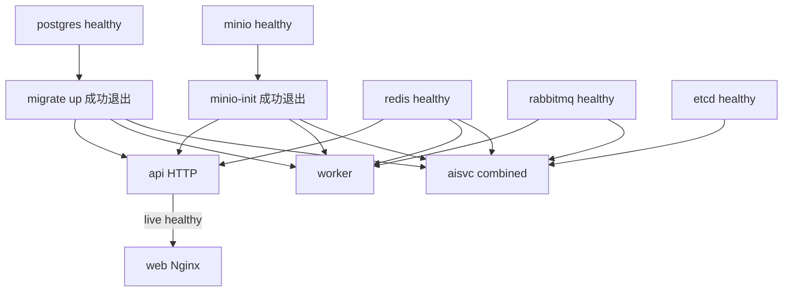
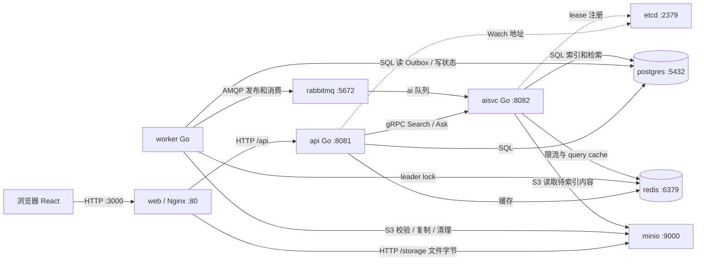
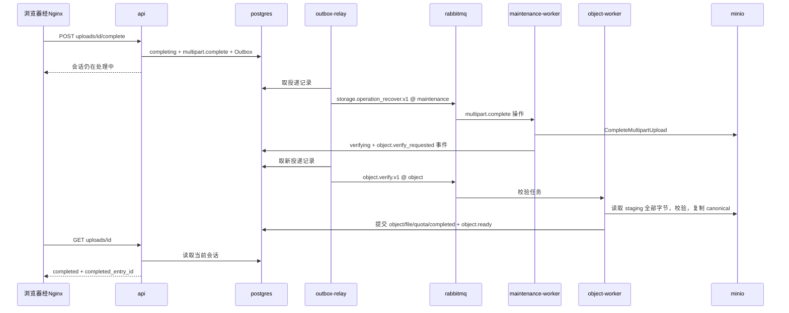
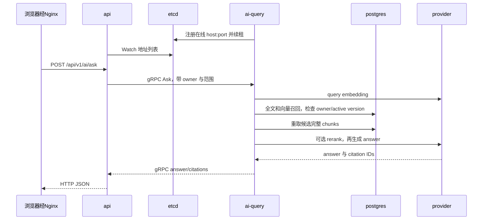

# BX YunPan：从启动到业务流转的进程地图

> 源码基准：2026-11-03，commit `ef0fc2362a286976848c8bf3640113f841cd6473`。依据当前启动脚本、Compose、Go 入口和实际装配函数编写，不依赖旧文档或历史记忆。
>
> 本文描述“按这些配置启动，代码会怎样组织进程和交互”，不是当前机器的容器盘点。本次没有读取真实 `.env`、启动容器或改动运行环境。配置组合经过隔离的启动命令捕获和只读 Compose 展开核对，证据见 [process-topologies.json](facts/2026-11-03/process-topologies.json)。

建议分三遍读：先看第 1–4 节，认清默认进程；再看第 7–10 节，沿一个文件追完整条链；最后对照第 5–6 节，理解拆分、扩容和配置改变了什么。

## 1. 默认启动后，先认清这 9 个常驻服务

假设使用 `./deploy/up.sh`，配置保持模板默认：AI 开启、fake provider、AI combined、etcd 开启，各一个副本，没有额外 profile。

**启动稳定后有 9 个常驻服务容器，其中 3 个是本项目的 Go 业务进程；另有 2 个一次性容器成功执行后退出。**

```text
浏览器：运行 React，属于用户客户端，不计入服务端容器

服务器上的常驻服务：
  1. web          Nginx：提供页面，代理 /api 和 /storage
  2. api          Go：接收业务 HTTP 请求
  3. worker       Go：发任务 + 消费 object/media/maintenance + 定时恢复
  4. aisvc        Go：接收 AI gRPC + 消费 ai 队列
  5. postgres     保存业务数据、上传状态、任务状态和 AI 索引
  6. redis        同时提供协调、限流、缓存
  7. rabbitmq     保存、分发、重试后台任务
  8. minio        保存原始文件、正式文件、缩略图字节
  9. etcd         保存在线 aisvc 的可达地址

启动期间运行，成功后退出：
  minio-init     创建 bucket、设置非匿名访问
  migrate        执行数据库迁移 up
```

这里的“9”是**服务容器实例数**，不是 Linux `ps` 总 PID 数。Go 业务容器启用 `init: true`，还可能有 init 辅助进程；Nginx 有 master/worker，PostgreSQL 有后台和连接进程，healthcheck 也会短暂启动命令。无法从 Compose 直接得到稳定不变的全机 PID 总数。后文统一同时列“常驻容器数”和“自研 Go 业务进程数”。

几个代码中的名字并不对应新进程：identity、drive、upload、sharing 都在 `api` 进程内；Outbox dispatcher 默认在 `worker` 内；fake AI 在 `aisvc` 内计算。它们不会因创建一个 Go service 对象就各自 fork。生产 Web 镜像也没有一个持续运行的 React/Node server，React JavaScript 在浏览器里执行。

**源码**：[主 Compose](../deploy/compose.yaml)、[up.sh](../deploy/up.sh)、[API 装配](../backend/internal/bootstrap/api.go)、[worker 装配](../backend/internal/bootstrap/worker.go)、[AI 装配](../backend/internal/bootstrap/aisvc.go)、[Web Dockerfile](../web/Dockerfile)。

## 2. 谁把谁拉起来：启动顺序不是 API 启动其他进程

### 2.1 宿主启动脚本先做什么

`deploy/up.sh` 是宿主 shell 脚本。它检查 Docker/Compose、Compose project 归属和配置；没有 `.env` 时调用 `init-env.sh` 从模板生成；需要构建时调用 `build.sh`，之后把选中的 profiles、服务列表和副本数交给 Docker Compose。

因此：**Compose/Docker 管理容器生命周期，Go API 不负责启动 worker、AI、数据库或 RabbitMQ。** Go 代码建立数据库连接、Redis client 或 MinIO client，只是连接已经存在的服务。

构建阶段的 Go compiler、Node/npm 和镜像 build 进程在这里结束；它们不应加入稳定运行的业务进程计数。`--no-build` 只跳过构建，不改变角色拓扑。

### 2.2 Compose 等待的真实依赖



这是依赖偏序，可以并行启动，不是一条固定串行列表。默认 API 没有 `depends_on: aisvc`；AI 未就绪时，目录等请求仍可先服务，Search/Ask 可能返回不可用。

`api` 的容器 healthcheck 只检查 `/health/live`；`web` 的 healthcheck 还代理检查 API ready 与 MinIO live。`migrate/minio-init` 的要求则是 **service_completed_successfully**：它们退出码为 0 后就完成职责，不需要永久保持 running。

启动脚本的 `--wait` 也不代表跑过完整上传或真实模型问答。worker 没有覆盖全部后台效果的业务级 healthcheck，单个进程 running 与任务最终完成是两回事。

### 2.3 启动成功后的角色收尾

脚本会停掉并移除不再使用的另一组角色容器，例如拆分 worker 后移除旧 combined worker，AI split 后移除旧 aisvc。这个动作发生在新一组启动成功之后，切换窗口可以暂时同时存在两组消费者；稳定后的数量才是本文对照表的数量。

**源码**：[up.sh](../deploy/up.sh)、[init-env.sh](../deploy/init-env.sh)、[构建脚本](../deploy/build.sh)、[Compose depends_on/healthcheck](../deploy/compose.yaml)、[依赖连接工厂](../backend/internal/platform/dependencies/dependencies.go)。

## 3. 每个业务进程到底干什么

### 3.1 自研 Go 进程清单

所有后端角色镜像的运行路径都叫 `/app/service`，但构建 TARGET 不同；不能只看进程文件名判断角色。

| Compose 服务 | 实际源码入口 | 接收什么 | 在哪里产生结果 |
| --- | --- | --- | --- |
| `api` | `cmd/api` → `RunAPI` | 浏览器经 Nginx 转来的 HTTP | PG 业务事务/Outbox、签名 URL；Search/Ask 转 gRPC |
| `worker` | `cmd/worker` → `RunWorker` | Outbox 轮询、object/media/maintenance 队列、定时器 | PG、MinIO、RabbitMQ；兼任发布者和消费者 |
| `outbox-relay` | `cmd/outbox-relay` → `RunOutboxRelay` | PG Outbox/执行恢复扫描 | RabbitMQ 发布及 PG 投递状态；不消费业务队列 |
| `object-worker` | `cmd/object-worker` → `RunObjectWorker` | object 队列 | 校验完整 staging，复制正式对象，提交 file/quota/completed |
| `media-worker` | `cmd/media-worker` → `RunMediaWorker` | media 队列 | MinIO 图片变体及 PG object_variants |
| `maintenance-worker` | `cmd/maintenance-worker` → `RunMaintenanceWorker` | maintenance 队列、定时器 | multipart 存储操作、过期上传、GC 和资源恢复 |
| `aisvc` | `cmd/aisvc` → combined | 在线 gRPC 与 ai 队列 | 在线检索/回答 + PG AI 文档/分块/向量 |
| `ai-query` | 同一 `cmd/aisvc` → `RunAIQuery` | 在线 gRPC | 查 PG/可选外部索引、调用模型、返回 hits/answer |
| `ai-indexer` | 同一 `cmd/aisvc` → `RunAIIndexer` | ai 队列 | 从 MinIO 读内容、解析/分块/embedding，写 PG AI 版本 |
| `search-indexer` | `cmd/search-indexer` → `RunSearchIndexer` | search 队列 | 读 PG 当前事实，写 search_* 投影与可选 ES/Qdrant |

`ai-query` 和 `ai-indexer` 复用 aisvc 镜像，通过环境中的 `AI_SERVICE_ROLE=query/indexer` 选择分支，并没有各自一套 Proto 服务实现或独立数据库。

### 3.2 默认 worker 里是一组 goroutine

```text
一个 worker Go 进程
├─ Outbox dispatcher 循环：默认约每 1 秒，PG → RabbitMQ
├─ RabbitMQ consumer/scheduler：object、media、maintenance，共享默认并发 8
├─ 上传过期清理循环
├─ storage_operations 恢复循环
├─ object.delete 恢复循环
├─ 业务资源恢复循环
└─ :8083 metrics HTTP server

一个 aisvc combined Go 进程
├─ :8082 gRPC server：Search / Ask / 兼容 Reprocess
├─ ai 队列 consumer：默认并发 8
└─ etcd 注册租约与 KeepAlive（开启发现时）
```

维护循环启动即跑一轮，之后默认每 5 分钟重复。它们不是 4 个独立守护进程。combined aisvc 的 registry 虽存在，当前没有相应 metrics HTTP server 启动调用。

拆分 worker 后，上图的 dispatcher 搬入 outbox-relay，3 类队列分别搬入 object/media/maintenance-worker，4 个维护循环都在 maintenance-worker。拆分 AI 后，gRPC 搬入 ai-query，队列消费搬入 ai-indexer。

### 3.3 两个名字相近的 indexer，处理的内容不同

| | ai-indexer | search-indexer |
| --- | --- | --- |
| 主要输入 | MinIO 的文件字节 | PG 已提交的业务/AI 数据 |
| 是否解析文件、调用 embedding | 是 | 否 |
| 消费队列 | ai | search |
| 主要输出 | ai_documents、ai_document_versions、ai_chunks | search_*、可选 ES/Qdrant |
| 默认是否独立启动 | 否，职责在 aisvc combined | 否，需要显式启用 |

**默认没有 search-indexer，仍然能做 PG AI 检索**，因为 aisvc 已直接建立 ai_* 内容索引。不能把搜索投影进程误认为所有 AI 问答的必经进程。

### 3.4 平时不会常驻的工具

`cmd/migrate` 是启动依赖中的一次性数据库工具；`cmd/migrate-asynq` 是离线旧任务迁移工具，普通 up 不选 migration profile；`cmd/search-backfill` 是回填/版本控制 CLI，主 Compose 没有自动启动它。它们不计入稳定运行的 Go 业务进程。

**源码**：[worker.go](../backend/internal/bootstrap/worker.go)、[roles.go](../backend/internal/bootstrap/roles.go)、[aisvc.go](../backend/internal/bootstrap/aisvc.go)、[队列装配](../backend/internal/platform/worker/server.go)、[角色队列分配](../backend/internal/platform/worker/role.go)、[后端 Dockerfile](../backend/Dockerfile)。

## 4. 默认进程怎样连在一起

下面每个大节点代表常驻服务。标为“进程内”的内容不会增加服务端进程数。



默认 fake provider 就在 aisvc 进程里。换成 DashScope 后，图中的 aisvc 再向配置的模型 endpoint 发 HTTPS；不会自动增加本地模型容器。

PostgreSQL 同时连着 API、worker、AI：worker 完成上传后不需要 RPC 回调 API，AI 建好内容索引后也不需要把分块发给另一个 query 进程。**下一次 API/AI 请求读共享 PG，就能观察到已提交结果。**

API 不直接向 worker 发 RPC，worker 不向 AI 发索引 RPC；中间是 PG Outbox 和 RabbitMQ。etcd 只告诉 API “在线 AI 地址有哪些”，Search/Ask 的请求内容不经过 etcd 中转。

**源码**：[API client 装配](../backend/internal/bootstrap/api.go)、[AI 注册](../backend/internal/bootstrap/aisvc.go)、[实际事件路由](../backend/internal/outbox/routes.go)、[Nginx](../web/nginx-app.conf)。

## 5. 不同启动配置，具体增加哪些进程

### 5.1 先给统计条件

下表从没有旧项目容器的环境推导，配置用模板默认值，仅修改表中开关；不使用额外 COMPOSE_PROFILES/override，不连接外部自管中间件，AI role 保持正常 combined/split 配置。副本默认各 1。

`D` = `--distributed-workers`，`A` = `--ai-split`，`R` = `--redis-split`，`S` = `--search-indexer`，`E` = `--search-backends`，`O` = `--observability`。这些是表格缩写，真实命令使用完整参数。

每行还会有 **minio-init + migrate 两个一次性容器**，不计入常驻列。无 AI 行需配置 `AI_ENABLED=false`、AISVC_REPLICAS 为 0 或空；它没有一个 `up.sh --no-ai` 开关。

| up 配置 | 自研 Go 常驻进程 | 常驻服务容器 | 相对默认的实际变化 |
| --- | ---: | ---: | --- |
| AI_ENABLED=false | 2 | 7 | api + worker；不选 aisvc/etcd |
| 默认 | 3 | 9 | api + worker + aisvc；基础设施 5、web 1 |
| `--api-replicas 2 --aisvc-replicas 2` | 5 | 11 | 多 1 API、多 1 combined AI |
| A | 4 | 10 | aisvc 1 → ai-query 1 + ai-indexer 1 |
| D | 6 | 12 | worker 1 → relay/object/media/maintenance 4 |
| D + A | 7 | 13 | api、4 worker 角色、query、indexer |
| D + A + R | 7 | 15 | 再加 coordination/cache Redis 各 1 |
| D + A + S | 8 | 14 | 再加 search-indexer 1 |
| D + A + R + S + E | 8 | 18 | 加两个 Redis、search-indexer、ES、Qdrant |
| O | 3 | 13 | 默认拓扑加 Collector、Jaeger、Prometheus、Grafana 4 |
| D + O | 6 | 12 | 当前脚本未把观测服务列入显式启动目标，见下文 |
| D + A + R + S + E + O | 8 | 18 | 当前脚本同样不会从空环境拉起 4 个观测服务 |
| ETCD_ENABLED=false，其余默认 | 3 | 9 | 发现关闭，但 Compose 仍拉 etcd |
| A + `--api-replicas 2 --aisvc-replicas 3` | 7 | 13 | api 2、worker 1、query 3、indexer 1 |

这些数量已经通过当前 up.sh 的命令捕获和真实 Compose config 展开核对，逐行服务清单见 [组合证据](facts/2026-11-03/process-topologies.json)。它们不是运行机器的实测 ps 结果。

### 5.2 拆分不是把 combined 留着再加新角色

稳定后的角色替换关系为：

```text
worker 1 个                         → outbox-relay 1 + object-worker 1
                                      + media-worker 1 + maintenance-worker 1

aisvc combined 1 个                 → ai-query 1 + ai-indexer 1

--aisvc-replicas N，combined 模式    → N 个 aisvc，每个同时做在线查询和离线索引
--aisvc-replicas N，AI split 模式    → N 个 ai-query，仍只有 1 个 ai-indexer
```

因此 `D+A` 的 Go 进程固定部分为 4 个 worker 角色 + 1 个 indexer，另加 API 数和 query 数：`Go = 5 + API副本 + query副本`。启用 S 再加 1。这不是操作系统总 PID 公式。

### 5.3 当前脚本里两个必须计入的细节

**Redis split 是加 2 个容器，当前没有减掉旧 redis。** API 和 worker 等服务的 depends_on 仍指向 `redis`；同时 up.sh 把实际协调/缓存 client 地址改到新实例。所以旧 redis 可以仍 running，却已经不承担这两项客户端流量。

**D+O 在空环境下不会启动观测栈。** D 分支给 `compose up` 追加了显式目标 `migrate api web outbox-relay ...`，只把 AI、Redis、搜索相关可选服务加进去，没有加 4 个观测服务；单纯激活 observability profile 不会使未被选择、也未被依赖的服务启动。已有观测容器是否仍运行，要另外看实际状态。

这也说明，直接执行 `docker compose --profile app --profile distributed up` 与 `./deploy/up.sh --distributed-workers` 行为不同：前者可能同时选中 app 的 combined worker；up.sh 的显式目标与后续收尾才负责角色替换。

### 5.4 staging overlay 是另一种组合方式

`up.sh` 只引用主 compose.yaml，不自动叠加 compose.staging.yaml。若手动叠加两文件，并启用 app/distributed/ai-split/search profiles，overlay 定义 API 2、relay 2，其余 object/media/maintenance/query/indexer/search 各 1，combined worker/aisvc 为 0。

该组合是 **10 个 Go 业务进程、16 个常驻服务容器、2 个一次性容器**；没有自动包含 Redis split、外部搜索或观测栈。overlay 还分别收紧各进程数据库池和 worker 并发，不能把它的数值套到普通 up。

**源码**：[up.sh 参数与显式服务列表](../deploy/up.sh)、[Compose 静态依赖](../deploy/compose.yaml)、[staging overlay](../deploy/compose.staging.yaml)。

## 6. 哪些配置改变进程，哪些只改变进程里的行为

### 6.1 决定启动拓扑的配置

| 配置入口 | 改变什么 | 注意实际生效位置 |
| --- | --- | --- |
| `.env` 的 `AI_ENABLED=true/false` | up.sh 是否选 AI profile；API 是否使用 AI backend；Relay 是否发 ai 任务 | 关闭后仍保留 core API/worker，但 Search/Ask 不可用，连 name 模式也经过 disabled backend |
| `.env` 的 `AISVC_REPLICAS=N`，或 `--aisvc-replicas N` | combined AI 或 split query 的副本数 | 参数优先；split indexer 固定 1 |
| `--api-replicas N` | API 副本数 | 当前脚本没有读取 `.env` 的 API_REPLICAS；不要只加这个 env 名就预期扩容 |
| `--distributed-workers` | 1 个 worker 替换为 4 个独立 Go 进程 | 不是设置 WORKER_CONCURRENCY |
| `--ai-split` | combined AI 替换为 query/indexer | 只在 AI_ENABLED=true 时允许 |
| `--redis-split` | 加 coordination/cache Redis 两个实例并改 client 地址 | 旧 redis 仍在 Compose 依赖链 |
| `--search-indexer` | 加一个投影 Go 进程，并导出本次 SEARCH_INDEX_ENABLED=true | 不等于切换在线读取到 ES/Qdrant |
| `--search-backends` | 加 ES/Qdrant，设置 endpoints/write backends | 不自动加 search-indexer、不自动改 read backend、不自动开 V2 事件 |
| `--observability` | 非 D 启动分支多 4 个观测容器 | D 分支有第 5 节的显式目标遗漏 |

`AI_SERVICE_ROLE` 是 **aisvc binary 内部分支**。split 服务已经固定覆盖为 query/indexer；若只把普通 aisvc 改成 query，ai 队列就失去这个索引消费者；改成 indexer 则不会提供 gRPC，现有 aisvc gRPC healthcheck 也不匹配。要完整分离职责，使用配套 split 服务。

### 6.2 不增减进程，但会改变流量走向

| 环境配置 | 默认 | 进程交互变化 |
| --- | --- | --- |
| `AI_PROVIDER` | fake | dashscope 时 query/indexer 向模型 endpoint 发 HTTPS；进程数不变 |
| `AI_RERANK_ENABLED` | false | 开启后 Ask 所在 query 进程增加 rerank 调用，不启动 rerank 容器 |
| `ETCD_ENABLED` | Compose 默认 true | false 时 API 直连 AISVC_GRPC_TARGET；etcd 容器不会因此从静态依赖中消失 |
| `AISVC_GRPC_TARGET` | aisvc:8082 | 关闭发现时的在线目标；split 脚本导出 ai-query:8082；开启发现时使用 etcd resolver |
| `CACHE_ENABLED` | true | false 时停止使用派生缓存；Redis 协调/限流与容器依赖仍存在 |
| `REDIS_COORDINATION_ADDR` / `REDIS_CACHE_ADDR` | 同一个 redis:6379 | 改变锁/限流和缓存分别连哪个进程；仅填地址不会创建 Redis 服务 |
| `POSTGRES_PRIMARY_DSN` | bundled postgres | 各角色连接的数据库地址；建立 client 不会自动创建外部数据库 |
| `RABBITMQ_URL` | bundled RabbitMQ | 指定任务 broker；up 的静态 RabbitMQ 不会自动因此裁掉 |
| `S3_PUBLIC_ENDPOINT` / `S3_PUBLIC_SECURE` | 127.0.0.1:3000 / false | 改变浏览器签名 URL 的公开入口；改变 WEB_PORT 时也要使其匹配 |
| `S3_ENDPOINT` | 主 Compose 固定 minio:9000 | Go 本身支持读取该配置，但主 Compose 没有用同名 env 插值；只改 `.env` 不会改掉这个固定值，需部署 override 或宿主直跑配置 |
| `SEARCH_INDEX_ENABLED` | false | 为事件增加 search 投递；只有这个 env 不会启动消费者进程 |
| `OUTBOX_V2_EVENTS_ENABLED` | false | 决定重命名、移动、删除等新增领域事件是否产生；外部投影持续更新需要配套开启 |
| `SEARCH_WRITE_BACKENDS` | postgres | es_qdrant 时 search-indexer 增加外部写请求；本地 PG 投影仍维护 |
| `SEARCH_READ_BACKEND` | postgres | shadow 额外对比外部；es_qdrant 从 ES/Qdrant 召回后回 PG 验证；name 仍 PG |
| `SEARCH_INDEX_EPOCH` | v1 | query/投影所用索引 target；backfill activate 不会自动改在线进程配置 |
| `OTEL_TRACES_ENABLED` | false | 开启后现有进程向 Collector 发 traces；不会自动启动 Collector |

配置地址、启动目标和功能开关是三件不同的事。例如完整外部检索需要对应的事件生产、search 投递、消费者、外部后端、回填/target，以及 query 的 read backend 配合；启动两个索引容器并不会自动完成其余配置。

### 6.3 改变单进程资源和时序的配置

| 配置 | 默认 | 应如何理解 |
| --- | --- | --- |
| `WORKER_CONCURRENCY` | 8 | 每个消费进程的任务并发；combined 的 3 个队列共享 8，拆分后各进程分别有自己的上限 |
| `WORKER_QUEUE_MEDIA/OBJECT/MAINTENANCE/AI` | 4/2/1/4 | 进程内队列调度权重，不是副本数或 4+2+1 个进程 |
| `RABBITMQ_PREFETCH` | 16 | 每队列预取，和活跃执行并发不是同一个数量 |
| `POSTGRES_MAX_OPEN_CONNS` | 32 | 每个通过 dependencies.Open 装配的进程各自一个池，不是整个项目共用 32 |
| `OUTBOX_POLL_INTERVAL/BATCH_SIZE` | 1s/20 | 发布扫描节奏和批次，不增加 Relay 进程 |
| `OUTBOX_LEADER_LOCK_ENABLED` | true | 多 Relay 默认通过 Redis 竞争发布领导权；多个副本不表示同时各发一份完整流量 |
| `UPLOAD_CLEANUP_INTERVAL` | 5m | 维护扫描周期；启动后也立即扫描一次 |
| `OBJECT_GC_DELAY` | 24h | 延迟物理删除；用户逻辑文件先在 API 事务中删除 |
| `AISVC_CALL_TIMEOUT` / `AI_REQUEST_TIMEOUT` | 120s/90s | 在线 RPC 总预算 / 单次 provider 请求预算 |
| `WORKER_METRICS_ADDR` | :8083 | 每容器独立端口空间，可重复；宿主直跑多个角色要避免监听冲突 |

这些值以 Go/Compose 默认值为准，staging overlay 会覆盖部分项。修改 `.env` 后，已经运行的 Go 进程不会自动重新读取整套配置；需要创建/更新相应实例才能生效。

up.sh 的角色选择先用自己的解析器读取 `deploy/.env`，Compose 插值还接受宿主已导出的环境变量。混用同名 shell 变量和文件值可能使“脚本选了哪些服务”和“服务里收到什么配置”不一致；本文数量表使用一致的合成文件值，未混用这两层。

**源码**：[up.sh](../deploy/up.sh)、[Compose environment 与角色覆盖](../deploy/compose.yaml)、[config.Load](../backend/internal/platform/config/config.go)、[AI client 的目标选择](../backend/internal/bootstrap/api.go)、[worker BrokerConfig](../backend/internal/platform/worker/server.go)。

## 7. 进程之间传什么：先认清通信线路

| 发起进程 → 目标进程 | 协议/目标 | 传递的真实内容 |
| --- | --- | --- |
| 浏览器 → web | HTTP，默认宿主 127.0.0.1:3000 → 容器 80 | 页面资源、业务 JSON、带签名的文件请求 |
| web → api | HTTP，api:8081 | /api 路径原样代理，JWT、JSON、请求 ID |
| web → minio | HTTP/S3，minio:9000 | 去掉 /storage 前缀后的分片 PUT/文件 GET 字节流 |
| api/worker/AI/搜索进程 → postgres | PostgreSQL，postgres:5432 | 各自执行 SQL；共享业务表、Outbox、执行状态、AI 数据 |
| Relay → rabbitmq | AMQP，rabbitmq:5672 | TaskID、task type、queue、payload、trace、重试预算 |
| RabbitMQ → 各消费者 | AMQP delivery / ACK | 具体任务；consumer 的业务结果另写 PG/MinIO/外部系统 |
| api → aisvc 或 ai-query | gRPC，在线实例 :8082 | Search/Ask 请求、owner ID 和范围；返回 hits/answer |
| ai-query/aisvc → etcd | etcd client，etcd:2379 | 注册自己的在线 host:port、续租 |
| api → etcd | etcd Watch | 获取在线 AI 地址列表，更新 gRPC round_robin |
| Relay / AI RPC 进程 → Coordination Redis | Redis，默认 :6379 | leader lock / 按 owner 的限流计数 |
| API / 在线 AI → Cache Redis | Redis，默认 :6379 | JSON 读模型 / query embedding |
| object/media/maintenance/AI indexer → minio | S3 SDK，minio:9000 | 读取、multipart 完成/取消、复制、删除、写变体 |
| search-indexer → ES/Qdrant | HTTP，:9200 / :6333 | chunk/file 派生投影、版本及墓碑 |
| 在线 AI → ES/Qdrant | HTTP，:9200 / :6333 | 可选文本/向量候选；候选后续回 PG 回验 |
| 在线/离线 AI → 外部模型 | HTTPS，配置的 provider endpoint | 文本/图片、embedding、rerank、回答请求 |

API 的预签名主要由 presigner 在本进程内生成，不是把文件 body 转发给 worker。RabbitMQ 消息主要携带对象/会话/任务标识和元数据，不携带整份文件。文件字节路径与任务控制路径在这里分开。

8081/8082/8083、ES/Qdrant 等在容器网络里可达，不代表都映射到宿主。8083 是 metrics HTTP；worker 并没有一个让 API 调用它执行上传的业务 HTTP 接口。

**源码**：[Nginx](../web/nginx-app.conf)、[任务 broker](../backend/internal/taskqueue/taskqueue.go)、[gRPC client](../backend/internal/ai/grpcclient/client.go)、[etcd resolver](../backend/internal/platform/registry/resolver.go)、[presigner](../backend/internal/platform/storageurl/presigner.go)、[Compose 端口配置](../deploy/compose.yaml)。

## 8. 把一次上传串到底：谁先动，谁接手

下面用 `D+A` 配置跟踪首次上传 `说明.txt`，因此进程名最清楚。默认 combined 配置只需把 relay/object/media/maintenance 四个参与者合并为 worker，把 ai-indexer 合并为 aisvc；业务交接仍然经过数据库和消息队列。

### 8.1 从浏览器到 staging 文件

1. **浏览器进程**读取本地 File，在 Web Worker 中计算 SHA-256，经 Nginx 向 API `POST /api/v1/uploads`。
2. **api 进程**校验用户、目录、文件名和配额，在 PG 事务中预留容量，写 initializing session、multipart.create operation 和恢复 Outbox，返回会话标识。它此时还没有收到整份文件。
3. **outbox-relay 进程**从 PG 看到待投递行，向 RabbitMQ maintenance 队列发 `storage.operation_recover.v1`。
4. **maintenance-worker 进程**收到任务，claim operation，再向 MinIO 创建 multipart，写 provider upload ID，PG session 变 created。定时恢复扫描也可以接手同一 operation。
5. **浏览器**轮询 API，发现会话可上传后，请求分片 PUT 签名；签名由 API 返回。浏览器通过 Nginx `/storage` 将字节 PUT 到 MinIO，再把 ETag/part number/size 确认给 API，API 写 upload_parts。

这里发生了两种完全不同的浏览器请求：`/api` 只传控制数据，`/storage` 才传文件字节。前端当前最多并发 4 个文件，同文件分片顺序上传；这不等于 worker 的服务端并发。

### 8.2 从 complete 到真正 completed



`complete` HTTP 返回并不代表校验结束。maintenance 负责把 MinIO 分片合并为 staging 对象；object-worker 才完整读取、重算 hash/size 并提交正式文件条目。最终状态由浏览器继续经 API 查询 PG，没有 object-worker → API 的回调。

### 8.3 文件完成后，另外两条处理分支

PG 中的 object.ready 事件由 relay 扇出为两个独立投递：

```text
object.ready
  ├─ RabbitMQ media → media-worker → 检查类型 → 需要时写缩略图与 object_variants
  └─ RabbitMQ ai    → ai-indexer   → 读 MinIO、解析、分块、模型处理 → PG ai_*
```

对 `说明.txt`，media 任务会检查类型，并不会生成图片缩略图；AI 走文本索引。两条分支不要求先缩略图再 AI，也不要求 AI 完成后上传才 completed。

因此用户可能同时看到：上传已经完成、文件可以下载、AI 仍在处理。它们对应不同进程已经提交到 PG 的不同阶段。

开启 S 后，相关 file/object/ai.indexed 事件还可再交给 search-indexer 建投影；它并不接管上述整文件校验或 embedding。

**源码**：[前端上传与轮询](../web/src/services/drive.js)、[Upload.Create/Complete/Verify](../backend/internal/upload/service.go)、[operation 日志](../backend/internal/storageops/operations.go)、[Relay routes](../backend/internal/outbox/routes.go)、[维护角色](../backend/internal/bootstrap/roles.go)、[媒体处理](../backend/internal/media/service.go)、[AI task](../backend/internal/ai/tasks.go)。

## 9. 索引与问答，怎样通过共享数据接上

### 9.1 离线索引：由 ai-indexer 写入 PG

```text
RabbitMQ ai 队列
  → ai-indexer 进程收到 object ID
  → PG 查对象，建立 building document generation
  → S3 GET，从 MinIO 读取文件字节
  → 进程内 parser/chunker
  → fake 在本进程计算，或 HTTPS 请求真实模型 embedding/摘要
  → PG 事务写 ai_chunks 并发布 active_version_id
```

默认 aisvc combined 内也是这条链。没有一个当前已运行的独立 parser 进程或模型网关进程；接口名称 ParserGateway 不会让 Compose 多启动服务。

### 9.2 在线 Ask：由 ai-query 读取 PG



这里 provider 在 fake 模式是 query 进程内的函数；真实模式才有外部 HTTPS。query 不需要 RPC 找 ai-indexer 要 chunks，它直接查 indexer 已写入的共享 PG。PG 没有可用 indexed 内容时，也不会为了本次 Ask 临时抓取所有文件重新做完整索引。

Search 的 name 模式不请求 embedding，全文模式查 PG 全文；semantic/hybrid 先取得查询向量再召回。Search 虽用 gRPC stream，API 仍收齐结果后返回普通 HTTP JSON；Ask 也没有通过 Nginx 转发逐 token 流。

### 9.3 如果启用了外部召回

`ai-query → ES 文本候选 / Qdrant 向量候选 → PG 重取并回验 owner、有效 entry、active version → 回答`。search-indexer 只参与此前/并行的派生写入，不是每个搜索请求同步调用的下游 RPC 服务。

ES/Qdrant 成功返回候选时仍需要 PG；默认 postgres read 模式则根本不经过它们。切 shadow 会同步多发对比查询，进程数不变，但流量和请求耗时会变。

### 9.4 用户点击“重建索引”时，走的是另一条路

```text
浏览器 POST /files/id/ai/reprocess
  → api 本地校验 owner/file
  → PG 事务写 async_tasks + reprocess Outbox
  → relay → RabbitMQ ai → ai-indexer
  → 索引重建后写 PG 文档与作业状态

浏览器 GET /ai/jobs/taskID
  → api 直接读 PG async_tasks → 返回进度/状态
```

当前 HTTP 重建不先调 ai-query 的 Reprocess RPC；gRPC Reprocess 是保留的兼容入口。文件 AI 摘要/状态 `GET /files/id/ai` 也由 API reader 直接查 PG，所以“看 AI 状态”和“执行问答”虽然都在 AI 页面，跨进程路径并不相同。

**源码**：[AI 版本发布](../backend/internal/ai/service.go)、[parser 装配](../backend/internal/ai/parser_builtin.go)、[Search/Ask](../backend/internal/ai/search.go)、[召回后端选择](../backend/internal/ai/tracing.go)、[API splitAIBackend](../backend/internal/bootstrap/api.go)、[AI HTTP reader/command](../backend/internal/ai/http.go)、[gRPC client](../backend/internal/ai/grpcclient/client.go)。

## 10. 其他常见操作经过哪些进程

### 10.1 登录、目录与元数据修改

`浏览器 → Nginx → api → PG → api → Nginx → 浏览器`。

登录、refresh、建目录、移动/重命名、目录分页都在 API 本地业务调用中完成。目录/文件读取可以查 Cache Redis，但 owner epoch 和权威可见性仍来自 PG。另启搜索投影时，修改事务写出的事件可能随后再经 Relay/RabbitMQ 通知 search-indexer；这不是 API 要等待的同步调用。

### 10.2 下载与预览

```text
第一段，取得许可和地址：
  浏览器 → Nginx /api → api → PG 校验 owner/file/object → 签名 URL 返回

第二段，取得字节：
  浏览器 → Nginx /storage → MinIO → 浏览器
```

API 不读取整份文件再返回。图片预览可选择 media-worker 已经生成的变体，未生成时可回原图；预览签名由 API 处理，media-worker 不在每次预览 HTTP 请求上被即时调用。

### 10.3 分享与导入

创建/撤销分享：浏览器 → Nginx → API → PG。公开 resolve/content 也先到 API，校验分享后签发短期访问/下载凭据，文件字节仍走 MinIO。

导入：目标用户请求 → API 在 PG 事务中新建自己的 file entry、增加同一个 object 的引用/逻辑容量、写事件。不经 worker 复制整个文件，也不会因为另一个 owner 导入就强制再解析同一 object。

### 10.4 删除：API 先消失条目，维护进程再删物理字节

```text
浏览器 DELETE file
  → api / PG：逻辑删除 entry、扣逻辑容量、减少 object reference
  → reference 为 0 时写 GC Outbox
  → relay：准备默认延迟 24h 的投递
  → RabbitMQ maintenance
  → maintenance-worker：重新查引用，登记/执行 object.delete
  → MinIO：删除该 generation 的源对象与变体
  → PG：object deleted、清理 AI 内容、登记后续事件
```

如果其他用户仍引用同一 object，不会因为当前用户删掉自己的 entry 就删掉共享字节。逻辑删除成功与物理容量释放发生在不同进程、不同时间。

**源码**：[身份](../backend/internal/identity/service.go)、[目录](../backend/internal/drive/service.go)、[下载/删除](../backend/internal/drive/files.go)、[分享](../backend/internal/sharing/service.go)、[GC](../backend/internal/objectstore/service.go)、[投递延迟](../backend/internal/outbox/dispatcher.go)。

## 11. 哪个进程停了，会卡住哪一段

这里讨论启动成功后的运行故障；首次启动的 healthy/completed 依赖可能先把服务挡在启动阶段。Compose 的 depends_on 不是每次业务请求都执行的检查，也不是依赖一宕机就自动级联停止所有下游的机制。

| 停止/不可用的角色 | 直接影响 | 仍可能继续的部分 |
| --- | --- | --- |
| 一个 api | 它承接的 HTTP 中断 | 有其他健康 API 时，Nginx 可连接其他副本；worker 继续处理已提交任务 |
| 默认 combined worker | Outbox 发布、3 类消费、维护循环同时中断 | API 仍可提交部分事务/意图；aisvc 可处理队列已有 ai 消息/查询既有索引 |
| 独立 outbox-relay | 新 Outbox 暂不进入 broker，执行恢复也延后 | 各 consumer 可处理 broker 里已有任务 |
| object-worker | 已合并的上传卡在 verifying 等待校验 | 已有文件下载、已有 AI 内容查询不依赖它逐次参与 |
| media-worker | 新缩略图延迟 | 上传校验、AI 索引和原文件下载可继续 |
| maintenance-worker | 新 multipart 操作、GC、过期清理和恢复扫描延后 | 已有文件读取；其他角色已取得的任务 |
| ai-indexer | 新文件 AI 内容/重建延后 | 独立 ai-query 可读已发布的索引 |
| ai-query | Search/Ask 受影响 | api 的目录、上传控制、下载和本地 reprocess 提交仍有自己的链路 |
| 默认 aisvc combined | 在线查询和离线索引一起受影响 | core API/worker 的文件业务链路 |
| search-indexer | 派生投影延后 | 默认 PG AI 读路径不依赖该进程；外部检索可能读到滞后候选 |
| RabbitMQ | 新发布/分发受阻 | 已提交 Outbox 仍在 PG；API 部分业务不以 broker 可用为提交前提 |
| Cache Redis | 缓存访问失败 | 缓存路径回 PG/模型；若和 Coordination 同实例，其故障还有下一行影响 |
| Coordination Redis | 默认 Relay 无法正常取得发布领导权；AI RPC 限流 fail-open | 不等于 PG 业务数据丢失；缓存是否受影响取决于是否共实例 |
| etcd | AI 注册/地址更新受影响 | resolver 可保留旧地址；已有地址是否仍可达需要另看实例，冷启动无地址则不同 |
| PostgreSQL | 业务事务、上传状态、执行租约、索引查询普遍受阻 | 不能把 Redis 命中理解成整套业务可完全脱离主库 |
| MinIO | 新字节传输、校验、下载、内容解析受阻 | 某些纯元数据查询仍可执行；Web readiness 会检查存储 |

worker 通过 PG 保存 TaskID/执行租约/终态，RabbitMQ 通过手动 ACK、确认重试来接力；handler 的具体效果仍需幂等。不能把“一个任务从一个队列取出”理解为跨进程永远执行且仅执行一次。

如果 handler 无视取消，超过 grace 后的保护代码可能 `os.Exit(70)`，终止的是**整个消费进程**。combined 模式会一起失去该进程承载的其他角色；拆分模式把影响收在对应角色进程内。

API 停机先把 ready 标为 false 再做 HTTP Shutdown；在线 AI 先撤掉 etcd 注册再 GracefulStop；消费者等待任务结束/取消，超出容器 stop grace 最终由 Docker 终止。这里没有一个 API 进程逐个 RPC 指挥所有服务退出的总控器。

**源码**：[API shutdown](../backend/internal/bootstrap/api.go)、[AI shutdown](../backend/internal/bootstrap/aisvc.go)、[任务执行/续租](../backend/internal/taskqueue/execution.go)、[取消保护](../backend/internal/taskqueue/timeout.go)、[etcd resolver](../backend/internal/platform/registry/resolver.go)、[health probes](../backend/internal/platform/dependencies/dependencies.go)。

## 12. 观测栈也是一组独立进程

```text
各业务进程 /metrics ← Prometheus 主动抓取 ← Grafana 查询展示
各业务进程 traces  → OTel Collector       → Jaeger 存储/展示
```

新增的是 Collector、Jaeger all-in-one、Prometheus、Grafana 四个服务容器。Prometheus 不是由 API 推送业务结果触发；Collector 也不参与上传是否完成的事务。

`--observability` 不自动开启 OTEL_TRACES_ENABLED；开启 traces 不自动启动观测容器。默认 Prometheus 抓 API、独立 relay/object/media/maintenance/search，以及 RabbitMQ；没有抓 combined worker、aisvc、ai-query、ai-indexer。尤其 combined aisvc 当前没有启动 metrics HTTP server，不能仅添一个 scrape 地址就当作已经解决全部覆盖。

若采用 D 分支，需要另外显式选择观测服务，才能得到那 4 个实例。下面只是对应的命令示例，本次未执行：

```bash
docker compose --env-file deploy/.env -f deploy/compose.yaml \
  --profile observability up -d otel-collector jaeger prometheus grafana
```

所以第 5 节“D+A+R+S+E 的 18 个常驻容器”再明确启动上述四项后，才是 22 个；Go 业务进程依然为 8。已有进程还需要自己的 tracing 配置生效，才能向新 Collector 发数据。

**源码**：[观测服务](../deploy/compose.yaml)、[Prometheus targets](../deploy/prometheus/prometheus.yaml)、[Collector](../deploy/otel/config.yaml)、[Tracing setup](../backend/internal/platform/tracing/tracing.go)、[AI metrics 装配](../backend/internal/bootstrap/aisvc.go)。

## 13. 宿主开发模式：入口进程换了，后半条链不变

项目还提供 `infra-up.sh`、`local-run.sh` 和 `local-frontend.sh`。它们不是一次调用就自动拉起所有宿主进程。

| 脚本 | 实际启动内容 |
| --- | --- |
| `infra-up.sh` | Docker 中 PG/Redis/MinIO 三个常驻服务，再一次性 run minio-init；当前漏了 RabbitMQ |
| `local-run.sh api` | 当前终端 exec go run cmd/api；不自动启动其他 Go 角色 |
| `local-run.sh worker` | 当前终端 exec go run cmd/worker |
| `local-run.sh aisvc` | 当前终端 exec go run cmd/aisvc，role 取配置 |
| `local-run.sh migrate up` | 运行一次迁移工具后退出 |
| `local-frontend.sh` | npm start，宿主 Node/CRA dev server；这里才有常驻的前端开发 Node 进程 |

完整 combined 宿主开发形态需要分别运行 API、worker、aisvc 和前端开发 server，并准备完整依赖。三个 Go 业务进程不变；go run/npm 还可能有工具父进程，不能据此声称全机恰好四个 PID。

浏览器路径变成：

```text
浏览器 → Node/CRA dev server
          ├─ /api     → 宿主 Go API
          └─ /storage → Docker MinIO 的宿主映射端口

Go worker / aisvc → 同一批 PG、Redis、RabbitMQ、MinIO
```

local-env.sh 把 PG/Redis/MinIO 和 AI target 改成宿主可达地址；etcd endpoint 仍是内部 etcd 名时关闭发现，改用直连。当前它不补起 RabbitMQ，也不改写 RABBITMQ_URL，broker 的宿主可达地址和认证仍需配套配置。不能把 `infra-up` 输出的 ready 理解成已经准备完整当前后台队列链路。

`local-run.sh` 只接受 api/worker/aisvc/migrate 四种 target，不能把独立 object-worker 等名字直接作为这个脚本的参数。独立二进制入口存在，但要用相应 Go 命令/镜像方式启动。

**源码**：[infra-up.sh](../deploy/infra-up.sh)、[local-run.sh](../deploy/local-run.sh)、[local-env.sh](../deploy/local-env.sh)、[local-frontend.sh](../deploy/local-frontend.sh)、[开发代理](../web/src/setupProxy.js)。

## 14. 对照代码和运行状态时，从这些位置进入

### 14.1 三条建议阅读路线

| 想弄清的问题 | 按真实调用方向阅读 |
| --- | --- |
| “启动后有哪些东西？” | up.sh 参数/服务列表 → compose.yaml profiles/depends_on → cmd/main → bootstrap.Run* |
| “上传为什么返回了还没完成？” | web/services/drive.js → upload.Create/Complete → storage operation → Relay routes → maintenance/object handler → upload.Verify |
| “AI 索引怎么被问答读到？” | aisvc.go 角色分支 → ai/tasks.go → ai/service.go 发布 PG active version → api splitAIBackend → gRPC → ai/search.go |

要判断某段逻辑是否是进程边界，直接找调用动作：Go 函数调用仍在当前进程；SQL 跨到 PG；Publish/Consume 跨到 RabbitMQ；gRPC client 调用跨到在线 AI；S3 SDK 跨到 MinIO。一个 internal 包或 interface 的名字本身不代表独立服务。

### 14.2 将来查看现场时，分别看什么

下面是读状态的例子，本次没有运行这些现场命令：

```bash
# 区分常驻服务和正常退出的一次性任务
docker compose --env-file deploy/.env -f deploy/compose.yaml ps -a

# 查看某个具体容器的真实 OS 进程；容器 ID 从上一步取得
docker top <容器ID>

# 默认模式的三类 Go 业务日志
docker compose --env-file deploy/.env -f deploy/compose.yaml \
  --profile app --profile ai logs --tail 100 api worker aisvc
```

独立角色日志中的 `rabbitmq worker started` 会带 concurrency/queues；API 日志有 `api listening`；AI 在线日志有 gRPC address。container running、listener ready、消费者在工作、某个上传/AI job completed 是不同观察层，最好用同一个 session/object/task ID 串联。

### 14.3 本文已经核对到哪一层

本次使用 Docker Compose `2.40.3+ds1-0ubuntu1~24.04.1`，对 **14 种 up.sh 组合 + 1 种 staging overlay** 做了以下核对：

1. 将当前 up.sh 原样复制到临时目录，用只记录参数的 fake docker 和合成 `.env` 捕获它真正选择的 profiles、显式服务和 scale。project guard 用临时空实现替代，未操作真实项目。
2. 使用真实 Compose 的只读 `config --format json` 展开主文件/overlay；配置环境隔离，不读取工作区真实 `.env`。
3. 根据捕获的显式选择、depends_on 闭包和 scale 计算常驻实例数，分开列 Go 业务进程与一次性任务；保存逐场景明细及相关源码 SHA-256。

该方法核对的是**启动命令、配置模型和代码链路**，不是容器真的启动成功、镜像可拉取、真实网络/数据库/模型可用的验证。本次没有重复跑业务测试，因为只新增本文、组合证据和相应 Git 放行规则，没有修改业务实现。

所有组合明细见 [process-topologies.json](facts/2026-11-03/process-topologies.json)。将来如果 up.sh、Compose 或 bootstrap 改动，应重新核对进程数和对应箭头。
