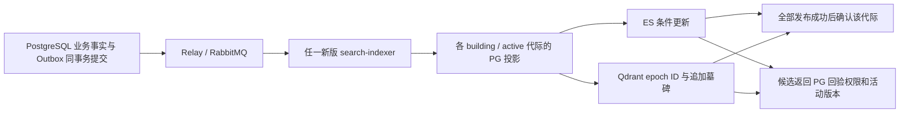

# ES / Qdrant 检索加速与同步审查

日期：2026-11-06（北京时间）。基于当前工作区，保留此前未提交的中文检索、异步任务改动。

## 已修复的问题

| 问题与触发窗口 | 修复 |
| --- | --- |
| 新旧 indexer 竞争同一个队列，各自只写自己的 target；回填游标经过后新增的小 UUID 也可能永远漏扫 | 每条事件写配置 target 及 PostgreSQL 已登记的 `building/active` target；先在一个事务中登记完整代际，再开始扫描 |
| 所有 target / 后端共用 `search-indexer` 消费确认；旧确认压掉新代际或后加外部 writer 的发布 | 确认和检查点按 target、epoch、writer 集合隔离；部分失败仅重试未完成的代际 |
| 超时后把回填设为 `failed`，实际无法续跑；更改 epoch / writer 集合还可能误用旧游标 | 可重试错误保留 `building`、错误和游标；同一 target 拒绝不同 epoch / 后端集合，变更需新 target |
| 快照还没完成就允许启用，多个后端逐个启用 / 回滚会留下半套状态 | 要求最终快照 checksum、计数、无回填错误；检查已开始但未完成的发布；整个 target 在同一 SQL 事务中启用或回滚 |
| 文档换代后外部旧 chunk 一直占用候选名额 | 锁定当前文档指针，退休旧投影，并向 ES / Qdrant 发布 chunk tombstone |
| 快照把扫描时的旧原文直接发到外部，可能与并发换代 / GC 冲突 | 在短事务中重读当前事实并写 canonical projection，再发布 canonical 值；内容处理保持批次范围 |
| 外部召回没有 MIME / 当前语义模型限制，SQL 回验后还丢失原评分顺序 | 补 MIME、活动版本的模型和 pipeline 检查，并按外部分数稳定排序 |
| ES HTTP 200 内含超时 / 失败分片也被当成完整结果；空集或权限过滤后不足不触发 fallback | 拒绝部分成功；开启 fallback 时，错误或有效文件数不足请求数量均回到 PostgreSQL |
| 新 indexer 可先触发 ES 动态 mapping；校验会一次装入整个索引 | 启动前准备 mapping / collection；回填支持实际向量维度；checksum 流式读取并覆盖向量、模型、MIME、归属等字段 |

代码主要位于 [projector.go](../backend/internal/search/projector.go)、[backfill.go](../backend/internal/search/backfill.go)、[index.go](../backend/internal/search/index.go)、[external.go](../backend/internal/search/external.go)、[search.go](../backend/internal/ai/search.go)、[tracing.go](../backend/internal/ai/tracing.go)、[search-backfill](../backend/cmd/search-backfill/main.go)。

## 同步依赖什么



这是最终一致。ES 与 Qdrant 分别从 PostgreSQL 投影，不互相同步，也没有跨三个数据库的原子提交。ES 成功、Qdrant 失败时，事件会重试；ES 的稳定 ID / 条件脚本和 Qdrant 的代际 ID / 墓碑使重放安全。网络调用在 SQL 事务外。

回填从 PostgreSQL 重建已有事实，注册后产生的增量事件负责覆盖游标之前的新数据和并发删除。每个队列消费者都遍历全部 live target，不能靠启动两个竞争消费者分别负责两个 target。

重试有预算，终止失败需要处理 `task_failures` / `task_results.status='dead'`，或进行对象修复 / 新 target 重建。单看队列为空、检查点为空或物理文档数相同，都不能证明三边完全同步。当前 checksum 是 canonical PG 投影摘要；外部版本记录保存相同摘要，**没有独立扫描外部数据计算 checksum**。

`SEARCH_EXTERNAL_FALLBACK=true` 能覆盖外部异常和有效文件召回不足，代价是这类请求会再查 PG；候选充足时仍使用外部结果。它不提供严格的写后立即可见屏障。外部索引始终只提供候选，不能替代 PG 权限回验。

## 当前是否真的支持扩 ES / Qdrant 节点

当前 Compose 是单机开发拓扑：ES `discovery.type=single-node`，Qdrant 未启用集群，两者分别绑定一个命名卷。**不能直接用 `docker compose --scale elasticsearch=N --scale qdrant=N` 形成正确的数据集群。**

本次读取运行实例的结果：

| 系统 | 实际状态 | 含义 |
| --- | --- | --- |
| ES | 1 个数据节点；`chunks_v3/files_v3` 各 1 primary + 1 replica；yellow，副本未分配 | 有可用主分片，没有另一节点承载副本 |
| Qdrant | `/cluster` 为 disabled；`chunks_v3` shard=1、replication=1、write consistency=1 | 单份数据，未建立跨节点复制 |
| 应用 | search-indexer / ai-query 指向 v3，读写均启用 es_qdrant | 可横向增加应用实例；数据节点复制另需集群部署 |

同一集群内扩节点，由后端负责复制与迁移：

- ES 要配置同一 cluster 的发现 / transport、各节点独立数据卷，配置 replica 并等待分片恢复、迁移完成。增加节点可分散副本和已有分片；增加主分片容量需要额外规划，例如新 target 重建。
- Qdrant 要启用分布式模式、正确加入同一个 peer 集群，各节点独立持久化，配置 collection 的 replication / write consistency，并显式检查 shard replica / transfer。新 peer 加入本身不代表已有 shard 已复制过去。
- 当前 Qdrant adapter 已请求 `wait=true&ordering=strong` 和读 `consistency=all`，但这些选项不会自动增加副本或完成 shard 迁移。ES 的应用级版本脚本同样不能代替集群副本配置。
- 应用 endpoint 应指向这个共享集群。把负载均衡轮流指向多个独立空 ES / Qdrant 实例，会造成随机缺数据；这种部署需要迁移到同一集群，或将新存储作为新 target 完整回填。

## 新 target 的实际切换顺序

1. 先升级所有 search-indexer 到本次实现，统一 ES / Qdrant endpoint、向量维度和 writer 集合。旧版竞争消费者仍可能直接确认事件，因此不能混用旧版消费者建立新代际。保持旧查询 target 服务。
2. 使用未使用过的 target，例如 `v4`，执行回填；不要直接加 `--activate`。同一集群扩节点且索引不变时无需重建 target。

   ```bash
   ./deploy/search-backfill.sh --mode backfill --target-version v4 --index-epoch 4 --embedding-dimension 1024 --batch-size 100
   ./deploy/search-backfill.sh --mode status --target-version v4 --index-epoch 4
   ```

3. 检查回填完成、状态无错误；检查 Outbox、RabbitMQ、执行租约、死信以及该代际检查点。`status` 会输出该 writer 集合的 consumer ID 和检查点分类，便于定位。再做当前活动 chunk 的 ID / 版本覆盖比对、删除与权限用例、实际查询对比。ES 必须考虑 refresh 可见性。
4. 保持新代际为 `building`、旧代际为 `active` 时，两边持续增量写入。把所有查询实例的 `SEARCH_INDEX_EPOCH` 切到新 target，确认旧查询实例退出后，再执行：

   ```bash
   ./deploy/search-backfill.sh --mode activate --target-version v4 --index-epoch 4
   ```

5. `activate/rollback` 仍属于控制表操作，**不会自动修改运行进程的查询配置**。retired 代际不持续接收增量；日后回滚必须先补齐数据并核对，不能直接把陈旧 target 当成同步副本。

启用门槛会拒绝未完成的快照和已记录的未完成发布，但它不是全局 CDC 截止线，也不能看到尚未开始的队列任务。需要严格零窗口切换时，应短暂停止业务写入、排空相关任务、进行实际覆盖验证后再切换。持续写入下按上述双写流程保持最终一致。

单个对象的修复可复用当前事实和已有向量，不重新调用模型：

```bash
./deploy/search-backfill.sh --mode repair-object --target-version v3 --index-epoch 3 --object-id '<object UUID>'
```

该命令只重建指定 target 的该对象派生投影，包括退休 chunk 墓碑，部分失败可以重复执行。新存储的全量恢复仍要走新 target 回填。

## 验证与运行态边界

真实 PostgreSQL 17 / pgvector、ES 8.19、Qdrant 1.15.5 验证使用独立数据库 `bx_search_sync_20261106`（迁移 31）和随机测试索引。测试索引由测试自身清理，业务原文与服务数据卷保留。重点用例覆盖新旧代际重试隔离、writer 变化、回填中断续跑、早启用 / 半启用拒绝、游标之前新增 chunk 的增量覆盖、文档换代和 GC、MIME / 模型 / 权限与召回回退。

本次初始检查运行态时，业务库迁移为 29、AI chunk 总数 89；当前 ready object 的活动版本 chunk 为 83。ES 与 Qdrant 的 v3 均无缺项、版本与 epoch 均匹配，但两边各有同一个非活动文档版本的旧 chunk 仍可被外部召回。PG 最终回验会过滤它。

已对该对象执行 `repair-object`，仅修改派生投影，退休旧 chunk。随后实际按 chunk ID、文档版本和 epoch 比对：PG 当前有效 83，ES / Qdrant 有效各 83，缺项、多余项、错误文档版本、错误 epoch 均为 0。见 [修复前](../artifacts/search-sync/20261106/runtime-coverage.json)、[修复后](../artifacts/search-sync/20261106/runtime-coverage-after.json)、[定点修复计划](../artifacts/search-sync/20261106/repair-plan.json)。

最终相关包的真实依赖回归含 race：136 个测试（含子测试）通过，0 失败，2 项跳过（未开启 Python 中文 parser 管线；未提供本轮独立 RabbitMQ / MinIO 上传集成环境）。真实 ES / Qdrant 与新加的同步 / 续跑 / 原子切换测试均运行通过。`go vet`、`search-indexer/search-backfill/aisvc` 的 Go 构建和 `git diff --check` 通过。

本次修复不增加数据库迁移；整个已有工作区包含此前的迁移 30 / 31 和中文检索改动，整体发布需一并遵循相应迁移要求。服务镜像的构建与部署、跨主机分片迁移 / 失联恢复 / 压测不在本次已验证结果内。

最终测试计数、race / vet / build 与运行态前后对比见 [verification.json](../artifacts/search-sync/20261106/verification.json)。
