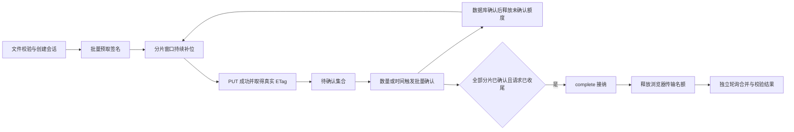

上传窗口与批量确认升级方案（2026-11-17）
========================================

本方案的升级前源码基线为 `f6b8518`，创建于 2026-11-17。2026-11-18 已开始并完成核心代码改造；本轮实施及验收范围见文末。下面的现状表记录升级前情况，方案参数与行为由实施记录说明落实结果。

目标是让单文件采用持续补位的分片窗口，让上传与批量确认重叠执行，同时限制浏览器并发和未确认积压。确认落库、最终合并和取消必须有清晰的先后关系。最终合并继续交给现有 upload-worker / committer / object-worker 链路处理。

升级前实现与改动入口如下。源码路径均相对仓库根目录；行号对应升级前基线。

| 事实 | 当前源码 | 对本次升级的影响 |
| --- | --- | --- |
| 文件之间最多并发 4 个，每次选择最多接收 10 个文件 | `web/src/contexts/TransferContext.js:7`、`:264` | 已有文件调度基础；选择批次与分片批处理是两个概念 |
| 单文件逐片执行签名、PUT、确认，三个请求全部 await 后才处理下一片 | `web/src/services/drive.js:102` | 主要串行点在浏览器 |
| 签名接口一次接受 1–20 个片号，返回数组由 Go map 遍历生成 | `backend/internal/upload/http.go:98` | 可以直接批量预取；前端必须按 part_number 匹配 URL |
| 确认接口一次接受 1–100 片 | `backend/internal/upload/http.go:123` | 已有批量请求入口 |
| 确认在事务外读取会话，事务内逐条 upsert，最后再次查询全部确认片 | `backend/internal/upload/service.go:352` | 需要补事务内互斥、真正批量写入和精简响应 |
| 签名也通过 Get 预加载全部确认片 | `backend/internal/upload/service.go:330`、`:310` | 热路径存在不需要的分片读取 |
| Complete 锁会话行，目前主要检查分片数量，登记 multipart.complete 并进入 completing | `backend/internal/upload/service.go:375` | 可以沿用现有异步链路，补强完整性前提 |
| planner 在后续计划阶段读取 upload_parts，冻结任务输入 | `backend/internal/asyncjobs/planner.go:104` | completing 之后必须禁止修改确认事实 |
| worker 一次调用 CompleteMultipartUpload，committer 推进到 verifying 并发出校验事件 | `backend/internal/asyncjobs/compute.go:66`、`backend/internal/upload/async_commit.go:86` | 最终合并已经异步化 |
| committer 已接入窗口收集和兼容结果批量提交 | `backend/internal/bootstrap/async.go:124`、`backend/internal/asyncjobs/batch.go:20` | 这是后台任务结果批处理，与浏览器分片确认分别处理 |
| completing / verifying 的等待仍占用文件并发名额 | `web/src/contexts/TransferContext.js:213`、`:258` | 需要把浏览器传输名额与后台等待拆开 |
| 前端缺少 ETag 时会构造 part-N，进度按确认结果折算 | `web/src/services/drive.js:118`、`web/src/contexts/TransferContext.js:196` | 需要真实 ETag，并区分已发送、PUT 成功和数据库确认 |
| OpenAPI 确认数组上限为 10000，ETag 上限 256、size 最小值 0；handler/service 实际是 100、512、正数 | `backend/api/openapi.yaml:1515`、`:1532` | 契约应与实际规则统一 |

已有证据是现状基线，不是升级结果：上一轮执行的 `drive.test.js` 与 `TransferContext.test.js` 共 16 个用例通过；直接执行当前 uploadFile 的六片 mock 探针，观察到 6 次签名、6 次确认、PUT 最大并发 1。这些结果没有证明窗口上传、真实网络吞吐或容量。

拟实施的数据流如下。PUT 完成就可以补位，不需要等待同批其他分片；确认器独立运行。



建议的初始参数如下，集中放入前端上传策略模块，允许测试注入策略。它们是保守起点，实施后的真实链路对照测试再决定是否调整。

| 参数 | 初始值 | 约束 |
| --- | --- | --- |
| 同时参与准备和传输的文件 | 4 | 沿用当前文件级规模 |
| 单文件同时 PUT | 4 | 剩余未确认额度不足时停止补位 |
| 页面内全局同时 PUT | 8 | 所有文件共享，按文件轮转分配 |
| 同时计算文件 hash | 2 | 取消、登出时可以终止 Worker |
| 单次预取签名 | 最多 20 片 | 每文件最多 1 个签名请求在途，缓存仅保留有限前瞻 |
| 批量确认数量触发值 | 8 片 | 每文件只有 1 个确认请求在途 |
| 批量确认等待时间 | 250ms | 从最早待确认片进入集合开始计时，不因新片到达不断推迟 |
| 单次确认硬上限 | 100 片 | 与实际后端限制一致 |
| 单文件未持久确认窗口 | 16 片 | 包含正在 PUT、待确认、确认请求中的片 |
| 页面全局未持久确认窗口 | 32 片 | 额度在开始 PUT 前预留，确认后释放；重试复用同一片的额度 |
| 上传控制请求全局并发 | 4 | 创建、签名、确认、complete 等共享；确认和取消优先，轮询使用单独预算 |
| 后台状态查询全局并发 | 4 | 定时等待不占网络请求额度，保留现有退避 |
| 浏览器已知的后台处理中会话 | 16 | 达到上限后停止接纳新的传输；恢复出的已有会话全部保留并继续观察 |

以上预算只约束当前页面。服务器继续依赖现有控制库预算和任务背压；浏览器窗口不能当作服务端限流或容量保证。多标签页各自有页面预算，服务器会话行锁负责业务互斥；跨标签页共享带宽预算可以另行扩展。

以当前常见的 10MiB 分片计算，每文件最多有 160MiB 对应的分片尚未得到数据库确认，页面最多 320MiB。这是失败后可能需要重新确认或重传的数据范围，不是承诺的 JS 堆内存占用。文件 slice 按需创建，不把多个窗口或整个文件转换成 ArrayBuffer 缓存。

**前端调度需要显式区分分片状态。** 每个分片按 part_number 维护 `missing → uploading → uploaded → confirming → confirmed`，并记录 URL 到期时间、真实 ETag、实际大小和尝试次数。只有 confirmed 计入可恢复的进度。PUT 重试时只允许同一分片有一个当前尝试；旧尝试的迟到回调通过运行代次过滤。

签名按片号映射，不能继续使用 `presigned.parts[0]`。签名缓存耗尽或接近到期时补充，最多保留一个有限预取批次。只有取得 PUT 名额和未确认额度后才发送字节。任何时刻释放 PUT 名额，都应唤醒其他文件的可运行分片，避免一个文件连续抢占全部名额。

确认器从 uploaded 集合截取不可变批次。发送后，新成功片进入另一个待确认集合；失败时重试原批次，不把新片混入同一次逻辑确认。每文件串行运行确认器，但它可以和本文件的其他 PUT 并行。响应成功才把对应片号合并到 confirmed 集合、释放未确认额度。确认服务变慢时，窗口自然停止补位，不能持续发送字节而无限积压 ETag。

数量触发、时间触发、文件尾部、暂停收尾都可以唤醒确认器。慢网络下一个批次可能只有一片；250ms 是减少等待的策略，不保证每个真实请求都满 8 片。不能为了凑满批次让尾部永久等待。

**后端先收紧确认和最终合并的共同边界。** 当前 ConfirmParts 在事务外检查状态；如果 Complete 在这之后把会话推进到 completing，确认事务仍可能写 upload_parts，而条件更新会话状态得到 0 行也不会报错。planner 随后读取分片冻结输入，因此这不是单纯的性能问题。

拟将确认的实际执行改成下面的顺序，所有在线分片写入口使用同一规则：

1. 将请求 context 传入 service，数据库错误、取消和权限不存在分别处理，不把数据库故障统一压成 upload.conflict。
2. 在事务内按 `id + user_id` 对会话执行 SELECT FOR UPDATE；确认、Complete、Abort 与到期推进共用会话行互斥。
3. 在锁内检查状态和有效期。created / uploading 才可新增确认事实；completing / verifying / completed 仅可接受与已有事实完全一致的重复确认，并且只读返回；aborted / expired / failed 拒绝确认。
4. 统一 ETag 的外围引号处理；校验片号范围、ETag 长度、checksum 长度和精确片大小。非尾片大小必须等于 part_size，尾片必须等于剩余字节数。客户端报告的大小仍需在后续真实对象校验中验证。
5. 同一请求内相同片号、相同内容去重；同一片号携带冲突值返回 422，整个批次回滚。对数据库中已有记录，一致则幂等成功，不重写 completed_at；ETag、大小或 checksum 冲突则返回 409，例如 upload.part_conflict，不静默覆盖。
6. 一次查询本批涉及的已有分片，将新增分片合成一次批量 INSERT；每批最多 100 片，不再逐片执行 INSERT/UPSERT。会话状态更新也在同一事务中完成。
7. 事务成功后返回本批接纳结果。事务失败时整个批次失败，前端不推定其中部分已确认。

“已有分片冲突时拒绝覆盖”是对当前覆盖式 upsert 的有意收紧。正常重复确认仍兼容；真实冲突需要查询权威状态并停止自动重写，必要时显式创建新会话。跨请求重复确认不能修改已冻结的合并输入。重复 PUT 也不能假设一定产生相同 ETag：PUT 结果不确定时先查询数据库已确认片，已确认片跳过；仅对未确认片重传并使用当前返回的真实 ETag。

Complete 继续采用现有幂等键和 storage_operations 意图。在同一会话行锁内检查片数、片号覆盖、各片预期大小及总字节数，然后进入 completing 并登记现有合并操作。进入 completing 后确认事实保持不变，供现有 planner 读取和冻结；同一会话只登记一次合并操作。业务事务内不访问 MinIO。当前模型已有会话行和 `(session_id, part_number)` 主键，本方案预计不需要数据库结构迁移。

PresignParts 改用携带 context 的轻量会话查询，避免预加载全量 ConfirmedParts。仍然保留每次 20 片的限制，检查状态、会话有效期和片号重复。签名生成发生在业务事务外；若签名返回前会话被取消，前端停止使用它，后续业务确认也不能使会话恢复。

**确认响应增加可选的增量形态，保留已有客户端的完整响应。** 建议复用现有路径：

```http
POST /api/v1/uploads/{uploadId}/parts/confirm?view=delta
```

请求仍使用现有 `parts` 数组。成功响应只包含当前状态及本次请求得到确认的片，不返回历史累计列表：

```json
{
  "upload_id": "<uploadId>",
  "status": "uploading",
  "acknowledged_parts": [
    { "part_number": 7, "size_bytes": 10485760 }
  ]
}
```

acknowledged_parts 表示本次提交中已在数据库成立的片，包含完全一致的幂等重复项。缺失项或格式不合法的响应不能视为整批成功。默认不带 view 时保持完整 UploadSession 响应；GET 会话继续提供完整 confirmed_parts，用于首次恢复和异常对账。handler 只有在默认完整模式下才读取全部确认片，delta 热路径不做这次全量查询。

新前端同时识别 delta 和旧完整响应：旧 API 可能忽略 view 并返回完整会话，此时按 confirmed_parts 对账；不因服务端不认识 delta 就重复上传。最终部署仍按后端先行处理，所有 API 副本完成并发边界升级后再启用前端窗口。

不需要在确认热路径额外 COUNT/SUM 全量分片来构造响应；前端按已确认片号集合计算累计值。正常单次响应的大小随本批片数增长，首次恢复或异常对账允许读取完整列表。同步修改 OpenAPI 和生成的 contract，统一 20 / 100 限制、ETag 512、checksum 512、size_bytes 正数规则及新增错误码。

**窗口调度与后台等待分开计数。** TransferContext 需要分别维护运行实例、准备/传输名额、后台会话集合和实际在途轮询。运行实例用来防止同一 task 重复启动，不能继续直接用它的数量限制传字节。

上传服务在 complete 已被接纳，或权威查询确认已进入 completing / verifying 后，通知 Context 转入后台等待并释放准备/传输名额。waitForUpload 的定时器及请求使用独立轮询预算；恢复出的后台会话不要求用户重新选择文件。后台处理数量达到页面上限时暂停接纳新的传输，给现有异步链路留出收敛空间。

前端将 completing 显示为“服务器合并中”，verifying 显示为“服务器校验中”，不把二者都描述为校验。服务端完成前不能显示“已完成”；传输字节到达 100% 可以单独显示“文件已发送，正在处理”。已有每次选择最多 10 文件的产品限制可以沿用，本次批量单位是同一上传会话内的分片；跨文件通过共享资源预算调度，最终合并仍逐会话执行。

**失败、暂停与取消必须按下面的行为验收。**

| 场景 | 拟实施行为 |
| --- | --- |
| PUT 网络失败、408、429、可恢复 5xx | 只重试该片；自动总尝试最多 4 次，采用退避与抖动；429 尊重 Retry-After |
| URL 即将过期或明确签名过期 | 有界重签；换签和重试共享该片的自动尝试预算，不能无限循环 |
| 其他 403、会话不存在、参数错误 | 分类报错，不统一当作签名过期反复重试 |
| PUT 成功但 ETag 不可读 | 不构造假的 ETag，不确认；对未确认片进行有界重试，仍失败则保留会话并提示可恢复错误 |
| 确认响应丢失 | 保留原 ETag 批次，原样重试；必要时 GET 对账；已经上传成功的片不因 ACK 丢失立即重传 |
| 确认暂时不可用 | 保留 pending 与 in-flight 批次；未确认窗口用尽后停止发送新片；自动确认尝试最多 4 次，耗尽后保留可重试会话 |
| 用户暂停 | 停止领取新片，允许已有 PUT 在超时内收尾，刷完成功片；确认成功后才进入 paused，失败则进入可恢复错误状态 |
| 所有 PUT 结束 | 立即刷尾部确认；所有片 confirmed、PUT 为 0、待确认与确认请求均为空且未暂停/取消时，才可 complete |
| complete 响应丢失 | GET 权威状态；已进入 completing / verifying / completed 则转后台等待；仍可上传才重试幂等 complete |
| 用户取消 | 停止调度并中止在途 PUT；服务端 DELETE 接纳或查询确认 aborted 后才显示取消成功；网络不确定时显示“正在取消/取消待确认” |
| 取消与 complete 竞争 | 由服务端会话锁决定；complete 先成立则观察 completing / verifying，不在本地伪造 canceled |
| 取消时创建请求结果未知 | 使用原 Idempotency-Key 与原创建参数找回同一会话，再请求取消；无法联网时保留取消待确认记录 |
| 同页恢复 | 先 GET 对账，再复用内存中尚未持久确认的 ETag；只发送服务器仍缺失且本地未成功上传的片 |
| 刷新或崩溃恢复 | 以 GET 的 confirmed_parts 为准；未确认片可能需重新选择原文件后重传，已确认片跳过；本阶段不承诺跨刷新保住未确认的内存 ETag |
| 会话已 failed / aborted / expired | 不重开原会话；用户显式重试时创建新幂等键和新会话 |
| 登出、切换用户、Provider 卸载 | 停止本地 PUT、hash、签名、确认、轮询及定时器，清理排队请求；迟到结果不能写入其他用户的 UI，原服务端会话保留恢复能力 |

自动重试必须有请求超时和尝试上限。初始建议单次 PUT 120 秒，控制请求 15 秒；这两个值需在限速测试中校准。取消可以立即打断等待和退避。用户显式点击重试可以开启新的客户端尝试预算，但不能绕过服务端会话终态和异步任务预算。

每个任务携带运行代次和 owner 标识，所有异步回调先检查它们；资源额度在 finally 中只释放一次。暂停、取消或失败后，不允许遗留 PUT、确认定时器或轮询继续偷偷运行。页面内共享调度器在每次额度释放时唤醒排队任务，避免早退或异常路径造成名额泄漏。

**进度与速度按实际字节计算。** 当前 fetch 不提供通用的请求上传进度事件，建议在独立分片传输模块中使用 XMLHttpRequest，封装 AbortSignal、超时、HTTP 状态和 ETag 读取；控制 API 继续使用现有 api 封装。

对外进度快照区分 `confirmedBytes`（数据库已确认）、`uploadedBytes`（PUT 成功的去重字节）和当前尝试的 `inFlightBytes`（浏览器发送进度）。重试替换该片的在途计数，不能重复累加逻辑字节；网络速度从实际发送增量计算，不再用 90% / 95% 的展示百分比反推。UI 更新节流，localStorage 仅在必要的恢复信息变化或合并后的持久化时机写入，不能跟随每次 XHR progress 同步写入整个任务数组。

实施文件建议如下，最终命名可在实现时调整，但职责应清楚。

| 文件 | 改动 |
| --- | --- |
| `web/src/services/uploadPolicy.js`（新增） | 集中默认预算、批量策略、重试和超时参数 |
| `web/src/services/uploadScheduler.js`（新增） | 页面共享 PUT、控制请求、hash、轮询及未确认额度，按文件公平唤醒 |
| `web/src/services/multipartUpload.js`（新增） | 每文件分片状态、签名缓存、上传窗口、确认泵、drain 与 complete 屏障 |
| `web/src/services/uploadPart.js`（新增） | XHR 分片上传、真实进度、ETag、取消与超时 |
| `web/src/services/drive.js` | 保留调用门面，接入新上传执行器和已有后台查询 |
| `web/src/services/fileHash.js` | 增加取消与 hash 名额管理 |
| `web/src/contexts/TransferContext.js` | 分离传输与后台等待，按运行代次保护回调，更新恢复与持久化逻辑 |
| `web/src/pages/Transfers.js` | 合并/校验/取消待确认状态、真实字节和可操作状态 |
| `web/src/services/api.js` | 新确认冲突等错误码映射，以及超时与取消需要的最小配合 |
| `backend/internal/upload/service.go` / 新增 `parts.go` | 确认事务锁、幂等冲突检查、批量 INSERT、轻量查询、Complete 前提校验 |
| `backend/internal/upload/http.go` | delta 响应、参数限制与 context 传递 |
| `backend/api/openapi.yaml`、`backend/internal/contract/api.gen.go` | 契约与生成物同步 |
| 相关测试与 `deploy/tests/` 专用上传场景 | 并发、故障、浏览器和真实链路证据 |

建议按四个阶段交付，每个阶段都给出已实现内容和实际执行结果。

1. **先完成后端确认边界。** 会话锁、冻结后只读幂等、批量写入、精确片大小、Complete 前提、delta 兼容响应和契约同步一起交付。通过专用数据库并发验证后，先部署全部 API 副本，旧前端仍可工作。
2. **再完成窗口执行器。** 实现共享预算、批量签名、持续补位 PUT、独立确认泵、未确认背压、重试和 drain。用可控的延迟与失败请求验证窗口行为后，接入 drive 调用门面。
3. **再完成页面状态与恢复。** 分离后台等待名额，处理暂停、取消竞争、刷新对账、hash 中止、真实进度和节流持久化；恢复和 UI 操作必须覆盖新增状态。
4. **最后做隔离真实链路和参数校准。** 通过实际浏览器、Nginx /storage、MinIO、业务 PG、控制 PG、RabbitMQ、worker、committer，再检查最终下载 SHA-256、条目、引用、配额及事件结果。验收通过后部署前端。

前端测试必须验证行为，不能只断言常量：

- 用延迟 PUT 证明单文件在额度内有多个在途请求，且任意时刻不超过单文件和全局上限；一个慢片不阻止其他片持续补位。
- 用多文件验证按文件公平调度、失败和取消后额度归还，以及后台合并/校验不占用传输名额。
- 在可控快速上传、固定时间轴的 100 片场景中，签名按 20 片预取为 5 个请求；确认按 8 片数量触发及尾部收尾为 13 个请求。真实慢网络可能因时间触发产生更多确认，不能把 13 写成真实链路硬保证。
- 延迟/阻断确认，证明“正在 PUT + 待确认 + 确认中”的逻辑片数不超过窗口上限，恢复确认后自动继续。
- 验证同一时刻只有一个本文件确认批次在途，确认重试保留原批次；PUT 与确认可以重叠。
- 验证签名乱序返回、URL 过期、ETag 缺失、PUT 失败、ACK 丢失、429、暂停、取消、响应迟到和 complete 响应丢失。
- 验证尾部不足一批、暂停时最后几片、恢复跳过已确认片、百分比不会提前显示服务端完成，以及重试字节不重复累计。

后端并发测试使用专用已迁移测试库及现有隔离 schema 夹具：

- 多个相同/重叠批次并发确认，相同值幂等，不同值冲突，最终无重复记录、无部分批次提交。
- 用同步屏障构造 confirm 与 complete、confirm 与 abort、confirm 与过期推进的交错，证明冻结后不再写分片事实。
- 已完成/合并中的完全一致重复确认只读成功；不同值不覆盖；终止会话不被重新打开。
- 片大小、尾片、片号覆盖、总字节、请求重复片和状态前提严格校验；SQL/context 错误按真实原因处理。
- delta 与默认完整响应、旧前端请求、100/101 确认项、20/21 签名项都覆盖；查询计数确认 delta 热路径不读取历史全部分片，新增多片使用批量 INSERT。
- Complete 重试只形成一个原有合并意图；后续 planner 读取的片号和 ETag 与被冻结的确认事实一致。

真实链路至少包括：单个大文件、多文件混合大小、限速慢片、确认端延迟、上传中刷新/暂停/取消，以及 ACK 丢失后继续。测试应使用独立数据和自己启动的进程；故障注入只作用于测试链路。记录 PUT 峰值并发、签名/确认次数与批大小、响应体大小、未确认峰值、重试次数，以及“开始传输→最后一片确认”和“complete 接纳→最终完成”的独立耗时。

对照旧实现和升级实现时保持文件、机器、网络限制、服务角色及预算一致，至少重复三轮并报告范围；确认批处理会减少控制往返，但不能预先承诺固定倍数的吞吐提升。单机测试只形成该环境的结果，不写成高可用或生产容量认证。

实施阶段的常规检查包括前端 lint、相关测试和 build，后端 build / vet / 相关测试及 contract 重新生成检查。全量测试按最终改动范围执行，集成环境缺失导致的 skip 必须单独列出。本次文档交付不把这些实施阶段检查标成已经执行。

部署顺序是后端全部 API 副本 → 隔离验证 → 前端。后端保留旧完整确认响应，因此前端可单独回退到旧上传调度。若需回退后端，先回退前端并等待新的窗口运行实例退出，再按当前后台角色的部署流程处理；已有 completing / verifying 会话继续由现有 worker 和 committer 收敛。本方案没有数据迁移步骤，回退不清理数据库、bucket、MQ 或运行时数据。

验收完成时应分别交付代码/契约改动、实际测试结果、已部署角色及版本、参数对照结果和仍未验证的边界。


2026-11-18 实施记录
-------------------

用户收紧本轮验收范围为“核心检查 + 冒烟 E2E”，更深入验证由用户单独执行。上文列出的完整故障矩阵、压力/容量对照和深入并发验证保留为后续参考，不作为本轮已通过的项目。

本轮代码已落地：后端会话锁与分片冻结、相同值幂等/冲突拒绝、精确片大小、批量 INSERT、delta 响应与旧完整响应兼容、OpenAPI 及生成物；前端共享窗口预算、持续补位、批量签名、数量/时间确认、未确认背压、内存 ETag 重试、恢复前对账、可取消 hash、XHR 实际字节进度、后台等待释放传输名额、取消待确认及页面状态。传输页面沿用原 Ant Design / ProductUI / CSS 变量及响应式布局。

初始策略为单文件 4 PUT、全局 8 PUT、预签名最多 20 片、确认 8 片或 250ms、未确认单文件 16/全局 32；创建/签名等控制请求全局 4，确认和取消优先；后台查询全局 4，同时观察的后台会话达到 16 后停止接纳新传输。同页确认失败保留的 ETag 继续占全局未确认额度，确认成功、取消、移除或退出页面时释放，避免失败任务让预算失效。

数据库结构未改动。业务栈尚未部署；验收使用本轮构建的宿主机进程、生产前端构建、独立数据库和 bucket，通过测试 Nginx /storage 访问真实 MinIO。

本轮实际验收结果如下，均已执行通过：

| 检查 | 实际结果 |
| --- | --- |
| 后端构建与静态检查 | Go 1.25.13 执行 `go build -p=1 ./cmd/...`、`go vet ./...` 通过；`go generate ./api` 已同步契约生成物 |
| 专用真实 PG 核心测试 | `TestBatchConfirmationAndFrozenReplay`、`TestBatchConfirmationRejectsWholeInvalidBatch`、`TestCompleteSerializesConcurrentRetries` 三项通过 |
| 前端核心测试 | `drive.test.js`、`multipartUpload.test.js`、`TransferContext.test.js`、`App.test.js` 共 24 项通过；最后调整签名候选过滤后，执行器 5 项再次通过 |
| 前端静态检查与构建 | `./node_modules/.bin/eslint src --ext .js --ignore-pattern build --max-warnings=0` 和 `npm run build` 通过；使用直接 ESLint 命令避开当前命令包装器对 lint 脚本的错误改写 |
| 核心真实链路冒烟 | 20MiB + 123 字节文件，3 片并发直传、delta 批量确认、相同确认幂等重放、冲突返回 409、异步完成及下载 SHA-256 一致，通过 |
| 浏览器冒烟 | 40MiB + 123 字节文件，实测峰值 4 个在途 PUT；暂停收尾、刷新、重选原文件后只上传缺失的第 5 片；最终下载 SHA-256 一致，通过 |
| 页面检查 | 1440px 桌面及 390px 手机视口截图已查看，沿用现有风格，无页面错误或横向溢出 |
| 最终事实核对 | 2 个 completed 会话、2 个有效文件条目、2 个 ready 对象，各引用数 1；对象总字节和 occupied_bytes 均为 62,914,806，reserved_bytes 为 0 |

浏览器实际签名批次为 `[1,2,3,4,5]`、恢复后的 `[5]`；确认批次为 `[1,4]`、`[3]`、`[2]`、`[5]`。实际确认请求包含不足 8 片的小批，不能据此宣称每批都达到 8 片。单文件实测峰值 4 也不代表已完成多文件全局预算或容量认证。

最终证据位于 `artifacts/upload-window-20261118/smoke-core-e2e/`：`results.json`、`browser-results.json`、`validation.json`、`upload-paused.png`、`upload-desktop.png`、`upload-mobile.png`；源码与构建摘要保存在上一级 `source-hashes.json`。测试配置、登录夹具和访问日志含测试授权信息，仅留在本地，不作为公开附件。此前浏览器工具的大文件注入和导航选择器问题已修正；最终 runner 两个场景均 PASS，退出码为 0。

本轮未部署业务栈，代码尚未提交 Git。未执行完整故障矩阵、深入并发/多文件公平性、跨主机高可用、压力容量或旧版吞吐对照；这些按用户要求留给后续专项验收。刷新后的恢复以服务端已确认片为准，尚未确认的内存 ETag 不跨刷新保存。本轮启动的测试应用与 Nginx 已退出，专用基础设施容器恢复停止状态，测试数据库、bucket 和卷保留。
